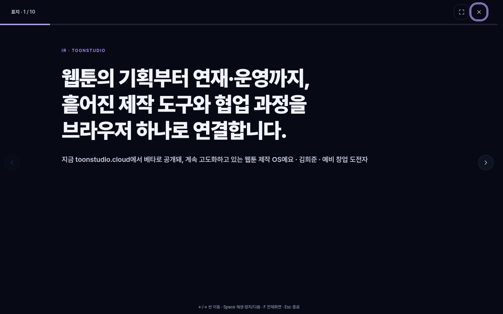
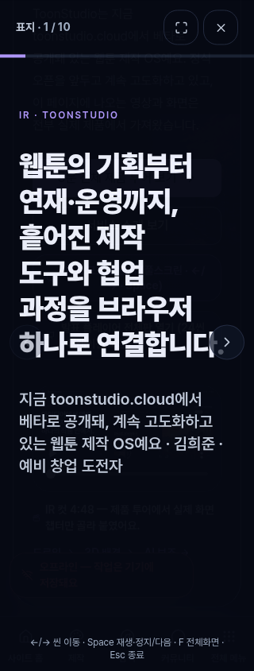
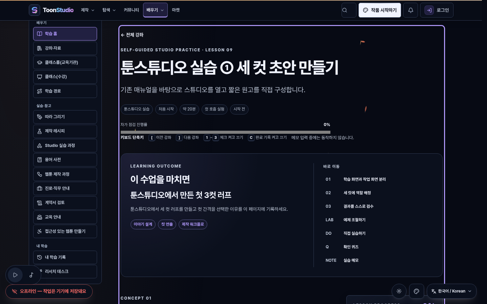
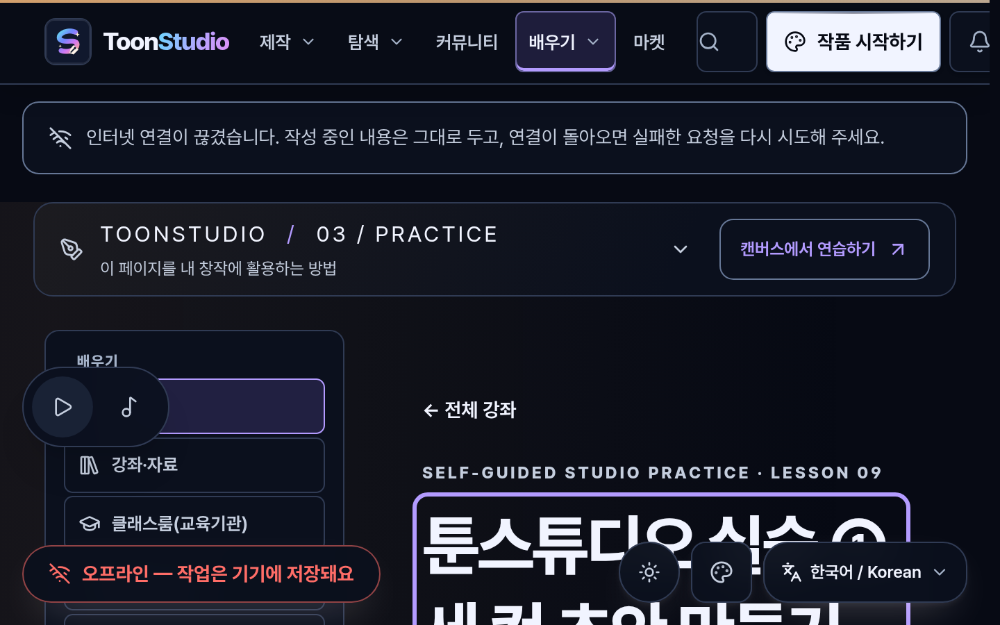

# ToonStudio `GAP-R4-01`(IR) · `GAP-R4-04`(Learn) 최소 수정 및 실브라우저 회귀 검증 보고서 (Round 5 — 2026-11-07)

## 1. 작업 범위 및 소유 경계 (`current`)

- **대상 결함**: Round 4 후속 독립 접근성 감사([../a11y-uncovered-round4-20261107/README.md](../a11y-uncovered-round4-20261107/README.md))에서 재현된 **`GAP-R4-01` (`/ir`)** 및 **`GAP-R4-04` (`/learn/lessons/studio-first-page`)** 2개 범위만 최소 수정.
- **독점 수정 파일 (앱 소스 2개 + 신규 검증 문서·테스트 폴더)**:
  - [IrPitchPage.tsx](../../apps/web/src/domains/marketing/IrPitchPage.tsx) (`736`줄 ≤ 800줄)
  - [LearnContent.tsx](../../apps/web/src/domains/learn/LearnContent.tsx) (`773`줄 ≤ 800줄)
  - [verify-ir-learn-round5-browser.mjs](./verify-ir-learn-round5-browser.mjs) (`584`줄 ≤ 800줄)
  - [ir-learn-fixes-round5.test.ts](./ir-learn-fixes-round5.test.ts) (`163`줄 ≤ 800줄)
  - [browser-round5-report.json](./browser-round5-report.json) (`220`줄 ≤ 800줄)
- **엄격한 비수정(Read-Only) 보호 경계**:
  - 공유 UI, 설정, 라우트, 다른 페이지, 기존 감사 문서(`../accessibility-sweep-20261107/`, `../accessibility-fixes-round2-20261107/`, `../a11y-uncovered-round4-20261107/`) **수정 0건**.
  - PR `#2740` 범위(`PackagePanel` / `package-panel`), 메시지함, 서비스 상태(`/status`), Character 문서(`../character-keyboard-round4-20261107/`) **수정 0건**.
  - IR 발표 자료 본문 내용·수치·가격·결제·외부 공유·녹음 기능 **변경 0건**.

---

## 2. 결함별 최소 수정 내역 및 전후(Before / After) 검증 결과 (`current`)

### `GAP-R4-01` (`/ir`) — 발표 모드 대화상자 초기 포커스·`Tab`/`Shift+Tab` 순환·`Escape`/닫기 후 원래 트리거 복귀·44px 아이콘 버튼·`reduced-motion`

- **수정 파일**: [IrPitchPage.tsx](../../apps/web/src/domains/marketing/IrPitchPage.tsx)
- **원인 (Before)**:
  1. `발표 모드로 열기` 버튼 활성화 시 `role="dialog"[aria-modal="true"]`가 열리지만 초점이 대화상자 내부로 이동하지 않음(`activeInsideDialogOnOpen: false`).
  2. `Tab`/`Shift+Tab` 키 입력 시 대화상자 내부 포커스 순환 트랩이 없어 배경 페이지 링크로 초점이 이탈함.
  3. `Escape` 키 또는 `발표 모드 종료` 버튼으로 닫을 때 원래 트리거 버튼으로 초점을 복귀시키지 않음.
  4. 대화상자 상단 아이콘 버튼 2개(`전체화면 전환`, `발표 모드 종료`)가 `size-10`(`40×40px`)으로 최소 터치 타깃(`44×44px`)에 미달함.
  5. 상단 진행 바(`transition-all duration-300`)에 `motion-reduce:transition-none`이 누락됨.
- **최소 수정 (After)**:
  1. `openPresentation(trigger)`에서 열기 직전 트리거 요소(`presentTriggerRef.current`)를 기록하고, 대화상자 오픈 시 `closeButtonRef.current`(`발표 모드 종료` 버튼)로 초기 포커스를 이동시킴(`activeInsideDialogOnOpen: true`).
  2. 대화상자 `keydown` 핸들러에 `Tab`/`Shift+Tab` 순환 트랩을 추가하여 대화상자 내부 포커스 가능 요소(`전체화면 전환`, `발표 모드 종료`, `이전 씬`, `다음 씬` 등) 사이에서만 순환하도록 보장함(`allTabStepsInsideDialog: true`).
  3. `closePresentation()`에서 `Escape` 및 닫기 버튼 클릭 시 `presentTriggerRef.current.focus()`로 원래 트리거 버튼에 초점을 즉시 복귀시킴(`restoredToTriggerAfterEscape: true`, `restoredToTriggerAfterCloseButton: true`).
  4. 상단 아이콘 버튼 2개를 `size-11 min-h-11 min-w-11`(`44×44px`)로 확대하고, 진행 바에 `motion-reduce:transition-none`을 추가함.
- **시각 증거**:
  - 
  - 

---

### `GAP-R4-04` (`/learn/lessons/studio-first-page`) — 스킵 링크 실제 초점 이동 및 대화상자 열림 중 전역 단일키 단축키 가드

- **수정 파일**: [LearnContent.tsx](../../apps/web/src/domains/learn/LearnContent.tsx)
- **원인 (Before)**:
  1. `.learn-skip-link`(`href="#learn-main"`)의 대상 `<div id="learn-main">`에 `tabIndex={-1}`과 클릭 시 초점 이동 처리가 없어 스킵 링크 활성화 후에도 `#learn-main`으로 초점이 이동하지 않음(`learnMainTabIndexAttr: null`).
  2. `LessonSession`의 전역 `keydown` 리스너(`1`~`9`, `c`, `[`, `]`, `Alt+Arrow`)가 입력창(`INPUT`/`TEXTAREA`/`SELECT`)만 제외하고 열린 대화상자(`[role="dialog"]`, `[aria-modal="true"]`, `dialog[open]`) 상태를 가드하지 않음.
- **최소 수정 (After)**:
  1. `<div id="learn-main" tabIndex={-1}>`을 부여하고 `.learn-skip-link` 활성화 시 `document.getElementById("learn-main")?.focus()` 및 `scrollIntoView({ block: "start" })`를 수행해 실제 초점이 `#learn-main`으로 이동하도록 수정함(`activeElementIdAfterSkipEnter: "learn-main"`).
  2. `LessonSession` 전역 `onKeyDown` 상단에 `target?.closest('[role="dialog"], [aria-modal="true"], dialog')`, `active?.closest('[role="dialog"], [aria-modal="true"], dialog')`, `document.querySelector('[role="dialog"], [aria-modal="true"], dialog[open]')` 가드를 추가하여 대화상자가 열려 있는 동안에는 단일 문자 단축키가 배경 학습 상태를 변경하지 않도록 차단하고(`shortcutsBlockedWhileDialogOpen: true`), 대화상자가 닫힌 뒤에는 기존처럼 `1` 키로 체크리스트가 정상 토글됨을 검증함(`shortcutWorksWhenNoDialogOpen: true`).
- **시각 증거**:
  - 
  - 

---

## 3. 6개 뷰포트(`320` / `390` / `768` / `1440` / `200%` / `reduced-motion`) 매트릭스 요약 (`current`)

[browser-round5-report.json](./browser-round5-report.json)에 기록된 `/ir` 및 `/learn/lessons/studio-first-page` 6개 뷰포트(`12`건) 실측 결과:

| 경로 | 뷰포트 | 가로 오버플로 (`horizontalOverflowPx`) | 첫 `Tab` 포커스 | `transitionDurationMs` | Axe 위반 수 |
| --- | --- | ---: | --- | ---: | ---: |
| `/ir` | `mobile-320` (`320×844`) | `0` | `본문으로 건너뛰기` | `250` | `0` |
| `/ir` | `mobile-390` (`390×844`) | `0` | `본문으로 건너뛰기` | `250` | `0` |
| `/ir` | `tablet-768` (`768×1024`) | `0` | `본문으로 건너뛰기` | `250` | `0` |
| `/ir` | `pc-1440` (`1440×900`) | `0` | `본문으로 건너뛰기` | `250` | `0` |
| `/ir` | `pc-1440-zoom-200` (`1440×900 @ 200%`) | `0` | `본문으로 건너뛰기` | `250` | `0` |
| `/ir` | `pc-1440-reduced-motion` | `0` | `본문으로 건너뛰기` | `0.01` | `0` |
| `/learn/lessons/studio-first-page` | `mobile-320` (`320×844`) | `0` | `01학습 화면과 작업 화면 분리` (초기 `h1` 포커스 다음) | `250` | `0` |
| `/learn/lessons/studio-first-page` | `mobile-390` (`390×844`) | `0` | `01학습 화면과 작업 화면 분리` (초기 `h1` 포커스 다음) | `250` | `0` |
| `/learn/lessons/studio-first-page` | `tablet-768` (`768×1024`) | `0` | `01학습 화면과 작업 화면 분리` (초기 `h1` 포커스 다음) | `250` | `0` |
| `/learn/lessons/studio-first-page` | `pc-1440` (`1440×900`) | `0` | `01학습 화면과 작업 화면 분리` (초기 `h1` 포커스 다음) | `250` | `1` (공유 셸 기존 `label-content-name-mismatch`) |
| `/learn/lessons/studio-first-page` | `pc-1440-zoom-200` (`1440×900 @ 200%`) | `0` | `01학습 화면과 작업 화면 분리` (초기 `h1` 포커스 다음) | `250` | `0` |
| `/learn/lessons/studio-first-page` | `pc-1440-reduced-motion` | `0` | `01학습 화면과 작업 화면 분리` (초기 `h1` 포커스 다음) | `0.01` | `0` |

---

## 4. 재현 및 회귀 테스트 명령어 (`current`)

```bash
# 1. 실제 Chromium 브라우저 6개 뷰포트 + GAP-R4-01/04 키보드·포커스·단축키 가드 검증
node docs/a11y-ir-learn-fixes-round5-20261107/verify-ir-learn-round5-browser.mjs

# 2. 소스 계약·800줄 상한·소유 경계·브라우저 리포트 단위 테스트
node --test docs/a11y-ir-learn-fixes-round5-20261107/ir-learn-fixes-round5.test.ts
```
