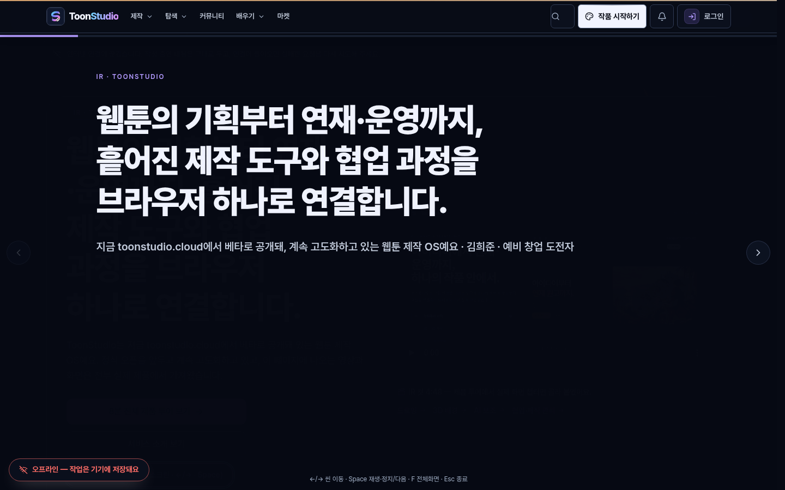
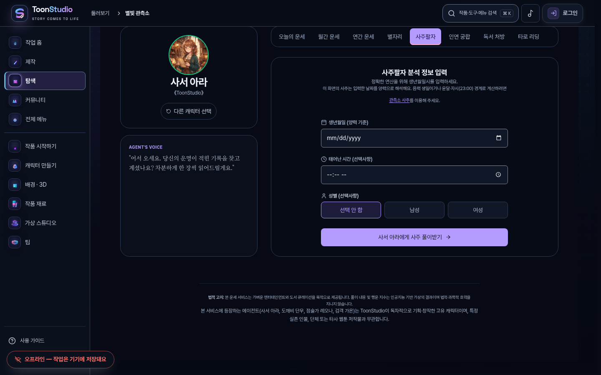
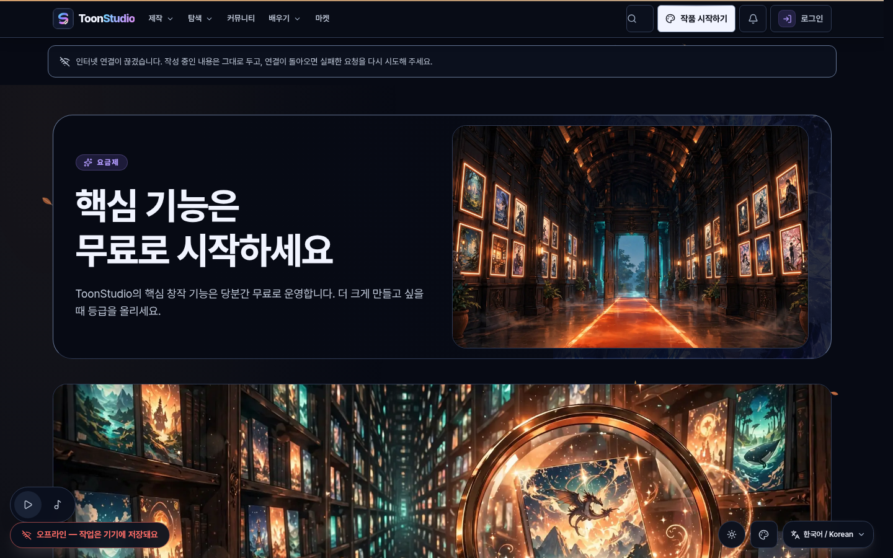
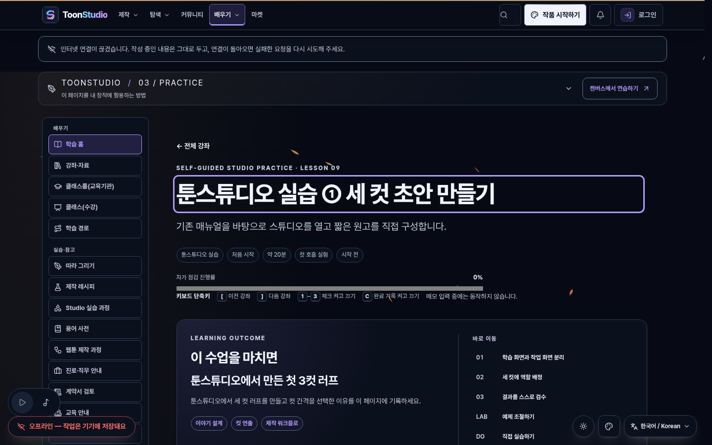
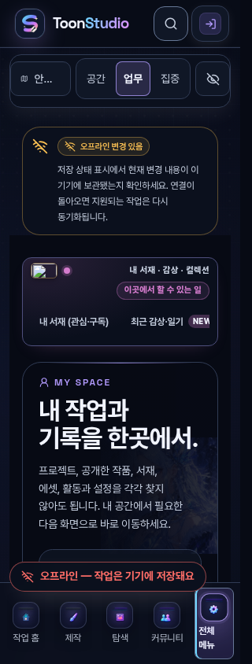

# ToonStudio 전 페이지 인벤토리(441건) 후속 독립 접근성 감사 보고서 (Round 4 — 2026-11-07)

## 1. 감사 목적 및 소유 경계 (`current`)

- **감사 범위**: 전 페이지 구체 라우트 인벤토리 **`441`건** 중 기존 실제 브라우저 매트릭스 검증(`31`건 / 베이스 라우트 `9`건)과 타 담당 진행 중 작업 영역을 제외하고, 단순 라우트 중복과 로그인·실데이터 필요·미구현 경로를 분리한 뒤 **기능군별 대표 미검증 표면 `12`개**를 선정해 키보드(`Tab`/`Escape`)·명도 대비·`200%` 확대/`320px` 리플로우·`prefers-reduced-motion: reduce`를 실제 Chromium 브라우저에서 검증한다.
- **독점 소유 경로**: `docs/a11y-uncovered-round4-20261107/**`
  - [uncovered-surface-catalog.ts](./uncovered-surface-catalog.ts)
  - [uncovered-surface-catalog.test.ts](./uncovered-surface-catalog.test.ts)
  - [verify-uncovered-round4-browser.mjs](./verify-uncovered-round4-browser.mjs)
  - [browser-round4-report.json](./browser-round4-report.json)
  - [route-classification-report.json](./route-classification-report.json)
- **엄격한 읽기 전용(Read-Only) 보호 경계**:
  - 앱 소스(`apps/**`, `packages/**`), 공유 UI 5개 파일(`LanguagePicker`, `FloatingControls`, `AccessibilityLab`, `AppearanceTrigger`, `studio-chrome-ui`), 기존 `scripts/accessibility-sweep-20261107/**` 및 `docs/accessibility-sweep-20261107/**` **수정 0건**.
  - 타 담당 활성 작업(`드로잉`, `홈`, `일정`, `탐색`, `Character`, `PackagePanel` / `package-panel/PackageDetail`, `메시지함`, `ServiceStatus`) **수정 및 선택 범위 중복 0건**.
  - 사용자 원본 데이터 대신 결정론적 합성 픽스처(`VITE_CATALOG_SOURCE=static`, 게스트 세션 및 `/api/**` `503` 합성 격리)만 사용하며, 실행 완료 후 자체 테스트 서버와 브라우저 탭을 즉시 정리한다.

---

## 2. 441개 전체 라우트 인벤토리 분류 원장 (`current`)

[uncovered-surface-catalog.ts](./uncovered-surface-catalog.ts)의 `buildRound4InventoryReport()`가 441개 구체 라우트를 중복·누락 없이 분류한 결과는 다음과 같다.

| 분류 코드 (`RouteAuditDisposition`) | 경로 수 | 설명 및 구분 기준 |
| --- | ---: | --- |
| `existing-verified` | `9` (매트릭스 `31`건) | Round 1~2에서 실제 브라우저 멀티 뷰포트(`31`건) 및 후속 검증을 마친 베이스 경로(`/`, `/discover`, `/community`, `/learn`, `/accessibility`, `/settings`, `/studio`, `/admin/overview`, `/studio/canvas`) |
| `excluded-active-owner` | `93` | 현재 별도 담당이 구현·검증 중인 영역(`드로잉`, `홈`, `일정`, `탐색`, `Character`·`PackagePanel`/`PackageDetail`, `메시지함`, `ServiceStatus`) |
| `duplicate-or-alias` | `164` | 단순 라우트 중복(`<Navigate>` 리다이렉트 별칭, 동일 컴포넌트 다중 마운트, `/learn/lessons/*`·`/research/*`·`/story-lab/*`·`/fortune/*` 등 동일 템플릿 파라미터 반복 확장) — 별도 페이지로 중복 집계하지 않음 |
| `auth-gated` | `34` | 비로그인 게스트 접근 시 관리자/로그인 가드(`data-admin-access-state="guest"`, `data-route-blocked="sign-in"`) 또는 계정 결제·정산 세션이 필요한 경로 |
| `realdata-required` | `12` | 로컬 시드 폴백 없이 실서버 API 레코드 조회가 필수여서 합성 오프라인(`503`) 환경에서 오류/빈 상태만 렌더되는 경로(`/reviews`, `/community/cafes`, `/community/post/visual-audit` 등) |
| `unimplemented-fallback` | `2` | 동적 파라미터 샘플(`visual-audit`)이 허용 목록 밖이거나 미구현 폴백(`NotFoundPage` / 차단 상태)으로 귀결되는 경로(`/auth/visual-audit`, `/production/projects/visual-audit/episodes/visual-audit`) |
| **`selected-uncovered-12`** | **`12`** | **기능군별 대표 미검증 실브라우저 검증 대상 `12`개 표면** |
| `uncovered-secondary` | `115` | 위 12개 기능군 대표 표면과 동일 도메인/레이아웃 셸을 공유하는 보조 정적·서브 경로 |
| **합계** | **`441`** | **전수 일치 (`441 / 441`)** |

---

## 3. 기능군별 대표 미검증 표면 12개 선정 및 브라우저 실증 (`current`)

| # | 표면 ID | 기능군 (`FunctionalSurfaceGroup`) | 대표 경로 | 통합된 단순 중복 별칭 예시 | 대상 컴포넌트 및 원본 파일 |
| --- | --- | --- | --- | --- | --- |
| 1 | `SURF-01-MARKET` | `market-hub` | `/market` | `/marketplace`, `/market/browse` | [MarketHomePage.tsx](../../apps/web/src/domains/market/pages/MarketHomePage.tsx), [MarketQuickPreviewDialog.tsx](../../apps/web/src/domains/market/components/MarketQuickPreviewDialog.tsx) |
| 2 | `SURF-02-PRICING` | `market-pricing` | `/pricing` | `/membership` | [pricing-page.tsx](../../apps/web/src/app/routes/pricing-page.tsx), [PricingPolish.tsx](../../apps/web/src/domains/marketing/PricingPolish.tsx) |
| 3 | `SURF-03-TIMELAPSES` | `community-media` | `/community/timelapses` | — | [TimelapseGalleryPage.tsx](../../apps/web/src/domains/community/TimelapseGalleryPage.tsx) |
| 4 | `SURF-04-COLLABORATE` | `community-collab` | `/collaborate` | `/collaborate/workspace`, `/team`, `/team/recruiting` | [CollaborationBoardPage.tsx](../../apps/web/src/domains/collaboration/CollaborationBoardPage.tsx) |
| 5 | `SURF-05-LEARN-LESSON` | `learn-lesson` | `/learn/lessons/studio-first-page` | `/learn/glossary`, `/learn/paths/first-three-panels` | [LearnContent.tsx](../../apps/web/src/domains/learn/LearnContent.tsx), [LessonLab.tsx](../../apps/web/src/domains/learn/LessonLab.tsx) |
| 6 | `SURF-06-HELP` | `legal-help` | `/help` | `/terms`, `/privacy`, `/copyright`, `/youth-policy` | [HelpCenterPage.tsx](../../apps/web/src/domains/legal/HelpCenterPage.tsx), [PolicyPage.tsx](../../apps/web/src/domains/legal/PolicyPage.tsx), [LegalDocTools.tsx](../../apps/web/src/domains/legal/LegalDocTools.tsx) |
| 7 | `SURF-07-MY-GUEST` | `account-guest` | `/my` | `/library`, `/bookmarks`, `/history` | [MySpaceHubPage.tsx](../../apps/web/src/domains/account/MySpaceHubPage.tsx) |
| 8 | `SURF-08-FORTUNE` | `experience-fortune` | `/fortune` | `/fortune/today`, `/fortune/monthly`, `/fortune/tarot` 등 8종 | [FortunePage.tsx](../../apps/web/src/domains/fortune/FortunePage.tsx), [FortuneShareModal.tsx](../../apps/web/src/domains/fortune/FortuneShareModal.tsx) |
| 9 | `SURF-09-PLAY` | `experience-play` | `/play` | `/worldcup`, `/quiz`, `/vote`, `/mbti`, `/tier` | [PlayPage.tsx](../../apps/web/src/domains/play/PlayPage.tsx), [PlayComicGuide.tsx](../../apps/web/src/domains/play/PlayComicGuide.tsx) |
| 10 | `SURF-10-EVENTS` | `events-promo` | `/events` | `/events/beta-open` | [EventsHubPage.tsx](../../apps/web/src/domains/marketing/events/EventsHubPage.tsx) |
| 11 | `SURF-11-IR-PITCH` | `creator-pitch` | `/ir` | `/story-lab`, `/product-tour` | [IrPitchPage.tsx](../../apps/web/src/domains/marketing/IrPitchPage.tsx) |
| 12 | `SURF-12-SPATIAL-READER` | `reader-spatial` | `/read/spatial` | `/studio/spatial-reader`, `/production`, `/cuts` | [StudioSpatialReaderPage.tsx](../../apps/web/src/domains/creator/spatial-reader/StudioSpatialReaderPage.tsx), [SpatialReaderViewer.tsx](../../apps/web/src/domains/creator/spatial-reader/SpatialReaderViewer.tsx) |

---

## 4. 검출된 결함(`GAP-R4-01` ~ `GAP-R4-05`), 수정 필요 파일 및 재현 절차 (`current`)

### `GAP-R4-01` (High) — `/ir` 발표 모드 대화상자 초기 포커스 미진입·`Tab` 트랩 부재·`Escape` 포커스 미복귀 및 40px 버튼
- **수정 필요 파일**:
  - [IrPitchPage.tsx](../../apps/web/src/domains/marketing/IrPitchPage.tsx) (lines `78-102`, `643-674`)
- **재현 절차**:
  1. `/ir` 접속 후 `발표 모드로 열기` 버튼을 키보드(`Enter`/`Space`) 또는 클릭으로 활성화한다.
  2. `role="dialog"[aria-label="IR 발표 모드"]`가 열릴 때 `document.activeElement`가 모달 내부로 이동하지 않고 기존 트리거/배경에 남는지 확인한다.
  3. `Tab` 키를 반복 입력할 때 포커스가 발표 모달 내부(`전체화면 전환`, `발표 모드 종료`, `이전 씬`, `다음 씬`)에 갇히지 않고 배경 페이지 링크로 이탈하는지 확인한다.
  4. `Escape` 키로 모달을 닫은 뒤 `document.activeElement`가 트리거 버튼으로 복귀하지 않는지 확인한다.
- **최소 수정 권고**:
  - 발표 모드 오픈 시 `triggerRef`에 직전 포커스 요소를 저장하고 닫기 버튼(`발표 모드 종료`)으로 초기 포커스를 이동시키며, 모달 내부 `Tab`/`Shift+Tab` 순환 트랩 및 닫기 시 `triggerRef.current?.focus()` 복귀를 추가한다. 상단 아이콘 버튼 2개(`size-10`=40px)는 `size-11`(44px)로 확대하고 진행 바(`transition-all duration-300`)에 `motion-reduce:transition-none`을 추가한다.
- **시각 증거**: 

### `GAP-R4-02` (High) — `/fortune` 공유 모달 포커스 트랩·복귀 누락, `tablist` `tabpanel`/화살표 키 누락, 성별 토글 `aria-pressed` 누락
- **수정 필요 파일**:
  - [FortuneShareModal.tsx](../../apps/web/src/domains/fortune/FortuneShareModal.tsx) (lines `58-66`, `148-155`)
  - [FortunePage.tsx](../../apps/web/src/domains/fortune/FortunePage.tsx) (lines `717`, `732-757`, `1549-1569`)
- **재현 절차**:
  1. `/fortune/saju` 접속 후 캐릭터 피커(`#fortune-character-picker`)에서 첫 번째 캐릭터(`선택하기`)를 선택한 뒤, 성별 선택 버튼(`선택 안 함`, `남성`, `여성`)의 `aria-pressed` 속성과 그룹 역할(`role="group"`) 존재 여부를 확인한다.
  2. 상단 `role="tablist"[aria-label="운세 종류"]` 탭에서 `ArrowRight`/`ArrowLeft` 키 입력 시 탭 이동 여부와 결과 영역의 `role="tabpanel"` 존재 여부를 확인한다.
  3. 결과 영역의 `공유·저장` 버튼을 눌러 `FortuneShareModal`을 연 뒤 `Tab` 키로 모달 외부 이탈 여부 및 `Escape` 닫기 후 트리거 복귀 여부를 확인한다.
- **최소 수정 권고**:
  - `FortuneShareModal`에 `Tab`/`Shift+Tab` 포커스 트랩과 닫기 시 직전 `activeElement` 복귀를 추가하고, `FortunePage` 탭 목록에 좌우 화살표 키 로빙과 `role="tabpanel"`을 연결하며, 성별 버튼에 `role="group"` 및 `aria-pressed`를 명시한다. `animate-ping`에는 `motion-reduce:animate-none`을 추가한다.
- **시각 증거**: 

### `GAP-R4-03` (Medium) — `/pricing` 추천 배지 하드코딩 `text-white` 고대비 테마 명도 대비 미달 및 FAQ `<summary>` 마커·포커스 링 누락
- **수정 필요 파일**:
  - [pricing-page.tsx](../../apps/web/src/app/routes/pricing-page.tsx) (lines `250`, `338-343`)
- **재현 절차**:
  1. `/pricing` 접속 후 고대비 테마(`data-theme="contrast"`) 상태에서 Pro 플랜 상단 `추천` 배지(`bg-accent ... text-white`)의 전경·배경 명도 대비를 측정한다.
  2. 하단 `자주 묻는 질문` 섹션의 `<summary>` 요소에 키보드 `Tab`으로 포커스할 때 기본 삼각형 마커가 `list-none [&::-webkit-details-marker]:hidden`으로 제거된 상태에서 대체 아이콘이나 `focus-visible` 링이 표시되는지 확인한다.
- **최소 수정 권고**:
  - 추천 배지의 `text-white`를 의미 토큰 `text-on-accent`로 교체하고, FAQ `<summary>`에 회전 Chevron 아이콘과 `focus-visible:outline` 링을 추가한다.
- **시각 증거**: 

### `GAP-R4-04` (Medium) — `/learn/lessons/studio-first-page` 스킵 링크 타깃(`#learn-main`) `tabIndex={-1}` 누락 및 단일 문자 단축키 미가드
- **수정 필요 파일**:
  - [LearnContent.tsx](../../apps/web/src/domains/learn/LearnContent.tsx) (lines `242-279`, `728-738`)
- **재현 절차**:
  1. `/learn/lessons/studio-first-page`에서 `.learn-skip-link`(`href="#learn-main"`)의 대상 `<div id="learn-main">`에 `tabindex="-1"`이 설정되어 있는지 확인한다.
  2. 전역 대화상자(`[role="dialog"]`)가 열려 있을 때 단일 문자 키(`1`~`9`, `c`, `[`, `]`) 입력 시 배경 레슨 상태가 반응하는지 확인한다.
- **최소 수정 권고**:
  - `<div id="learn-main" tabIndex={-1}>`을 부여하고, `LessonSession`의 전역 `keydown` 핸들러에 `target.closest('[role="dialog"], dialog')` 및 수정키(`ctrlKey || metaKey || altKey`) 차단 가드를 추가한다.
- **시각 증거**: 

### `GAP-R4-05` (Medium) — `/my`, `/read/spatial`, `/community/timelapses`, `/market` 필터 칩·컨트롤 44px 터치 타깃 미달 및 `/play` 그룹 역할 누락
- **수정 필요 파일**:
  - [MySpaceHubPage.tsx](../../apps/web/src/domains/account/MySpaceHubPage.tsx) (lines `325-341`)
  - [StudioSpatialReaderPage.tsx](../../apps/web/src/domains/creator/spatial-reader/StudioSpatialReaderPage.tsx) (lines `406-441`)
  - [TimelapseGalleryPage.tsx](../../apps/web/src/domains/community/TimelapseGalleryPage.tsx) (lines `86-91`, `126-130`)
  - [MarketQuickPreviewDialog.tsx](../../apps/web/src/domains/market/components/MarketQuickPreviewDialog.tsx) (lines `206`, `286`)
  - [HelpCenterPage.tsx](../../apps/web/src/domains/legal/HelpCenterPage.tsx) (lines `276`, `393`)
  - [PlayPage.tsx](../../apps/web/src/domains/play/PlayPage.tsx) (line `137`)
- **재현 절차**:
  1. `320×844` 모바일 뷰포트에서 `/my`(역할 필터 칩 `min-h-9`), `/read/spatial`(곡률·시선 포커스 칩 `py-1.5`), `/community/timelapses`(CTA·검색 `min-h-9`/`h-9`)의 컨트롤 높이를 측정한다(30~36px로 44px 미달).
  2. `/play`에서 `.play-filter-tabs`(`aria-label="콘텐츠 분류"`) 요소의 `role` 속성을 확인한다(`role="group"` 누락).
- **최소 수정 권고**:
  - 각 필터/토글 버튼과 컨트롤에 `min-h-11`/`size-11`(44px) 바닥선을 적용하고, `PlayPage.tsx:137`의 `.play-filter-tabs`에 `role="group"`을 추가하며, `HelpCenterPage.tsx:276`을 `grid-cols-1 min-[380px]:grid-cols-2` 및 `motion-reduce:transition-none`으로 보강한다.
- **시각 증거**: 

---

## 5. 재현 및 검증 명령어 (`current`)

```bash
# 1. 441개 라우트 분류·12개 대표 표면·소유 경계 단위 테스트
node --test docs/a11y-uncovered-round4-20261107/uncovered-surface-catalog.test.ts

# 2. 12개 미검증 대표 표면 실제 Chromium 멀티 뷰포트(320/390/768/1440/200%/reduced-motion) 및 결함 재현
node docs/a11y-uncovered-round4-20261107/verify-uncovered-round4-browser.mjs
```
