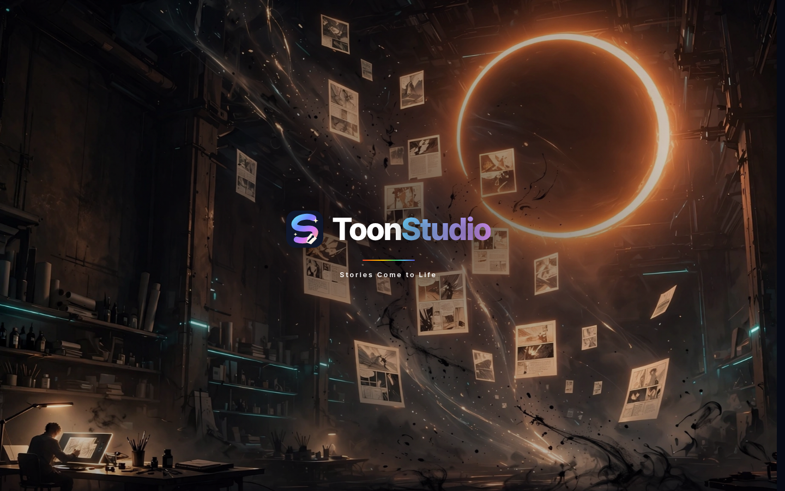
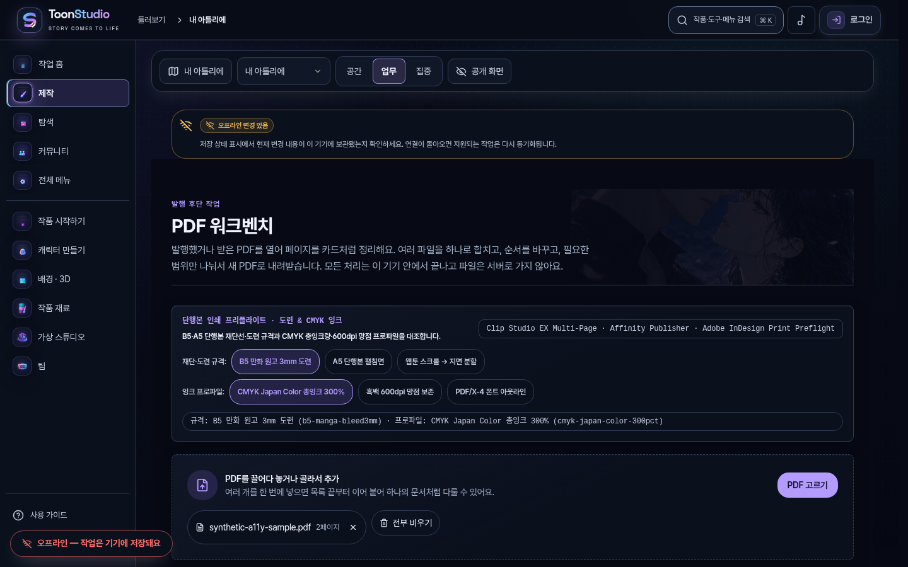
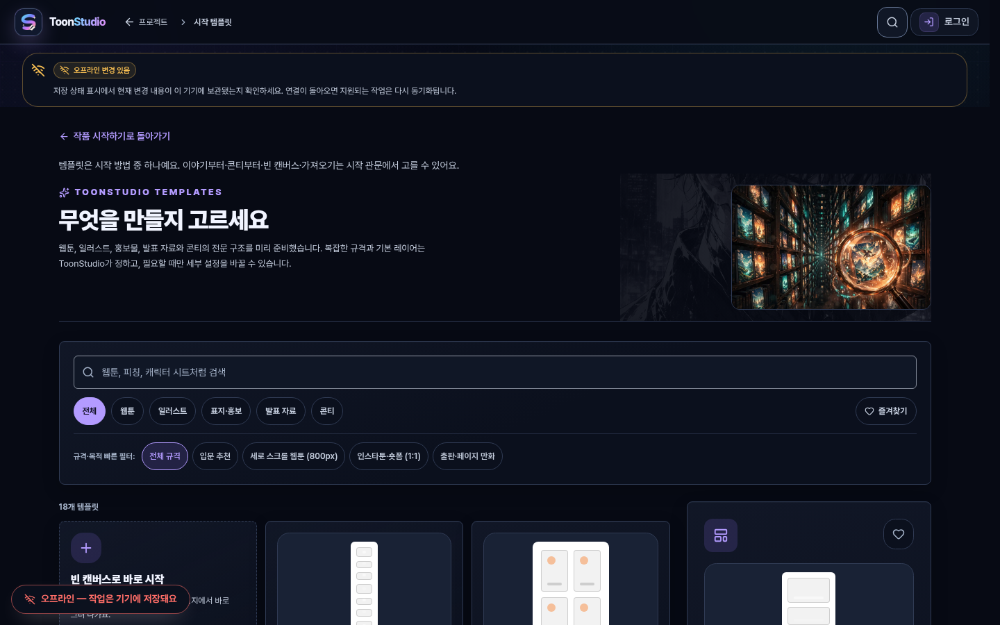
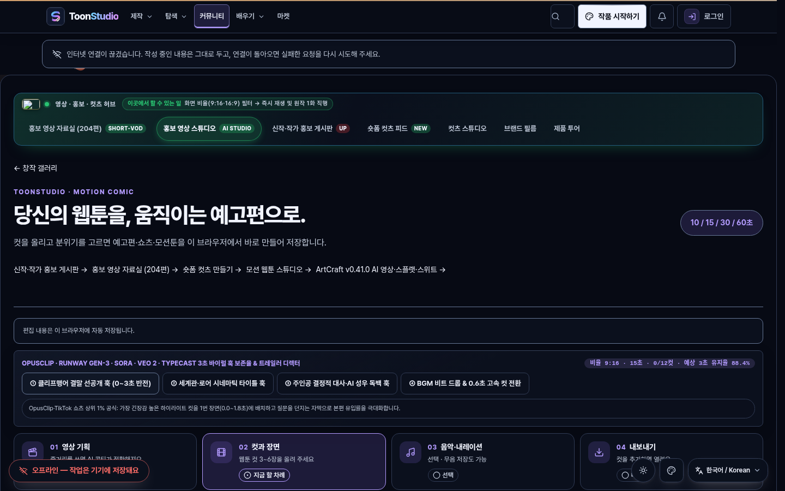
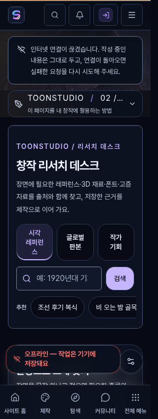

# ToonStudio 미점검 Secondary 화면 접근성 독립 감사 보고서 (Round 6 — 2026-11-07)

## 1. 감사 개요 및 소유권·제외 경계 확인

### 1.1 작업 목적 및 보존 원칙
- **선행 작업 보존**: Round 5 IR(`GAP-R4-01`) 및 배우기(`GAP-R4-04`) 실제 수정 및 독립 검증 결과(`3771f84f6`, [../a11y-ir-learn-fixes-round5-20261107/README.md](../a11y-ir-learn-fixes-round5-20261107/README.md))는 완료 상태로 보존했습니다.
- **독점 소유 범위**: 본 Round 6 감사는 제품 소스 코드(`apps/**`, `packages/**`, `scripts/**`) 및 기존 감사 문서를 일절 수정하지 않고(READ-ONLY), **`docs/a11y-uncovered-round6-20261107/**`** 디렉터리만 독립 소유합니다.
- **활성 브랜치·PR 충돌 점검**:
  - `git fetch origin --prune`, `git branch -r`, `git log origin/main -n 15`, `gh pr list --state open`(`[]`)을 대조했습니다.
  - 사용자 지시 및 타 세션 소유 보호 원칙에 따라 아래 도메인·기능군은 선정 후보에서 **전면 제외**했습니다:
    - **Fortune** (`/fortune`, `/fortune/saju`, `/fortune/tarot`, `/fortune/Astrology`, `/fortune/Match` 등)
    - **Pricing / Billing / Membership** (`/pricing`, `/billing*`, `/membership*`, `/memberships*`)
    - **MySpace / SpatialReader** (`/my`, `/my-space`, `/read/spatial`, `/spatial-reader`)
    - **Timelapse / Play** (`/timelapse*`, `/timelapses*`, `/play*`)
    - **Help / MarketPreview** (`/help*`, `/market*`, `/marketplace*`)
    - **메시지함 / 서비스상태** (`/inbox*`, `/messages*`, `/status*`, `/ops/status*`)
    - **Character / Brush** (`/character*`, `/brush*`, `/brushes*`, `/studio/anchor-lab*`)
    - **Drawing** (`/studio/drawing*`, `/studio/canvas*`)
    - **카탈로그** (`apps/web/src/domains/catalog/**`, `/discover*`, `/works*`, `/series*`, `/episodes*`, `/authors*`, `/tags*`)
    - **모든 공유 UI** (`apps/web/src/shared/**`, `PackagePanel`, `package-panel`, `PackageDetail`)
    - **Round 1~5 기검증 31+12개 표면** (`/about`, `/ir`, `/business-plan`, `/product-tour`, `/changelog`, `/learn/paths`, `/learn/glossary`, `/learn/lessons/:lessonSlug` 등)

---

## 2. Round 4 Secondary 후보 115개 전수 재분류 및 비검증(인증·빈 데이터) 분리

[../a11y-uncovered-round4-20261107/route-classification-report.json](../a11y-uncovered-round4-20261107/route-classification-report.json)에 수록된 `uncovered-secondary` 후보 **115개 전수**를 [round6-surface-catalog.ts](./round6-surface-catalog.ts) 및 [route-classification-round6.json](./route-classification-round6.json)에서 누락 없이 6개 범주로 분류했습니다.

| Round 6 분류 (`round6Disposition`) | 라우트 수 | 검증 완료 여부 | 처리 원칙 및 설명 |
| --- | ---: | --- | --- |
| `selected-round6-12` | **12** | **검증 완료 (`VERIFIED_IN_ROUND6_REAL_BROWSER`)** | 제외 도메인 외 서로 다른 12개 독립 컴포넌트·도메인 화면을 선정해 6개 뷰포트(72건) 실브라우저 검증 완료 |
| `excluded-active-owner-or-domain` | **10** | 제외 (`NOT_VERIFIED_EXCLUDED_DOMAIN`) | Fortune(`/fortune/Astrology`, `/fortune/Match`), Pricing(`/membership`, `/memberships/:id`), Play(`/play/:id`), Market(`/marketplace`, `/marketplace/assets/:slug`), Character(`/studio/anchor-lab`), Package/Store(`/store`, `/store/orders`) 제외 |
| `auth-gated-wall` | **17** | **검증 미완료 구분 (`NOT_VERIFIED_AUTH_WALL`)** | 게스트 상태에서 로그인/권한 안내 벽만 렌더되어 본문 워크스페이스 검증 불가 — **검증 완료(PASS)로 처리하지 않고 분리** |
| `api-or-token-dependent-empty-or-error` | **11** | **검증 미완료 구분 (`NOT_VERIFIED_EMPTY_OR_API_WALL`)** | 실서버 API 응답·초대 토큰·결제 콜백 없이는 빈 상태/오류 배너만 표시됨 — **검증 완료(PASS)로 처리하지 않고 분리** |
| `redirect-or-multi-mount-query-gated` | **8** | 제외 (`NOT_VERIFIED_REDIRECT_OR_QUERY_GATE`) | `<Navigate>` 즉시 리다이렉트 또는 특수 쿼리 조건부 마운트 래퍼 |
| `remaining-uncovered-backlog` | **57** | 차기 백로그 (`DEFERRED_TO_ROUND7_BACKLOG`) | 본 라운드 상한(8~12개) 준수를 위해 분리 보존한 잔여 독립 화면 후보 |
| **합계** | **115** | - | Round 4 secondary 후보 115개 100% 매핑 |

### 2.1 인증 불가(`AUTH_GATED_WALL`) 및 빈 데이터·API 의존(`EMPTY_OR_API_ERROR_WALL`) 실브라우저 분리 증적
[verify-uncovered-round6-browser.mjs](./verify-uncovered-round6-browser.mjs)의 `probeNonVerifiedAuthAndEmptyBoundaries`에서 대표 경계 4건을 실제 브라우저로 호출해 **`verifiedComplete: false` (`NOT_VERIFIED_AUTH_OR_EMPTY_BOUNDARY`)**로 기록했습니다:
1. **`/newsletter`** ([../../apps/web/src/domains/newsletter/MyNewslettersPage.tsx](../../apps/web/src/domains/newsletter/MyNewslettersPage.tsx#L79-L95)) — 비로그인 시 `"로그인이 필요합니다"` 카드와 `/login?next=/newsletter` 링크만 노출되어 구독 관리 목록·발송 주기 제어 UI가 마운트되지 않음 (`AUTH_GATED_WALL`).
2. **`/team/organization`** ([../../apps/web/src/domains/creator/production-hub/OrganizationHomePage.tsx](../../apps/web/src/domains/creator/production-hub/OrganizationHomePage.tsx#L331-L340)) — 비로그인 시 `"조직 홈을 보려면 먼저 로그인해 주세요."` 게이트만 렌더되어 조직 멤버·프로젝트 보드가 노출되지 않음 (`AUTH_GATED_WALL`).
3. **`/collaborate/visual-audit`** ([../../apps/web/src/domains/collaboration/CollaborationPostPage.tsx](../../apps/web/src/domains/collaboration/CollaborationPostPage.tsx#L70-L85)) — `/api/collaboration/posts/:slug` 오프라인/합성 게스트 응답 시 `"모집글을 불러오지 못했습니다"` 오류 카드만 렌더되어 본문/지원 모달 검증 불가 (`EMPTY_OR_API_ERROR_WALL`).
4. **`/publish`** ([../../apps/web/src/domains/integrations/PublishCenterPage.tsx](../../apps/web/src/domains/integrations/PublishCenterPage.tsx#L349-L351)) — `/api/works`, `/api/publish/jobs` 미연결 시 상단 `role="alert"` 오류 배너와 빈 선택기만 노출되어 실제 배포 잡 행 검증 불가 (`PARTIAL_API_ERROR_WALL`).

---

## 3. Round 6 선정 12개 미점검 Secondary 대표 화면 및 72건 실브라우저 매트릭스

제외 도메인 및 기검증 화면과 겹치지 않는 **12개 실제 서로 다른 화면(12개 고유 컴포넌트·소스 파일)**을 선정하고, Chromium 실브라우저에서 `mobile-320`(`320×844`), `mobile-390`(`390×844`), `tablet-768`(`768×1024`), `pc-1440`(`1440×900`), `pc-1440-zoom-200`(`1440×900 @ 200%`), `pc-1440-reduced-motion`(`1440×900, prefers-reduced-motion: reduce`) 총 **72회(12×6)** 측정을 완료했습니다([browser-round6-report.json](./browser-round6-report.json)).

| ID | 대표 라우트 | 도메인 구분 | 대상 컴포넌트 (상대 경로) | 320 / 390 / 768 / 1440 / 200% 가로 오버플로 | 첫 `Tab` 포커스 도달 | 44px 미달 타깃 (PC 1440 기준) | 관련 결함 ID |
| --- | --- | --- | --- | --- | --- | ---: | --- |
| `SURF-R6-01-CUTS-STUDIO` | `/cuts/studio` | `cuts` | [CutsStudioPage.tsx](../../apps/web/src/domains/cuts/CutsStudioPage.tsx) | `0px` (전 뷰포트 PASS) | 스킵 링크 (`본문으로 건너뛰기`) | `16`개 (REA 칩 `40px`) | **`GAP-R6-01`** |
| `SURF-R6-02-LEARN-TRACE` | `/learn/trace` | `learn` | [TracePracticePage.tsx](../../apps/web/src/domains/learn/TracePracticePage.tsx) | `0px` (전 뷰포트 PASS) | 스킵 링크 (`본문으로 건너뛰기`) | `7`개 (드릴/농도 칩 `40px`) | **`GAP-R6-01`** |
| `SURF-R6-03-PDF-WORKBENCH` | `/studio/pdf-workbench` | `creator-pdf-workbench` | [PdfWorkbenchPage.tsx](../../apps/web/src/domains/creator/pdf-workbench/PdfWorkbenchPage.tsx) | `0px` (전 뷰포트 PASS) | 스킵 링크 (`본문으로 건너뛰기`) | `6`개+ (프리셋 `40px`, 파일삭제 `28×40px`, 페이지 버튼 `32×40px`) | **`GAP-R6-02`** |
| `SURF-R6-04-TASTE-ONBOARDING` | `/onboarding/taste` | `engagement` | [TasteOnboardingPage.tsx](../../apps/web/src/domains/engagement/TasteOnboardingPage.tsx) | `0px` (전 뷰포트 PASS) | 스킵 링크 (`본문으로 건너뛰기`) | Step 3 회피 태그 칩 `40px` | **`GAP-R6-03`** |
| `SURF-R6-05-STUDIO-TEMPLATES` | `/studio/templates` | `creator-templates` | [StudioTemplatesPage.tsx](../../apps/web/src/domains/creator/studio-shell/StudioTemplatesPage.tsx) | `0px` (전 뷰포트 PASS) | 스킵 링크 (`본문으로 건너뛰기`) | `10`개 (카테고리·판형 프리셋 칩 `40px`) | **`GAP-R6-03`** |
| `SURF-R6-06-CREATE-START` | `/create` | `creator-start` | [CreateStartPage.tsx](../../apps/web/src/domains/creator/CreateStartPage.tsx) | `0px` (전 뷰포트 PASS) | 스킵 링크 (`본문으로 건너뛰기`) | `3`개 (섹션 전환 칩 `40px`) | **`GAP-R6-04`** |
| `SURF-R6-07-STUDIO-TOOLCHAIN` | `/studio/toolchain` | `creator-toolchain` | [StudioProductionToolchainPage.tsx](../../apps/web/src/domains/creator/toolchain/StudioProductionToolchainPage.tsx) | `0px` (전 뷰포트 PASS) | 스킵 링크 (`본문으로 건너뛰기`) | `4`개 (파이프라인 트랙 칩 `40px`) | **`GAP-R6-04`** |
| `SURF-R6-08-HIRING-POSITIONS` | `/collaborate/positions` | `collaboration-hiring` | [HiringPositionsPage.tsx](../../apps/web/src/domains/collaboration/hiring/HiringPositionsPage.tsx) | `0px` (전 뷰포트 PASS) | 스킵 링크 (`본문으로 건너뛰기`) | `15`개 (직군·컷수·정산·모집 필터 칩 `40px`) | **`GAP-R6-04`** |
| `SURF-R6-09-SHOWCASE-PROMO` | `/showcase/promo` | `creator-promo` | [StudioPromoPage.tsx](../../apps/web/src/domains/creator/promo/StudioPromoPage.tsx) | `0px` (전 뷰포트 PASS) | 스킵 링크 (`본문으로 건너뛰기`) | `9`개 (REA 훅·비율·내보내기 칩 `40px`) | **`GAP-R6-04`** |
| `SURF-R6-10-SITEMAP` | `/sitemap` | `legal-navigation` | [SitemapPage.tsx](../../apps/web/src/domains/legal/SitemapPage.tsx) | `0px` (전 뷰포트 PASS) | 스킵 링크 (`본문으로 건너뛰기`) | `14`개 (허브 앵커 칩 `28px`, 프로모션 링크 `36px`) | **`GAP-R6-05`** |
| `SURF-R6-11-DESIGN-SYSTEM` | `/design` | `legal-design-system` | [DesignSystemPage.tsx](../../apps/web/src/domains/legal/DesignSystemPage.tsx) | `0px` (전 뷰포트 PASS) | 스킵 링크 (`본문으로 건너뛰기`) | `1`개 (`Select` 트리거 `40px`) | **`GAP-R6-05`** |
| `SURF-R6-12-CREATOR-RESEARCH` | `/research` | `creator-resources` | [CreatorHubPage.tsx](../../apps/web/src/domains/creator-resources/CreatorHubPage.tsx) | `0px` (전 뷰포트 PASS) | 스킵 링크 (`본문으로 건너뛰기`) | `0`개 (단, 320px 3열 한국어 카드 폭 `79px` 협소) | **`GAP-R6-05`** |

---

## 4. 실브라우저 재현 결함 상세 및 최소 변경 후보 (GAP-R6-01 ~ GAP-R6-05)

### `GAP-R6-01` (심각도: **High**) — `/cuts/studio` 및 `/learn/trace` 활성 REA 칩의 `bg-accent text-white` 명도 대비 미달(2.44:1) 및 44px 클릭 타깃 미달

- **재현 URL**:
  - `http://127.0.0.1:4182/cuts/studio`
  - `http://127.0.0.1:4182/learn/trace`
- **요소 (Selector)**:
  - `/cuts/studio`: `[data-testid='cuts-studio-rea-engine-gsap-parallax-25d']`, `[data-testid='cuts-studio-rea-fps-60fps-webgpu']`, `[data-testid^='cuts-studio-rea-duck-']`, `[data-testid^='cuts-studio-rea-spring-']`
  - `/learn/trace`: `[data-testid='trace-practice-rea-drill-posemaniacs-30s-gesture']`, `[data-testid='trace-practice-rea-opacity-50pct-onion']`
- **실브라우저 측정치**:
  - 기본 다크 테마(`--color-accent: oklch(0.72 0.185 42)`, 밝은 주홍색)에서 활성 칩이 시맨틱 토큰 `text-on-accent`(`oklch(0.2 0.02 60)`) 대신 하드코딩된 `text-white`(`rgb(255, 255, 255)`)를 사용하여 실측 명도 대비가 **2.44:1**로 WCAG 2.1 AA 기준(4.5:1)을 위반합니다(`axe-core` `color-contrast` 위반 `/cuts/studio` 1건, `/learn/trace` 1건 실측 재현).
  - 반면 같은 파일인 [CutsStudioPage.tsx](../../apps/web/src/domains/cuts/CutsStudioPage.tsx#L565)의 오디오 더킹 활성 버튼은 `"border-accent bg-accent text-on-accent"`를 올바르게 사용하여 대비 위반이 발생하지 않습니다.
  - 또한 PC(`1440×900`, `pointer: fine`)에서 해당 칩 버튼들의 높이가 **`40px`**(`px-2.5 py-1 text-[11px]`, `min-h-11` 미적용)로 측정되어 44px 클릭 타깃 기준에 미달합니다.
- **원인**:
  - [../../apps/web/src/domains/cuts/CutsStudioPage.tsx](../../apps/web/src/domains/cuts/CutsStudioPage.tsx#L469-L505) (`L471`, `L500`) 및 [../../apps/web/src/domains/learn/TracePracticePage.tsx](../../apps/web/src/domains/learn/TracePracticePage.tsx#L109-L145) (`L111`, `L140`)에서 활성 토글 스타일에 `text-white`를 하드코딩하고 `min-h-11` 및 `focus-visible:outline-2` 클래스를 누락함.
- **최소 변경 후보**:
  1. [../../apps/web/src/domains/cuts/CutsStudioPage.tsx](../../apps/web/src/domains/cuts/CutsStudioPage.tsx#L469-L505) (`L469-L473`, `L498-L502`) 및 `L563-L600`:
     - `"border-accent bg-accent text-white"` → `"border-accent bg-accent text-on-accent"`로 교체.
     - 버튼 공통 클래스에 `min-h-11 px-3 py-1.5 focus-visible:outline-2 focus-visible:outline-offset-2 focus-visible:outline-accent` 추가.
  2. [../../apps/web/src/domains/learn/TracePracticePage.tsx](../../apps/web/src/domains/learn/TracePracticePage.tsx#L109-L145) (`L109-L113`, `L138-L142`):
     - `"border-accent bg-accent text-white"` → `"border-accent bg-accent text-on-accent"`로 교체.
     - 버튼 공통 클래스에 `min-h-11 px-3 py-1.5 focus-visible:outline-2 focus-visible:outline-offset-2 focus-visible:outline-accent` 추가.
- **재현 스크린샷**:
  

---

### `GAP-R6-02` (심각도: **Medium**) — `/studio/pdf-workbench` 판형·잉크 프리셋 그룹 시맨틱(`role="group"`) 누락 및 파일 삭제(`28×40px`)·페이지 조작(`32×40px`) 타깃 미달

- **재현 URL**: `http://127.0.0.1:4182/studio/pdf-workbench`
- **요소 (Selector)**:
  - `[data-testid='pdf-rea-trim-b5-manga-bleed3mm']` 및 `[data-testid='pdf-rea-ink-cmyk-japan-color-300pct']`의 부모 `<div class="flex flex-wrap items-center gap-1.5">`
  - `ul[aria-label='추가된 파일'] button[aria-label*='빼기']`
  - `section[aria-label='페이지 목록'] li button` (앞으로 이동 / 뒤로 이동 / 90도 회전 / 제거 4종)
- **실브라우저 측정치**:
  - 판형 프리셋 그룹(`재단·판형 프리셋:`)과 잉크 프로파일 그룹(`잉크·별색 프로파일:`) 컨테이너의 `role`이 모두 **`null`**(`aria-label: null`)로 측정되어 스크린리더에서 토글 버튼 묶음의 맥락이 전달되지 않습니다.
  - 합성 2페이지 PDF(`synthetic-a11y-sample.pdf`) 업로드 후 실측한 결과:
    - 프리셋 칩 버튼 높이: **`40px`** (`< 44px`)
    - 추가된 파일 목록의 파일 빼기(`X`) 버튼 크기: **`28×40px`** (`size-7`, 너비 28px · 높이 40px로 44×44px 미달)
    - 페이지 카드 하단 액션 버튼 4종(`1번째 페이지를 앞으로 이동`, `뒤로 이동`, `시계 방향으로 90도 회전`, `출력에서 제거`) 크기: **`32×40px`** (`size-8`, 너비 32px · 높이 40px로 44×44px 미달)
- **원인**:
  - [../../apps/web/src/domains/creator/pdf-workbench/PdfWorkbenchPage.tsx](../../apps/web/src/domains/creator/pdf-workbench/PdfWorkbenchPage.tsx#L324-L365)에서 두 프리셋 버튼 래퍼 `<div>`에 `role="group"`과 `aria-label`을 부여하지 않고 버튼에 `px-2.5 py-1`만 지정함.
  - 같은 파일 [PdfWorkbenchPage.tsx](../../apps/web/src/domains/creator/pdf-workbench/PdfWorkbenchPage.tsx#L439-L553)에서 파일 제거 버튼(`L440`)에 `size-7`, 페이지 조작 아이콘 버튼(`L521`, `L530`, `L540`, `L548`)에 `size-8`을 지정함.
- **최소 변경 후보**:
  - [../../apps/web/src/domains/creator/pdf-workbench/PdfWorkbenchPage.tsx](../../apps/web/src/domains/creator/pdf-workbench/PdfWorkbenchPage.tsx#L324-L365):
    - `L324` `<div className="flex flex-wrap items-center gap-1.5">`에 `role="group" aria-label={t("재단 및 판형 프리셋", "Trim & Bleed Presets")}` 추가, 버튼(`L338`)에 `min-h-11 px-3 py-1.5` 적용.
    - `L345` `<div className="flex flex-wrap items-center gap-1.5">`에 `role="group" aria-label={t("잉크 및 별색 프로파일", "Ink & Spot-Color Profiles")}` 추가, 버튼(`L359`)에 `min-h-11 px-3 py-1.5` 적용.
  - [../../apps/web/src/domains/creator/pdf-workbench/PdfWorkbenchPage.tsx](../../apps/web/src/domains/creator/pdf-workbench/PdfWorkbenchPage.tsx#L439-L553):
    - `L440` 파일 빼기 버튼의 `size-7` → `size-11 min-h-11 min-w-11`로 확장.
    - `L521`, `L530`, `L540`, `L548` 페이지 조작 아이콘 버튼의 `size-8` → `size-11 min-h-11 min-w-11`로 확장.
- **재현 스크린샷**:
  

---

### `GAP-R6-03` (심각도: **Medium**) — `/onboarding/taste` Step 2·3 및 `/studio/templates` 카테고리 필터 `role="group"` 누락·40px 타깃 미달

- **재현 URL**:
  - `http://127.0.0.1:4182/onboarding/taste`
  - `http://127.0.0.1:4182/studio/templates`
- **요소 (Selector)**:
  - `/onboarding/taste`: Step 2(`선호 서사 톤`)의 `div.grid.gap-2.5.sm\:grid-cols-2`, Step 3(`회피 소재 태그`)의 `div.flex.flex-wrap.gap-2` 및 내부 `button[aria-pressed]`
  - `/studio/templates`: `section[aria-label*='템플릿'] div.flex.flex-wrap.gap-2` 및 `button[data-template-spec-preset]`
- **실브라우저 측정치**:
  - `/onboarding/taste`에서 Step 1은 `role="group" aria-label="선호 장르"`가 있으나, Step 1에서 장르 3개 선택 후 Step 2·Step 3로 이동해 측정하면 `step2GroupRole: null`, `step3GroupRole: null`로 그룹 시맨틱이 누락되어 있으며, Step 3 회피 태그 토글 버튼 높이가 **`40px`**(`px-3.5 py-2`)로 측정됩니다.
  - `/studio/templates`에서 판형 규격 프리셋 바(`L416`)는 `role="group"`이 있으나 상단 카테고리 필터(`전체`, `에피소드`, `단편`, `세계관`, `콘티`) 컨테이너(`L380`)는 `categoryContainerRole: null`이며, 카테고리 필터 버튼과 판형 프리셋 버튼 높이가 모두 **`40px`**(`px-3.5 py-1.5`, `px-2.5 py-1`)로 44px에 미달합니다.
- **원인**:
  - [../../apps/web/src/domains/engagement/TasteOnboardingPage.tsx](../../apps/web/src/domains/engagement/TasteOnboardingPage.tsx#L305-L363) (`L305`, `L339`, `L350`)에서 Step 2·Step 3 컨테이너의 `role="group"` / `aria-label` 및 Step 3 버튼의 `min-h-11`이 누락됨.
  - [../../apps/web/src/domains/creator/studio-shell/StudioTemplatesPage.tsx](../../apps/web/src/domains/creator/studio-shell/StudioTemplatesPage.tsx#L380-L441) (`L380`, `L388`, `L431`)에서 카테고리 래퍼의 `role="group"` / `aria-label`과 필터 칩들의 `min-h-11`이 누락됨.
- **최소 변경 후보**:
  1. [../../apps/web/src/domains/engagement/TasteOnboardingPage.tsx](../../apps/web/src/domains/engagement/TasteOnboardingPage.tsx#L305-L363):
     - `L305` 컨테이너에 `role="group" aria-label={t("선호 서사 톤", "Preferred narrative moods")}` 추가.
     - `L339` 컨테이너에 `role="group" aria-label={t("회피 소재 태그", "Avoided content tags")}` 추가 및 `L350` 버튼에 `min-h-11` 추가.
  2. [../../apps/web/src/domains/creator/studio-shell/StudioTemplatesPage.tsx](../../apps/web/src/domains/creator/studio-shell/StudioTemplatesPage.tsx#L380-L441):
     - `L380` 컨테이너에 `role="group" aria-label={t("템플릿 카테고리 필터", "Template category filter")}` 추가.
     - `L388` 카테고리 버튼 및 `L431` 판형 프리셋 버튼에 `min-h-11` 추가.
- **재현 스크린샷**:
  

---

### `GAP-R6-04` (심각도: **Medium**) — `/create`, `/studio/toolchain`, `/collaborate/positions`, `/showcase/promo` 핵심 필터·프리셋 토글 칩의 40px 타깃 미달 및 포커스 링 불일치

- **재현 URL**:
  - `http://127.0.0.1:4182/create`
  - `http://127.0.0.1:4182/studio/toolchain`
  - `http://127.0.0.1:4182/collaborate/positions`
  - `http://127.0.0.1:4182/showcase/promo`
- **요소 (Selector)**:
  - `/create`: `[role='group'][aria-label*='시작 화면'] button` (`전용 도구 바로 열기`, `가이드와 빠른 시작`, `준비 상태 점검`)
  - `/studio/toolchain`: `button[data-testid^='toolchain-rea-track-']`
  - `/collaborate/positions`: `button[data-testid^='hiring-rea-role-']`, `button[data-testid^='hiring-rea-cuts-']`, 직군·정산 방식 필터 칩
  - `/showcase/promo`: `button[data-testid^='studio-promo-rea-hook-']`, 비율·내보내기 프리셋 버튼
- **실브라우저 측정치**:
  - 4개 창작·협업 허브 화면에서 `aria-pressed` 토글 칩들이 모두 `px-2.5 py-1` 또는 `px-3 py-1.5`로 선언되어 PC(`1440×900`) 실측 높이가 **`40px`**(`sectionSwitchHeight: 40`, `trackButtonHeight: 40`, `roleButtonHeight: 40`, `cutsButtonHeight: 40`, `hookButtonHeight: 40`)로 44px 기준에 미달합니다.
  - 또한 `/create` 섹션 전환 버튼과 `/studio/toolchain` 트랙 토글 버튼은 `hasExplicitFocusVisibleClass: false`로 측정되어 키보드 `Tab` 이동 시 컴포넌트 자체 `focus-visible:outline-*` 강조가 누락되어 있습니다.
- **원인**:
  - [../../apps/web/src/domains/creator/CreateStartPage.tsx](../../apps/web/src/domains/creator/CreateStartPage.tsx#L174-L188), [../../apps/web/src/domains/creator/toolchain/StudioProductionToolchainPage.tsx](../../apps/web/src/domains/creator/toolchain/StudioProductionToolchainPage.tsx#L205-L218), [../../apps/web/src/domains/collaboration/hiring/HiringPositionsPage.tsx](../../apps/web/src/domains/collaboration/hiring/HiringPositionsPage.tsx#L203-L227) (`L208`, `L226`, `L275-L315`), [../../apps/web/src/domains/creator/promo/StudioPromoPage.tsx](../../apps/web/src/domains/creator/promo/StudioPromoPage.tsx#L349-L358) (`L354`, `L409`, `L441`)에서 컴팩트 칩 패딩만 지정하고 `min-h-11` 및 `focus-visible` 유틸리티를 누락함.
- **최소 변경 후보**:
  - 위 4개 파일의 `aria-pressed` 토글 버튼 클래스에 `min-h-11 px-3.5 py-2 focus-visible:outline-2 focus-visible:outline-offset-2 focus-visible:outline-accent`를 일관 적용.
- **재현 스크린샷**:
  

---

### `GAP-R6-05` (심각도: **Low**) — `/sitemap` 28px·36px 앵커 칩, `/design` 펄스 모션·40px 컨트롤, `/research` 320px 3열 한국어 카드 협소(74px·3줄) 및 아코디언 모션 감쇠 누락

- **재현 URL**:
  - `http://127.0.0.1:4182/sitemap`
  - `http://127.0.0.1:4182/design`
  - `http://127.0.0.1:4182/research`
- **요소 (Selector)**:
  - `/sitemap`: `[data-testid='sitemap-rea-hub-architecture'] a.min-h-7`, `a.min-h-9`
  - `/design`: `.animate-pulse-soft`, `button[aria-label='플랫폼']` 및 버튼 변형 데모
  - `/research`: `section[aria-labelledby='research-rights-title'] dl` (`grid-cols-3`), `#research-workspace summary svg.transition-transform`
- **실브라우저 측정치**:
  - `/sitemap`: 상단 허브 아키텍처의 12개 도메인 앵커 칩(`a.min-h-7`) 높이가 **`28px`**, 프로모션 CTA 링크(`a.min-h-9`) 높이가 **`36px`**로 측정됩니다(`<a>` 요소는 전역 `button` 최소 높이 보정 대상에서 제외되어 320px 모바일에서도 28px·36px 그대로 유지됨).
  - `/design`: 라이브 배지 점(`.animate-pulse-soft`)에 `motion-reduce:animate-none` 클래스가 없고(`pulseHasMotionReduceClass: false`), 데스크톱(`1440×900`) 데모 버튼 18개가 **`40px`** 높이로 측정됩니다.
  - `/research`: `320×844` 뷰포트에서 권리·출처 요약 `<dl class="mt-3 grid grid-cols-3 gap-2 text-center">`의 각 카드 폭이 **`74px`**(`rightsCardWidthAt320: 74`)에 불과해 한국어 라벨(`출처 기록 완료` 등)이 3줄(`rightsLabelHeightAt320: 48px`)로 좁게 줄바꿈되며, `<details>` 아코디언 화살표(`svg.transition-transform`)에 `motion-reduce:transition-none`이 누락(`chevronHasMotionReduceClass: false`)되어 있습니다.
- **원인**:
  - [../../apps/web/src/domains/legal/SitemapPage.tsx](../../apps/web/src/domains/legal/SitemapPage.tsx#L188-L215) (`L188` `min-h-9`, `L214` `min-h-7`)에서 앵커 칩 높이를 28px/36px로 고정함.
  - [../../apps/web/src/domains/legal/DesignSystemPage.tsx](../../apps/web/src/domains/legal/DesignSystemPage.tsx#L344-L425) (`L344` `animate-pulse-soft`, `L418` `h-9`)에서 모션 감쇠 클래스 및 44px 최소 높이를 누락함.
  - [../../apps/web/src/domains/creator-resources/CreatorHubPage.tsx](../../apps/web/src/domains/creator-resources/CreatorHubPage.tsx#L304-L373) (`L304`, `L355` `transition-transform`, `L369` `grid-cols-3`)에서 모바일 반응형 열 분할(`grid-cols-1 sm:grid-cols-3`)과 `motion-reduce:transition-none`을 누락함.
- **최소 변경 후보**:
  1. [../../apps/web/src/domains/legal/SitemapPage.tsx](../../apps/web/src/domains/legal/SitemapPage.tsx#L188-L215): `L188`의 `min-h-9` 및 `L214`의 `min-h-7` → `min-h-11 px-3.5 py-2`로 상향.
  2. [../../apps/web/src/domains/legal/DesignSystemPage.tsx](../../apps/web/src/domains/legal/DesignSystemPage.tsx#L344-L425): `L344`에 `motion-reduce:animate-none` 추가, `L418`의 `h-9` → `min-h-11`로 변경.
  3. [../../apps/web/src/domains/creator-resources/CreatorHubPage.tsx](../../apps/web/src/domains/creator-resources/CreatorHubPage.tsx#L304-L373): `L304`, `L355`의 `transition-transform` 뒤에 `motion-reduce:transition-none` 추가, `L369`의 `grid-cols-3` → `grid-cols-1 sm:grid-cols-3`으로 변경.
- **재현 스크린샷**:
  

---

## 5. 재현 및 자동 검증 실행 절차

```bash
# 1. Round 4의 115개 secondary 후보 전수 분류 및 JSON 리포트 생성
node docs/a11y-uncovered-round6-20261107/round6-surface-catalog.ts

# 2. 12개 화면 × 6개 뷰포트(72건) + GAP-R6-01~05 재현 + 비검증 경계 분리 실브라우저 측정
node docs/a11y-uncovered-round6-20261107/verify-uncovered-round6-browser.mjs

# 3. Round 6 감사 불변 조건 회귀 테스트 실행
node --test docs/a11y-uncovered-round6-20261107/uncovered-round6-audit.test.ts
```

## 6. 산출물 목록 (상대 경로)

- [./round6-surface-catalog.ts](./round6-surface-catalog.ts) — Round 4 secondary 115개 전수 분류 카탈로그 및 12개 선정 화면 메타데이터
- [./route-classification-round6.json](./route-classification-round6.json) — 115개 후보 분류 결과 JSON (`selected-round6-12`, `auth-gated-wall`, `api-or-token-dependent-empty-or-error` 등)
- [./verify-uncovered-round6-browser.mjs](./verify-uncovered-round6-browser.mjs) — Playwright + `@axe-core/playwright` 실브라우저 72건 매트릭스 및 `GAP-R6-01`~`05` 재현 스크립트
- [./browser-round6-report.json](./browser-round6-report.json) — 실브라우저 측정 원시 데이터 리포트
- [./uncovered-round6-audit.test.ts](./uncovered-round6-audit.test.ts) — 도메인 제외·경계 분리·상대 링크·파일 무결성 자동 검증 테스트
