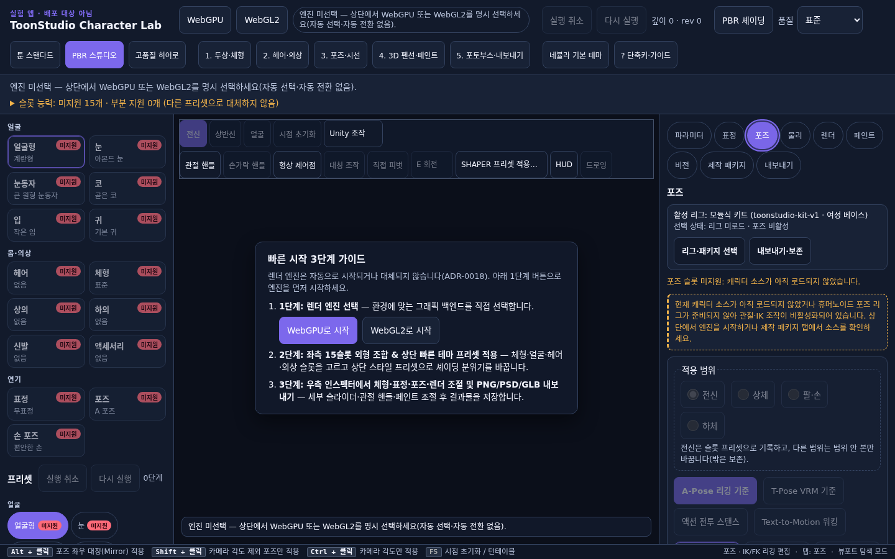
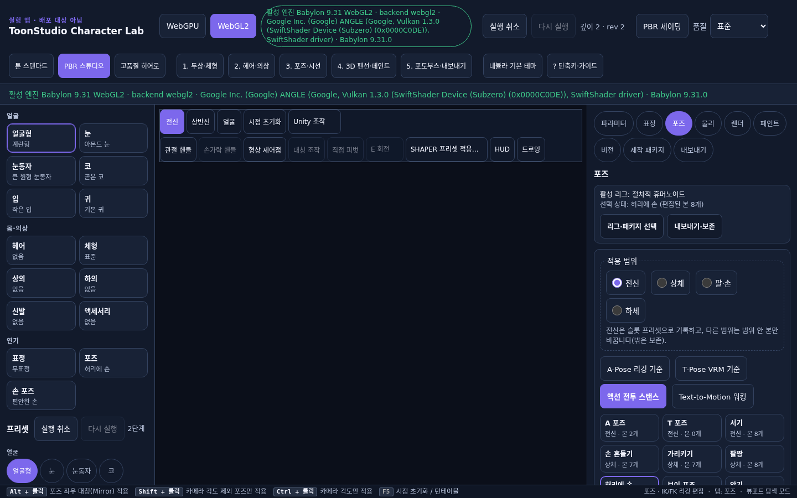
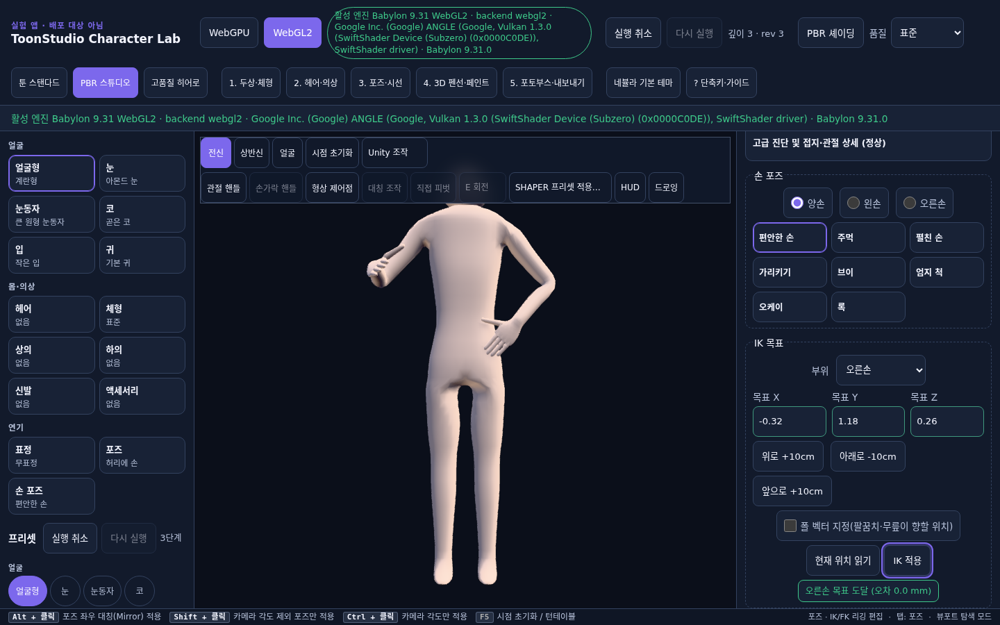
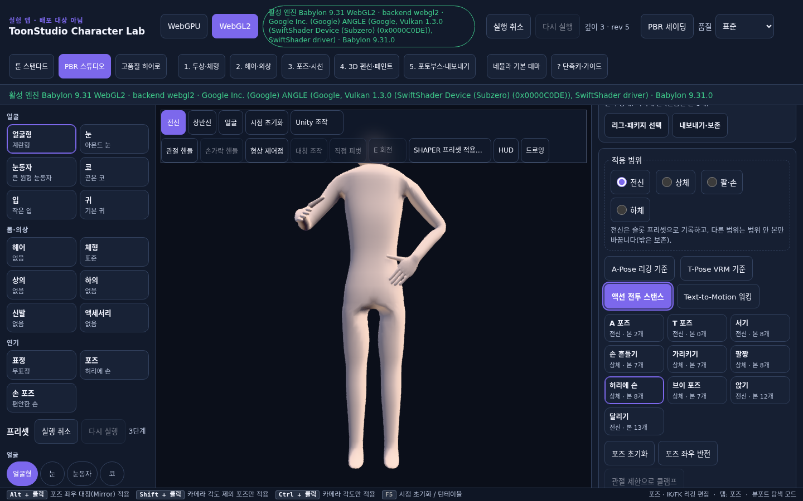
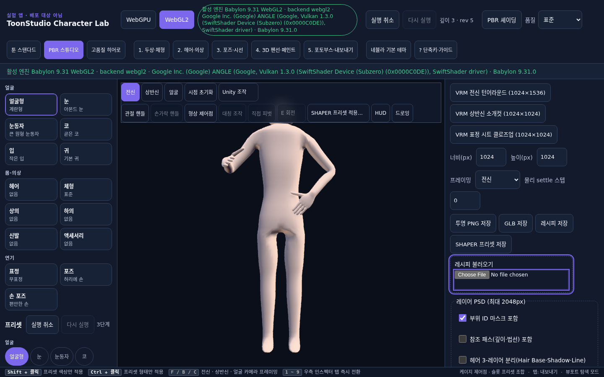

# Character Lab Round 5 — KBD-01 / KBD-02 / KBD-04 / KBD-05 최소 수정 및 회귀 검증 보고서

- **작성일**: 2026-11-07
- **작업 브랜치**: `feat/character-keyboard-fixes-round5-20261107`
- **독립 소유 범위**:
  - [`apps/character-lab/src/app/shell/InspectorTabs.tsx`](../../apps/character-lab/src/app/shell/InspectorTabs.tsx) · [`InspectorTabs.test.tsx`](../../apps/character-lab/src/app/shell/InspectorTabs.test.tsx)
  - [`apps/character-lab/src/app/shell/panels/SlotPanel.tsx`](../../apps/character-lab/src/app/shell/panels/SlotPanel.tsx) · [`SlotPanel.test.tsx`](../../apps/character-lab/src/app/shell/panels/SlotPanel.test.tsx)
  - [`apps/character-lab/src/app/shell/TopBar.tsx`](../../apps/character-lab/src/app/shell/TopBar.tsx) · [`TopBar.test.tsx`](../../apps/character-lab/src/app/shell/TopBar.test.tsx)
  - [`apps/character-lab/src/app/shell/panels/PosePanel.tsx`](../../apps/character-lab/src/app/shell/panels/PosePanel.tsx) · [`PosePanel.test.tsx`](../../apps/character-lab/src/app/shell/panels/PosePanel.test.tsx)
  - [`apps/character-lab/src/app/shell/panels/ExportPanel.tsx`](../../apps/character-lab/src/app/shell/panels/ExportPanel.tsx) · [`ExportPanel.test.tsx`](../../apps/character-lab/src/app/shell/panels/ExportPanel.test.tsx)
  - [`apps/character-lab/src/app/styles/character-lab.css`](../../apps/character-lab/src/app/styles/character-lab.css)
  - [`docs/character-keyboard-fixes-round5-20261107/`](./verification-report.json)
- **보호 범위 준수**:
  - `docs/character-keyboard-round4-20261107/**` (CI 담당 소유) 수정 없음 (`0` diff)
  - `apps/character-lab/src/app/shell/panels/PackagePanel.tsx` 및 `package-panel/PackageDetail*` (별도 CI 담당 소유) 수정 없음 (`0` diff)
  - `KBD-03`(전역 Undo `isEditableTarget` 및 관절 엔진 의미 변경), 리깅 엔진, 공유 스토어/스키마/라우트/테마/다른 앱 수정 없음 (`0` diff)

---

## 1. 결함별 최소 수정 요약 (`KBD-01` / `KBD-02` / `KBD-04` / `KBD-05`)

| 결함 ID | 대상 파일 | 수정 내용 | 검증 결과 |
| --- | --- | --- | --- |
| **KBD-01** | [`InspectorTabs.tsx`](../../apps/character-lab/src/app/shell/InspectorTabs.tsx), [`SlotPanel.tsx`](../../apps/character-lab/src/app/shell/panels/SlotPanel.tsx), [`TopBar.tsx`](../../apps/character-lab/src/app/shell/TopBar.tsx) | 우측 인스펙터 탭(`role="tablist"`, 9개) 및 좌측 슬롯 탭(`role="tablist"`, 15개)에 `tabIndex={selected ? 0 : -1}`(roving `tabIndex`)와 `ArrowLeft`/`ArrowRight`/`ArrowUp`/`ArrowDown`/`Home`/`End` 키보드 이동을 구현하고, 상단 `1`~`9` 숫자 단축키로 탭 전환 시 `#cl-tab-${tab}`으로 초점을 함께 이동. | **FIXED** (`inspectorInitialZeroTabCount: 1`, 방향키 및 `1`~`9` 단축키 초점 동기화 확인) |
| **KBD-02** | [`PosePanel.tsx`](../../apps/character-lab/src/app/shell/panels/PosePanel.tsx), [`ExportPanel.tsx`](../../apps/character-lab/src/app/shell/panels/ExportPanel.tsx), [`TopBar.tsx`](../../apps/character-lab/src/app/shell/TopBar.tsx), [`character-lab.css`](../../apps/character-lab/src/app/styles/character-lab.css) | `pose-switch-to-package-tab` / `pose-switch-to-export-tab` 및 `export-switch-to-package-tab` / `export-switch-to-pose-tab` 작동 시 언마운트되는 패널 대신 대상 인스펙터 탭(`#cl-tab-package`, `#cl-tab-export`, `#cl-tab-pose`)으로 초점을 복원해 `document.body` 추락을 방지. `?` 도움말 패널을 `Escape` 또는 `닫기` 버튼으로 닫을 때 `[data-testid="topbar-help-toggle"]`로 초점 복원. `.cl-export-file:focus-within` 시각적 포커스 링 추가. | **FIXED** (모든 탭 전환 및 도움말 닫기 후 `document.activeElement` 유실 `0`건) |
| **KBD-04** | [`character-lab.css`](../../apps/character-lab/src/app/styles/character-lab.css) | `body` 및 `#root, .cl-app`의 `overflow-x: hidden`을 `overflow-x: clip`으로 변경해 `@media (max-width: 1180px)`에서 `.cl-workbench-main { position: sticky; top: 0; }`이 정상 작동하도록 복원. 세로·가로 회전(`640×320`, `844×390`, `1024×768`) 및 `200%` 확대(`720×450`)에서 3D 뷰포트가 화면을 과도하게 차폐하지 않도록 높이를 `clamp(110px, 32dvh, 220px)`(단축 높이 `@media (max-height: 500px)`는 `clamp(96px, 28dvh, 132px)`)로 제한하고 `html { scroll-padding-top: ... }`를 적용해 3D 뷰포트와 하단 조작 패널이 공존하며 포커스된 컨트롤이 가려지지 않게 보장. | **FIXED** (8개 뷰포트·회전·200% 확대 모두 `mainViewportVisibleWhileEditingPose: true`, `obscuredByStickyMain: false`, `horizontalOverflowPx: 0`) |
| **KBD-05** | [`PosePanel.tsx`](../../apps/character-lab/src/app/shell/panels/PosePanel.tsx) | `hasEmptySkeleton`(`hasEmptyEngineSkeleton && !rigCorrupted`)과 미로드 리그 상태 `isRigUnloaded`(`poseDisabled && !hasEmptyEngineSkeleton && !rigCorrupted`)를 분리. 미로드 상태에서 `"스켈레톤 없음(정적 메시)"`로 오분류하던 요약 문구를 `"리그 미로드 · 포즈 비활성"`으로 바로잡고, 전용 안내 배너(`pose-unloaded-rig-notice`) 및 `pose-switch-to-package-tab`의 `aria-describedby` 연결을 추가. | **FIXED** (`misclassifiedAsStaticMesh: false`, `describedByResolvesAllIds: true`) |

---

## 2. 키보드 연속 여정 검증 (포즈 프리셋 선택 → 관절 선택 → 값 변경 → Undo/Redo → 내보내기 → 취소)

상세 측정 데이터는 [`verification-report.json`](./verification-report.json)에 기록되어 있습니다.

1. **미로드 리그 안내 및 `aria-describedby` 확인 (`KBD-05`)**:
   - 초기 미로드 상태에서 `pose-active-selection-summary`가 `"선택 상태: 리그 미로드 · 포즈 비활성"`을 표시하며 정적 메시 오분류가 발생하지 않음.
   - 스크린샷: 
2. **포즈 프리셋 선택 (`Step 1`)**:
   - `Tab`으로 `[data-testid="pose-quick-chip-hands-on-hips"]`에 초점을 이동한 뒤 `Enter` 입력 → `"선택 상태: 허리에 손 (편집된 본 8개)"` 즉시 반영.
   - 스크린샷: 
3. **관절(IK 목표) 선택 및 좌표 값 변경 (`Step 2–3`)**:
   - `부위` `<select>`에서 `rightArm`(`오른손`) 선택 후 `Tab`으로 `목표 X/Y/Z` 입력(`-0.32`, `1.18`, `0.26`) 및 `IK 적용` 버튼 `Enter` 실행 → `"오른손 목표 도달 (오차 0.0 mm)"` 기록.
   - 스크린샷: 
4. **키보드 Undo / Redo (`Step 4`)**:
   - `Ctrl+Z`로 직전 스탠스로 되돌린 뒤 `Ctrl+Shift+Z`로 다시 실행하여 `"선택 상태: 허리에 손 (편집된 본 8개)"` 상태가 무손실 복원됨(`restoredIdentically: true`).
   - 스크린샷: 
5. **내보내기 탭 이동·레시피 저장·파일 선택 취소·복귀 (`Step 5` & `KBD-02`)**:
   - `[data-testid="pose-switch-to-export-tab"]`에서 `Enter` 입력 시 `#cl-tab-export`로 초점이 복원됨(`activeId: "cl-tab-export"`).
   - `레시피 저장` 버튼을 `Enter`로 실행해 `.character.json` 영수증을 생성하고, `[data-testid="export-recipe-file-input"]`에서 파일 선택 취소(`files: []`) 시 기존 영수증과 실험 포즈(`실험 포즈: 허리에 손 (본 8개 · 손 relaxed) · 레시피 #83e6abeb`)가 그대로 보존됨(`preservedOnCancel: true`).
   - `[data-testid="export-switch-to-pose-tab"]`에서 `Enter` 입력 시 `#cl-tab-pose`로 초점이 복원됨(`activeId: "cl-tab-pose"`).
   - 스크린샷: 

---

## 3. 5대 뷰포트 · 가로/세로 회전 · 200% 확대 공존 검증 (`KBD-04`)

| 뷰포트 / 조건 | `body overflow-x` | 가로 오버플로 (`px`) | `.cl-workbench-main` 위치 · 높이 (`px` / 비율) | 포즈 조작 중 3D 뷰 가시성 | 포커스 컨트롤 가림 여부 (`obscuredByStickyMain`) | 선택 요약 보존 | 스크린샷 |
| --- | --- | --- | --- | --- | --- | --- | --- |
| `320×640` (모바일 세로) | `clip` | `0` | `sticky` · `205px` (`32.0%`) | `true` | `false` (`top: 407px >= 205px`) | `선택 상태: 허리에 손 (편집된 본 8개)` | [320×640 세로](./viewport-320x640-portrait.png) |
| `640×320` (모바일 가로 회전) | `clip` | `0` | `sticky` · `96px` (`30.0%`) | `true` | `false` (`top: 190px >= 96px`) | `선택 상태: 허리에 손 (편집된 본 8개)` | [640×320 가로](./viewport-640x320-landscape.png) |
| `390×844` (모바일 세로) | `clip` | `0` | `sticky` · `220px` (`26.1%`) | `true` | `false` (`top: 516px >= 220px`) | `선택 상태: 허리에 손 (편집된 본 8개)` | [390×844 세로](./viewport-390x844-portrait.png) |
| `844×390` (모바일 가로 회전) | `clip` | `0` | `sticky` · `109px` (`28.0%`) | `true` | `false` (`top: 232px >= 109px`) | `선택 상태: 허리에 손 (편집된 본 8개)` | [844×390 가로](./viewport-844x390-landscape.png) |
| `768×1024` (태블릿 세로) | `clip` | `0` | `sticky` · `220px` (`21.5%`) | `true` | `false` (`top: 606px >= 220px`) | `선택 상태: 허리에 손 (편집된 본 8개)` | [768×1024 세로](./viewport-768x1024-portrait.png) |
| `1024×768` (태블릿 가로 회전) | `clip` | `0` | `sticky` · `220px` (`28.6%`) | `true` | `false` (`top: 478px >= 220px`) | `선택 상태: 허리에 손 (편집된 본 8개)` | [1024×768 가로](./viewport-1024x768-landscape.png) |
| `1440×900` (PC 데스크톱) | `clip` | `0` | `relative` · `687px` (`76.3%`, 3열) | `true` | `false` | `선택 상태: 허리에 손 (편집된 본 8개)` | [1440×900 데스크톱](./viewport-1440x900-desktop.png) |
| `1440×900 @ 200%` (`720×450`) | `clip` | `0` | `sticky` · `126px` (`28.0%`) | `true` | `false` (`top: 271px >= 126px`) | `선택 상태: 허리에 손 (편집된 본 8개)` | [1440×900 200% 확대](./viewport-1440x900-zoom200.png) |

---

## 4. 테스트 · 타입 · 린트 · 800줄 규칙 검증 결과

- **단위 및 통합 테스트 (`vitest`)**: 260개 테스트 파일, 2,511개 테스트 전수 통과
- **타입 검사 (`pnpm --filter @toonstudio/character-lab typecheck`)**: 오류 `0`건
- **변경 파일 린트 (`node scripts/lint-changed.mjs`)**: 오류 `0`건, 경고 `0`건
- **소스 파일 800줄 상한 규칙 (`wc -l`)**:
  - [`InspectorTabs.tsx`](../../apps/character-lab/src/app/shell/InspectorTabs.tsx): `89`줄 (`<= 800`)
  - [`InspectorTabs.test.tsx`](../../apps/character-lab/src/app/shell/InspectorTabs.test.tsx): `74`줄 (`<= 800`)
  - [`SlotPanel.tsx`](../../apps/character-lab/src/app/shell/panels/SlotPanel.tsx): `307`줄 (`<= 800`)
  - [`SlotPanel.test.tsx`](../../apps/character-lab/src/app/shell/panels/SlotPanel.test.tsx): `393`줄 (`<= 800`)
  - [`TopBar.tsx`](../../apps/character-lab/src/app/shell/TopBar.tsx): `311`줄 (`<= 800`)
  - [`TopBar.test.tsx`](../../apps/character-lab/src/app/shell/TopBar.test.tsx): `152`줄 (`<= 800`)
  - [`PosePanel.tsx`](../../apps/character-lab/src/app/shell/panels/PosePanel.tsx): `745`줄 (`<= 800`)
  - [`PosePanel.test.tsx`](../../apps/character-lab/src/app/shell/panels/PosePanel.test.tsx): `525`줄 (`<= 800`)
  - [`ExportPanel.tsx`](../../apps/character-lab/src/app/shell/panels/ExportPanel.tsx): `524`줄 (`<= 800`)
  - [`ExportPanel.test.tsx`](../../apps/character-lab/src/app/shell/panels/ExportPanel.test.tsx): `664`줄 (`<= 800`)
