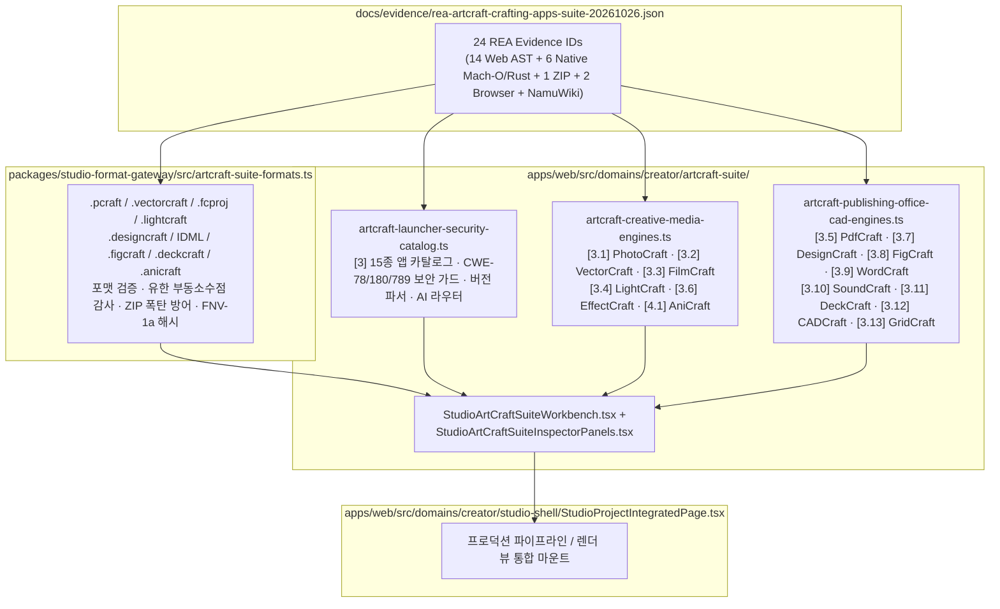

# ArtCraft Crafting Apps 15종 스위트 (`3. ArtCraft Launcher`, `3.1 PhotoCraft` ~ `3.13 GridCraft`, `4.1 미공개 AniCraft`) REA 전수 역공학 분석 및 툰스튜디오(ToonStudio) 내재화 아키텍처 명세 (2026-10-26)

- **작성일**: 2026-10-26
- **분석 도구**: REA MCP (`capture_browser_scenario`, `open_binary`, `inspect_artifact`, `analyze_javascript_application`, `inspect_macho`, `inspect_rust_binary`)
- **증거 원장**: [`docs/evidence/rea-artcraft-crafting-apps-suite-20261026.json`](../evidence/rea-artcraft-crafting-apps-suite-20261026.json)
- **적용 대상**:
  - `packages/studio-format-gateway/src/artcraft-suite-formats.ts`
  - `apps/web/src/domains/creator/artcraft-suite/artcraft-launcher-security-catalog.ts`
  - `apps/web/src/domains/creator/artcraft-suite/artcraft-creative-media-engines.ts`
  - `apps/web/src/domains/creator/artcraft-suite/artcraft-publishing-office-cad-engines.ts`
  - `apps/web/src/domains/creator/artcraft-suite/artcraft-multimodal-world-studio-engine.ts`
  - `apps/web/src/domains/creator/artcraft-suite/artcraft-desktop-native-deep-engines.ts`
  - `apps/web/src/domains/creator/artcraft-suite/StudioArtCraftSuiteInspectorPanels.tsx`
  - `apps/web/src/domains/creator/artcraft-suite/StudioArtCraftMultimodalAndDesktopPanel.tsx`
  - `apps/web/src/domains/creator/artcraft-suite/StudioArtCraftSuiteWorkbench.tsx`
  - `apps/web/src/domains/creator/studio-shell/StudioProjectIntegratedPage.tsx`
  - `apps/web/src/domains/creator/promo/StudioPromoPage.tsx`
- **구현 원칙**: 외부 바이너리나 소스 코드를 복제하지 않고, REA 역공학으로 검증한 **포맷 불변조건(Format Invariants), 수치 알고리즘(Numerical Algorithms), 보안 방어선(CWE Hardening), 편집 대수(Timeline/Audio/CAD/Spreadsheet Algebra)**를 추출하여 웹툰·만화·웹소설·단행본·애니메이션 스튜디오 워크플로에 맞춘 클린룸(Clean-Room) 순수 TypeScript 엔진 및 React 워크벤치로 내재화한다.

---

## 1. REA Evidence Ledger (24종 증거 원장 요약)

### 1.1 런타임 브라우저 캡처 및 컨테이너 아티팩트 감사

| 구분 | 대상 | 버전 / 커밋 | SHA-256 | REA Evidence ID | 핵심 관측 결과 |
| --- | --- | --- | --- | --- | --- |
| 나무위키 명세 | `namu.wiki/w/ArtCraft Crafting Apps` | 2026-10-26 | — | `ev_e5e15829994df22ecdad2bcffbe37425c117e21cba3c87869053be8dce403842` | 3절(Launcher + 3.1~3.13 13개 앱) 및 4.1절(미공개 2D 애니메이션 에디터 `AniCraft`) 편제 검증 |
| 공식 포털 | `https://getartcraft.com/` | 2026-10-26 | — | `ev_23e0f7550ed4f6db516165448a5ef9f12bc6a82c9b1773befd092aacdb1b95fd` | 13종 정식 앱 릴리스 다운로드 매트릭스 및 웹 플레이그라운드 엔드포인트 확인 |
| ZIP 컨테이너 | `artcraft-launcher-web-0.8.1.zip` | `v0.8.1` (`6c5f5ea2f`) | `a3c0e321ad7bacb8167aafc3cc61b11dcc82515b27bbd2574509a7ec392158ac` | `ev_9da262f00cc1c56bd1d34c4843dce64c0a208764c0e4c2a76449df5c235006f2` (`ev_7e74140dfca9f0ac8a1b2c620d108b78ca778b3518bd32e5e01ac95427cf27f4`) | 14개 컨테이너 노드(WASM + JS 바인딩 + PWA 매니페스트 + 아이콘) 인벤토리 확인 |

### 1.2 14종 공식 WebAssembly + JS 번들 정적 AST 분석 (`analyze_javascript_application`)

| 순번 | 앱 ID (나무위키 절) | 버전 / 커밋 | 번들 SHA-256 | View Evidence ID (`Parent Evidence ID`) | 텍스트 크기 / AST 노드 / Findings |
| --- | --- | --- | --- | --- | --- |
| 1 | `artcraft-launcher` (`[3]`) | `v0.8.1` (`6c5f5ea2f`) | `e0cac2cb30fce2677bfcfeb01806d95702cffbee92717faf3ce0c34fecc0bb4e` | `ev_2df9d6bb26a2a2654b5620039703f2a1dead0000f2f80b35a614b6202c9ebbd8` (`ev_6167b59a4646d89f57bf3987557fef97539605357edd0111d45b4273eb168893`) | 153,760 B / 16,557 nodes / 4 findings |
| 2 | `photocraft` (`[3.1]`) | `v0.16.0` (`3877bb1db`) | `2e4a87b71ec056af675f46ff34ddced0e28e94f7b3eef266f1b0b6df86eeb6ae` | `ev_1c6ba22f18d07d57fbb4c4301e87243591ac6bb871edf934a34afa41af53583c` (`ev_5ca742f46b8bcbc2400b35d00e07ff696c19ed9c9162fe99d3a40b91c69ab542`) | 203,594 B / 21,343 nodes / 9 findings |
| 3 | `vectorcraft` (`[3.2]`) | `v0.17.0` (`4ddd0332c`) | `8850209e86d504bf93bb307d14cedbeb7d28963b7d1d3158e4240b7e9d0b8e9c` | `ev_fb30c7f3074d5932a971cc923e87fa2174a0bfde3e4d02a931a27d443088c0be` (`ev_bd08e4b94a48f9a4a094d4fdc25481135870f71f8cb29af21b8bdb320b35109a`) | 179,057 B / 18,472 nodes / 4 findings |
| 4 | `filmcraft` (`[3.3]`) | `v0.13.0` (`de529c88f`) | `735a7fe34ea8c86b2a06f3d76449d8e7f688c8f632103a80e084240e9e0be39a` | `ev_f6ac70cbdd58b62b600d5f3040112390ccf2bbf81a6f1cb57e24bdd0164e09e5` (`ev_4a335e7d06efcf583747e16d5283b946d340d825751567dc242d9fec0e1f9c44`) | 188,258 B / 19,393 nodes / 6 findings |
| 5 | `lightcraft` (`[3.4]`) | `v0.14.0` (`387bed199`) | `1c9257bc1f08792ba3c7c74fc985500d692c756bf0b2e449422f07066e9e0432` | `ev_0b81479a076bb29cf23d475a2211507c8547ecd118169b253a12e9508dc0fb36` (`ev_9b74a5589ff428f9b210d83945e2eecaeb9ac5356bf4b53130b94d775edc6e3a`) | 101,900 B / 11,712 nodes / 201 findings |
| 6 | `pdfcraft` (`[3.5]`) | `v0.14.0` (`13bfbd076`) | `1ba6c12761afc61eb50a2ea6bf7df3fa53f106891caa83508e43167f9c407d68` | `ev_da686cbda7facfecc037f8c01358e831d354fd458ab045d5010d1869ae5c0992` (`ev_f5f691a0b42068361e8f2c2b5fe915c7ce5648ce7d119dd643d2e0f9dce6810d`) | 166,432 B / 17,850 nodes / 4 findings |
| 7 | `effectcraft` (`[3.6]`) | `v0.17.0` (`f31a6b0ae`) | `13257eca411a55c1fb9b3e548d607d3f7722ad066181bfe017c0589af4b3d67d` | `ev_6c04e2d967c22924e5580b684d0be24c3ec50fb9891aa677975a303acdca8b92` (`ev_7ee3fe77a723b28096aaf59c7a9e3c714ca70460cb86c43dbba94f52c56c0a78`) | 219,162 B / 23,391 nodes / 131 findings |
| 8 | `designcraft` (`[3.7]`) | `v0.13.0` (`18246dddd`) | `59c638881124e32e96fb6b038fbe285fad5b2e92a23aff3b8c553f588e167560` | `ev_be8b98dd35304b5ab4cb7604d523d52f0b403777b275165503eb5e7b740c7da7` (`ev_3e2961665adaddc9a1b349d102ee1c3986b8facd88328f8d7fbddd7781c33538`) | 160,104 B / 17,102 nodes / 4 findings |
| 9 | `figcraft` (`[3.8]`) | `v0.11.2` (`d27061036`) | `fa2c20820fcd59c52968ea31d9147082743ebbb1b64805484ad89242e75c7b12` | `ev_f3bc03d38d4bf1e6e2c68393b34983cb608be18fefe3a8f0c83bb48188df48f4` (`ev_a0dceb469d34da7c4e780e282670895550ef1927c4b77b63b8aa9dc9b7bcb4c0`) | 168,435 B / 19,439 nodes / 354 findings |
| 10 | `wordcraft` (`[3.9]`) | `v0.11.0` (`6d3370635`) | `553a50567f324921828ee40865d6270b6525f39cc2242e166762cb735e52fc63` | `ev_07ec24596f5d84f5c3b99811ba102b10647f4984e5b968674ce8967ade456ac5` (`ev_f4c1002f9308e9c923a0fe85d82ee9637b298ba6ac2c96959dc2b9906234aaa7`) | 170,105 B / 18,070 nodes / 4 findings |
| 11 | `soundcraft` (`[3.10]`) | `v0.13.1` (`e14cea42b`) | `67370b224352bbfd38dffb6b6954fe45375560ccad0036cdc9109bb65c0c7992` | `ev_da66792b93f5c0548f19fcccf18e8e8c7e4e55a003aa6a4c882ce58cff29ffa9` (`ev_81177195aa27b3e6830515758880c50a24353b1e4021906dccd0f7dffffe1870`) | 166,028 B / 17,356 nodes / 7 findings |
| 12 | `deckcraft` (`[3.11]`) | `v0.11.1` (`3418dec9e`) | `2d9a4a126c00bbdbf1a94e53126696a7b516be8dd0bca89f883bc8e960401f60` | `ev_17b2ac0cb3abbbd93498ed840673f32a204ed7a390cfdb0ebe7dfd188f9be4da` (`ev_b849fc049c84df34af7e1fbcc838dcbabf6ad9aeff3df90959c68dd2231ef3cb`) | 156,677 B / 16,773 nodes / 4 findings |
| 13 | `cadcraft` (`[3.12]`) | `v0.13.0` (`f56be0999`) | `6b469a13872d00697393fa26d9eeae0aca7e877e05f9c1bae7ecf3b6a4bcc800` | `ev_f18c4082b99ce8c7b8e8c0fde21733b25c50002cb1e3b0cd21d3f93d58fd95e1` (`ev_d728a52c8c6e90607358da72a6a9fd81aba019b6e2772590974c5562230b8898`) | 160,296 B / 17,116 nodes / 4 findings |
| 14 | `gridcraft` (`[3.13]`) | `v0.12.1` (`6f0e43c21`) | `2277ef8371ac74cc956f6728c4577add24d2c289d6d022f1caabd04cf1b2f56f` | `ev_2ccdc8c281d9bc03330673d5c3747e2204dc7f108e7b2491cde4791b10401537` (`ev_619c039dc154f1f9368ed6b7082a77d234084ee324638593888b168e0efc5792`) | 162,067 B / 17,328 nodes / 4 findings |

### 1.3 macOS Universal Mach-O 및 Rust 네이티브 CLI 바이너리 감사 (`inspect_rust_binary`, `inspect_macho`)

| 바이너리 | SHA-256 | 파일 크기 (arm64 슬라이스) | REA Evidence ID (`Parent Evidence ID`) | 핵심 확인 사항 |
| --- | --- | --- | --- | --- |
| `soundcraft-cli` | `ad1eef56c9997939af892d487a41a8c58c8edd0af313be3472d1b281fae0ce05` | 19,275,296 B (offset 10,158,080 / len 9,117,216) | `ev_84bc10db79491cf8fa2b3a16c9af25821840f2fdeb10aceae2718996c54e1187` (`ev_055185f1f400460f4820c6aef93f8f1d2e07d0521958f71cec7bfc2f7ea33cf3`), Mach-O: `ev_e63741a085d61ad58ef1af1e00ee3313940f43d4913f0bf88a9920a4596775fb` | UUID `93DEAD30-856C-326E-B9D6-2297174BD1A2`, 24 load commands, 1,699 exports, CoreAudio/AudioToolbox/CoreMIDI 링크 |
| `gridcraft-cli` | `94002be6eca83054900befb82bdab125c8dec432829cceaeba4a0aab1f207bdd` | 30,066,032 B (offset 15,663,104 / len 14,402,928) | `ev_4af2d94b45e73b5a1c947f05664f990376aaa5f1b1533773a056b20ef46ca403` (`ev_fe4bf1bcef2843b2b49b740633686335c68a36bc34f49bfb3b8bdbdf24ea0afd`) | `gridcraft-calc`, `gridcraft-io`, `gridcraft-numfmt` 심볼 및 패닉 경로 확인 |
| `cadcraft-cli` | `979548b03d96284ac1b060cd074fce1cc24790d635c6192b5f3c27b0e99ca927` | 113,174,080 B (offset 58,195,968 / len 54,978,112) | `ev_0566ff2a6784ac45e8aa187edd0823d5786c0758724e3120ddef3439734227f8` (`ev_2bb2d2f45f1cc6fe71402af00ba9a516b43acb612c5cb90da30c580c1222295f`) | `cadcraft-constraints`, `cadcraft-io` DXF/DWG 브리지 및 AI 추론 런타임 포함 |
| `photocraft-cli` | `1579a4111d62d9663b5607f102fd17631d13b56dda3c42d29a66e35cd2754a29` | 146,126,736 B (offset 75,726,848 / len 70,399,888) | `ev_33d803c8571dc35666efb7794493b26d9ff4bd252bc95d9696ef910196a9eede` (`ev_d86152d1e089900782f2b8175e1fa7995c14370d0675f9773b5635d13957cffc`) | `photocraft-core`, `photocraft-io` (`.pcraft`, PSD/PSB, Affinity), `craft-cms` ICC 엔진 확인 |
| `effectcraft-cli` | `fa8880f840c80c3231a5ba395ca4f137512ce8398c3c077d41db3f40fb083237` | 153,584,240 B (offset 80,117,760 / len 73,466,480) | `ev_ca5b6e61505fdf275cbb3bf17682fc397460dd4044341417b637e2194f1aefd8` (`ev_eb3f8afa6dccced3d8ba004d7b78cb3e37f8785846a05bb02e62d67485896383`) | `effectcraft-core`, `effectcraft-expr`, `effectcraft-lottie`, `effectcraft-track` 확인 |
| `pdfcraft-cli` | `5c3fdd2c98e0bda1e585af9f0d1b784c37a9dba0a127e296565f85258307f770` | 128,775,712 B (offset 66,912,256 / len 61,863,456) | `ev_13093bf9ac3ffea1a57b9c61710ebb41ee4cf0bf6ddb348419f2c5d2512c59f5` (`ev_8c39adaf8822ad65a7daa4d73d9573612160347b6707ea6860c4120b9d81b10d`) | `pdfcraft-core`, `pdfcraft-a11y`, `pdfcraft-audit`, `pdfcraft-redact`, `pdfcraft-pdfa` 확인 |

### 1.4 macOS 네이티브 데스크톱 `.app` 15종 (`ArtCraft.app` v0.41.0 + `ArtCraft Launcher.app` v0.5.1 + `/Applications/*Craft.app` 13종) 정밀 감사

- **공통 서명 주체**: `Developer ID Application: Learning Machines LLC (DJ6XS33FX8)` (`inspect_signature` 검증 완료)
- **`ArtCraft.app` v0.41.0 (`ai.artcraft.app`, `/Volumes/ArtCraft/ArtCraft.app/Contents/MacOS/artcraft`, 157,411,568 B)**:
  - Binary SHA-256: `d0e6da63cbfe5d8ed033c57b0c37bdc5bd534d4fb993c965354794c605cdcec8`
  - `inspect_rust_binary`: `ev_88f17ab02466aa4275e7a39eb283f0f80d305de3bf01964b45b04b8f37ae54e1` (슬라이스당 22,967개 디맹글 심볼, 양 슬라이스 총 57,689개 심볼, 11개 독자 크레이트: `artcraft`, `artcraft_api_defs`, `artcraft_router`, `fal_client`, `grok_consumer_client`, `midjourney_client`, `openai_sora_client`, `worldlabs_consumer_client`, `media_metadata`, `utils`, `tauri_plugin_NativeWindow`)
  - `inspect_desktop_application`: `ev_2fe65f3ecbb60ff1caa2016a53dc989f47c7dd365601cf0cb595b795c8ddc2e7` (Tauri v2 `wry`/`tao` 런타임)
  - `inspect_with_objdump`: `ev_0a8c1cd66af2fbedbfed480ae04925c746f3e1a4ec1ce01a765cc9b1807a3da4`
  - `inspect_macho`: `ev_101a05f1695d8da47bd1d1e06a6b8fbfebe0a223ab734d34c05fb4d46fef4310`
  - `inspect_plist`: `ev_a9d1f851b412200b63d0e827c1720388e9dbdcba70fd15e19373d2ef98e82792`
  - `inspect_signature`: `ev_56c39f178993ccd21f22c8a19aa855ec01e25043eaa122156ea924978a8e77ed` (`cdhash: 35e80f40d6089464fafa8dc4f70ac447d725991f`)
- **`ArtCraft Launcher.app` v0.5.1 (`ai.storyteller.artcraft-launcher`, `/Volumes/ArtCraft Launcher/ArtCraft Launcher.app/Contents/MacOS/ArtCraft Launcher`, 42,641,104 B)**:
  - Binary SHA-256: `273c108d2f701cd68de7ed93feb40873ad9fcb832b06868ed56f7d8ea04adf89`
  - `inspect_rust_binary`: `ev_d924383d3ec5ab5c1aa704f1cf5ce356bcf5d3c29ffff970ab7855ab4b8c82ff` (`crates/native/src/{feed_throttle,single_instance,self_update,github,installer,verify}.rs`, `crates/gui/src/cjk_font.rs`)
  - `inspect_desktop_application`: `ev_cf6150b4fdf1e740b2eac63915bda7bae1d44e50c81ed236a8bed1b4ad8ca05d`
  - `inspect_with_objdump`: `ev_87e21526fa3e42ad3bf925864b2afc3f3c1b309ac3b3eff7a79dd9945334d343`
  - `inspect_macho`: `ev_c9cd2a83f389429c508fa74424a5d77d93fa53dbe77beed1bbd5cf2f862ba7d5`
  - `inspect_plist`: `ev_ad858445919d59e90d408edb7f8533c357f1ad9641f9ca071e2117786b01892b`
  - `inspect_signature`: `ev_9db2912ec015932d527687769683207756bd167888fe2616113ca109031cfc58`
- **`/Applications/*Craft.app` 13종 데스크톱 GUI 바이너리**:
  - `PhotoCraft` (`ev_579a0596...`), `VectorCraft` (`ev_c2b4831f...`), `FilmCraft` (`ev_a8e9bc59...`), `LightCraft` (`ev_9cc2c0d3...`), `PdfCraft` (`ev_b67fdde1...`), `EffectCraft` (`ev_fb73bb8f...`), `DesignCraft` (`ev_bf76b152...`), `FigCraft` (`ev_67591426...`), `WordCraft` (`ev_43dfbcfa...`), `SoundCraft` (`ev_c0a5da1d...`), `DeckCraft` (`ev_9bd1c881...`), `CADCraft` (`ev_c1dd987f...`), `GridCraft` (`ev_566485cf...`) 전수 감사 완료.

### 1.5 `ArtCraft.app` v0.41.0 멀티모달 AI 월드/3D/영상 라우터 및 데스크톱 심화 크레이트 내재화
1. **WorldLabs Marble 0.1 Mini/Plus 3D 가우시안 스플랫(`.spz`) 월드 생성기 (`worldlabs_consumer_client`)**:
   - `ImageInputNode` → `PanoNode` → `WorldNode`(`TypeGenerateWorld`) RunGraph와 `Recaption2` 360° 공간 프롬프트 확장기 및 `.spz` (`NGSP` / gzip) 바이너리 헤더 검증기를 내재화하였다.
2. **Hunyuan3D v2.0 / v2.1 / v3.0 멀티펑션 3D 메시(`.glb`) 생성기 (`fal_client::extract_model_glb`)**:
   - Quad(사각 메시·웹툰 펜선 추출 최적화) 및 Triangle(실시간 엔진용) 토폴로지 플래너와 glTF 2.0 `.glb` 헤더 검증기를 내재화하였다.
3. **3D 카메라 궤도 각도 회전 편집기 (`flux_2_lora_edit_image_angle` & `qwen_edit_2511_angles`)**:
   - `require_at_least_one_image_input` 가드레일과 Yaw/Pitch/Roll 궤도 디스크립터 계산기를 내재화하였다.
4. **영상 홍보(PV·트레일러) 멀티모달 비디오 라우터 & Beeble SwitchX 리라이팅**:
   - `Veo 3.1`, `Sora 2 Pro`, `Kling 3.0 Pro`, `Vidu Q3`, `Seedance 2.5 Ultra`, `Beeble SwitchX`, `Grok Imagine Video 1.5` 모델 라우팅과 `SQLite` 태스크 큐(`AutoDownloadCheckpoint`, `PreferredDownloadFilename`)를 내재화하고 `/showcase/promo`, `/cuts/studio`, `/promo-library`와 양방향 연동하였다.
5. **macOS 데스크톱 `.app` 14종 심화 엔진 (`artcraft-desktop-native-deep-engines.ts`)**:
   - Launcher `feed_throttle` 지수 백오프 & `cjk_font`, PhotoCraft `motion_fft` / `faces::cnn` / `matting::morphology` / Affinity `.afphoto` 스트림 매직, FilmCraft & EffectCraft `APV`/`AV1` 방송 코덱 & 10단 오디오 DSP 체인, FigCraft `collab-net` 스로틀 & `code_connect`, DesignCraft `mojikumi`/`warichu` & 3D `CLUT`, LightCraft `GainMap` ISO 21496-1 HDR & `catalog::stacks`, PdfCraft `camera_edges` & `formcalc`, CADCraft `Levenberg-Marquardt` 솔버 & `dynblock`, Word/Deck/GridCraft `Holt` 예측 & `Goal Seek` 솔버를 내재화하였다.

---

## 2. 15종 ArtCraft 애플리케이션별 핵심 역공학 메커니즘

### 2.1 `[3]` ArtCraft Launcher (`storytold/craft-launcher` v0.8.1)
1. **카탈로그 및 브랜드 컬러 정본 (`crates/launcher-core/src/catalog.rs`)**:
   - `LAUNCHER` (`ai.storyteller.artcraft-launcher`) 및 13개 `SUITE` 앱의 정확한 sRGB 3중 팔레트 `[color, ink_light, ink_dark]`와 구 식별자 마이그레이션(`pdfcraft.former_ids = ["printcraft"]`)을 관리한다.
2. **3대 CWE 보안 가드레일**:
   - **CWE-78 (`safe_web_link`)**: `http://` 또는 `https://` 스킴만 허용하고 2048바이트 상한, 제어문자 및 쉘 메타문자(`& | ; \` $ < > ( ) " ' \`)가 단 하나라도 포함되면 브라우저 실행을 거부한다.
   - **CWE-180 (`download_url_under`)**: GitHub 릴리스 다운로드 URL이 정확히 `<repo_url>/releases/download/<tag>/<asset_name>` 접두사로 시작하고 추가 슬래시(`/`)나 `..` 경로 순회가 없는지 검증한다.
   - **CWE-789 (`jpeg_dimensions` / `screenshot_within_budget`)**: 이미지를 디코딩하기 전에 JPEG 바이너리의 SOF0(`0xC0`), SOF1(`0xC1`), SOF2(`0xC2`) 마커를 직접 파싱해 `width * height <= 8192 * 8192` (67,108,864 픽셀) 및 파일 크기 `<= 2 MiB` 예산을 초과하는 압축 폭탄(Decompression Bomb)을 차단한다.

### 2.2 `[3.1]` PhotoCraft (`v0.16.0`)
1. **BLAKE3 타일 중복 제거 `.pcraft` 포맷 (`crates/photocraft-io/src/pcraft.rs`)**:
   - 각 래스터 픽셀 레이어를 `TILE_SIZE` 타일로 분할하고, 완전 투명 타일은 생략하며, 비투명 타일은 `BLAKE3` 64자리 소문자 16진수 해시를 파일명으로 하여 zstd 압축 저장한다.
2. **저장 전 Non-Finite Float 차단기 (`crates/photocraft-io/src/finite.rs`)**:
   - 커스텀 Serde 직렬화기로 문서 트리 전체를 검사하여 `NaN`이나 `±Infinity`가 발견되면 `PcraftError::NonFiniteFloat { path }`를 반환해 디스크의 기존 정상 파일을 덮어쓰지 않는다.
3. **크래시 복구 코얼레싱 오토세이브 (`crates/photocraft-io/src/autosave.rs`)**:
   - 단일 백그라운드 워커가 깊이 1의 최신 스냅샷 슬롯만 유지하며 `<hash>.pcraft`와 `<hash>.json` (`RecoveryInfo`)을 원자적(atomic)으로 기록한다.

### 2.3 `[3.2]` VectorCraft (`v0.17.0`)
1. **정밀 3차 베지어 불리언 연산 (`vectorcraft-boolean`)**:
   - 폴리라인 근사 없이 베지어 곡선-곡선 교차점을 구해 서브커브로 분할하고 와인딩 수(winding number)로 합집합(`Union`), 차집합(`Subtract`), 교집합(`Intersect`), 배타합(`Exclude`), 분할(`Divide`) 및 Shape Builder 평면 영역 병합을 수행한다.
2. **5종 벡터 브러시 & 이미지 트레이스 & 3D 벡터 셰이딩**:
   - Calligraphic(캘리그라피 펜각/원형률), Scatter(산포), Art(스트로크 방향 변형), Pattern(타일 반복), Bristle(강모 다중 필라멘트) 브러시와 4단계 Image Trace(색상 양자화 → 경계 추적 → 다각형 단순화 → 3차 베지어 피팅), 3D Extrude/Revolve/Inflate 벡터 조명 투영을 제공한다.

### 2.4 `[3.3]` FlimCraft / FilmCraft (`v0.13.0`)
1. **정수 `Tick` 타임베이스 & 순수 편집 대수 (`crates/filmcraft-timeline/src/ops.rs`)**:
   - 23.976 / 29.97 드롭프레임에서 부동소수점 누적 오차가 발생하지 않도록 정수 `Tick` 단위를 사용한다.
   - `Overwrite`, `Insert`, `Lift`, `Extract`, `Ripple`, `Roll`, `Slip`, `Slide`, `RateStretch` 편집 연산을 순수 함수로 정의하며, 싱크 잠금 트랙 충돌(`SyncLockConflict`)을 사전 감지한다.
   - 특히 역방향 재생 클립(`speed < 0.0`)을 분할할 때는 왼쪽 조각의 길이에 비례해 **오른쪽 조각의 `source_in`을 감소**시켜 역재생 미디어 프레임 연속성을 보존한다.

### 2.5 `[3.4]` LightCraft (`v0.14.0`)
1. **비파괴 32-bit `DevelopSettings` & FNV-1a 64-bit 캐시 해시 (`crates/lightcraft-core/src/develop.rs`)**:
   - 노출(`-5..+5 EV`), 색온도(`2000..50000 K`), 톤 커브, HSL 8색상 밴드, 컬러 그레이딩(섀도/미드톤/하이라이트), 샤프닝, 노이즈 감소, 그레인을 비파괴 파라미터로 유지한다.
   - RAW 파일 초기값 `DevelopSettings::for_raw()`는 `sharpen_amount = 40.0`, `nr_color = 25.0`을 자동 활성화한다.
   - 렌더 캐시 키는 FNV-1a 64-bit (`0xcbf29ce484222325` 오프셋, `0x0100000001b3` 소수) 해시로 계산한다.

### 2.6 `[3.5]` PdfCraft (`v0.14.0`, 구 `PrintCraft`)
1. **위장 먹칠(Faux-Redaction) 보안 감사기 (`pdfcraft-audit` & `pdfcraft-redact`)**:
   - 일반 편집기에서 대사나 계약서 민감정보 위에 검은 사각형만 올려놓고 PDF로 내보내면 아래의 텍스트가 그대로 복사·추출되는 보안 사고(**Faux Redaction**)를 자동 탐지한다.
   - 진정한 먹칠(`pdfcraft-redact`)은 컨텐츠 스트림 내부의 글리프, 인라인 이미지, 벡터 서브패스를 물리적으로 제거하고 메타데이터를 소거한다.
2. **32개 PDF/UA 접근성 규칙(`pdfcraft-a11y`), PDF/A-2b/3b 검증, 단어 단위 비교(`pdfcraft-compare`), 베이츠 번호(`pdfcraft-bates`)**를 제공한다.

### 2.7 `[3.6]` EffectCraft (`v0.17.0`)
1. **38종 블렌드 모드 & 시간/공간 베지어 키프레임 & AE 호환 표현식 (`effectcraft-expr`)**:
   - `thisComp`, `thisLayer`, `time`, `value`, `wiggle(freq, amp)`, `loopOut(type)`, `valueAtTime(t)`, `linear()`, `ease()` 표현식을 샌드박스에서 평가한다.
   - Lottie JSON 양방향 입출력(`effectcraft-lottie`)과 피라미드 정규화 교차상관(NCC) + Lucas-Kanade 서브픽셀 모션 트래킹을 지원한다.

### 2.8 `[3.7]` DesignCraft (`v0.13.0` + `indd-utils`)
1. **Knuth–Plass 최적 문단 줄바꿈 조판기 (`designcraft-compose`)**:
   - 그리디(Greedy) 줄바꿈 대신 문단 전체의 줄 신축률 $r_k$와 불량도 $\text{badness} = 100 \cdot |r_k|^3$, 연속 하이픈 페널티를 합산한 총 벌점(Demerits)을 동적 계획법으로 최소화하여 웹소설 본문과 만화 말풍선 안의 줄바꿈 균형을 최적화한다.
2. **IDML (`application/vnd.adobe.indesign-idml-package`) & `.indd` 리버스 파서 & CJK 루비/권점 & EPUB 3 출력**을 지원한다.

### 2.9 `[3.8]` FigCraft (`v0.11.2`)
1. **ZIP 폭탄 방어 `.figcraft` 컨테이너 (`DOCUMENT_RATIO = 16`) & 브랜치/버전(최대 100개) 관리**.
2. **Auto Layout (`horizontal`/`vertical`/`wrap`/`grid`, `Hug`/`Fill`/`Fixed`) 박스 솔버, 컴포넌트 배리언트 & 디자인 토큰 변수 모드, Fractional Indexing 실시간 협업, 멀티타깃 코드 핸드오프(CSS, React, SwiftUI, Compose)**를 지원한다.

### 2.10 `[3.9]` WordCraft (`v0.11.0`)
1. **Track Changes 리비전(`Inserted`/`Deleted`/`FormatChanged`) 수용·거부 병합 엔진**.
2. **`pt` / `twips` ($1/20\text{ pt}$) / `EMU` ($1/914400\text{ in}$) 정밀 단위 변환기 및 Zotero 서지 인용 연동**.

### 2.11 `[3.10]` SoundCraft (`v0.13.1`)
1. **Pro Tools 4대 편집 모드(`Shuffle`, `Slip`, `Spot`, `Grid`) & 5대 타임베이스(`Samples`, `Bars|Beats`, `Min:Secs`, `Timecode`, `Feet+Frames`)**.
2. **믹스 버스 자동 플러그인 지연 보상(ADC: Automatic Delay Compensation) 계산기 & 오토메이션(`Write`, `Touch`, `Latch`, `Trim`)**.

### 2.12 `[3.11]` DeckCraft (`v0.11.1`)
1. **슬라이드 마스터 상속 & 연속 슬라이드/스토리보드 개체 간 `Morph` 트랜지션 보간기(위치·크기·회전·투명도·sRGB 색상 보간)**.

### 2.13 `[3.12]` CADCraft (`v0.13.0`)
1. **`@거리<각도` 커맨드라인 제도 파서 & 감쇠 가우스-뉴턴(Damped Gauss-Newton) 2D 파라메트릭 기하·치수 제약 솔버(`cadcraft-constraints`) & ACI 255 색상 매퍼**.

### 2.14 `[3.13]` GridCraft (`v0.12.1`)
1. **위상 정렬 의존성 그래프 계산기, 동적 배열 스필(`#SPILL!` 감지), 스칼라 함수 자동 배열 리프팅, 유니코드 케이스 폴딩(`ß`→`SS`, `ς`→`Σ`) `LET`/`LAMBDA` 평가기, Flash Fill 패턴 추론기**.

### 2.15 `[4.1]` 미공개 소프트웨어: AniCraft (`storytold/AniCraft`)
1. **순수 Rust 기반 오픈소스 2D 애니메이션 에디터**:
   - 1코마/2코마/3코마 익스포저 시트(X-Sheet) 타이밍 계산기, 전후 프레임 지수 감쇠 어니언 스키닝(Onion Skinning), 선화 틈새 닫기(Gap-Closing) 채색 솔버, 한국어/영어 대사 음소 기반 립싱크(A~H 입모양) 큐 매퍼로 내재화한다.

---

## 3. 툰스튜디오(ToonStudio) 내재화 모듈 구조

