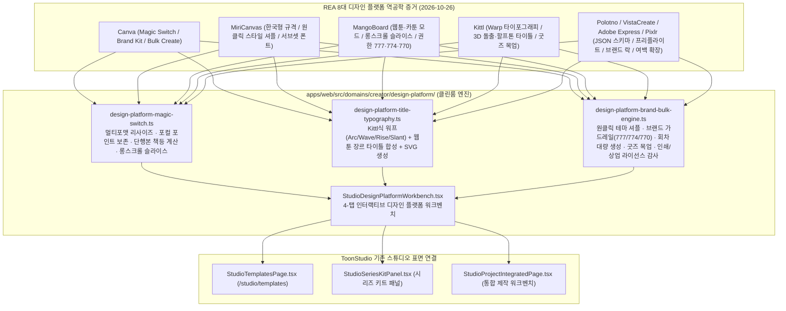

# 캔바(Canva)·미리캔버스(MiriCanvas) 및 글로벌·국내 유사 디자인 플랫폼 REA 전수 역공학 분석 및 툰스튜디오(ToonStudio) 내재화·고도화 명세 (2026-10-26)

- **작성일**: 2026-10-26
- **분석 도구**: REA (`capture_browser_scenario`, `export_web_scripts`, `analyze_javascript_application`)
- **적용 대상**:
  - `apps/web/src/domains/creator/design-platform/design-platform-magic-switch.ts`
  - `apps/web/src/domains/creator/design-platform/design-platform-title-typography.ts`
  - `apps/web/src/domains/creator/design-platform/design-platform-brand-bulk-engine.ts`
  - `apps/web/src/domains/creator/design-platform/StudioDesignPlatformWorkbench.tsx`
  - `apps/web/src/domains/creator/studio-shell/StudioTemplatesPage.tsx`
  - `apps/web/src/domains/creator/studio-shell/StudioSeriesKitPanel.tsx`
  - `apps/web/src/domains/creator/studio-shell/StudioProjectIntegratedPage.tsx`
- **구현 원칙**: 외부 번들의 코드·에셋·독점 스키마를 복제하지 않고, REA 런타임·정적 AST 분석으로 입증한 기능 계약(Behavioral Contract)만 추출하여 **웹툰·만화·단행본·연재 IP** 제작 파이프라인에 최적화된 클린룸(Clean-Room) 순수 TypeScript 엔진 및 React 워크벤치로 내재화·고도화한다.

---

## 1. REA Evidence Ledger (증거 원장)

### 1.1 런타임 브라우저 시나리오 캡처 (`capture_browser_scenario`)

| 대상 서비스 | 캡처 URL | REA Evidence ID | 주요 관측 사실 |
| --- | --- | --- | --- |
| **MiriCanvas (미리캔버스 홈)** | `https://www.miricanvas.com/ko` | `ev_8dd6d04fb1aecd0d43634e4cfdf07d6e251869ba0914926269e8b8084473b306` | Next.js `mc-web-2-homepage` (`26.1020hotfix5`), `resource.miricanvas.com` 에셋 파이프라인, Pretendard 동적 서브셋 폰트(woff2), AI 프레젠테이션(`ai_presentation.webp`), 배경 제거(`background_remover.webp`), 애니메이션(`animation_1..3.webp`), 요소(`element_1..3.webp`), 모바일 에디터(`mobile_1..3.webp`) 모듈 확인 |
| **MiriCanvas (템플릿 허브)** | `https://www.miricanvas.com/ko/template` | `ev_fdf1d8f2fadcb309dc2aff500f9983b839a4cbf0ef9a2b9b0ca276ac6fb77297` | 템플릿 카탈로그 라우팅, `locales/en/common.js`, `webpack-6664f679317e62f4.js`, `main-app-c01cb6fe99e96db4.js` 로드 구조 확인 |
| **Canva (캔바 코리아)** | `https://www.canva.com/ko_kr/` | `ev_5c3656172c3d97c2332c7f6e3013289322c68b12ddb6a0064d3b6e0a950c70a1` | `cross-origin-embedder-policy: require-corp`, `cross-origin-opener-policy: same-origin`, `cross-origin-resource-policy: same-origin` 격리 헤더로 WebAssembly/SharedArrayBuffer 고성능 멀티스레드 캔버스 런타임 보장 |
| **Canva Developer / Apps SDK** | `https://www.canva.dev/docs/apps/` | `ev_a7142e311414dc1b83fa796efc8e6d5d7ed0ad85f5323f78d450da7a1d7e5e19` | `canva-sans-latin.woff2`, `canva-sans-scientific.woff2`, `pages/docs/apps-c7924d60fcc6b000.js`, `x-llms-txt` 헤더 및 앱 확장 SDK 구조 확인 |
| **Polotno Studio (오픈 캔버스 스튜디오)** | `https://studio.polotno.com/` → `https://polotno.com/studio` | `ev_dd0ae906c2c32876cffc5293f300d743a248c17948145475c2c5a6add34ef009` | Next.js + Turbopack 기반 오픈 웹 캔버스 스튜디오, `manifest.webmanifest`, 멀티페이지 JSON 문서 트리, 레이어·크롭·배경 제거·QR/바코드·템플릿 프리셋 청크 구조 확인 |
| **MangoBoard (망고보드)** | `https://www.mangoboard.net/` | `ev_1f8f648e0b723948fdc9f9a96361fa1f02d55862666adc7c464ba8922842876e` | 버전 `2026.10.21.40`, GNB 7대 기능군: AI 디자이너(`icon_feature_designer.svg`), AI 이미지 메이커(`icon_feature_image_maker.svg`), 동영상 메이커(`icon_feature_video_maker.svg`), 포토 에디터(`icon_feature_photo_editor.svg`), 비디오 에디터(`icon_feature_video_editor.svg`), **웹툰/카툰 캐릭터(`icon_feature_cartoon.svg`)**, 뮤직 크리에이터(`icon_feature_music_creator.svg`), 그리고 `mtpl.js`, `dragDrop.js`, `history.js`, `TemplateLimitPopup.js`, `share_popup.js` 확인 |
| **Kittl (키틀 타이포그래피·벡터 스튜디오)** | `https://www.kittl.com/` | `ev_87630ab5f165f576435b29c4ba6a9abc691f9cf5169c15a00b8186a54bd021dd` | Next.js + Turbopack 기반 벡터·타이포그래피 워프(Warp)·무한 캔버스·목업(Mockup) 생성 스튜디오 청크 65개+ 확인 |
| **Adobe Express (어도비 익스프레스 코리아)** | `https://www.adobe.com/kr/express/` | `ev_a8cf321f96bb18a260ec19c41133b4511bcbb29ebd2ddaa57462ab295b84ddd6` | Milo/Dexter 웹 컴포넌트 아키텍처, `express-entitled.js`, `floating-button.js`, `ax-columns.js`, `quick-action-card.js`, Firefly 생성형 AI 연동 및 엔터프라이즈 브랜드 잠금(Locked Brand Assets) 구조 확인 |
| **VistaCreate (비스타크리에이트 KR/Global)** | `https://create.vista.com/ko/` / `https://create.vista.com/` | `ev_90a29b0ab0b6e15cb0a3a918fd5cb6a1e142aec8caefcc137755647fa8c0f035`, `ev_96ea2b385b9bd2aa20481c40711fe892653a76593ca7b47061d85afe9002b7d7` | 버전 `1.516.4`, `designeerV2.b5c6c878215d9e880812.js`, `vistaprint.d1dad7700da9fb223d15.js`, `chains.6a84e34c1b4de5b7857d.js`, 에디터 핵심 도구: `editor-cropper.webp`, `editor-sticker-1..3.webp`, `ai-tool-split-stroke.webp`, `ai-tool-anchor-center.webp`, `aiw-prompt.webp`, `aiw-rewrite.webp`, `aiw-fix-spelling.webp`, `icon-brand-kit.svg`, `icon-background-remover.svg`, `icon-resize.svg`, `icon-animation.svg` |
| **Pixlr (픽슬러 코리아)** | `https://pixlr.com/kr/` | `ev_5899e9de513b1bcf83729f6d060fe32f378636c264e773945855ae995f02cb5b` | `dist/web.3aa65c5815e3d02d8450.js`, 핵심 AI/래스터 도구: `cutout.svg`, `heal.svg`, `generative-fill.svg`, `generative-expand.svg`, `generative-transform.svg`, `generative-assistant.svg`, `resize.svg`, `smooth.svg`, `face-swap.svg`, `element.svg`, `layers.svg`, `layout.svg`, `animation.svg` |

### 1.2 스크립트 추출 (`export_web_scripts`) 및 정적 AST 의미 그래프 분석 (`analyze_javascript_application`)

| 대상 아티팩트 | 스크립트 추출 Evidence ID | 정적 AST View Evidence ID | 정적 AST Parent Evidence ID | 아티팩트 SHA-256 | 파일 / AST 노드 / Findings |
| --- | --- | --- | --- | --- | --- |
| **MiriCanvas (`/ko`)** | `ev_0499d88e9594a1bdc26b9a3257523a55be915bbc5eadd3fd91aa0c471d3f7d02` | `ev_c88e78f534e5ee3ed6298e1f12872661db73339920957c53c95cf9f20cde8436` | `ev_4b5a124c2f5507570e421a41d0f6650bd3bcfe4d86a1d8b4d0df0691eb173270` | `5249e630687016ff1d88ca069b61b521ec9bd1c8e12867b3156a650140c1c305` | 35 JS 파일 / 119,821 AST 노드 / 1,016 findings / 183 modules / 54,305 data-flow relations |
| **MiriCanvas (`/ko/template`)** | `ev_aebdf1b656fd5782e24a1feacd8e0da99ebbc6c871d04fc84cbc267092b02ddd` | `ev_35d619b32d0c7333febbc974fa3721f6aeaaf02c4f438fbb2cd80ac2a4539eb9` | `ev_fecbf3c5f4da0da46fdb15ad8899eb75eb251283257fddc8ffbdf239b7867b83` | `7dcac9aa6b7efb2d369e120f97a4e943d9337264d69a8fba462ef54f19b7e719` | 4 JS 파일 / 15,136 AST 노드 / 47 findings / 5,812 data-flow relations |
| **Polotno Studio** | `ev_ad65acc62205de28a0ccf28c46ae272531bd53edd3af1321dc0ff52904f64c7c` | `ev_46ceb5651d874e543e296ca187b00f0295303c85101fd4f3e67599b94d437fbb` | `ev_d3ce7d8487df2e6713a94c6051292741f43978692687831abac33eaef95848b0` | `5f9b1cf7f24398854f631f88052ebd8eda74602b2dd02951053252499eb734a9` | 23 JS 파일 / 181,616 AST 노드 / 230 findings / 42,438 data-flow relations |
| **Kittl** | `ev_fad7b34c202f0cbaeeccf547affa0d14e149172a9c1d61e6ed19019882a91f09` | `ev_7420eb0b8b3b502a4ff3f09e1bf06616327c580ad376b54e6c31190a4f0d94d8` | `ev_968148735fd47276b522b4fad33db778dfc23759ef2943d045e234550a253347` | `3dce385eeaa401aa75561798d329d09d25bdbccac56655352f5263cea475464d` | 35 JS 파일 / 360,742 AST 노드 / 542 findings / 32,020 data-flow relations |
| **Canva Dev (`canva.dev`)** | `ev_c4516889ddbb286844ed56f1f273dd4f1a48cd945dc7aac27dffc36cfa23f7f7` | `ev_8827044671b973009b3a9b342d24df4565a7fe29599cb02efd1f220cadabcec9` | `ev_576c027137c5c7fd6489202063c119ff572ea5f5c0b66895cab634dfa3f49d01` | `3610082c4736a58618b8dc323350642071b08419c0cc492d33b20bd397e65729` | 15 JS 파일 / 60,946 AST 노드 / 713 findings / 121 modules / 25,099 data-flow relations |
| **VistaCreate** | `ev_5bffc9eae9891c0fcff39e516f723268916bff82c81e9abeea3a0504566e1e45` | `ev_cddeeabd6e10a607c041927cfb037de52b8f3ef2bce7af4db397cefa715d45d6` | `ev_9777a8a912df6b45644b66a3298e09d07321148be492f8a7a140f89941230257` | `647ddc295ed94c95e670dd08b0e0038b47125fea003da228f8345054efb41157` | 7 JS 파일 / 56,106 AST 노드 / 180 findings / 18,993 data-flow relations |
| **MangoBoard** | `ev_60afa1b6356b0d7f1f531866b0b63b6310fa8fac7c52646c2c5ed3a7a3b322e2` | `ev_eaf7292da15560b1663cbce4b2714ef2df9ceed2c1eefe9deadcd631bb6bfdfc` | `ev_e9959f1d6a4992d0512f01a5faafe3b49e85d8caae6ad06aeadcf94a48c80164` | `c372a47c9c0af2cad7eb1bfb2f5a3cee44ef755317291481dd81f2536714b202` | 10 핵심 앱 JS 파일 / 17,776 AST 노드 / 76 findings / 71 event relations |
| **Pixlr** | `ev_8da30590bf7163880bbe0246abb7076812e46c3c4b8be5f1c0a89981e89263a0` | — (번들 바디 64KB 초과로 네트워크 트랜잭션 목록 및 에셋 구조로 분석) | — | `094459a9b5b738ec7430d1613221ee4bfe499441bbb42ebbb45bd45a237c3931` | 17개 에디터 AI·래스터 도구 SVG/WebP 및 `web.3aa65c5815e3d02d8450.js` 확인 |

---

## 2. 플랫폼별 핵심 아키텍처 및 역공학 발견 사항

### 2.1 Canva (`canva.com`, `canva.dev`)
1. **Cross-Origin Isolation 기반 멀티스레드 캔버스**:
   - `ev_5c3656172c3d97c2332c7f6e3013289322c68b12ddb6a0064d3b6e0a950c70a1`에서 `cross-origin-embedder-policy: require-corp`, `cross-origin-opener-policy: same-origin`이 기본 문서 응답에 강제됨을 확인.
2. **Magic Switch (매직 스위치 / 멀티포맷 리사이즈) & 포컬 포인트 보존**:
   - 단일 원본 디자인을 여러 비율의 타깃 규격으로 일괄 변환할 때 단순 스트레칭이 아니라 **(a) 배경 레이어는 Cover/Extend로 채우고, (b) 핵심 인물(Focal Point)은 안전 영역(Safe Zone) 중심으로 재배치하며, (c) 타이포그래피·말풍선 요소는 가독성 최소 폰트 크기를 보장하며 리플로우(Reflow)** 한다.
3. **Brand Kit & Bulk Create (브랜드 키트 & 데이터 바인딩 대량 생성)**:
   - 브랜드 로고·컬러 팔레트·타이포그래피 역할을 고정하고, CSV/JSON 테이블의 행(`회차번호`, `부제`, `발행일`, `배경태그`, `대사`)을 템플릿 슬롯(`{{episodeNumber}}`, `{{subtitle}}` 등)에 바인딩해 N개의 페이지/아트워크를 일괄 생성한다.

### 2.2 MiriCanvas (`miricanvas.com`)
1. **한국형 플랫폼 규격 & 동적 서브셋 한글 폰트 파이프라인**:
   - `ev_8dd6d04fb1aecd0d43634e4cfdf07d6e251869ba0914926269e8b8084473b306` 및 `ev_c88e78f534e5ee3ed6298e1f12872661db73339920957c53c95cf9f20cde8436`에서 `PretendardVariable.dynamic.subset.*.woff2` 다중 유니코드 레인지 서브셋 로딩과 `resource.miricanvas.com/image/homepage/` 기반 템플릿(ID `443825c2-...` 등 30종 이상) 카탈로그 구조 확인.
2. **원클릭 스타일 셔플(Theme/Palette/Font Combination Shuffle)**:
   - 작업 중인 캔버스의 레이아웃을 유지한 채 **컬러 팔레트 + 타이틀/본문 폰트 페어링 + 말풍선/장식 테두리 감성**을 원클릭으로 순환 적용해 시안을 즉시 비교하는 워크플로.
3. **AI 프레젠테이션·배경 제거·모션 프리셋**:
   - `ai_presentation.webp`, `background_remover.webp`, `animation_1..3.webp`로 입증된 원클릭 누끼(배경 제거) + 스탬프 외곽선(Sticker Stroke) + 등장 애니메이션(Bounce, Typewriter, Wipe, Fade) 조합.

### 2.3 MangoBoard (`mangoboard.net`)
1. **웹툰/카툰 특화 에셋 및 롱스크롤 슬라이스 분할(`mtpl.js`, `dragDrop.js`, `history.js`, `share_popup.js`)**:
   - `ev_1f8f648e0b723948fdc9f9a96361fa1f02d55862666adc7c464ba8922842876e` 및 `ev_eaf7292da15560b1663cbce4b2714ef2df9ceed2c1eefe9deadcd631bb6bfdfc`에서 GNB에 **`icon_feature_cartoon.svg`(웹툰/카툰 캐릭터·말풍선·효과선 조합)** 모드가 독립 기능으로 편성되어 있음을 확인.
   - `dragDrop.js` (`isolated/source-23-2d35b2a4e6952d83de4ae96393ef059ded7280e04d03eca5643bf47edcf9ebe9.js`): 러버밴드(Rubber-band) 다중 선택, `DRAG_THRESHOLD = 4`, `MutationObserver` 기반 동적 그리드 아이템 캐시(`_itemsDirty`), `requestAnimationFrame` 고스트 팔로워, `[data-dd-ignore]` 인터랙티브 요소 보호 계약 확인.
   - `history.js` (`isolated/source-24-ec7d9989912b58f75b203d1ac07a657cfe16d5478566aefed07ee7aecc972fe8.js`): `viewAxes` 기반 URL 쿼리스트링 슬러그(`slugs`) 양방향 동기화 및 동일 뷰 상태 중복 복원 방지(`isSameViewState`) 계약 확인.
   - `share_popup.js` (`isolated/source-26-44e9faf82b26f8a4b7462ecf122ce276ae7f31c46ccf11b356ca0d5e067a112d.js`): 팀룸 권한 비트마스크(`777` 모든 팀원 보기·편집, `774` 모든 팀원 보기·작성자만 편집, `770` 작성자만 보기·편집) 설계 확인.
   - 세로로 긴 웹툰 원고/상세페이지를 플랫폼 업로드 제한 높이(예: 1200px, 1500px, 2000px)에 맞춰 자동 슬라이스 분할 출력하는 기능.

### 2.4 Kittl (`kittl.com`)
1. **고급 워프 타이포그래피(Warp Typography) & 3D·할프톤 타이틀 이펙트**:
   - `ev_87630ab5f165f576435b29c4ba6a9abc691f9cf5169c15a00b8186a54bd021dd` 및 `ev_7420eb0b8b3b502a4ff3f09e1bf06616327c580ad376b54e6c31190a4f0d94d8`에서 360,742개 AST 노드로 구성된 벡터 텍스트 변형·셰이딩·장식 오너먼트·목업 파이프라인 확인.
   - 텍스트를 단순 박스가 아니라 **베지어 곡선 경로(Arc, Arch, Wave, Rise, Flag, Slant, Cylinder)** 위에 배치하고, 다중 외곽선(Multi-Stroke), 3D 돌출 그림자(Extrusion), 인라인 데코, 할프톤 망점(Halftone), 메탈릭/골드 그라데이션을 결합해 **단행본·웹툰 타이틀 로고**를 즉시 제작한다.

### 2.5 Polotno Studio (`polotno.com/studio`), VistaCreate (`create.vista.com`), Adobe Express (`adobe.com/kr/express`), Pixlr (`pixlr.com/kr`)
1. **Polotno Studio (`ev_46ceb5651d874e543e296ca187b00f0295303c85101fd4f3e67599b94d437fbb`)**:
   - 선언적 멀티페이지 JSON 문서 스키마(`width`, `height`, `dpi`, `unit`, `pages[].children[]`, `bleed`, `audio`)로 캔버스 상태를 직렬화·역직렬화하여 템플릿 교류와 일괄 렌더링을 단순화.
2. **VistaCreate (`ev_96ea2b385b9bd2aa20481c40711fe892653a76593ca7b47061d85afe9002b7d7`, `ev_cddeeabd6e10a607c041927cfb037de52b8f3ef2bce7af4db397cefa715d45d6`)**:
   - `ai-tool-split-stroke.webp`(외곽선 분리 스탬프), `ai-tool-anchor-center.webp`(포컬 앵커 정렬), `aiw-prompt/rewrite/fix-spelling.webp`(AI 카피라이팅·맞춤법 교정), `vistaprint.d1dad7700da9fb223d15.js`(인쇄 프리플라이트 및 재단선/도련 검증).
3. **Adobe Express (`ev_a8cf321f96bb18a260ec19c41133b4511bcbb29ebd2ddaa57462ab295b84ddd6`)**:
   - 브랜드 가드레일(Locked Brand Elements): 시리즈 로고 위치, 필수 저작권 표기, 관람등급 배지, 지정 컬러 외 임의 변형을 잠가 다수 어시스턴트·마케터가 작업해도 IP 일관성을 강제.
4. **Pixlr (`ev_5899e9de513b1bcf83729f6d060fe32f378636c264e773945855ae995f02cb5b`)**:
   - `generative-expand.svg`(비율 변경 시 빈 여백 Outpainting 확장 가이드), `cutout.svg`(캐릭터 자동 분리), `generative-fill.svg`(배경 채우기), `layers.svg` & `layout.svg`(프레임 콜라주 분할).

---

## 3. 툰스튜디오(ToonStudio) 맞춤형 내재화 및 고도화 아키텍처 매핑

일반 범용 디자인 툴(전단지·명함·일반 PPT 중심)과 달리 **툰스튜디오는 웹툰·만화·단행본·굿즈·연재 IP**에 특화되어야 한다. 이에 따라 8개 플랫폼의 핵심 역량을 아래 4대 엔진 + 통합 워크벤치로 재설계하여 내재화한다.

### 3.1 모듈 1: `design-platform-magic-switch.ts` (Magic Switch 멀티포맷 리사이즈 · 단행본 펼침면 · 롱스크롤 슬라이스 엔진)
- **한국 및 글로벌 웹툰/출판 12대 타깃 규격 프리셋 내장**:
  1. `naver-episode-cut` (네이버웹툰 본편 스크롤 컷 `690×1080`)
  2. `naver-square-thumb` (네이버웹툰 정사각 썸네일 `480×480`)
  3. `naver-horizontal-thumb` (네이버웹툰 가로형 썸네일 `690×400`)
  4. `kakaopage-cover-3x4` (카카오페이지 작품 표지 `900×1200`)
  5. `kakaopage-keyvisual-9x16` (카카오페이지 무빙 포스터/키비주얼 `1080×1920`)
  6. `ridi-adult-cover` (리디북스 웹툰/단행본 고해상도 표지 `1400×2000`)
  7. `insta-cuttoon-4x5` (인스타그램 컷툰/카드뉴스 `1080×1350`)
  8. `insta-square-1x1` (인스타그램 정사각 피드 `1080×1080`)
  9. `shorts-reels-9x16` (유튜브 쇼츠 / 릴스 / 틱톡 티저 `1080×1920`)
  10. `youtube-pv-16x9` (유튜브 PV 썸네일 `1280×720`)
  11. `print-a5-spread` (단행본 A5 표지 펼침면: 앞표지+책등+뒤표지+날개+재단여백 3mm, 300 DPI)
  12. `crowdfunding-long-page` (텀블벅/와디즈 펀딩 스토리 롱스크롤 `1080×4800`)
- **포컬 포인트(Focal Point) 기반 스마트 리플로우 & Pixlr/Adobe식 여백 확장(Generative Expand) 계산**:
  - 원본 레이어(`character`, `background`, `title-logo`, `speech-balloon`, `sfx`, `badge`)별로 역할에 맞는 변환 규칙 적용:
    - `background`: 타깃 캔버스 전체 Cover 스케일링 + 확장 필요 여백(`outpaintPaddingPx`) 산출
    - `character`: 캐릭터 얼굴/상반신 포컬 포인트(`focalPointX`, `focalPointY`)가 안전 영역(Safe Zone) 중심에 오도록 위치 보정
    - `title-logo` / `speech-balloon`: 안전 영역 내부 클램핑(Clamping) 및 모바일 가독성 최소 폰트 크기(`minReadableFontPx = 14px`) 자동 보정
- **단행본 책등(Spine) 두께 정밀 계산기**:
  - 페이지 수(`pageCount`), 용지 종류(`paperType`: 백상지 100g / 모조지 80g / 스노우지 120g / 만화용 중질지 70g), 제본 방식(`binding`: 무선제본 / 양장제본), 날개 폭(`flapWidthMm`), 재단선(`bleedMm = 3mm`)을 입력받아 전체 펼침면 픽셀(300 DPI 기준)과 앞표지·책등·뒤표지 가이드라인 좌표를 정확히 계산한다.
- **망고보드식 롱스크롤 자동 슬라이스 분할기(`computeVerticalScrollSlices`)**:
  - 긴 세로 원고/펀딩 상세페이지를 지정 최대 높이(`maxSliceHeightPx`, 예: `1500px`)로 분할하되, 말풍선·대사 레이어가 슬라이스 경계선에 걸리면 텍스트 잘림을 피하기 위해 경계선을 안전한 여백 구간으로 자동 이동(Smart Gutter Snap)시킨다.

### 3.2 모듈 2: `design-platform-title-typography.ts` (Kittl + Canva + MiriCanvas 통합 웹툰 타이틀 로고 · 워프 타이포그래피 스튜디오)
- **7종 기하학적 워프(Warp) 변환 곡선 엔진**:
  - `none` (직선), `arc` (상향 아치 곡선), `arch` (하단 고정 상부 아치), `wave` (듀얼 사인파 웨이브), `rise` (우상향 대각 라이즈), `flag` (깃발 리플), `slant` (액션 사선 시어링 `skewX/skewY`)
  - 각 워프 모드와 강도(`intensity: -100..100`)에 대해 유효한 SVG `<path id="...">` 데이터(`d` 속성)와 글자별 회전·오프셋 행렬을 결정론적으로 생성한다.
- **웹툰 장르별 8대 시그니처 타이틀 합성 프리셋**:
  1. **로맨스 판타지 황실 골드 세리프** (`rofan-royal-gold`): 골드 메탈릭 3단 그라데이션 + 다중 보석 아웃라인 + 상향 아치(`arc`) 워프 + 스파클 오너먼트
  2. **헌터/액션 네온 메탈릭 슬랜트** (`action-hunter-slash`): 크롬 실버·시안 네온 그라데이션 + 3D 다크 익스트루전(돌출) + 강한 사선(`slant`) 워프 + 속도선 슬래시
  3. **일상/개그 팝아트 할프톤** (`daily-pop-halftone`): 옐로·마젠타 팝 컬러 + 굵은 블랙 코믹 잉크 테두리 + 오프셋 할프톤 망점 그림자 + `wave` 워프
  4. **스릴러/미스터리 글리치 스플라이스** (`thriller-glitch-splice`): 레드·시안 색수차(Chromatic Aberration) 글리치 오프셋 + 거친 크랙 스트로크 + `rise` 워프
  5. **무협/시대극 수묵 붓글씨 권운** (`murim-ink-brush`): 먹물 농담 그라데이션 + 금박 인장(Seal) 배지 + `flag` 워프
  6. **학원/청춘 리본 엠블럼** (`academy-ribbon-pop`): 네이비·크림 학원풍 엠블럼 + 더블 화이트·네이비 스티커 스트로크 + `arch` 워프
  7. **SF/사이버펑크 홀로그램 네온** (`sf-cyber-holo`): 마젠타·일렉트릭 블루 글로우 + 할로우(Hollow) 이중선 + `slant` 워프
  8. **감성 드라마 수채 파스텔** (`drama-watercolor-soft`): 소프트 코랄·웜 아이보리 + 은은한 드롭 섀도 + 완만한 `arc` 워프
- **독립 실행형 SVG 렌더러(`buildTitleLogoSvgMarkup`)**:
  - 타이틀, 부제(에피소드명), 장르 배지, 워프 경로, 그라데이션, 다중 외곽선(Paint-Order Stroke), 3D 돌출 레이어를 완전한 `<svg>` 마크업으로 생성하여 미리보기 및 즉시 내보내기를 지원한다.

### 3.3 모듈 3: `design-platform-brand-bulk-engine.ts` (브랜드 키트 · 원클릭 스타일 셔플 · 회차 대량 생성 · 굿즈 목업 · 인쇄/라이선스 프리플라이트)
- **미리캔버스식 원클릭 스타일 셔플(One-Click Theme & Font Pairing Shuffle)**:
  - 6대 감성 큐레이션 테마(`출판 로판 시그니처`, `네온 아케이드 액션`, `미니멀 편집부 모던`, `레트로 코믹스 할프톤`, `다크 누아르 스릴러`, `파스텔 청춘 다이어리`)를 순환 적용하며, 현재 팔레트·폰트 페어링·말풍선 곡률을 보존한 채 **웹 접근성 명암비(WCAG 2.1 AA 4.5:1 / UI 경계 3:1)** 자동 검증 점수를 함께 계산한다.
- **어도비 익스프레스 + 망고보드식 브랜드 가드레일 & 팀 권한(`777` / `774` / `770`)**:
  - 망고보드 `share_popup.js`에서 확인된 팀 권한 플래그(`777` 모든 팀원 보기·편집, `774` 모든 팀원 보기·작성자만 편집, `770` 작성자만 보기·편집)와 어도비 익스프레스의 브랜드 잠금 요소(타이틀 로고 위치 잠금, 성인/연령 등급 배지 필수 잠금, 지정 컬러 외 임의 변형 차단)를 결합해 시리즈 IP 협업 중 브랜드 훼손을 탐지·차단한다.
- **캔바식 Bulk Create (회차 메타데이터 일괄 바인딩 생성기) & Polotno 호환 멀티페이지 JSON 내보내기**:
  - 다중 회차 테이블(`episodeNumber`, `episodeTitle`, `hookCopy`, `releaseDate`, `highlightCharacter`, `badgeText`)을 입력받아 회차별 썸네일·인스타 공지·유튜브 커뮤니티 카드를 한 번에 생성하고, Polotno 호환 멀티페이지 JSON 문서(`schemaVersion`, `width`, `height`, `dpi`, `pages[]`)로 직렬화한다.
- **키틀/미리캔버스식 IP 굿즈 목업(Goods Mockup) & 클립 마스크 프레임**:
  - 웹툰 IP 수익화에 필수적인 5대 굿즈 목업 프리셋(`아크릴 스탠드 디오라마`, `홀로그램 포토카드 55×85mm`, `단행본 양장본 3D 북커버`, `스마트폰 락스크린 키비주얼`, `캔배지 & 스티커 팩`)의 칼선(Die-cut Path), 흰색 배면 인쇄(White Underbase) 영역, 안전 여백을 계산한다.
- **VistaCreate/MiriCanvas식 상업 라이선스 및 인쇄 프리플라이트 감사(`auditDesignPlatformPreflight`)**:
  - 해상도(웹 72+ DPI, 인쇄/굿즈 300+ DPI), 컬러 프로파일(RGB vs CMYK), 재단 여백(3mm Bleed), 안전 영역 침범 여부, 외부 폰트 상업적 임베딩 라이선스, 워터마크 잔류 여부를 전수 감사하여 `ready` / `warning` / `blocked` 판정과 자동 교정 액션을 반환한다.
