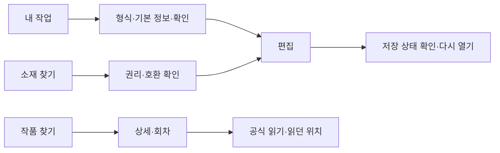

# 모바일 우선 재구성의 적용·구현 계획 — 2026-11-12

상태는 **migration**이다. 화면의 목적과 기능을 함께 재구성하되, 이미 진행한 구현과 조사에서 이어간다. 이 문서는 선택한 디자인을 어떤 경로·컴포넌트·검증에 연결할지 정한다. 버전별 결과와 18개 화면군의 개별 상태는 [상태표](status-matrix.md), 공유한 이미지와 출처는 [아카이브 안내](README.md)를 따른다.

기준 실제 번들은 `57bee8c191e2f87f17c3c9687cee16a0197fd15a` / `aead678b8310`이다. 별도 작업본의 후속 단위 검증 통과와 새 통합 번들의 실행 성공은 구분한다. 웹 441주소·1,323개 정적 이미지는 별칭·동적 표본과 레이아웃 재사용을 포함한 설계 범위다. 독립 화면 441개나 사용 과업 1,323개의 성공 수로 읽지 않는다. 추가 앱·도구 29개 제안도 아직 구현 완료가 아니며, 그 안의 실험 화면 13개는 운영 미배포다.

후속 44파일 통합분은 14개 suite·224개 단위 검사 통과 기록을 확보했다. 이후 사용자용 문구 조정과 새 통합 번들의 빌드·실제 화면·동선 검증은 별도 대기 상태다. 기준 번들의 관측을 후속 변경의 실제 실행 결과로 승계하지 않는다.

## 하나의 목적에서 다음 행동까지

재구성의 중심은 **현재 작업을 이어 주는 화면**이다. 첫 화면은 작업이 있으면 실제 최근 원고와 이어서 작업하기를, 없으면 새 작업을 앞세운다. 작품은 표지와 읽던 위치, 소재는 미리보기와 적용 조건을 보여 준다. 장식 이미지보다 판단에 쓰이는 이미지를 우선하고, 큰 이미지가 도구·검색·저장을 아래로 밀어내면 카드 크기와 배치를 줄인다. 이미지 로딩에 실패해도 제목과 행동은 남긴다.

상위 모바일 목적지는 **내 작업 `/studio` · 작품 찾기 `/discover` · 소재 찾기 `/market` · 내 정보 `/my`**다. `site-navigation.ts`, `site-mobile-purpose.ts`, `site-route-authority.ts`를 기준으로 이름·정본 주소·현재 위치를 계산한다. 화면마다 같은 목적지를 다른 말로 다시 정의하지 않는다. 관리자 업무는 일반 창작·감상 메뉴와 분리하고 기존 경로 가드와 서버 권한 검사를 유지한다. 메뉴 숨김은 접근 제어를 대신하지 않는다.

Workspace는 현재 작업 문맥을 가진 기존 5항목을 유지하는 예외다. 일반 모바일 4목적과 같은 목록이라고 표시하지 않는다. 작업 홈·내 작업·작품 찾기·커뮤니티와 유틸리티인 전체 메뉴를 유지하면서, 전체 메뉴는 공통 drawer와 설정·음악 동작을 공유한다. `WorkspaceMenuNavigation`은 열림 상태와 초점만 소유하고 문서·프로젝트 선택·권한은 기존 소유자에 둔다. 메뉴 청크가 준비되지 않으면 기존 전체 기능 링크와 음악 진입점을 남긴다. 실제 대체 진입점이 있을 때만 떠 있는 음악 버튼을 생략한다.

일반 셸의 모바일·태블릿 탐색은 기존 1180px 경계를, Workspace 하단 탐색과 drawer는 기존 768px 경계를 사용한다. PC의 사이드바와 제작 바로가기는 보존한다. 태블릿 768·1024px에서는 두 탐색이 겹치지 않는지, 현재 위치가 일관되는지, 본문 끝과 첫 행동이 고정 메뉴에 가려지지 않는지를 확인한다. 공통 셸과 작업 셸의 차이는 명시된 예외로 관리하며 화면별 임의 분기를 늘리지 않는다.

목적이 바뀌면 페이지를 나누고, 같은 작업의 입력은 단계로 나눈다. 감상에서 편집, 계정에서 운영으로 이동할 때는 목적지와 돌아갈 경로를 드러낸다. 형식·이름·확인은 기존 `/studio/new`의 한 작업으로 유지한다. 게시·학습처럼 이미 단계 query 계약이 있는 곳은 해당 query를 사용한다. 새 URL을 만드는 것만으로 간소화했다고 판단하지 않는다. 단계 뒤로 가기는 입력·선택·문맥을 유지하며, 페이지 복귀는 검색 조건·스크롤·초점을 함께 복원한다. 시안의 `design:` 주소는 계획용 식별자이며 실제 라우터 연결을 뜻하지 않는다.

## 기능과 디자인을 함께 연결하는 범위

| 과업과 선택한 화면 구성 | 구현 연결 | 현재 증거와 다음 완료 조건 |
| --- | --- | --- |
| **시작→편집→저장→재접속**: 최근 원고, 간결한 형식 카드, 3단계 입력, 캔버스와 핵심 4도구, 한 곳의 더보기 | `StudioProjectLibraryResumeCard`, `StudioCreateChoiceSteps`, `StudioCreateStepFlow`, `StudioDrawingClarity*`, `StudioFormalSaveDialog` | 기준 번들에서 생성·Back·획·Undo/Redo와 기기 복구 저장·재접속의 조건별 증거를 확보했다. 후속 형식 카드·첫 CTA·저장 창은 새 번들에서 다시 비교한다. 임시 복구 저장, 파일 선택, 실제 다운로드, 클라우드 보관을 나누고 실제 완료 시간·대상만 표시한다. 현재 headless 파일 선택 거부는 정식 저장 성공으로 처리하지 않는다. |
| **작품 찾기→상세→회차·공식 읽기**: 검색과 결과를 먼저, 다른 찾기 방법은 이름 있는 보조 영역 | `DiscoverHubPage`, `SearchPage`, `TitleCard`, `TitleDetailPage`, `TitleReaderPage`, `RouteScrollRestoration` | 기준 번들의 390px 한 조건에서 Back 후 카드 초점 누락을 확인했다. 후속 초점 키·compact header·선택 metadata 부재 처리는 관련 60단위 검사를 통과했다. 새 번들에서 첫 결과 위치, query·필터·스크롤·초점, 공식 읽기·이전/다음 회차를 확인한다. 공식 링크 확인은 외부 회차 완주 증거와 구분한다. |
| **소재 찾기→권리·호환 확인→현재 원고 적용**: 미리보기·검색·필터·현재 작업 문맥 유지 | `ResourceSearchPage`, `ResourceSearchHeader`, `MarketBrowsePage`와 기존 가져오기·작업 전달 경로 | 정본 자료 출처와 기존 적용 계약을 재사용한다. 허용된 무료·내장 표본의 실제 선택·적용·저장 복원과 자료별 실패 처리를 확인한다. 라이선스 미확인을 사용 허가로 바꾸지 않고, 전달 링크를 실제 반입 성공으로 표시하지 않는다. |
| **게시 정보 준비**: 실제 작품 선택→정보·채널→준비 파일 | `PublishCenterPage`, `SerialCenterOverview`, `PublishPreparedFiles`, `publish-center.css` | 로컬 fixture 기준 3폭에서 입력·Back·503 재시도와 JSON 6개 다운로드를 관측했다. fragment 소실과 44px CTA 목표 차이는 별도 후속으로 고쳐 관련 39검사를 통과했다. 작품 선택의 중복 제목도 줄였다. 새 번들에서 hash·history.state·48px·산출물 영향을 다시 확인한다. 두 API 요청 본문은 유지하며 JSON 준비·예약 계획·실제 외부 게시를 구분한다. |
| **학습 목표→한 과제→자가 확인**: 결과와 시작 행동을 먼저, 참고 자료는 다시 찾을 수 있게 제공 | `LearnContent`, `LessonSession`, `LessonReference`, `use-lesson-step.ts` | 기준 번들의 과제·메모·Back·복원·저장 실패/재시도는 수행했고 33/36과 CTA 가림·크기 차이를 남겼다. 후속 배치·48px 수정의 단위 결과와 별개로 새 번들의 실제 bbox·터치·동일 목표 상태를 확인한다. 숨긴 예제의 실행은 멈추되 메모·실험값은 보존한다. |
| **가상 작업실의 선택·이동·포즈·재진입**: 장면과 현재 선택, 필요한 조작 우선 | `StudioVirtualSpacePage`, 기존 avatar·위치 저장 함수, 캐릭터·장면 소비 코드 | 아바타 선택·위치 쓰기의 실패 반환값 처리와 사용자 안내는 후속 범위다. 실패 때 완료 배지를 만들지 않고 현재 선택과 마지막 기록을 구분해 재시도를 제공한다. 이동 중 반복 알림은 억제한다. 기존 atlas 방향·프레임·anchor 규격과 정상 자산을 보존하며 캐릭터·3D 품질은 실제 움직임·배치·저장 복원으로 검증한다. |

위 연결의 주요 소스는 저장소 기준 `apps/web/src/domains/creator/studio-shell/`, `apps/web/src/domains/creator/studio-cuttoon-editor/`, `apps/web/src/domains/creator/save-first/`, `apps/web/src/domains/catalog/`, `apps/web/src/domains/creator-resources/`, `apps/web/src/domains/market/pages/`, `apps/web/src/domains/integrations/`, `apps/web/src/domains/learn/`에 있다. 공통 메뉴·초점은 `apps/web/src/shared/components/`와 `apps/web/src/app/RouteScrollRestoration.tsx`가 연결한다. 실제 운영자 경계는 `apps/web/src/app/routes/groups/admin.routes.tsx`와 독립 `apps/admin-web/src/app/`를 함께 확인한다.

## 시각 규칙과 구현 경계

색·타이포·간격·카드·폼·버튼·빈 상태·오류·포커스는 공통 토큰을 사용한다. 밝은 보라·청록 시안의 대조 테마는 **Aurora**다. Paper와 Aurora는 서로 다른 팔레트다. 기존 기본값 Starlight와 사용자가 고른 사이트/Studio 선호는 보존한다. 9개 테마는 `aurora`, `blossom`, `starlight`, `dark`, `light`, `graphite`, `midnight`, `sepia`, `contrast`다.

별도 작업본의 팔레트 정리는 **테마당 13개 `--ui-palette-*` 원시색 변수, 총 117값**을 정본화한 것이다. 정적 시안의 재사용 레이아웃 13개와 다른 수치다. 선정된 computed 비교 73,728건의 값 동일성과 관련 97단위 검사는 색값 보존 근거이며 새 화면의 전체 접근성 성공 수는 아니다. 본문·주 버튼 4.5:1, 필수 경계 3:1과 기존 고대비 검사의 7:1 기준을 낮추지 않는다. UI 팔레트는 원고 색·캔버스 픽셀·내보낸 이미지에 적용하지 않는다.

모바일 주요 행동은 실제 48px 이상, 분명한 이름, 보이는 초점을 기준으로 한다. 첫 화면에서 핵심 목적과 다음 행동을 알 수 있어야 하고, 큰 글자·320px·짧은 높이·키보드 입력 중에도 내용을 스크롤해 끝까지 사용할 수 있어야 한다. 고정 CTA와 하단 탐색은 안전 영역과 본문 여백을 공유한다. 접은 영역은 결과·목적을 이름으로 쓰고, 닫기·Escape 뒤 원래 조작 지점으로 돌아간다. PC의 조작 크기·배치는 과업에 맞게 유지하면서 확인된 주요 CTA의 48px 목표를 적용한다.

풍부함은 실제 표지·최근 원고·소재 미리보기·선택된 장면으로 만든다. 첫 방문 미디어는 제한하고 표지는 기존 `TitlePoster`·`coverGridPriority` 정책을 재사용한다. 무거운 편집·3D·특수 도구는 사용 의도 시점에 불러온다. SW critical 예산 `2544 × 1024B`와 warm 예산 `512 × 1024B`는 유지한다. 기준 번들의 critical 실측 2,605,005B는 여유가 작으므로 새 통합 Vite 빌드로 다시 확인한다. 용량 검사를 통과시키기 위해 필수 오프라인 의존성을 제외하지 않는다.

모션 감소 설정에서는 장식 전환·상시 움직임을 줄이고 조작 결과를 즉시 식별할 수 있게 한다. 로딩은 준비 중인 대상과 가능한 행동을, 오류는 유지된 입력과 재시도·돌아갈 위치를 보여 준다. 저장 실패를 감추거나 placeholder·가짜 선택기·미연결 자동화로 성공 화면을 만들지 않는다. 초기 로딩 종료를 기다리는 QA 보정과 실제 가림·잘못된 초점·작은 타깃 수정도 별도로 기록한다.

## 적용 순서와 출하 기준

1. **핵심 모바일부터 고정한다.** 드로잉·새 작업·저장·재접속, 검색·공식 읽기, 소재 적용의 확인된 막힘을 먼저 고친다. 단계·이름·실제 데이터·기존 API 요청과 저장 소유권을 유지하며, 실제 기능 개선과 시각 충실도를 각각 검증한다. 기준 `57bee8c…`의 실행 결과를 후속 작업본의 단위 통과와 합쳐 새 번들 성공으로 만들지 않는다.
2. **공통 메뉴와 토큰을 통합한다.** Workspace drawer·음악 가림·초점 복귀·역할별 운영 경계, 팔레트 정본·타깃·포커스를 한 담당이 조율한다. 파일 담당별 preimage를 대조해 기존 작업과 사용자 변경을 보존한다. 통합된 정확 SHA에서 타입·관련 회귀·빌드를 실행하고 미리보기의 HTML·entry·CSS가 그 빌드와 같은지 확인한다.
3. **같은 조건의 시안·구현을 대조한다.** 새 첨부 기준인 390×844·834px 태블릿·1440×1000의 Starlight와 동일 상태를 기본 쌍으로 삼고 320px·기존 768px·Aurora·고대비·모션 감소를 보완한다. 기존 Aurora 제안은 해당 팔레트와 비교한 역사 근거로 보존한다. 빈 상태·실제 자료 있음·오류를 나누고 작품 내용·이력·선택 단계가 다르면 차이를 적는다. 레이아웃·색·간격·타이포·이미지뿐 아니라 실제 클릭·Tab·Escape·Back·저장·복구를 실행한다. 자동 접근성 0과 초보자 과업 성공은 별도 판정한다.
4. **잔여 화면군과 앱으로 넓힌다.** 기존 18개 화면군 원장에 기능·콘텐츠·역할별 과업을 연결해 아직 복잡한 곳부터 같은 규칙을 적용한다. 운영 업무·쇼츠 실제 Android 재생·가상 공간·Native/Desktop·DCC·추가 앱 29개 제안은 각자의 권한·실행 환경에서 검증한다. 실험 앱은 운영 배포에 섞지 않는다. 전면 재구성 허용 범위 안에서도 검증된 기능을 지우거나 조사·시안 수만 늘려 완료로 표시하지 않는다.

출하는 필수 검사·현재 main과 충돌 조율을 마친 뒤 기존 운영 배포의 SHA와 진행 상태를 먼저 확인한다. 동일 변경이 배포됐거나 진행 중이면 다시 배포하지 않는다. 인증·권한·무료 사용 범위가 확인된 기존 승인 경로만 사용하며, 현재 부족한 Cloudflare 인증은 우회·비밀 복사로 해결하지 않는다. main 반영, 빌드, 실제 프런트 배포, 운영 핵심 흐름·API 확인을 각각 기록한다. API live/ready 200만으로 최신 프런트 반영을 판정하지 않는다.

실패하면 해당 변경 묶음과 원본 증거를 보존하고 정상 버전으로 복구할 수 있게 한다. UI 회귀는 논리 단위의 일반 revert로 다루며 사용자 원고·설정·임시 작업본을 삭제하지 않는다. 이미 배포했다면 기존 정책의 정상 정적 웹 버전으로 복구하고 다시 확인한다. 원래 정상 자산·브랜치·작업본은 병합과 복구 가능성을 확인하기 전 정리하지 않는다.

## 사용자에게 보여 줄 정보와 완성도 판정

기본 화면에는 사용자가 판단할 **현재 상태·다음 행동·저장 범위·실패와 복구·이용 조건**을 쉬운 말로 보여 준다. OPFS·SQLite·Rights BOM 같은 내부 구현·진단 용어와 배지는 목적이 드러나는 상세 영역이나 기술 문서로 옮긴다. 저장 실패나 소재의 권리·호환 조건은 계속 가까이 두고, 상세 정보로 가는 이름과 위치를 남긴다. 모바일에서는 목적이 다른 일을 별도 화면으로, 같은 과업은 짧은 단계로 제공하며 Back 뒤 입력·선택·작업 문맥을 유지한다.

100점 목표는 시각 일관성, 설명 없이 수행하는 핵심 동선, 실제 기능과 산출물, 모바일 터치·가림, 키보드·대비, 저장 실패·복구의 **각 실측 통과 조건**으로 관리한다. 미확인 조건은 미완료로 남기고 실측 전에 100점이나 전 페이지 완료를 선언하지 않는다.
