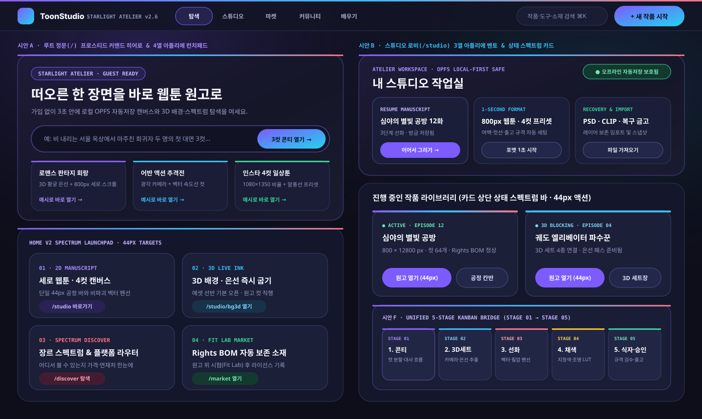
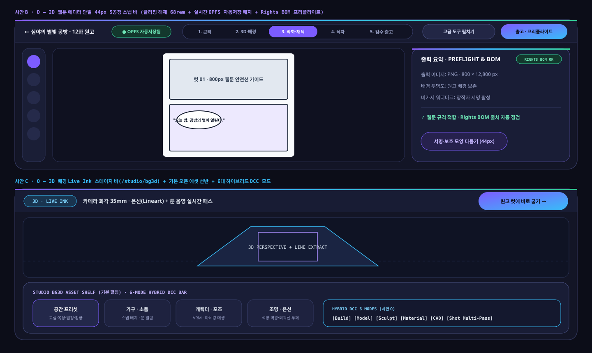
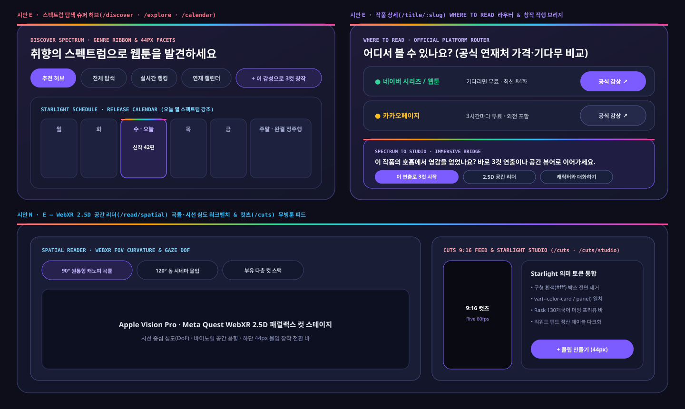
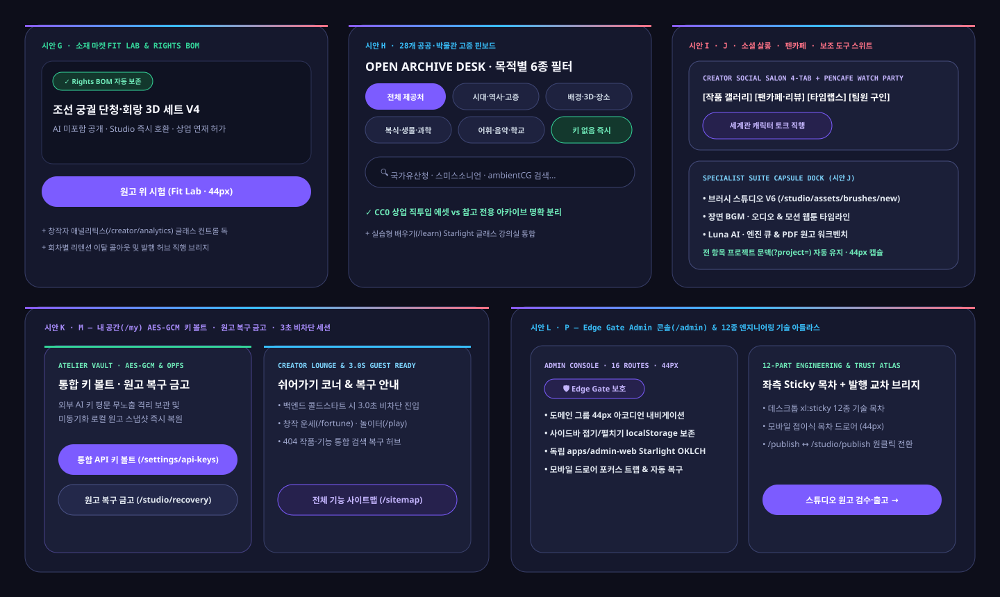
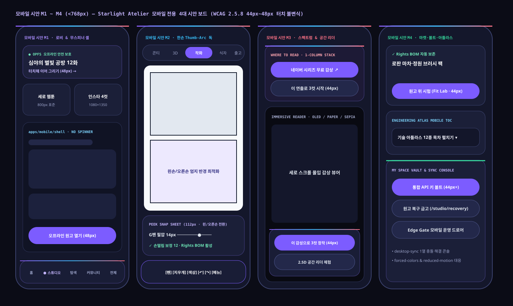

# ToonStudio Starlight Atelier 디자인 참고 시안 패키지 (v2.6)

- 상태: **reference / target** (`2026-11-11`). 데스크톱 `시안 A ~ 시안 P` 16종과 모바일 `시안 M1 ~ M4` 4종의 참고 아트보드·목표 구성·토큰 매핑을 보존한 패키지다. 실제 구현·미적용·검증·배포 상태는 [구현·검증 대조표](../sitewide-clarity-20261111/verification-matrix.md)와 [검증·배포 기록](../sitewide-clarity-20261111/validation-and-release.md)에서 구분한다.
- 상위 정본: [PRODUCT.md](../../../PRODUCT.md), [DESIGN.md](../../../DESIGN.md), [UI/UX v2 통합 개편 설계서](../../architecture/ui-ux-v2-overhaul-blueprint-2026-11-11.md), [품질 게이트 정책](../../operations/quality-gates-policy.md)

## 1. 시안 패키지 구성 파일

이 폴더는 툰스튜디오 모노레포 7개 애플리케이션(`web`, `api`, `admin-web`, `brush-lab`, `character-lab`, `mobile`, `desktop-sync`)과 웹의 여러 경로를 20개 화면 계열로 묶은 **Starlight Atelier** 참고 시안 번들입니다. 보드와 라우트 매핑은 설계 의도를 보여줍니다. 각 실제 페이지의 기능·사용성·접근성·데이터 처리는 별도의 실행 증거로 판정합니다.

| 파일 경로 | 참고 시안·목표 구성의 내용 |
| :--- | :--- |
| [starlight-atelier-interactive-gallery.html](./starlight-atelier-interactive-gallery.html) | WebStorm 미리보기나 브라우저에서 바로 열어 전체 20개 시안(`시안 A~P` · `모바일 M1~M4`), OKLCH 스와치, 고해상도 아트보드를 탭별로 필터링해 볼 수 있는 독립 실행형 시안 아틀라스 |
| [starlight-atelier-design-tokens.json](./starlight-atelier-design-tokens.json) | OKLCH 의미 색상 팔레트, 13개 Spectacle 계약 토큰, `44px`(`min-h-11`) 터치 타깃 불변식, 20대 보드별 정본 라우트 매핑 JSON 원장 |
| [boards/board-a-b-home-and-studio-lobby.svg](./boards/board-a-b-home-and-studio-lobby.svg) | **시안 A · B · F** — 루트 홈 프로스티드 커맨드 히어로 + 첫 화면 4열 Bento 런치패드 + 스튜디오 3열 아틀리에 로비 + 5열 공정 칸반 벡터 아트보드 |
| [boards/board-b-c-editor-2d-and-3d-live-ink.svg](./boards/board-b-c-editor-2d-and-3d-live-ink.svg) | **시안 B · C · D · O** — 2D 웹툰 에디터 단일 44px 5공정 스냅 바(68rem 클리핑 해제 + 자동저장 배지) + Rights BOM 출고 요약 + 3D Live Ink 에셋 선반 벡터 아트보드 |
| [boards/board-e-n-discover-spectrum-and-reader.svg](./boards/board-e-n-discover-spectrum-and-reader.svg) | **시안 E · N** — 스펙트럼 탐색 패싯 허브 + 연재 캘린더 오늘 열 강조 + 작품 상세 `WHERE TO READ` 라우터 + 2.5D WebXR 공간 리더 + Starlight 컷츠 피드 벡터 아트보드 |
| [boards/board-g-h-i-k-p-ecosystem-hubs.svg](./boards/board-g-h-i-k-p-ecosystem-hubs.svg) | **시안 G · H · I · J · K · L · M · P** — 소재 마켓 Fit Lab + 28개 공공 고증 핀보드 + 소셜 살롱 4탭/펜카페 + 보조 도구 스위트 + 내 공간 볼트 + Edge Gate Admin + 12종 기술 아틀라스 벡터 아트보드 |
| [boards/board-m1-m4-mobile-starlight-suite.svg](./boards/board-m1-m4-mobile-starlight-suite.svg) | **모바일 시안 M1 ~ M4 (`<768px`)** — 모바일 하단 글래스 독 + 한손 6슬롯 Thumb-Arc 에디터 + 모바일 1열 가격 라우터 + 무스피너 실루엣 스켈레톤 네이티브 셸 벡터 아트보드 |

## 2. 대표 시각 아트보드 미리보기

### 2.1 시안 A · B · F — 통합 홈 런치패드 · 스튜디오 아틀리에 로비 · 5열 공정 칸반

### 2.2 시안 B · C · D · O — 2D 단일 44px 공정 바 · 출고 프리플라이트 · 3D Live Ink 에셋 선반

### 2.3 시안 E · N — 스펙트럼 탐색 · 작품 상세 라우터 · WebXR 2.5D 공간 리더 · 컷츠

### 2.4 시안 G ~ P — 마켓 Fit Lab · 고증 핀보드 · 소셜 살롱 · 볼트 · Admin · 기술 아틀라스

### 2.5 모바일 시안 M1 ~ M4 — 모바일 하단 글래스 독 · 한손 Thumb-Arc · 무스피너 네이티브 셸

## 3. 정적 계약 검사와 실제 검증

[verify-ui-ux-v2-contracts.mjs](../../../scripts/verify-ui-ux-v2-contracts.mjs)는 명시한 파일·보드 식별자의 존재, 일부 색상·최소 높이 문자열, 이전 주소와 소스 앵커를 정적으로 검사합니다. SVG의 XML 유효성은 파일 구조 검사입니다. 이러한 검사는 렌더된 컨트롤의 실제 크기, 이동 목적지의 실행, 저장·내보내기, 사용자 여정 완주 또는 시안과 런타임의 기능 일치를 입증하지 않습니다.

| 판정 대상 | 이 패키지의 역할 | 확인할 증거 |
| --- | --- | --- |
| 참고 시각 자료 (**reference**) | 기존 5개 SVG 묶음·20개 시안 이름·토큰·HTML 갤러리를 보존한다. | 이 문서의 원본 링크와 이미지 |
| 목표 화면 구성 (**target**) | 화면 계열별 배치와 기능 방향을 제안한다. | 보드별 구성과 [명료성 개선 계열 계약](../sitewide-clarity-20261111/index.html#contracts) |
| 실제 반영 (**current / migration**) | 실제 소스·마운트·콜백 연결로 확인한 범위를 구분한다. | [구현·검증 대조표](../sitewide-clarity-20261111/verification-matrix.md) |
| 미적용·미검증 | 샘플·순수 모델·표시용 링크와 실행 기능을 구분하고 남은 항목을 기록한다. | 대조표의 남은 차이와 [검증 단계와 조건](../sitewide-clarity-20261111/validation-and-release.md) |
| 실제 화면·릴리스 | 실행 환경·테마·뷰포트·인증·데이터 조건과 통과/실패를 함께 기록한다. | [검증·배포 기록](../sitewide-clarity-20261111/validation-and-release.md)와 실제 실행 캡처 |

저장소에 포함한 실제 구현 캡처와 전후 비교는 [실행 화면 모음](../sitewide-clarity-20261111/review-renders/README.md)에서 확인한다. `.qa/`의 원본 실행 로그와 추가 캡처는 로컬 검증 산출물이므로 다른 작업공간에서도 열리는 링크로 가정하지 않는다. 게스트/API fixture 관측의 조건·실패·한계는 검증·배포 기록을 함께 읽는다. 보드를 시각적으로 읽은 검토와 앱을 실행해 캡처한 검증도 별개로 기록한다.

## 4. 기존 상태 선언의 이력

2026-11-11의 초기 v2.6 문서는 다음과 같이 상태를 선언했다.

> 데스크톱 시안 A~P 16종 + 모바일 M1~M4 4종 전수 아트보드·토큰·실제 코드 1:1 동기화 완료

이 문구는 당시의 선언 이력으로 보존한다. 파일·마커 계약 검사와 라우트 매핑만으로 모든 화면의 런타임·기능·사용성 일치를 판정할 수 없어, 현재 상태 표시는 위의 **reference / target**, 실제 구현 대조표, 실행 검증·배포 기록으로 나누었다. 원본 SVG와 기존 링크는 유지한다.
