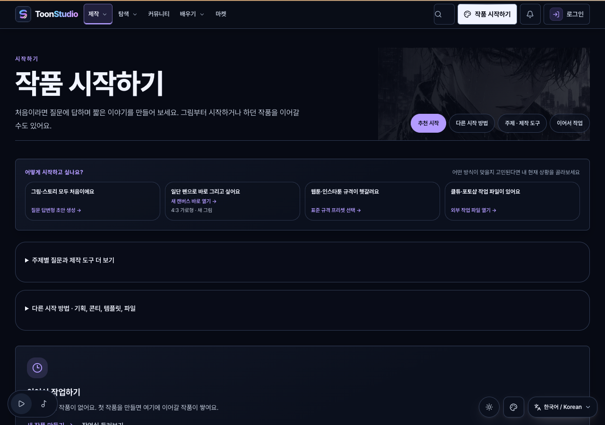
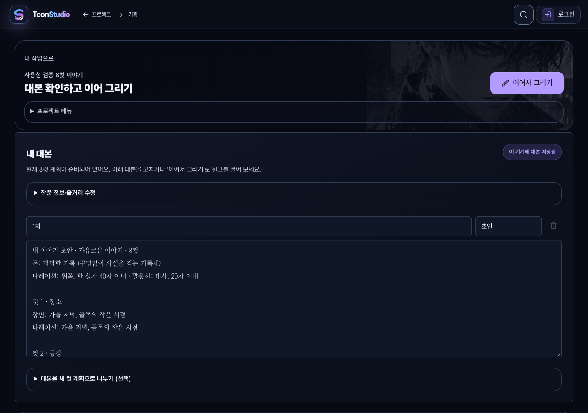
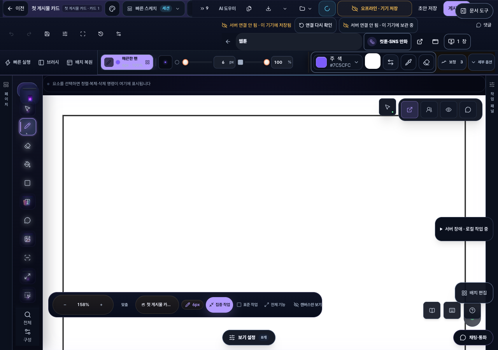

# 툰스튜디오 초보자 사용성 개선과 검증

- 상태: **migration** — 구현과 로컬 검증을 완료했으며 필수 원격 CI와 운영 배포는 대기 상태다.
- 기준일: **2026-10-29**
- 대상: 비로그인 사용자의 **시작 → 질문·초안 → 대본 → 그리기 → 기기 저장·다시 열기 → 이미지·ZIP 다운로드**.
- 최초 평가: **63/100**. 같은 여정과 같은 배점으로 개선본을 다시 평가한다.
- 목표: **90/100 이상**. 점수는 전문가 휴리스틱 평가이며, 사용자 설문·SUS·실사용자 성공률이 아니다.
- 검증 소스: `6c53a4b32ca32afbec346fa7c5a1f9a807eabde5`에서 분기한 `codex/usability-validation-20261029`의 변경분.
- 1차 변경은 [PR #2548](https://github.com/blue45f/toonstudio/pull/2548)로 병합됐다. 이 문서는 실제 실행에서 추가 발견한 문제와 후속 수정까지 기록한다.

## 재평가

개선본의 **데스크톱·비로그인 핵심 제작 여정은 90/100**으로 평가한다. 최초 평가의 항목과 배점을 유지하고 배포용 빌드의 실제 행동·화면·저장 결과를 근거로 삼았다. 모바일은 시작·대본·출력의 배치 검증까지 수행했으며 정밀 편집의 기기 제약은 남아 있다. 실제 초보자 집단의 사용성 실험은 미실행이다.

| 항목 | 배점 | 최초 점수 | 개선본 점수 | 판단과 남은 감점 사유 |
| --- | ---: | ---: | ---: | --- |
| 첫 진입과 시작 | 20 | 11 | 18 | 상황별 선택과 한 번의 클릭으로 그리기. 첫 결과 예시와 선택 추천 설명은 더 보강할 수 있음 |
| 메뉴와 용어 | 15 | 7 | 14 | 핵심 작업을 일상적인 한국어로 표시. 고급 도구에는 전문 용어가 남음 |
| 작업 흐름과 조작 부담 | 25 | 17 | 22 | 질문·대본·그리기 연결과 4/8컷 보존. 편집기의 보조 조작·작업 전환 부담이 남음 |
| 저장·상태·오류 이해 | 15 | 11 | 14 | 기기 저장·실패·재시도·복원·출력 확인. 일부 상태 안내가 중복됨 |
| 시각적 위계와 가독성 | 15 | 10 | 13 | 시작 선택과 대본을 먼저 표시하고 테마별 가독성 확인. 편집기의 떠 있는 보조 도구 밀도는 개선 여지 있음 |
| 도움말과 학습 부담 | 10 | 7 | 9 | 단계 안내와 필요할 때 펼치는 설명. 고급 출력·정밀 도구는 추가 학습 필요 |
| 합계 | 100 | 63 | **90** | 원래 배점 유지 |

배점과 평가 범위를 바꾸어 목표 점수를 맞추지 않는다. 테스트 통과 건수도 사용성 점수로 환산하지 않는다. 실제로 시작·그리기·저장·복원·출력을 완료할 수 있는지, 다음 행동과 현재 상태가 이해되는지를 함께 평가한다.

## 사용자가 체감하는 변경

| 사용 단계 | 확인한 문제 | 개선한 동작 |
| --- | --- | --- |
| 작품 시작 | 제작 도구·홍보·소개가 시작 선택과 경쟁 | 상황별 네 가지 선택을 먼저 표시. 추가 도구는 접고, `/create`에서는 인트로·반복 홍보·이벤트 안내를 생략 |
| 바로 그리기 | 빈 캔버스를 골라도 긴 설정 화면을 거침 | 한 번의 명시적 클릭으로 새 프로젝트와 문서를 만들고 펜을 선택한 집중 편집기를 열기 |
| 크기 안내 | 프리셋의 명목 크기와 작업 캔버스·출력 크기가 다름 | 시작 카드에는 정확한 4:3 비율을 안내. 실제 출력 픽셀 수는 내보내기 창에서 표시 |
| 아이디어 입력 | 홈 아이디어가 기획 양식의 제목으로만 전달 | 자유로운 이야기 질문의 첫 답변으로 전달. 6문항과 4컷·8컷 미리보기 지원 |
| 기존 임시 답변 | 새 아이디어와 저장한 답변이 충돌 | 이전 저장본을 명시적으로 선택할 때까지 보존 |
| 대본 확인 | 프로젝트 메뉴와 설명 때문에 본문이 첫 화면 밖으로 밀림 | ‘내 대본’과 ‘이어서 그리기’를 앞에 배치. 작품 설정·재분석·도움말은 필요할 때 펼치기 |
| 현재 컷 수 | 선택한 4컷·8컷과 재분석의 예상 컷 수가 혼동됨 | 현재 계획과 새 분석을 구분. 기존 계획 교체는 별도 확인 버튼으로 실행하며 중복 클릭만으로 실행되지 않음 |
| 대본 저장 | 로컬 저장 실패가 화면에 알려지지 않음 | 저장 중·이 기기에 저장됨·실패를 표시. 실패 시 본문 유지, 복사 안내와 재시도 제공 |
| 편집기 진입 | 집중 모드에도 작업 가이드와 페이지 띠가 기본 노출 | 중앙 화면 밀도 정책으로 기본 접기. ‘이어서 그리기’는 펜을 선택하고 기존 집중 모드를 유지 |
| 빈 그림 안내 | 이미 그리기를 골랐는데 시작 방법을 다시 질문 | 집중 화면에서는 안내를 접고, 사용자가 필요할 때 다시 열기 |
| 저장 상태 | 기기 복구본과 서버 기록의 차이가 모호 | 기기 저장과 서버 확인·미저장·연결 상태를 구분하고 다음 행동을 안내 |
| 파일 출력 | 기본 다운로드와 전문 출력 설정이 한 화면에 혼재 | 형식·배율·현재 페이지·전체/선택 ZIP을 먼저 배치. 인쇄·교환 형식·게시 준비는 접기 |
| 화면 복구 | GPU 오류에 구현 용어가 노출 | 짧은 상태 설명과 ‘작업 화면 다시 열기’로 복구 행동을 제시 |

그림을 자동 생성했다는 안내는 하지 않는다. 질문의 답변으로 **대본과 컷 계획**을 준비하고, 사용자는 편집기에서 그림을 그린다. 원고·프로젝트 식별자, 기존 저장 권한, Undo/Redo, 워터마크와 출력 인코딩의 경계를 유지했다. 전체 도구 화면으로 돌아갈 수 있다.

## 실제 검증

### 환경과 범위

- macOS Apple M2 Max에서 저장소의 정식 pnpm 의존성과 Chromium을 사용했다.
- 데스크톱 1280 × 900, 모바일 크기 390 × 900에서 실제 화면과 동작을 확인했다. 모바일 크기 검증은 데스크톱 Chromium의 뷰포트 검사이며 실제 휴대전화·펜 입력 검증은 아니다.
- 새 브라우저 컨텍스트의 실제 기기 저장소를 사용했다. 인증·문서 저장소·서버 응답을 모의한 결과가 아니다.
- 로컬 검증 서버에는 Core API를 연결하지 않았다. 따라서 서버 동기화·로그인·결제·공개 게시는 검증 범위 밖이며 화면의 오프라인 안내는 이 환경에 따른 것이다.
- 기본 어두운 테마, 페이퍼, 고대비를 확인했다. 접근성 자동 검사는 시작 화면과 모바일 대본의 `#main-content`를 대상으로 한다. 사이트 전체 WCAG 준수 인증이나 스크린리더 실사용 검증을 뜻하지 않는다.

### 결과

[검증 기록과 파일 해시](usability-2026-10-29/verification.json)에 실행 결과를 보관했다.

| 검증 | 상태 |
| --- | --- |
| 변경 영역 단위 테스트 | **50개 파일 · 746건 통과** |
| 하네스·전체 타입 검사 | **통과** — 구조·린트·Secretlint·소스/의존 그래프 제한·앱/API 타입 검사 |
| 배포용 빌드·CSP·번들 예산 | **통과** — 기준선 완화 없음. 실제 사용자 Web Vitals는 이번에 측정하지 않음 |
| 배포용 빌드의 사용자 여정 | **6개 시나리오 모두 통과**, 재시도 0회 |
| 네이티브 GPU·Undo/Redo·복구 | **최종 단독 실행 6항목 통과**, 오류 목록 비어 있음. 복구 전후 PNG SHA-256 동일 |

GPU의 첫 병렬 실행에서는 복구 직후 픽셀 비교가 1회 불일치했다. 검사에 새 복구 프레임을 기다리는 조건을 추가하고 동일 픽셀 요구를 유지한 채 최종 단독 실행으로 확인했다. 첫 불일치의 원인을 확정하거나 여러 GPU 작업을 동시에 수행하는 환경의 반복 안정성까지 보장한 결과는 아니다.

브라우저 검증은 다음을 확인한다.

1. 390px·1280px 시작 화면의 주 행동, 인트로 비노출, 키보드 진입, 가로 넘침과 접근성 자동 검사.
2. 홈의 아이디어 → 질문 → 4컷·8컷 초안 → 대본 → 집중 편집기.
3. 대본 수정 후 실제 기기 저장, 새로고침 후 수정 내용과 현재 컷 수 보존.
4. 실제 포인터로 그린 선을 PNG로 다운로드. 표시한 픽셀 크기와 실제 PNG 헤더 비교.
5. 문서를 다시 연 뒤 다시 다운로드한 PNG가 첫 파일과 바이트 단위로 동일한지 비교.
6. 4페이지·8페이지 전체 ZIP 및 8페이지 중 1·3·8페이지 선택 ZIP의 페이지 수·순서·PNG 크기·SHA-256 확인.
7. 밝은 테마·고대비의 접근성 자동 검사 및 모바일 편집기·내보내기 화면 확인.

별도 GPU 검증은 실제 획 세 개, 선택, 확대·90도 회전, Undo/Redo, WebGL 컨텍스트 상실과 명시적 복구를 검사한다. 복구 전후 그림 픽셀도 비교한다.

## 검증 화면

배포용 빌드에서 직접 캡처한 화면이다. 로컬 API를 연결하지 않아 보이는 오프라인 안내는 운영 장애 관찰을 뜻하지 않는다.







모바일 확인: [작품 시작](usability-2026-10-29/02-start-mobile.png), [이미지 저장](usability-2026-10-29/05-export-mobile.png), [정밀 편집의 기기 제약 안내](usability-2026-10-29/06-mobile-editor-guidance.png).

## 재현

저장소 루트에서 의존성을 설치하고 Playwright의 Chromium을 사용할 수 있어야 한다. 테스트는 허구의 작품을 새 브라우저의 기기 저장소에 만들고 `artifacts/`에 결과를 쓴다. 실제 계정·운영 데이터는 변경하지 않는다.

```bash
pnpm harness:doctor
pnpm harness:check
pnpm harness:verify --base=6c53a4b32ca32afbec346fa7c5a1f9a807eabde5
pnpm exec playwright test --config=playwright.usability.config.ts
```

Playwright 설정은 기본적으로 로컬 Vite 서버를 시작한다. 배포용 결과물을 로컬 HTTP 서버에서 제공할 때는 `STUDIO_USABILITY_BASE_URL`을 지정한다. GPU 검증용 서버에는 저장소의 Studio COOP/COEP 헤더가 필요하다. 루프백 주소만 허용하며 공개 운영 서버를 대상으로 실행하지 않는다.

```bash
STUDIO_USABILITY_BASE_URL=http://127.0.0.1:5299 pnpm exec playwright test --config=playwright.usability.config.ts
node scripts/verify-studio-skia-product.mjs http://127.0.0.1:5299
```

변경 영역 단위 테스트의 정확한 목록은 [unit-test-files.txt](usability-2026-10-29/unit-test-files.txt)에 기록했다. 저장소 루트에서 다음과 같이 같은 목록을 실행할 수 있다.

```bash
python3 - <<'PY'
from pathlib import Path
import subprocess
files = Path("docs/features/usability-2026-10-29/unit-test-files.txt").read_text().splitlines()
subprocess.run(["pnpm", "exec", "vitest", "run", *files], check=True)
PY
```

행동 검증의 정의는 [Playwright 사용자 여정](../../e2e/usability-first-session.spec.ts)과 [GPU 제품 검증](../../scripts/verify-studio-skia-product.mjs)에서 확인할 수 있다.

## 배포 상태와 남은 조건

- 현재 운영 사이트에 이번 개선 전체가 반영되었다고 주장하지 않는다. 로컬 개선본 점수와 운영 반영 상태는 구분한다.
- 2026-10-29 최신 확인 기준 [메인 CI](https://github.com/blue45f/toonstudio/actions/runs/40856018105/job/123387073652)는 계정 결제 실패 또는 사용 한도 증가 필요라는 GitHub 안내로 **작업 시작 전** 종료됐다. 해당 작업의 `runner_id`는 0, 실행 단계는 빈 목록이다.
- 이 제한은 Desktop Commander 연결과 별개다. 로컬 검증 통과가 원격 CI 통과를 대신하지 않는다.
- 루트 `AGENTS.md`와 `DEPLOY.md`의 배포 조건인 정확한 메인 SHA의 필수 `core`·`verify` 통과를 유지한다. CI·보안·비용 승인 절차를 우회하거나 결제·유료 한도를 변경하지 않는다.
- 운영 반영의 다음 조건은 GitHub 계정 제한 해소, 필수 CI 재실행·통과, 승인된 메인 SHA 배포와 운영 스모크 확인이다.
- 실제 초보자 집단의 사용성 실험, 로그인한 여러 기기 사이 동기화, 공개 게시, 실제 모바일·펜 입력과 장시간 작업은 별도 검증이 필요하다.
