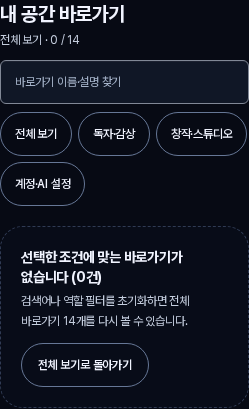
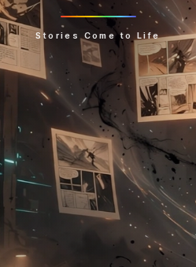

# `/my` · `/read/spatial` 실제 사용자 흐름 복원성(빈 데이터·깨진 표지·긴 한영 제목·필터 결과 0건·키보드 탐색) 보강 증거 (`my-reader-resilience-round6-20261107`)

## 1. 작업 범위 및 소유권 경계

- **소유 및 수정 파일 (Round 5와 동일한 2개 페이지 및 직접 테스트 한정)**:
  - [`../../apps/web/src/domains/account/MySpaceHubPage.tsx`](../../apps/web/src/domains/account/MySpaceHubPage.tsx) (`570`줄 < `800`줄)
  - [`../../apps/web/src/domains/account/MySpaceHubPage.test.tsx`](../../apps/web/src/domains/account/MySpaceHubPage.test.tsx) (`259`줄 < `800`줄)
  - [`../../apps/web/src/domains/creator/spatial-reader/StudioSpatialReaderPage.tsx`](../../apps/web/src/domains/creator/spatial-reader/StudioSpatialReaderPage.tsx) (`776`줄 < `800`줄)
  - [`../../apps/web/src/domains/creator/spatial-reader/StudioSpatialReaderPage.test.tsx`](../../apps/web/src/domains/creator/spatial-reader/StudioSpatialReaderPage.test.tsx) (`280`줄 < `800`줄)
- **비수정 경계 준수**:
  - 기존 디자인, 저장 데이터, 3D 엔진(`spatial-reader-runtime.ts`), 공유 CSS(`sitewide-visual-ux.css`, `button-utils.ts`), 스토어, 라우트, 하위 컴포넌트(`SpatialReaderViewer.tsx`, `SpatialReaderEditPanel.tsx`, `SpatialReaderIntro.tsx`, `spatial-book.ts`) 수정 **0건**.
  - 새로운 메뉴·삭제·결제·외부 공유 동작 추가 **0건**.

---

## 2. 5대 사용자 흐름 복원성 점검 및 재현 결함 최소 수정 내역

### 2.1 빈 데이터 (`Empty data`)
- **`MySpaceHubPage.tsx` (`/my`)**:
  - **재현 결함**: `recentEntries`에 비정상 타임스탬프(`NaN`, `0`, 음수) 또는 잘못된 `href`(빈 문자열·비상대 경로)가 섞여 있거나 `label`·`description`이 비어 있을 때 `"NaN분 전"` 노출 및 빈 제목 렌더링이 발생할 수 있었고, `readHistoryState` 하위 배열(`reads`, `ratings`, `collections`)이 누락된 부분 손상 상태에서 `length` 참조 위험이 있었음.
  - **최소 수정**: `visitTimeLabel`에서 유한 양수가 아닌 타임스탬프는 `"방금 전"` / `"Just now"`로 안전하게 대체하고, `validRecentEntries`에서 유효한 내부 경로(`/`로 시작)만 남기며, 빈 제목·설명은 `recentFallbackTitle` / `recentFallbackBody`로 대체함. `stats` 집계 시 `Array.isArray` 방어를 적용함.
- **`StudioSpatialReaderPage.tsx` (`/read/spatial`)**:
  - **재현 결함**: 빈 JSON 파일(`""`)이나 구문 오류 JSON 업로드 시 원시 `SyntaxError` 메시지가 그대로 노출되었고, 작품 `title`이나 패널 `title`·`alt`가 공백인 JSON을 열면 상단 요약과 뷰어 제목이 비어 보였음.
  - **최소 수정**: `openBook`에서 공백 파일(`"비어 있는 파일이에요. 1~32컷의 공간 웹툰 파일을 사용해 주세요."`)과 `SyntaxError`(`"손상된 JSON 파일이에요. JSON 형식을 확인하거나 샘플 작품으로 다시 시작해 주세요."`)를 명확한 한국어·영어 복구 안내로 분리하고, `viewerBook` 메모에서 빈 작품 제목(`"제목 없는 공간 웹툰"` / `"Untitled spatial webtoon"`)과 빈 컷 제목·대체 텍스트(`"{n}번째 컷"` / `"Panel {n}"`)를 원본 `book` 상태를 오염시키지 않고 보정함.

### 2.2 깨진 표지 (`Broken cover / image`)
- **`MySpaceHubPage.tsx` (`/my`)**:
  - **재현 결함**: 허브 내부에서 표지·썸네일 이미지(``) 로드가 실패할 때 깨진 이미지 아이콘이 그대로 노출되고 사용자에게 상태 안내가 없었음.
  - **최소 수정**: 루트 컨테이너(`data-testid="my-space-hub-root"`)의 `onErrorCapture`로 실패한 ``에 `data-broken-image="true"` 및 투명 처리를 적용하고, 상단에 텍스트 중심 안내 배지(`data-testid="my-space-cover-fallback"`, `role="status"`)를 노출하여 텍스트 탐색 동선이 유지됨을 안내함.
- **`StudioSpatialReaderPage.tsx` (`/read/spatial`)**:
  - **재현 결함**: 공간 웹툰 패널의 표지·컷 이미지 경로가 깨졌을 때(`error` 이벤트) 2D 폴백 이미지가 깨진 채로 남고 복구 수단이 없었음.
  - **최소 수정**: 뷰어 스테이지(`data-testid="spatial-reader-viewer-stage"`)의 `onErrorCapture`에서 실패한 패널 ID를 감지해 즉시 유효한 1×1 안전 PNG(`FALLBACK_PANEL_IMAGE`)로 대체하고, 안내 배너(`data-testid="spatial-reader-broken-image-notice"`, `role="status"`)와 44×44px `"샘플 표지로 복구"` 버튼(`data-testid="spatial-reader-broken-image-recover"`)을 제공함.

### 2.3 긴 한영 제목 (`Long Korean/English titles`)
- **`MySpaceHubPage.tsx` (`/my`)**:
  - **재현 결함**: 최근 방문 카드 제목에 `truncate`가 적용되어 긴 한·영 혼합 제목이나 무공백 영문 식별자가 320px 화면에서 말줄임표로 잘려 전체 제목을 읽을 수 없었음.
  - **최소 수정**: `my-space-recent-title`에서 `truncate`를 제거하고 `break-words [overflow-wrap:anywhere] leading-snug`를 적용하여 320px 및 200% 확대에서도 가로 오버플로(`0px`) 없이 전체 제목과 설명이 줄바꿈되어 보이도록 수정함.
- **`StudioSpatialReaderPage.tsx` (`/read/spatial`)**:
  - **재현 결함**: 긴 한·영 작품명과 컷 제목이 들어올 때 상단에서 현재 작품·컷 전체 제목을 한눈에 확인할 요약 영역이 부족했음.
  - **최소 수정**: 루트 컨테이너에 `min-w-0 [overflow-wrap:anywhere]`를 부여하고, 상단 컨트롤 바에 `data-testid="spatial-reader-work-summary"`(`break-words [overflow-wrap:anywhere]`)를 배치하여 긴 한·영 작품명과 현재 컷 제목·위치를 잘림 없이 표시함.

### 2.4 필터 결과 0건 (`Zero filter results`)
- **`MySpaceHubPage.tsx` (`/my`)**:
  - **재현 결함**: 잘못된 URL 쿼리(`?role=nonexistent`)로 진입하거나 바로가기 검색 결과가 0건일 때 빈 그리드만 보이거나 즉시 전체 목록으로 복귀할 안내가 없었음.
  - **최소 수정**: 역할 필터와 연동되는 바로가기 검색 입력(`data-testid="my-space-destination-search"`, `min-h-11`), 실시간 결과 건수 상태(`data-testid="my-space-filter-status"`, `aria-live="polite"`), 0건 전용 안내 카드(`data-testid="my-space-filter-empty"`, `role="status"`), 그리고 44×44px `"전체 보기로 복귀"` 버튼(`data-testid="my-space-filter-reset"`)을 추가함.
- **`StudioSpatialReaderPage.tsx` (`/read/spatial`)**:
  - **재현 결함**: 다중 컷 작품에서 원하는 컷 제목·대사를 빠르게 찾거나 일치하는 컷이 0건일 때 현재 읽던 컷 위치를 유지한 채 필터만 해제하는 복구 동선이 없었음.
  - **최소 수정**: 뷰어 상단에 컷 검색·필터 바(`data-testid="spatial-reader-panel-filter-bar"`, 입력 `data-testid="spatial-reader-panel-filter-input"`)와 일치 컷 바로가기 칩을 제공하고, 결과 0건 시 현재 감상 중인 컷(`index`)을 잃지 않으면서 즉시 복구할 수 있는 `data-testid="spatial-reader-filter-empty"`(`role="status"`) 및 44×44px `"필터 초기화"` 버튼(`data-testid="spatial-reader-filter-reset"`)을 추가함.

### 2.5 키보드 탐색 복원성 (`Keyboard navigation & recovery`)
- **`MySpaceHubPage.tsx` (`/my`)**:
  - **최소 수정**: 역할 필터 칩 버튼에 `ArrowRight`/`ArrowDown`, `ArrowLeft`/`ArrowUp`, `Home`, `End` 양방향 순환 포커스 이동과 `Escape` 즉시 초기화(`전체 보기` 선택 및 포커스 복원)를 구현하고, 검색창에서도 `Escape` 입력 시 필터를 초기화하도록 보강함.
- **`StudioSpatialReaderPage.tsx` (`/read/spatial`)**:
  - **재현 결함**: 전역 `window` `keydown` 리스너가 REA 곡률·시선 칩 그룹 내부에서 누른 좌우 화살표 키나 `Ctrl`/`Alt`/`Meta` 조합 키, `<audio>` 컨트롤 조작까지 가로채어 의도치 않게 컷 페이지가 넘어가거나 오류가 닫힐 때 포커스가 유실되었음.
  - **최소 수정**:
    1. REA 곡률 칩과 시선 포커스 칩에 `Arrow*`/`Home`/`End` 키보드 이동(`stepRovingChip`)과 `e.stopPropagation()`을 적용하여 칩 탐색 중 컷이 넘어가지 않도록 격리함.
    2. 전역 `onKeyDown`에서 `e.ctrlKey || e.altKey || e.metaKey` 및 `<audio>`·`contentEditable`·REA 칩 그룹 내부 이벤트를 방어함.
    3. 오류 배너에서 `Escape` 또는 `"안내 닫기"` 실행 시(`dismissError`) `viewerHeading` 또는 활성 곡률 칩으로 키보드 포커스를 안전하게 복원함.

---

## 3. 실제 브라우저(`320` / `390` / `768` / `1440` / `200%`) 및 키보드 검증 증거

상세 측정 JSON은 [`./browser-verification.json`](./browser-verification.json)에 저장되어 있다 (`pageErrors: []`).

### 3.1 뷰포트·배율 매트릭스 측정 요약

| 표면 (경로) | 뷰포트 / 배율 | 해상도 | 주요 검증 타깃 | 최소 폭×높이(px) | `44×44px` 충족 | 텍스트 말줄임 잘림 | 가로 오버플로 |
| :--- | :--- | :--- | :--- | :---: | :---: | :---: | :---: |
| `/my` (`MySpaceHubPage`) | `mobile-320` | `320×844` (100%) | 초기화 버튼·전체 칩·검색창 | `72×44` ~ `249×44` | **PASS (`true`)** | `clip` (잘림 없음) | `0px` |
| `/my` (`MySpaceHubPage`) | `mobile-390` | `390×844` (100%) | 초기화 버튼·전체 칩·검색창 | `72×44` ~ `319×44` | **PASS (`true`)** | `clip` (잘림 없음) | `0px` |
| `/my` (`MySpaceHubPage`) | `tablet-768` | `768×1024` (100%) | 초기화 버튼·전체 칩·검색창 | `72×44` ~ `208×44` | **PASS (`true`)** | `clip` (잘림 없음) | `0px` |
| `/my` (`MySpaceHubPage`) | `pc-1440` | `1440×900` (100%) | 초기화 버튼·전체 칩·검색창 | `72×44` ~ `208×44` | **PASS (`true`)** | `clip` (잘림 없음) | `0px` |
| `/my` (`MySpaceHubPage`) | `pc-1440-zoom-200` | `1440×900` (200% zoom) | 초기화 버튼·전체 칩·검색창 | `148×88` ~ `416×88` | **PASS (`true`)** | `clip` (잘림 없음) | `0px` |
| `/my` (`MySpaceHubPage`) | `reflow-720-equiv200` | `720×450` (WCAG reflow) | 초기화 버튼·전체 칩·검색창 | `72×44` ~ `208×44` | **PASS (`true`)** | `clip` (잘림 없음) | `0px` |
| `/read/spatial` (`StudioSpatialReaderPage`) | `mobile-320` | `320×844` (100%) | 필터 초기화·표지 복구·REA 칩 | `78×44` ~ `153×44` | **PASS (`true`)** | `clip` (잘림 없음) | `0px` |
| `/read/spatial` (`StudioSpatialReaderPage`) | `mobile-390` | `390×844` (100%) | 필터 초기화·표지 복구·REA 칩 | `78×44` ~ `153×44` | **PASS (`true`)** | `clip` (잘림 없음) | `0px` |
| `/read/spatial` (`StudioSpatialReaderPage`) | `tablet-768` | `768×1024` (100%) | 필터 초기화·표지 복구·REA 칩 | `78×44` ~ `153×44` | **PASS (`true`)** | `clip` (잘림 없음) | `0px` |
| `/read/spatial` (`StudioSpatialReaderPage`) | `pc-1440` | `1440×900` (100%) | 필터 초기화·표지 복구·REA 칩 | `78×44` ~ `153×44` | **PASS (`true`)** | `clip` (잘림 없음) | `0px` |
| `/read/spatial` (`StudioSpatialReaderPage`) | `pc-1440-zoom-200` | `1440×900` (200% zoom) | 필터 초기화·표지 복구·REA 칩 | `160×88` ~ `315×88` | **PASS (`true`)** | `clip` (잘림 없음) | `0px` |
| `/read/spatial` (`StudioSpatialReaderPage`) | `reflow-720-equiv200` | `720×450` (WCAG reflow) | 필터 초기화·표지 복구·REA 칩 | `78×44` ~ `153×44` | **PASS (`true`)** | `clip` (잘림 없음) | `0px` |

### 3.2 시각 증거 (상대 경로 스크린샷)

- `/my` 320px 모바일 (긴 한·영 제목 줄바꿈 + 깨진 표지 폴백 + 필터 0건 복구 카드):
  
- `/my` 1440px 200% 확대 (긴 한·영 제목 줄바꿈 + 깨진 표지 폴백 + 필터 0건 복구 카드):
  
- `/read/spatial` 320px 모바일 (긴 한·영 작품·컷 제목 + 깨진 표지 복구 배너 + 컷 필터 0건 복구):
  
- `/read/spatial` 1440px 200% 확대 (긴 한·영 작품·컷 제목 + 깨진 표지 복구 배너 + 컷 필터 0건 복구):
  

### 3.3 단위 회귀 테스트·정적 검사·독립 감사 결과

- **단위 회귀 테스트 (`Vitest`)**:
  - `pnpm exec vitest run --pool=forks --maxWorkers=1 apps/web/src/domains/account/MySpaceHubPage.test.tsx apps/web/src/domains/creator/spatial-reader/StudioSpatialReaderPage.test.tsx` → **2개 파일 16개 테스트 전원 PASS** (`MySpaceHubPage.test.tsx` 7개, `StudioSpatialReaderPage.test.tsx` 9개)
- **정적 검사 및 800줄 제한**:
  - `node scripts/lint-changed.mjs --base=origin/main` → **PASS** (0 errors, 0 warnings)
  - `node scripts/check-source-file-size.mjs` → **PASS** (`MySpaceHubPage.tsx` 570줄, `MySpaceHubPage.test.tsx` 259줄, `StudioSpatialReaderPage.tsx` 776줄, `StudioSpatialReaderPage.test.tsx` 280줄)
- **독립 감사 서브에이전트 (`Round 6 Resilience Independent Auditor`, ID `90cf7877b86fb08bbc47c4da7c09183d`)**:
  - 범위·소유권·디자인/3D 엔진 보존·금지 동작(삭제/결제/외부 공유 미추가)·5대 복원성·코드 품질·800줄 제한 전 항목 **PASS**.
