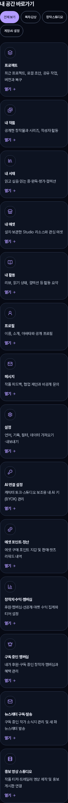
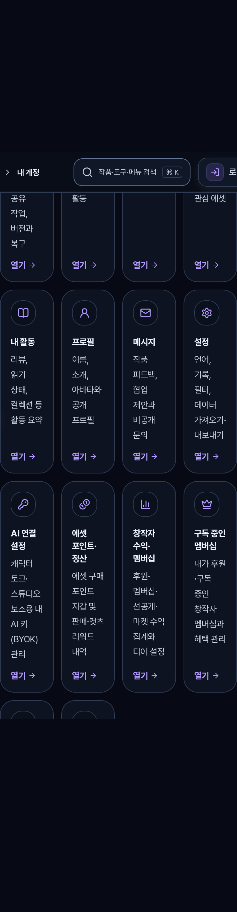
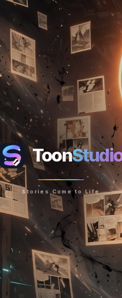

# `GAP-R4-05` 중 `/my` · `/read/spatial` 320px 필터 칩 44px 터치 타깃 보강 증거 (`my-reader-touch-round5-20261107`)

## 1. 작업 범위 및 소유권 경계

- **소유 및 수정 파일 (지정된 2개 페이지 및 직접 테스트 한정)**:
  - [`../../apps/web/src/domains/account/MySpaceHubPage.tsx`](../../apps/web/src/domains/account/MySpaceHubPage.tsx) (`/my` 역할별 보기 필터 칩 4종 44×44px 터치 타깃 바닥선·줄바꿈·테스트 식별자 보강)
  - [`../../apps/web/src/domains/account/MySpaceHubPage.test.tsx`](../../apps/web/src/domains/account/MySpaceHubPage.test.tsx) (`min-h-11`·`min-w-11`·`h-auto`·포커스 링·역할 필터 선택 보존 검증 추가)
  - [`../../apps/web/src/domains/creator/spatial-reader/StudioSpatialReaderPage.tsx`](../../apps/web/src/domains/creator/spatial-reader/StudioSpatialReaderPage.tsx) (`/read/spatial` 곡률 모드 3종·시선 포커스 3종 칩 44×44px 터치 타깃 바닥선·그룹 역할·포커스 링·줄바꿈 보강)
  - [`../../apps/web/src/domains/creator/spatial-reader/StudioSpatialReaderPage.test.tsx`](../../apps/web/src/domains/creator/spatial-reader/StudioSpatialReaderPage.test.tsx) (`min-h-11`·`min-w-11`·`role="group"`·포커스 아웃라인·로케일 전환 후 선택 보존 검증 추가)
- **비수정 경계 준수**:
  - 공유 CSS(`sitewide-visual-ux.css`, `button-utils.ts` 등), 3D 엔진(`spatial-reader-runtime.ts`), 읽기 데이터(`spatial-book*`), 스토어, 라우트 수정 **0건**.
  - 별도 담당 범위인 IR, Learn, Fortune, pricing, 메시지함, PR `#2740` 및 `GAP-R4-05` 내 타 페이지(`PlayPage`, `HelpCenterPage`, `MarketQuickPreviewDialog`, `TimelapseGalleryPage`) 수정 **0건**.

---

## 2. 재현 결함(`GAP-R4-05`) 원인 및 최소 수정 내역

1. **`MySpaceHubPage.tsx` (`/my`) 역할별 보기 필터 칩**:
   - **원인**: `buttonClass({ size: "sm", className: "min-h-9 rounded-full px-3 text-xs" })`로 인해 320px 뷰포트에서 높이가 `36px`(`min-h-9`)에 머물렀고, 768px 이상 뷰포트에서는 `#main-content :where(button...) { min-block-size: 2.5rem; }` 규칙에 의해 `40px`로 눌렸음.
   - **최소 수정**: `className`을 `"h-auto min-h-11 min-w-11 [min-block-size:2.75rem]! [min-inline-size:2.75rem]! max-w-full whitespace-normal rounded-full px-3.5 py-2 text-center text-xs leading-snug"`로 보강하여 기존 알약형(`rounded-full`) 디자인·선택 표시(`solid` vs `outline`, `aria-pressed`)·키보드 포커스(`focus-visible:ring-2`)·화면 밀도를 그대로 유지하면서 전 뷰포트에서 최소 `44×44px` 터치 영역과 텍스트 줄바꿈(잘림 없음)을 보장함.
2. **`StudioSpatialReaderPage.tsx` (`/read/spatial`) 곡률 모드·시선 포커스 토글 칩**:
   - **원인**: `px-3 py-1.5 text-xs`만 지정되어 320px 뷰포트에서 높이가 `30px`에 불과했고, 각 행 컨테이너에 `role="group"`이 없었음.
   - **최소 수정**: 곡률 모드 행과 시선 포커스 행에 `role="group"` 및 한·영 `aria-label`을 부여하고, 각 칩 버튼에 `inline-flex min-h-11 min-w-11 [min-block-size:2.75rem]! [min-inline-size:2.75rem]! max-w-full items-center justify-center rounded-xl ... px-3 py-2 text-left text-xs font-semibold leading-snug ... focus-visible:outline-2 focus-visible:outline-offset-2 focus-visible:outline-accent sm:text-center`를 적용하여 기존 테두리·배경 대비(`border-accent bg-accent-soft text-accent` vs `border-line bg-panel text-fg-2`)와 화면 밀도를 해치지 않고 `44×44px` 터치 영역 및 키보드 포커스 가시성을 확보함.

---

## 3. 실제 브라우저(`320` / `390` / `768` / `1440` / `200%`) 측정 및 검증 증거

상세 측정 데이터는 [`./browser-verification.json`](./browser-verification.json)에 기록되어 있다.

### 3.1 뷰포트·배율 매트릭스 측정 요약

| 표면 (경로) | 뷰포트 / 배율 | 해상도 | 칩 수 | 최소 폭×높이(px) | `44×44px` 충족 | 텍스트 잘림 | 칩 겹침 | 가로 오버플로 |
| :--- | :--- | :--- | :---: | :---: | :---: | :---: | :---: | :---: |
| `/my` (`MySpaceHubPage`) | `mobile-320` | `320×844` (100%) | 4 | `70×44` ~ `92×44` | **PASS (`true`)** | `false` | `false` | `0px` |
| `/my` (`MySpaceHubPage`) | `mobile-390` | `390×844` (100%) | 4 | `70×44` ~ `92×44` | **PASS (`true`)** | `false` | `false` | `0px` |
| `/my` (`MySpaceHubPage`) | `tablet-768` | `768×1024` (100%) | 4 | `70×44` ~ `92×44` | **PASS (`true`)** | `false` | `false` | `0px` |
| `/my` (`MySpaceHubPage`) | `pc-1440` | `1440×900` (100%) | 4 | `70×44` ~ `92×44` | **PASS (`true`)** | `false` | `false` | `0px` |
| `/my` (`MySpaceHubPage`) | `pc-1440-zoom-200` | `1440×900` (200% zoom) | 4 | `139×88` ~ `184×88` | **PASS (`true`)** | `false` | `false` | `0px` |
| `/my` (`MySpaceHubPage`) | `reflow-720-equiv200` | `720×450` (WCAG reflow) | 4 | `70×44` ~ `92×44` | **PASS (`true`)** | `false` | `false` | `0px` |
| `/read/spatial` (`StudioSpatialReaderPage`) | `mobile-320` | `320×844` (100%) | 6 | `103×44` ~ `153×44` | **PASS (`true`)** | `false` | `false` | `0px` |
| `/read/spatial` (`StudioSpatialReaderPage`) | `mobile-390` | `390×844` (100%) | 6 | `103×44` ~ `153×44` | **PASS (`true`)** | `false` | `false` | `0px` |
| `/read/spatial` (`StudioSpatialReaderPage`) | `tablet-768` | `768×1024` (100%) | 6 | `103×44` ~ `153×44` | **PASS (`true`)** | `false` | `false` | `0px` |
| `/read/spatial` (`StudioSpatialReaderPage`) | `pc-1440` | `1440×900` (100%) | 6 | `103×44` ~ `153×44` | **PASS (`true`)** | `false` | `false` | `0px` |
| `/read/spatial` (`StudioSpatialReaderPage`) | `pc-1440-zoom-200` | `1440×900` (200% zoom) | 6 | `213×88` ~ `315×88` | **PASS (`true`)** | `false` | `false` | `0px` |
| `/read/spatial` (`StudioSpatialReaderPage`) | `reflow-720-equiv200` | `720×450` (WCAG reflow) | 6 | `103×44` ~ `153×44` | **PASS (`true`)** | `false` | `false` | `0px` |

### 3.2 시각 증거 (상대 경로 스크린샷)

- `/my` 320px 모바일 역할 필터 칩: 
- `/my` 1440px 200% 확대 역할 필터 칩: 
- `/read/spatial` 320px 모바일 곡률·시선 포커스 칩: 
- `/read/spatial` 1440px 200% 확대 곡률·시선 포커스 칩: 

### 3.3 키보드 조작·필터 선택 보존·단위 테스트·정적 검사

- **키보드 조작 및 선택 보존**:
  - `/my`: `Enter` / `Space` 키로 `계정·AI 설정`(`14개 → 4개`) → `창작·스튜디오`(`6개`) → `전체 보기`(`14개 복원`) 전환 시 `aria-pressed` 및 목적지 카드 목록이 손실 없이 일관되게 보존됨 (`preservedAndRestored: true`).
  - `/read/spatial`: `Enter` / `Space` 키로 `120° 돔 시네마 몰입` 및 `바이노럴 공간 음향 패닝` 선택 후 `샘플 작품으로 체험하기`로 3D 작품을 열어도 선택 상태(`aria-pressed="true"`)와 상태 바 표시가 그대로 유지됨 (`preservedAcrossSampleLoad: true`).
- **단위 테스트·린트·800줄 제한**:
  - `pnpm exec vitest run --pool=forks --maxWorkers=1 apps/web/src/domains/account/MySpaceHubPage.test.tsx apps/web/src/domains/creator/spatial-reader/StudioSpatialReaderPage.test.tsx`: **2개 파일 10개 테스트 전원 PASS**
  - `node scripts/lint-changed.mjs --base=origin/main`: **PASS**
  - `node scripts/check-source-file-size.mjs`: **PASS** (`MySpaceHubPage.tsx` 353줄, `MySpaceHubPage.test.tsx` 160줄, `StudioSpatialReaderPage.tsx` 548줄, `StudioSpatialReaderPage.test.tsx` 154줄 — 모두 800줄 미만)
  - 독립 감사 서브에이전트(`Round 5 Touch Target Independent Auditor`) 감사 결과: 범위·소유권·디자인 보존·코드 품질 전 항목 **PASS**.
