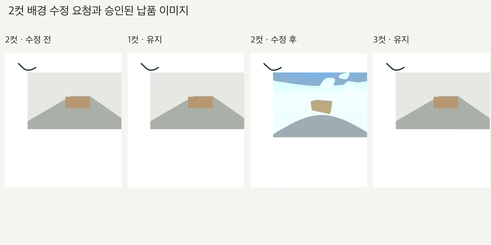
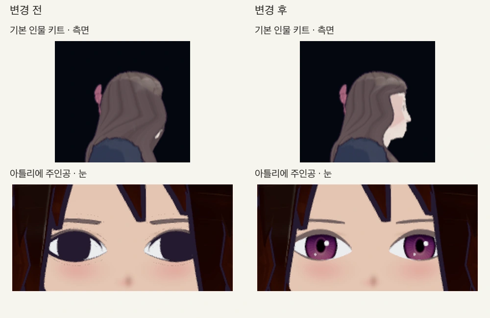
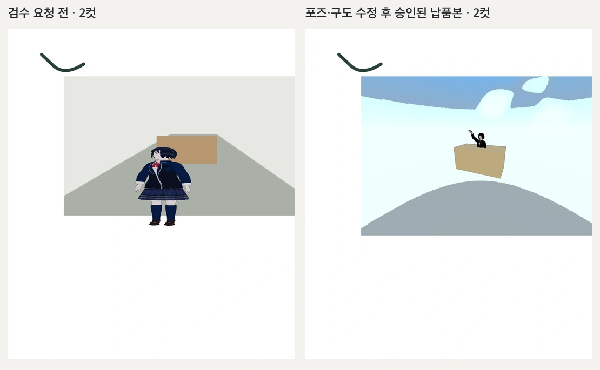

# 한 회차 제작·검수·납품 실측

**current · 2026-11-23~2026-11-24.** 로컬 `main`의 `f43f74540`에서 분기해 작가와 PD의 정상 제작 화면을 확인했다. 브라우저·API·저장소에는 합성 원고와 격리 계정을 사용했다. 배경만 고친 회차와 [인물 포즈·배경을 함께 고친 회차](#손드는-포즈와-넓어진-배경을-함께-납품하기)를 각각 실행했다. 시간은 각 회차의 자동 조작에서 잰 경과 시간이다.

2026-11-24의 마지막 검사에서는 연속 획 시작 지연과 저장 전 검수 위치를 고친 뒤 같은 회차 납품을 재실행했다. [수정 전·중간·최종 15회 측정과 검수 좌표](#2026-11-24-연속-획과-저장-전-검수-위치-재검증)

## 세 컷 중 배경 하나만 고쳐 납품하기

검수 대상은 손선과 배경이 각각 있는 세 컷이다. 시작 원고는 격리 DB에 리비전 4로 준비했다. 이어지는 메모와 배경 수정, 서버 저장, 승인본 발행에는 이 원고 하나를 사용했다. 새 원고에서의 작가 첫 획은 아래 게스트 흐름으로 따로 확인했다. PD가 두 번째 컷 너비의 42%, 높이의 68% 위치를 지정했다. 720×830 원고에서는 (302.4, 564.4)다. 같은 회차에서 작가가 해당 위치로 돌아오고, 배경을 고친 수정본을 PD가 승인한 뒤 수령인이 ZIP을 확인했다.

| 관찰 지점 | 실제 결과 |
| --- | --- |
| 휴대폰 검수 메모 | 390×844 창에서 로그인한 PD가 남긴 좌표 댓글에 서버가 201로 응답했다. 별도 작가 세션에서 같은 고정 버전 댓글의 편집 링크를 열었다. 두 번째 컷의 실제 위치는 390×800 작업 영역 안의 (163.8, 305.7)px였다. 확대·반전·회전 좌표 변환은 별도 회귀 검사로 대조했다. |
| 배경 재편집 | Three.js r187 WebGPU에서 화각 50°→90°, 선폭 1.75→1.80, flat→cel, 태양 그림자 켜짐→꺼짐. 이 회차에서 배경 편집 진입부터 반영까지 38.833초, 적용 버튼부터 반영까지 3.681초였다. 별도 게스트 원고에서는 각각 16.718초와 3.220초였다. |
| 원고 보존 | 재열기한 세 페이지가 편집 직후와 일치했다. 세 컷의 손선과 첫째·셋째 컷의 요소를 원본과 대조했다. 6개 패스를 만드는 동안 작가가 원고를 수정하면 준비 당시 페이지와 현재 페이지를 대조해 오래된 결과의 적용을 중단한다. 나중에 그린 획은 원고에 남는다. |
| 재제출 | 실패한 재제출에서 직전 제출과 미해결 메모 원문을 보존했다. 정상 재제출에서는 둘째 컷만 변경 목록에 올랐다. 제작 공정 명령 검사에서도 첫째·셋째 컷의 기존 승인자와 버전이 보존됐다. PD가 수정본을 승인했다. |
| 납품 | 고정된 승인 버전의 소재 사용권을 검사하고 페이지별 순서·규격·해시를 발행 명세와 대조한다. 공식 발행·다운로드·수령 절차를 마친 ZIP은 266,297바이트였다. 세 장을 풀어 최종 PNG와 RGBA 전체를 비교했고 바뀐 이미지는 둘째 컷 하나였다. |

[휴대폰 PD 메모와 작가 편집 화면](mobile-review.webp) · [작가가 같은 원고에서 연 3D 편집 화면](episode-camera.webp)



납품 ZIP의 SHA-256은 `a21772bf254bfa19ca62c8a09059f4db904250f7699edc94a840caf8134ee3dd`다. 단일 원고 시험을 시작한 뒤 모바일 메모 저장은 18.793초, 작가의 해당 좌표 복귀는 86.886초, 3D 수정 반영은 136.062초, 서버 저장 확인은 139.914초, 실패 뒤 메모 보존은 148.953초, 재제출은 149.103초, PD 승인은 149.109초, 다운로드는 149.860초, 수령은 149.900초에 관찰됐다. 작가 화면의 해당 위치에는 24×24px 표식이 나타났다.

PD와 작가는 별도 브라우저 세션으로 로컬 Nest와 PostgreSQL에 로그인했다. 작가는 댓글이 가리킨 원고에서 3D 배경을 직접 열어 수정하고 서버에 저장했다. PostgreSQL에서 읽은 수정본의 해시 `ad7921a1…`가 승인된 원고와 일치했다. 컷 2는 해당 작가 화면에서 내보낸 PNG를 사용했고, 손선과 1·3컷은 원본과 같음을 확인한 뒤 기존 PNG를 전달했다. 검수본 고정, 재제출, 승인, 발행, 다운로드, 수령은 도메인 서비스·저장소로 실행했다. 비공개 객체 저장·서명 읽기는 로컬 어댑터를 썼다. 별도 실험에서도 기존 작품 클라이언트의 HTTP PATCH가 200을 반환하고 리비전이 4에서 5로 올랐다. 이 첫 시험에서는 배경을 고쳤다. 인물까지 함께 고친 회차는 아래에 기록했다. 첫째·셋째 컷의 합성 기준 이미지는 같은 모양이라 컷 식별자와 순서도 검사했다.

## 첫 획, 기기 저장, 서버 확인

- 새 게스트가 `/create`의 ‘캔버스 열기’로 그은 첫 획은 기기 원고에 17개 점으로 남았다. 보관함에서 ‘이어서 작업’을 누르자 같은 문서, 같은 획, 마지막 도구인 지우개가 복원됐다.
- 44px 문맥 막대와 모바일 하단 도크를 제외해 실제 작업 영역을 쟀다. 1440×960에서 92.24%, 390×844에서 89.31%, 320×700에서 87.11%로 세 화면 모두 목표 82%를 넘었다. 측정 대상은 작가가 이동하고 그릴 수 있는 뷰포트다. 펜과 픽셀 펜에서는 그리기 설정을, 글자나 획을 선택하면 불투명도나 선 두께를 여는 기존 도구 경로도 확인했다.
- 아홉 획을 저장한 다음 열 번째 획에서 OPFS와 SQLite 양쪽 쓰기에 장애를 넣었다. 재시도 후 오프라인 새 탭에서 열 획을 읽고, 재연결 시 소유권을 다시 확인했다. 서버 PATCH는 한 번이었다. 응답을 1.721초 붙들고 UI 변경 52회를 확인한 동안 서버 저장 완료를 먼저 표시한 횟수는 0회였다. 정본 리비전은 18에서 19로 올랐다. 별도로 편집 권한이 있는 작가의 실시간 연결을 끊었을 때 캔버스가 동기화 대기와 재연결을 안내했다. 소켓이 복구되자 새로고침 없이 같은 원고에서 입력을 재개했고 리비전은 유지됐다.
- 별도로 실제 서비스 워커가 캐시 689개를 준비한 뒤 모든 네트워크를 끊었다. 새 탭에서 셸·소유 영수증·열 획을 읽었다. 이 빌드는 로컬 실시간 게이트웨이 설정이 없어 온라인 편집이 읽기 전용이었다. 앞에서 확인한 같은 소유자·리비전의 열 획을 출하 코드의 OPFS 세션으로 먼저 넣어 재열기를 검증했다.
- 로그인한 작가의 보관함은 실제로 열었던 기기 원고와 서버 원고의 최근 작업 시각을 비교한다. 기기 원고는 마지막 컷·도구·배율로 돌아왔다. 온라인에서는 팀 작가도 서버가 현재 편집 권한을 확인하면 같은 작품을 이어서 열 수 있다. 실제 편집자가 보관함에서 원고를 다시 열었고, PD가 열람자로 바꾸자 다음 조회에서 이어가기 링크가 사라졌다. 오프라인에서는 기기에 소유 확인 기록이 남아 있는 원고를 연다.
- CDP가 생성한 신뢰된 펜 이벤트의 필압은 0.4~0.8, 기울기는 15°였다. 다섯 이동 이벤트에서 다음 애니메이션 프레임까지 0.61~3.52ms가 걸렸다. 태블릿 접촉부터 실제 표시까지의 지연은 측정하지 않았다.
- 안정화를 끄고 같은 위치에서 펜을 뗐을 때 입력 14개 표본의 25개 필드가 미리보기·커밋·기기 저장에서 일치했다. 같은 렌더러로 그리면 세 단계에서 437개 잉크 픽셀이 동일했다. 193% 화면의 WebGPU 미리보기와 커밋 화면은 잉크 영역 510픽셀 중 248픽셀의 RGBA가 달랐다. 평균 알파 차이는 255단계 중 4.17, 절반 이상 불투명한 윤곽의 최대 거리는 1px였다. 표준 펜의 미리보기는 WebGPU 셰이더, 커밋은 Canvas2D 원 그리기를 사용한다. 반투명 가장자리에서 색과 알파 차이가 나타났고, 양쪽 모두 불투명한 픽셀 중에서도 4개의 색이 달랐다. 커밋 화면과 기기 재열기 화면은 1392×1088 전체의 RGBA가 일치했다. 강한 안정화는 펜을 뗄 때 끝점 표본 두 개를 추가했다. 이 경로를 다시 검사하는 `pnpm verify:studio-pen-render-roundtrip`에서도 14표본, 193.33% 배율의 양방향 윤곽 1px 이내, 기기 재열기 RGBA 일치를 확인했다.

## 셰이퍼의 기본 인물과 대표 모델

2026-11-19 조형 보고서에서 다룬 기본 자세·얼굴 그림자·목 실루엣을 기준으로 삼았다. 파츠·표정·포즈·표면 드로잉·출력의 기존 구현은 셰이퍼 체크리스트와 대조했다. [이전 조형 보고서](../shaper-model-comparison-2026-11-19.md) · [캐릭터 랩 셰이퍼 체크리스트](../../archive/character-lab/shaper-parity-checklist.md)

캐릭터 랩에서 처음 열리는 자체 인물 키트와 제작 패키지의 ‘아틀리에 주인공’을 같은 조명·카메라·해상도로 촬영했다. 아래 각 시트의 첫 줄이 수정 전, 둘째 줄이 수정 후다. 전신의 정면·측면 90°·반측면 35°, 얼굴 윙크, 팔을 굽힌 인사 포즈를 나란히 놓았다. 인사 포즈는 두 판본 모두 920×720에서 전신 버튼을 누르고 휠을 한 번 돌려 손끝 여백을 맞췄다. 확대 시트에서 기본 인물 손끝 위로 24px, 아틀리에 주인공은 41px가 남았다. [인사 포즈의 손·팔 확대](hands-wave.webp)



- **기본 인물 키트.** 90°에서 옆머리에 코와 턱이 거의 가려졌다. 자체 롱 헤어의 관자놀이 가닥을 뒤와 옆으로 옮기고 안쪽 두피 테두리를 막았다. 정수리, 어깨 쪽 끝, 본·UV·가중치·표정 데이터를 보존했다. 같은 102×87px 구간의 피부색 픽셀은 15→987개였다. 3판 원장을 추가해 1·2판 레시피도 해당 판의 파일로 열린다. [기본 키트 다섯 컷](default-views.webp)
- **아틀리에 주인공.** 툰 외곽선이 홍채를 먹색 원으로 덮었다. 안구와 속눈썹·눈썹을 저작된 크기로 그리고, 필압 윤곽 모드에서는 눈 부위를 가리는 머리 외곽선을 기존 스텐실로 제한했다. 같은 62×37px 눈 구간에서 보라색 홍채 픽셀은 0→589개, 밝은 공막 픽셀은 309→412개였다. [아틀리에 주인공 다섯 컷](hero-views.webp)
- **카메라.** 반측면이나 자유 회전에서 얼굴·상반신을 누르면 정면으로 돌아오던 문제를 고쳤다. 렌더러에서 읽은 시선 방향으로 현재 각도를 유지한다. 전후 시트는 Apple M2 Max, ANGLE Metal WebGL2, Babylon 9.36.0에서 촬영했다. 같은 홍채를 Metal WebGPU로도 열었으며 해당 색 분류 픽셀은 602개였다.
- **팔을 올린 전신.** 기본 인물에서 전신 버튼을 눌러도 손끝이 잘렸다. 기본 자세의 상자가 읽은 몸통 꼭대기는 1.445m였고, 실제 포즈를 적용한 정점은 1.778m에 있었다. 전신 버튼과 전신 출력의 카메라가 스킨·모프를 적용한 메시 경계를 읽도록 고쳤다. 휠 조작 없이 기본 인물 손끝은 화면 위 3.10px 밖에서 안쪽 42.56px로 들어왔다. 아틀리에 주인공의 같은 포즈는 위 여백이 15.37→43.42px가 됐다. 기본 인물은 Apple Metal WebGPU에서도 손끝 42.56px, 아래 여백 42.13px로 WebGL2와 일치했다. [전신 버튼 한 번으로 연 두 모델의 전후](posed-framing.webp)
- **메시 검증.** Blender 5.3.0에서 새 GLB를 다시 불러 세 LOD 각각의 비다양체 변, 방향이 어긋난 변, 고립 정점, 퇴화 면이 0개임을 확인했다. glbforge에서 열린 변 119→0, 삼각형 18,145→18,258, 정점 9,213개와 재질 1개를 확인했다. 수정된 파일 해시는 `0c24de3667f8e1e4a8dd179ad03c91a222484ff86c53c6420190a51516ea786d`다. 픽셀 수는 정해진 화면 구간의 색 분류 결과이며 작품 선호도를 나타내지 않는다.

### 원고에서 연 캐릭터 셰이퍼

`/studio/character`에서 여는 기본 루미와 대표 하늘도 따로 확인했다. 이 편집기는 원고에 VRM 장면과 렌더 이미지를 함께 넣는다. 두 모델의 정면·측면·반측면·인사 포즈를 같은 뷰포트에서 확인했으며, 하늘의 얼굴 편집은 표시된 아홉 채널 중 여덟 개가 지원됐다. [루미·하늘 촬영 시트](manuscript-models.webp)

하늘의 재킷에는 포인터를 정확히 맞혀도 브러시 획이 생기지 않았다. 도구 수명과 메시 사이의 포인터 이동을 고친 뒤 한 획 다섯 샘플이 커밋됐다. PSD에는 원고 페인트와 원본 재질의 차이를 별도 획 레이어로 출력한다. 수정 전에는 빠졌던 ‘브러시 획’이 수정 후 2048×1357 PSD에 들어갔고, 레이어를 직접 디코드해 알파가 0보다 큰 픽셀 6,204개를 세었다. 원고를 저장하고 다시 열었을 때 모델, 포즈, 표면 텍스처 참조 다섯 개와 1604×1040 캡처 이미지의 해시가 일치했다. [표면 페인트 전후](manuscript-paint.webp)

같은 원고의 하늘을 ‘3D 캐릭터 재편집’으로 다시 열어 뒤돌아보기 포즈와 카메라를 바꿨다. 캡처 중 카메라 감쇠가 계속 움직여 올바른 수정본도 거부하던 원인을 바로잡았다. 캐릭터의 요소 ID, 별도 손선, 표면 텍스처 다섯 개는 그대로였고 캡처 PNG가 교체됐다. 한 번 더 저장·재열기해 페이지 전체를 대조했다. [재편집 전후의 같은 레이어](manuscript-pose.webp)

재킷에 한 번 그었는데 양말까지 물드는 문제도 원본 VRM에서 재현했다. 재킷과 양말이 같은 재질·UV를 쓰고 로더는 같은 이미지 버퍼를 가리키는 텍스처를 합쳤다. 자사 하늘의 새 판본은 재킷 재질·이미지·버퍼 참조를 분리하고 원본 정점 44,832개와 삼각형 62,948개를 유지한다. 같은 위치의 한 획으로 몸통 영역에서 바뀐 RGB 픽셀은 구판 121개·신판 190개, 양말 영역에서는 54개·0개였다. 큰 획에서도 몸통 1,894개·양말 0개였고 PSD의 별도 획 레이어에는 분홍 픽셀 989개가 남았다. 구판 원고는 기존 URL로 열리고 새 원고에는 새 모델 해시가 기록됐다. [같은 획의 재킷과 양말 전후](haneul-jacket.webp)

## 비교 도구의 공개 기능

설치된 macOS용 SHAPER 1.05의 편집 화면도 열었다. 얼굴형 프리셋 여섯 개와 원형·중년형, 눈·코·입·귀 파츠 탭, 펜 스타일·두께·색·가상 필압, Layer 0~5와 대칭 그리기를 화면에서 확인했다. 편집 화면 중앙에는 검은 윤곽과 두 단계 음영이 있는 두상이 보였다. 같은 캐릭터를 넣어 포즈나 납품 시간을 대조하는 시험은 수행하지 않았다.

WEBTOON SHAPER의 공개 안내는 파츠·포즈 편집, 모델 위 드로잉, 레이어 출력을 설명한다. VRoid Studio는 인물 파츠와 텍스처 편집을 제공한다. 이번에 바꾼 메시와 텍스처는 툰스튜디오 원본에서 왔다. [SHAPER 공식 가이드](https://shaper.webtoons.com/how-to/) · [VRoid Studio 공식 소개](https://vroid.com/en/studio)

CLIP STUDIO PAINT EX에는 선·톤 변환, Procreate에는 필압·테이퍼 제어, Frame.io에는 위치 댓글과 버전 비교가 있다. 이번 시험에서 검증한 가설은 한 회차의 모바일 수정 지시가 해당 컷의 편집과 승인본 납품까지 정확히 이어지는지였다. 경쟁 제품을 같은 작업·기기로 반복 측정한 실사용 시간이나 모델 선호도 결과는 없다. [CLIP STUDIO PAINT EX 매뉴얼](https://help.clip-studio.com/en-us/manual_en/390_filters/Convert_to_lines_and_tones_%28EX_only%29.htm) · [Procreate 브러시 설정](https://help.procreate.com/procreate/handbook/brushes/brush-studio-settings) · [Frame.io 댓글](https://help.frame.io/en/articles/9105251-commenting-on-your-media) · [Frame.io 비교 뷰어](https://help.frame.io/en/articles/9952618-comparison-viewer)

권리 검사에는 서버에 저장한 팀 VRM도 포함한다. 같은 작품·컷의 봉인 기록과 합성 이미지 해시를 확인하고, 원저작자 한정 모델은 해당 컷의 이용자 확인을 대조한다. 실제 PostgreSQL에서 같은 컷의 확인 기록은 통과했고 다른 작품·다른 컷·확인 누락·합성 이미지 불일치는 모두 차단됐다. 납품 UI는 별도의 합성 HTTP 응답을 사용한 100쪽 시나리오에서 준비·발행·다운로드·수령 각 1회, 네 화면 너비에서 페이지 오류 0건으로 끝났다.

## 변경된 제작 경로

| 영역 | 구현과 회귀 검사 |
| --- | --- |
| 오프라인 원고 | [소유자 미리보기](../../../apps/web/src/domains/creator/offline/StudioOfflineOwnerPreview.tsx), [서비스 워커 드로잉 캐시](../../../apps/web/src/app/service-worker/studio-service-worker-drawing-plan.ts) |
| 보관함 → 최근 작화 | [현재 권한과 최근 원고 확인](../../../apps/web/src/domains/creator/studio-shell/useStudioRecentOwnerWork.ts), [계정별 이어가기 기록](../../../apps/web/src/domains/creator/offline/studio-recent-owner-work.ts) |
| 펜 미리보기 → 기기 재열기 | [실제 화면에서 선 윤곽과 다시 연 RGBA 대조](../../../scripts/verify-studio-pen-render-roundtrip.mts) |
| 휴대폰 메모 → 편집 | [검수 댓글을 편집 대상으로 변환](../../../apps/web/src/domains/creator/review-handoff/studio-review-editor-handoff.ts), [도착한 지점 표시](../../../apps/web/src/domains/creator/review-handoff/use-studio-comment-editor-focus.ts) |
| 3D 배경과 손선 | [현재 원고에 적용하는 코드](../../../apps/web/src/domains/creator/studio-cuttoon-editor/studio-cuttoon-bg3d-insert.ts), [6패스 삽입 중 손선 보존 검사](../../../apps/web/src/domains/creator/bg3d/studio-bg3d-six-pass-insert.test.ts) |
| 승인본 납품 | [승인 원본의 권리 검사](../../../apps/api/src/modules/studio-project-graph/review-delivery/review-delivery-material-rights.ts), [승인 이미지·순서 대조와 발행](../../../apps/api/src/modules/studio-project-graph/review-delivery/review-delivery.service.ts), [검수·납품 PostgreSQL 통합 테스트](../../../apps/api/src/modules/studio-project-graph/studio-review-preview-producer.integration.test.ts) |
| 캐릭터 편집 | [원고 셰이퍼의 표면 브러시](../../../apps/web/src/domains/creator/vrm/useStudioVrmSurfacePaintTool.ts), [텍스처 페인트 출력](../../../apps/web/src/domains/creator/vrm/studio-vrm-texture-paint-projection.ts), [자체 헤어 재생성](../../../tools/blender/character_kit/build_swept_hair_edition.py), [키트 판 무결성](../../../scripts/lib/character-kit-directory-files.mjs), [툰 윤곽 정책](../../../packages/studio-project-model/src/character-kit/quality-gate/outline-policy.ts) |

캐릭터 랩 전체 295개 파일의 2,706개 테스트, 랩 타입 검사·빌드, 키트 출하 검사, 생성물 재현성 검사를 실행했다. 키트 출하 검사에서 오류는 0개였고 기존 베이스의 모프 6건과 UV 1건에 경고가 있었다. Blender에서 아틀리에 주인공을 다시 열어 메시 16개, 열린 테두리 0개, 밑창 높이 0.0000001m, 좌우 눈 검사 8건을 확인했다. 보행 176자세에서 몸과 치마의 교차는 0건이었다. 손가락·얼굴·의상의 모든 조합은 확인하지 못했다.

새 헤어 단품은 glbforge의 데스크톱 예산을 통과했다. 전체 여성 베이스와 아틀리에 주인공은 각각 드로콜 10개와 18개로 같은 프로필의 예산 8개를 초과했다. 원고 셰이퍼의 하늘은 두 판본 모두 드로콜 21개, 비다양체 변 1개였다. 재킷 채색을 분리하면서 추정 텍스처 메모리는 51,949,075바이트에서 56,132,893바이트로 늘었다. 재킷 안에서 좌우 소매는 기존 대칭 UV를 사용한다.

정식 원고 셰이퍼 검사에서는 데스크톱 GPU에서 투명 PNG 2048×1119와 4096×2237, PSD 2048×1119의 18개 레이어(래스터 12개)를 읽었다. PNG와 PSD 레이어를 다시 합성한 결과의 평균 알파 차이는 0이었다. 출력 취소 중 다운로드는 0건이었다. 320px와 390px에서 설정을 펴고 접는 여덟 상태를 확인했다. 한 예비 실행에서는 PNG와 PSD 높이가 1119px와 1090px로 달랐다. 최종 재실행은 규격과 합성 검사를 통과했지만 예비 실행의 차이는 원인을 확정하지 못했다. [셰이퍼 브라우저 검사](../../../scripts/verify-studio-character-shaper.mts)

## 재검증 경로

저장소 루트에서 빌드한 웹으로 `pnpm verify:studio-launch`를 실행했다. 데스크톱 두 세션은 각각 한 페이지에서 세 페이지로 늘어났고, 모바일에서는 첫 점과 실행 취소를 확인했다. 320·360·390px에서는 현재 도크의 여섯 버튼을 실제로 눌러 최소 44px, 터치 중심, 네 가지 더보기 분류를 확인했다. 페이지·레이어·브러시 시트의 터치 드래그, 키보드 조작과 초점 복귀도 통과했다. [제작 화면 브라우저 검사](../../../scripts/verify-studio-launch.mts)

세 컷의 수정 요청·실패 보존·승인·납품 계약을 재검사하려면 마이그레이션을 적용한 격리 PostgreSQL 주소를 `STUDIO_LIVE_POSTGRES_INTEGRATION_URL`에 설정한 뒤 저장소 루트에서 다음 테스트를 실행한다. 이 테스트는 합성 사용자·작품과 검수 이력을 만든다.

```sh
pnpm exec vitest run apps/api/src/modules/studio-project-graph/studio-review-preview-producer.integration.test.ts
```

## 2026-11-24 추가 검증

이미 저장한 원고를 오프라인에서 다시 여는 시험에 더해, 온라인에서 작화 자료만 준비하고 네트워크를 끊은 뒤 처음 펜을 댔다. 기존 빌드는 첫 필압 HUD가 필요한 코드를 요청하다 원고 화면이 오류로 전환됐다. 미터를 작화 화면과 함께 로드하도록 바꾸고, 첫 입력·출력의 지연 로딩 자원과 앱 셸 글꼴·작화 아이콘을 오프라인 자료에 포함했다. Skia의 출고 경로가 빠진 중간 빌드에서는 같은 획을 두 번 내보냈을 때 PNG에서 3,216픽셀이 달랐다. 원고의 저장 상태 센터를 통해 준비를 확인하고, 네트워크가 끊긴 동안 실시간 입장권과 배경음 목록 조회를 보류하게 했다. [오프라인 작화 자료 구성](../../../apps/web/src/app/service-worker/studio-service-worker-drawing-plan.ts) · [공식 수명 주기 검사](../../../scripts/verify-studio-lifecycle.mts)

웹 빌드 `1d8289841`(`83d1b447d874`)의 공식 수명 주기 검사에서 실제 획은 4,243픽셀이었다. 실행 취소·다시 실행·재열기의 대응 화면 차이는 각각 0픽셀이었다. 독립 시험에서는 온라인으로 빈 원고의 작화 자료를 준비한 뒤 브라우저 프로세스를 종료했다. 네트워크를 끈 새 프로세스에서 처음 그은 4,690픽셀 획을 저장·출력하고 프로세스를 다시 종료했다. 여전히 오프라인인 세 번째 프로세스가 같은 획과 PNG 전체 3,110,400픽셀을 복구했다. 재출력한 파일도 76,809바이트, SHA-256 `fe06d1aebdc29d6633d873ca3724268589955960ef5a5d8d1cccc5bac5238477`로 같았다. 첫 미리보기와 커밋 사이의 진단 차이는 공식 검사에서 784/130,832픽셀, 독립 시험에서 0픽셀이었다.

### 손드는 포즈와 넓어진 배경을 함께 납품하기

검수 메모를 “2컷에서 하늘을 손드는 포즈로 바꾸고 배경 카메라를 넓혀 주세요”로 바꾼 뒤 같은 원고에서 두 편집기를 이어서 열었다. 작가는 모델에 ‘손들어 인사’를 적용하고 배경 편집기에서 화각·선폭·톤·태양 그림자를 조정했다. 합성 배경에는 새 포즈의 인물이 들어갔고, 원고에는 숨긴 편집용 인물과 장면 연결이 남았다.

예비 납품에서 서버는 83.295초에 수령을 기록했지만 ZIP을 풀어보니 인물 위치에 ‘이미지 에셋 오류’ 안내가 찍혀 있었다. 저장된 배경의 색과 일치한 표본이 660,866개 중 0개였다. 공동 편집의 숨김 변경을 새 이미지 참조로 잘못 읽었던 것이 원인이었다. 기존 공동 편집 판정을 재사용하고 화면에 보이는 자산 오류는 캡처 단계에서 중단하도록 고쳤다. Chromium의 실제 캔버스에서도 보이는 자산을 읽지 못하면 PNG 생성이 중단되고 원고 이미지 참조가 보존됐다. [공동 편집 이미지 판정](../../../apps/web/src/domains/creator/studio-work-asset-render-projection.ts) · [캡처 준비 검사](../../../apps/web/src/domains/creator/studio-capture-readiness.ts)

수정 후 작가의 서버 원고를 다시 열고 2컷을 내보냈다. 독립 검사에서 숨긴 인물 영역 중 가장자리 보간에 민감하지 않은 660,866픽셀을 저장된 합성 원본과 비교했다. 모든 표본에서 8비트 색상 채널 차이가 1 이하였다. 1440×1660 PNG 세 장을 순서대로 복호화하자 요청한 2컷만 달라졌다. 세 컷의 손선 데이터와 1·3컷의 원고 요소·완성 픽셀은 그대로였다. 두 편집기 중 배경 편집기는 기기의 WebGL2 계속하기로 렌더했다. 2컷 인물 장면에는 같은 모델과 바뀐 포즈가 남았다.



| 같은 회차의 구간 | 실행 시작 후 시간 |
| --- | ---: |
| 실제 편집기에서 첫 검수본 2컷 출력 | 14.039초 |
| 모바일 PD 메모 저장 → 작가의 2컷 좌표 복귀 | 22.875초 → 37.075초 |
| 인사 포즈 적용 → 배경 재편집 열기 | 94.334초 → 97.127초 |
| 배경 렌더 시작 → 반영 | 122.199초 → 125.593초 |
| 원고 서버 저장 → 작가 화면에서 재열기 → PNG 출력 | 131.020초 → 156.630초 → 159.457초 |
| 재제출 실패 뒤 기존 제출과 메모 보존 → 재제출·메모 해결 | 164.865초 → 164.945초 |
| PD 승인 → 납품 발행 → 다운로드 → 수령 | 164.948초 → 165.345초 → 165.445초 → 165.468초 |

PD 메모 저장부터 수령까지 142.593초였다. 고정된 원고와 PostgreSQL에서 읽은 원고의 SHA-256은 `bfabd2f92b736a84a8319d5fd042c1c7d607fb812f0dbfc06669ffeea19b4eb3`, ZIP은 273,920바이트이며 SHA-256은 `10b9649e7347ea345aebea2834341b0cbec2998c7200b0ea4083a21f29f1eff7`다. 이 수치는 로컬 자동 조작 한 번에서 나온 값이다. 승인·발행·수령은 앞선 시험과 동일하게 실제 도메인 서비스와 PostgreSQL에서 수행했다. 1·3컷은 같은 합성 기준 이미지를 쓰므로 컷 식별자·순서도 대조했다.

한 예비 실행에서는 PD가 저장 전에 좌표를 입력하던 중 세로 입력란이 사라졌다. 별도 시험에서 동일 계정의 권한·미리보기 URL 갱신 동안 입력값은 유지됐고, 창이 다시 포커스를 받는 권한 재확인 때 미저장 좌표가 초기화됐다. 예비 실행에서 어느 이벤트가 일어났는지는 기록되지 않았다. 이미 서버에 저장된 메모는 실패 재제출 뒤에도 원래 위치와 본문을 유지했다.

### 1d8289841 빌드의 입력 지연

`pnpm harness:verify`로 29,627개 TypeScript 파일을 검사했고 진단은 0개였다. 변경 범위에서 자동 선택한 Vitest 10개 파일의 85개 테스트, API 타입 검사, 아키텍처 검사도 통과했다. 최종 웹 빌드로 `verify:studio-launch`를 다시 실행해 데스크톱 두 세션과 모바일 320·360·390px를 확인했다. 새 자산 오류 처리의 회귀 검사 98개와 실제 Chromium 캔버스의 캡처 거절도 통과했다.

같은 커밋의 변경 없는 작업 트리와 빌드에서 `TOONSPECTRUM_BRUSH_LATENCY_IDS=pen pnpm verify:studio-brush-latency`를 실행했다. Apple Metal GPU와 Playwright 마우스를 썼다. 매끈한 펜의 첫 픽셀은 24.445ms, 기준 프레임을 넘긴 시간은 7.780ms로 허용치 8ms 이내였다. 이동 72개를 모두 받았고, 이동에서 다음 프레임까지 p95는 1.250ms였다. 빈 프레임은 211개 중 0개였다. 메인 스레드 작업 두 개가 57ms·64ms로 하드 기준 50ms를 넘겨 명령은 종료 코드 1을 반환했다. Apple Pencil·S Pen의 물리 접촉부터 화면 표시까지의 시간, 모든 브러시의 장시간 성능과 경쟁 앱 작업 시간은 측정하지 않았다. [펜 지연 검사](../../../scripts/verify-studio-brush-latency.mts)

### 입력 중 첫 GPU 초기화 수정

앞선 50ms 초과 작업을 같은 빌드에서 Chromium 추적으로 다시 확인했다. 연속 획을 시작하는 첫 구간은 51ms였다. 직전 획을 공동 편집 기록과 페이지에 반영하는 동기 작업 뒤 Konva가 포인터 좌표를 읽으면서 레이아웃을 계산했다. 이때 직전 획을 확정하는 순서는 유지했다. 획 중 71ms 구간은 CanvasKit 준비가 끝난 뒤 원고용 WebGL 컨텍스트를 처음 만드는 시점과 겹쳤다. [원고 GPU 표면](../../../apps/web/src/domains/creator/render/StudioSkiaDocumentSurface.tsx) · [Skia 렌더러](../../../packages/studio-engine-skia/src/document-renderer.ts)

웹 편집기는 기존 펜 상태를 최초 컨텍스트 생성 직전에 확인한다. 획이 진행 중이면 유휴 시점까지 기다리고, 화면이 닫히거나 더 새 프레임이 오면 이전 작업을 취소한다. 이미 보이는 GPU 표면과 내보내기 전용 렌더러는 기존 처리를 계속한다. WASM 준비 중 첫 획이 시작되면 WebGL 생성 0회, 펜을 뗀 뒤 1회, 대기 중 프레임 교체와 화면 닫기를 포함한 40개 테스트가 통과했다. 서버 회귀 검사에는 서로 다른 세 컷 이미지를 써서 1·3컷의 업로드 순서를 바꿔도 실패하는지 추가했고, 실제 PostgreSQL 55개 검사를 통과했다. [서버 통합 검사](../../../apps/api/src/modules/studio-project-graph/studio-review-preview-producer.integration.test.ts)

코드 커밋 `386be7c47`에서 모바일 메모부터 같은 회차 납품까지 다시 실행했다. 28.892초에 메모를 저장하고 45.813초에 작가가 좌표로 돌아왔으며, 포즈 반영은 58.943초, 배경 반영은 79.538초, 서버 저장은 83.051초, 작가의 원고 재열기는 101.851초였다. 실패한 재제출 뒤 보존을 확인하고 PD가 승인했다. 수령은 106.312초였다. **메모 저장에서 수령까지 77.420초**다. 앞선 142.593초와는 로딩 상태와 동시 작업 조건이 다르다. 이 차이를 성능 개선량으로 환산할 수 없다.

세 컷 원고·손선·납품 픽셀 비교가 다시 통과했고 위 전후 시트의 이미지 바이트도 같았다. 660,866개 색 면 표본의 최대 채널 차이는 1이었다. 서버 원고와 승인 원고 해시는 `1411090644bdb852d85e3b2de574009a4b7a5b512e43e3633653d88ac46fd16c`, 최종 ZIP은 273,920바이트, SHA-256은 `cf8d3f0ac922f3ae968bbcb9f0c9051f603d136b424f4b54c6611df28f1bc82f`였다. 이 재실행에 앞서 브라우저가 이미 닫은 대화상자를 자동화가 다시 수락해 검사기 오류가 1건 났다. 종료 경합을 처리한 뒤 회차 검사와 독립 ZIP 대조가 모두 종료 코드 0을 반환했다.

같은 커밋의 웹 빌드 `49d72de7e759`로 공식 오프라인 검사와 완전 재시작 2회 검사를 반복했다. 첫 획은 각각 4,229픽셀·4,262픽셀이었다. 두 검사에서 Undo·Redo·재열기 화면 차이는 각 0픽셀, 재출력 PNG 차이는 0/3,110,400픽셀이었다. 완전 재시작 시험의 첫 PNG와 재출력 PNG는 각각 77,010바이트, SHA-256 `09f3175ac7edb7b3b8d84b77cb4633dcc58ca9ba15c25e587056b1a4e6de0da7`였다. 첫 미리보기와 커밋의 차이는 각 815/130,832픽셀, 768/130,832픽셀로 별도 기록됐다.

최종 빌드를 처음 검사했을 때 커밋 409픽셀·재열기 418픽셀로 비교가 실패했다. 기존 검증기는 캔버스 목록에서 잉크가 먼저 잡힌 버퍼를 선택했고, 이 과정에서 방금 표시된 Konva와 게시를 마친 Skia를 비교했다. 검사기가 실제 원고 표시 권한과 게시 완료를 확인하게 고쳤다. 수정 후 193.33% 확대, 필압·기울기 14표본에서 라이브 잉크 407픽셀과 게시된 Skia 416픽셀의 윤곽은 양방향 1픽셀 이내였다. 게시 완료본과 재열기의 RGBA 해시는 `e958659ffd1256dd85b241fde87d32b00d7c819294f63ba9c359f6ec06d9b55b`로 같았다. 별도 시험에서 포인터를 밖으로 옮긴 81×37 실제 화면도 2,997픽셀 모두 같았다. WebGL을 쓸 수 없는 조건에서는 Konva 문서 레이어의 409픽셀 RGBA가 재열기와 일치했다. [최종 펜 왕복 검사](../../../scripts/verify-studio-pen-render-roundtrip.mts)

수정 후 공식 펜 지연 검사에서 첫 픽셀은 24.360ms, 프레임 초과분은 7.695ms였다. 이동 72/72개 수신, 이동→다음 프레임 p95 1.145ms, 빈 화면 0/214회, 펜을 뗀 뒤 다음 프레임까지 8.59ms였다. 이전 57·64ms 두 구간 중 최종 측정에 남은 장기 작업은 연속 획 시작의 54ms 한 건이다. **50ms 기준을 넘어서 공식 지연 검사의 종료 코드는 1이다.** 별도 추적에서는 같은 시작 작업이 53.71ms였고, 직전 획을 확정하는 포인터 처리 뒤 호환 마우스 이벤트의 레이아웃 계산이 10.47ms를 차지했다. CanvasKit 첫 WebGL 컨텍스트 생성 표본 93개는 모두 펜을 뗀 뒤 132.28~146.70ms에 관측됐다.

최종 웹 빌드 후에는 웹이 참조하는 Skia 타입 선언과 펜 검사기를 고쳤다. 렌더러 실행 코드가 마지막으로 포함된 빌드의 커밋은 `386be7c47`, 빌드 ID는 `49d72de7e759`다. 로컬 Nest·PostgreSQL·테스트 웹은 종료했고 합성 원고·승인 ZIP과 검증 기록은 보존했다. 운영 DB·객체 저장소·배포 서비스, 원격 CI, 물리 태블릿은 이 검증에 포함되지 않았다.

### 2026-11-24 연속 획과 저장 전 검수 위치 재검증

이 작업의 기준은 로컬 브랜치의 `957b05b827`이다. 직전 웹 빌드는 `386be7c47 / 49d72de7e759`다. 권한·원고·검수본이 같은 상태에서만 입력 위치를 복원하고, Apple GPU에서 연속 획을 시작할 때 직전 획 확정이 끼어드는 시간을 측정했다.

#### 390px 검수 화면에서 포커스 복귀

수정 전에는 2컷에서 가로 42%, 세로 68%와 메모를 입력하고 다른 탭으로 옮겼다 돌아오면 위치 방식이 ‘이 페이지’가 됐다. 본문만 남았다. 수정 후에는 위치를 연결하기 전과 연결한 뒤에 각각 같은 조작을 했다. 두 번 모두 권한 조회가 진행되는 동안 위치 입력 영역이 화면에서 사라졌고 새 미리보기 응답 200 이후 입력값과 본문이 복원됐다. Chrome이 발생시킨 `blur`와 `focus`는 두 회차 모두 `isTrusted=true`였다. 자동화 프로필은 두 탭 사이를 오가는 동안 문서를 `visible`로 유지했다. `hidden → visible` 경로는 별도 컴포넌트 검사에서 검증했다.

임시 좌표와 선택한 위치는 계정·검수 버전별 패널 메모리에만 둔다. 서버가 다시 쓰기를 허용하고 새 페이지의 이미지 SHA·원본 페이지 매핑이 일치할 때 연결한다. 권한 회수와 원본 변경, 다음 미리보기 묶음 복귀를 포함한 관련 테스트 84개가 통과했다. [검수 패널](../../../apps/web/src/domains/creator/virtual-space/StudioPinnedReviewPanel.tsx) · [검수 위치 회귀 검사](../../../apps/web/src/domains/creator/virtual-space/StudioPinnedReviewPanel.spatial.test.tsx)

합성 PD의 의견 저장 요청은 HTTP 201이었다. PostgreSQL에서 다시 읽은 위치는 2컷 `(302.4, 564.4)`, 원본 서버 리비전 4였다. 작가는 같은 원고에 표시된 24×24px 마커로 복귀한 뒤 인물 포즈와 배경을 수정하고 재열었다. 재제출 실패 후 이전 제출과 메모를 확인한 다음 성공한 재제출을 승인하고 수령했다. 최종 실행은 메모 저장부터 수령까지 151.635초가 걸렸다. ZIP의 세 페이지를 복호화해 2컷만 바뀌었고 세 컷의 손선과 1·3컷 원고가 보존됐음을 확인했다. 1·3컷에는 같은 기준 이미지를 사용했다. 두 페이지의 이미지가 서로 다를 때 순서를 바꾼 업로드를 거부하는 경우를 포함해 실제 PostgreSQL 통합 검사 55개도 통과했다. 합성 배경의 색 면 660,866픽셀 모두 최대 채널 차이 1 이하였다. 실제 API·PostgreSQL을 사용했고 서명 이미지의 객체 저장소는 격리된 로컬 테스트 어댑터였다.

검증 원고 해시는 `ee4a32764d51599b32b4795bb1ea96acd0d3ce91cdbba53ba685f0692c6a8fcf`이다. 납품한 273,920바이트 ZIP의 SHA-256은 `7e044c13607ba579922c95c9be676e8f831f3ea7bcabe3090a5f5dca8f2f9679`이다. 저장 전후 상태와 브라우저 이벤트는 작업 트리의 `.qa/workflow/followup-20261124/{before,final}/focus-roundtrip.json`, 서버 좌표와 픽셀은 같은 `final/`의 `formal-ui.json`, `verified-archive.json`, `independent-composite.json`에 보존했다.

#### 펜 입력과 확정 지연

끝난 단일 GPU 획의 최종 영수증을 확인하고 공동 편집 기록과 기기 저장을 시작한 뒤, 유휴 시간이 생기면 기존 원고 커밋을 먼저 실행한다. 다음 접촉이나 저장이 이미 시작됐거나 페이지·권한·대기 배치·영수증이 바뀌면 기존 경로에서 처리한다. 새 접촉에서 확정을 강제하는 검사와 원래 2초 타이머도 유지했다. [GPU 획 확정](../../../apps/web/src/domains/creator/StudioCuttoonEditorHost.tsx) · [영수증 경합 테스트](../../../apps/web/src/domains/creator/render/studio-webgpu-live-receipt-starvation.test.ts)

각 빌드에서 같은 공식 `pen` 검사를 연속 5회 실행했다. Apple Metal 3 비폴백 어댑터, Chromium 158.0.8127.18, 기본 타이밍 설정과 기준을 그대로 사용했다. 작업 트리의 `.qa/workflow/followup-20261124/latency/` 아래에 회차별 stdout·stderr·종료 코드·측정값·해시를 보존했다. 표의 ‘없음’은 관측한 50ms 이상 작업이 0건이라는 뜻이다. 50ms 미만의 실제 최댓값은 이 관측기가 제공하지 않는다.

| 빌드 | 공식 통과 | 1~5회별 50ms 이상 작업의 최대 시간(ms) | 1~5회 첫 픽셀(ms) |
| --- | --- | --- | --- |
| 수정 전 `386be7c47 / 49d72de7e759` | 0/5 | 71 · 72 · 101 · 72 · 52 | 47.510 · 38.105 · 48.945 · 38.870 · 31.725 |
| 선행 확정 적용 `05aab6fd74 / fdfeca0ceac7` | 0/5 | 없음 · 없음 · 없음 · 86 · 없음 | 30.245 · 28.085 · 28.290 · 24.865 · 28.110 |
| 최종 `122291d2c8 / 2e6b3854a242` | **5/5** | 없음 · 없음 · 없음 · 없음 · 없음 | 23.295 · 22.735 · 24.370 · 22.725 · 22.310 |

수정 전 다섯 회 모두 연속 획의 시작과 긴 작업이 겹쳤다. 중간 빌드의 같은 위치에서는 다섯 회 모두 겹치지 않았다. 중간 빌드 4회차에는 접촉 1,263.575ms 뒤 86ms 작업이 있었고, 5회차에는 화면 표본 231개 중 4개에서 빈 프레임이 검출됐다. 첫 픽셀 초과는 다섯 회 모두 오류였고, 16ms 정착 목표 초과는 경고였다. 양쪽 모두 이동 입력 360개를 전부 수신했다. 직전 보고의 54ms는 이번 반복 측정과 별개다.

CPU 추적을 따로 켠 중간 빌드에서는 연속 획 시작의 `pointerdown`이 6.437ms, 이어진 호환 `mousedown`이 4.234ms였다. 진단 실행에서 잡힌 61ms와 119ms 작업에는 공식 검증기의 합성 화면 픽셀 읽기가 각각 약 36.4ms와 116.9ms 포함됐다. 일반 실행의 86ms 작업에서 어느 코드가 시간을 썼는지는 확인하지 못했다. 첫 단발 접촉에서는 브러시 소리용 오디오 컨텍스트 준비가 약 10.0ms로 나타났다. 물리 디스플레이에 잉크가 표시되는 시각은 측정하지 않았다.

브러시를 고르는 실제 클릭에서 이미 로드된 Foley의 오디오 컨텍스트를 한 번 준비하도록 고쳤다. 소리는 첫 획에서 재생하며, 바로 그리기·음소거·준비 실패 후 재시도를 검사했다. 브러시 소리와 도구 선택 관련 테스트 119개가 통과했다. [도구 선택 처리](../../../apps/web/src/domains/creator/studio-cuttoon-editor/studio-foley-tool-gesture.ts) · [첫 획·음소거 검사](../../../apps/web/src/domains/creator/studio-cuttoon-editor/studio-live-stroke-foley-bridge.test.ts)

같은 페이지에서 첫 획 커밋이 원고의 변경 번호를 올리면, 대기 중이던 둘째 획이 이를 문서 교체로 판단해 복구 기록으로 옮겨지는 경우도 있었다. 이제 대기를 시작할 때 앞에 있던 획 ID가 실제로 확정된 경우에만 새 변경 번호를 이어받는다. 다른 문서·페이지·접근 권한이나 원격 변경이 끼면 원본 복구 경로를 사용한다. [획 입력 대기열](../../../apps/web/src/domains/creator/live/studio-pending-stroke-admission.ts) · [순서·원격 수정·권한 회귀 검사](../../../apps/web/src/domains/creator/live/studio-pending-stroke-admission.test.ts)

Apple Metal 3에서 첫 획의 잉크를 눈에 보이는 표면에서 확인한 후 두 펜 접촉을 연달아 주었다. 첫 손 떼기와 다음 접촉 사이 실측 간격은 0.110ms였다. 정상 제품 코드에 주입한 변경 없이 CDP 펜으로 그었고, Undo 0→2와 두 획 각각의 좌표·필압·기울기 3개 표본, 두 ID의 순서가 재열기 후에도 같았다. 앞선 실패에서는 같은 페이지에서 0.040ms 간격의 둘째 획이 복구 기록에만 남았다. 이 시간은 자동화 입력의 인접 이벤트 간격이다. [재열기 판정 기준](../../../scripts/verify-studio-pen-render-roundtrip.mts)

최종 코드 `122291d2c8`의 별도 193.33% 검사에서는 필압·기울기 14표본을 읽었다. 실시간 WebGPU 잉크 409픽셀과 확정한 Skia 잉크 419픽셀은 서로의 윤곽에서 1픽셀 이내였다. 커밋과 재열기의 RGBA SHA-256은 `dfe50b0b6ec6ef598e45fc32ce04df072163d3d19a31c5da7cfd2114ecf97a71`로 같았다. 중간 빌드의 같은 검사에서도 라이브 409픽셀, 확정 418픽셀, 커밋과 재열기 해시 일치를 확인했다.

최종 다섯 회의 종료 코드는 모두 0이었다. 첫 픽셀 중앙값 22.735ms, 최대 24.370ms, 기준 프레임 초과분 최대 7.705ms였다. 이동 입력 360/360개를 수신했고 빈 화면은 0/1,118개였다. 다섯 회 전체의 원시 최댓값은 이동 프레임 간격 33.340ms, 이동 입력부터 다음 프레임까지 2.120ms, 포인터 추가 처리 1.950ms, 손 뗀 뒤 정착 9.295ms였다. 같은 장비에서 다른 작업도 실행되고 있어 이 수치를 물리 펜이나 다른 앱의 지연과 직접 비교할 수 없다.

최종 별도 CPU 추적에서 첫 펜 입력을 받는 순간 소리는 음소거 해제 상태였고, 미리 준비한 AudioContext는 `running`이었다. 손을 뗄 때는 소리 엔진이 해당 컨텍스트를 넘겨받았다. 첫 단발의 `pointerdown`은 15.720ms, 호환 `mousedown`은 9.682ms였다. 연속 획의 같은 두 이벤트는 4.873ms와 4.445ms였고 추적에서도 50ms 이상 작업은 없었다. 추적을 켠 이 한 번은 첫 픽셀 27.115ms로 기준을 넘어 종료 코드 1이었다. 공식 다섯 실행과 별도로 원자료를 `latency/final-122291d2c8/diagnostic/`에 남겼다. 공식 다섯 회의 이동 프레임 간격 p95는 약 33.34ms였다.

별도 고장 주입에서는 처음에 접촉 중 영수증이 늦어 2개 표본에서 취소된 원본을 3개로 예상한 단언이 실패했다. 이어서 손을 뗀 최종 영수증을 1초만 지연했을 때는 제품의 2초 기한 안에 영수증이 도착했다. 두 실행의 로그를 보존했다. 마지막 시험에서는 첫 획의 완성 영수증 `frame:4`만 3,502.030ms 늦췄다. 제품이 2,001.740ms에 시간 초과를 기록하고 완성한 원본을 보관했다. 원고를 다시 열어 둘째 획을 확인하고 ‘획 복구’를 누르자 첫 획의 3개 좌표·필압·기울기 표본이 새 ID로 같은 페이지에 추가됐다. 두 획이 기기에 저장됐고 한 번 더 재열었을 때 복구 획의 잉크 156픽셀을 포함한 비교 영역 전체 RGBA가 같았다. 정상 연속 입력과 지연 주입 기록은 각각 `.qa/workflow/pen-canvas-forensics/rapid-metal-adjacent-preview.log`, `rapid-terminal-3500.log`에 있다. 제품의 시간 제한과 영수증·저장 기준을 그대로 사용했다.

코드 커밋은 `28d1134331`(유휴 시간 획 확정과 검수 패널 변경 일부), `05aab6fd74`(검수 위치 복원 완성), `592a5251fe`(브러시 선택 때 소리 준비), `122291d2c8`(연속 입력 순서 보존)이다. 모두 기존 로컬 작업 브랜치 `codex/episode-production-handoff`에 있다. 물리 태블릿의 펜촉부터 디스플레이까지 걸리는 시간, 운영 API·객체 저장소와 원격 CI는 이 시험에서 확인하지 않았다.

`HARNESS_BASE=957b05b827f34f583cbed3144c4684572ac67780 pnpm harness:verify`는 이번 변경 18개 파일 기준으로 종료 코드 0이었다. 웹 타입 검사 29,629개에서 진단 0개, API·도구 타입 검사 통과, 변경 모듈 테스트 6개 파일·59개 통과였다. 별도 영역 검사에서는 GPU 유휴 확정 관련 98개, 연속 입력 순서 관련 108개, 도구 선택·첫 획 소리 관련 119개, 검수 위치 관련 84개, PostgreSQL 검수·납품 관련 55개가 통과했다. 이 집계에는 중복되는 테스트가 있다. UI·지연·회차 원자료와 하네스 로그는 로컬 작업 트리에 보존했다. 이 작업에서 사용한 임시 웹·API·PostgreSQL을 종료했다. 원격 푸시·PR·병합·운영 배포는 없었다.
