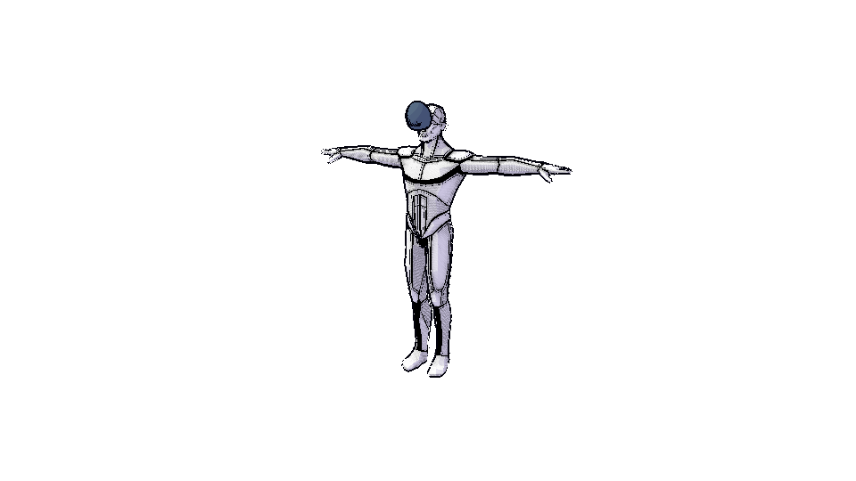
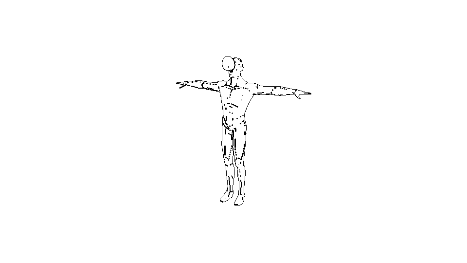
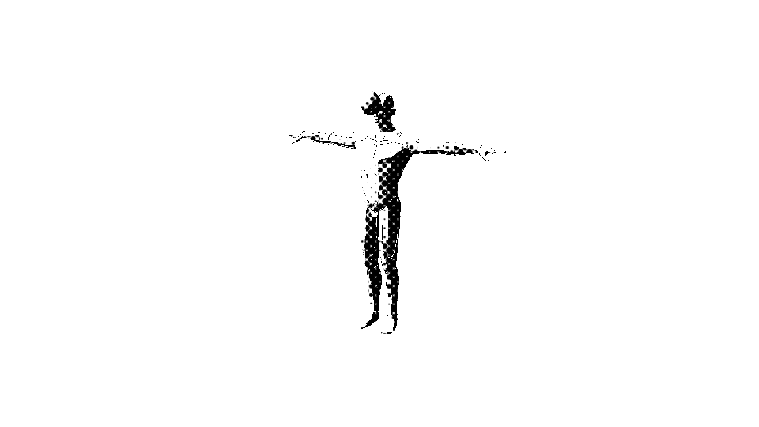
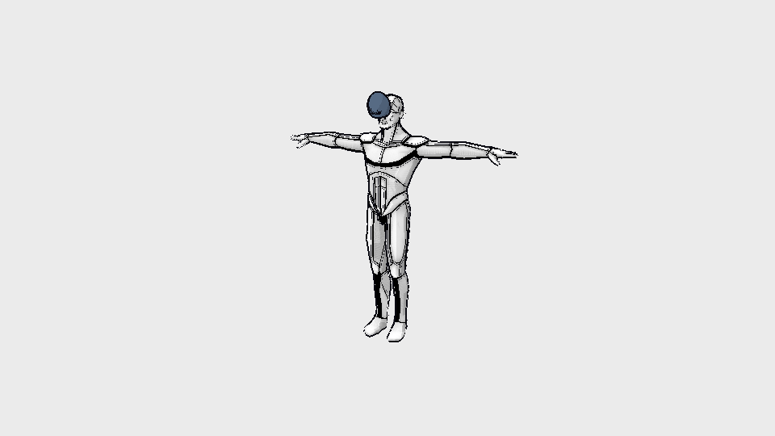

# Godot 3D 한계 진단과 적용 모드 평가 — 2026-10-15

- 문서 상태: `target`(평가·제안 보고서). 이 문서는 현재 기능을 설명하지 않는다.
  Studio 3D 편집·캡처·출력 경로에는 Godot가 연결되어 있지 않다. 운영 중인 Godot는 가상스튜디오 `godot-space`, `/play`, `/cuts` 세 곳의 게임형 섬(`current`)뿐이다.
- 기준: 저장소 커밋 `7e0a45710b1b1c9517005b0fee98be5c410269ed`, 조사·측정일 2026-10-15, 작성 브랜치 `claude/swq-godot`.
- 짝 문서: [ADR-0028](../adr/0028-godot-3d-adoption-modes.md)(모드별 채택 조건 제안), [PoC README](../../tools/godot-3d-poc/README.md), [측정 증거](../evidence/godot-3d-poc/2026-10-15/README.md).
- 증거 표기: **[저장소]** 기준 커밋의 `파일:줄`, **[공식]** Godot 공식 문서(URL과 확인일 2026-10-15는 §12), **[측정]** 이 PoC의 결과 JSON, **[산술]** 위 값들로 계산한 값, **[추정]** 위 넷으로 직접 확인하지 못한 추론(그렇게 표시한다).

## 1. 결론

요청(2026-10-15)은 "3D 관련 기능이 고도(Godot) 엔진 없이는 한계가 보이니 적용을 적극 검토하라"였다. 결론을 정해 두지 않고,
(1) 한계를 저장소 문서·원장·소스로 먼저 진단하고 (2) 적용 방식 네 가지 — A 브라우저 섬, B 빌드타임·헤드리스 도구, C 데스크톱 동반 앱, D 서버 렌더 — 가 각 한계를 푸는지 공식 문서와 PoC 측정으로 확인했다.

### 1.1 한 줄 판단

**이번에 확인한 범위에서는 "Godot가 없어서 생기는 3D 한계"를 찾지 못했다.** 진단한 13개 한계 중 현 스택이 못 풀면서 Godot가 푸는 것은 없었다.
이는 웹 export(모드 A)와 이 저장소의 예산·입력 형식에 대한 판정이며 Godot 엔진 자체의 품질 평가가 아니다.
이미 운영 중인 세 게임형 섬(가상스튜디오 `godot-space`, `/play`, `/cuts`)은 Godot의 맞는 용도이고 이 PoC도 그 선택을 반박하지 않는다.
한계의 대부분은 렌더 엔진이 아니라 (1) 자산·캡처 입구의 의도된 제한, (2) 모델링 기능 범위, (3) 실기기 측정 부재에서 나온다.

### 1.2 한계별 판정 (상세와 근거는 §4)

| 판정 | 한계 | 요지 |
| --- | --- | --- |
| 동등 (Godot도 풀지만 현 스택이 이미 해결) | L2 2점 투시, L3 선화·톤 래스터 패스, L13 카메라 roll·near clip·샷 연출 | `frustum_offset`이 저장소 공식과 같은 결과를 냈다. 패스는 만들 수 있으나 래스터뿐이고 벡터 선은 둘 다 없다 |
| Godot가 더 나쁨 | L1 압축 확장 GLB 입력, L8 활성화 번들, L9 WebGPU 기능, L10 배포 크기·격리 헤더, L13의 DOF 블러 | meshopt·quantization·Draco 거절, wasm gzip이 예산의 36.5배, 웹은 WebGL2(Compatibility) 고정 |
| Godot도 못 풂 | L4 직접 모델링·UV·가중치·컴포넌트·정밀 치수, L5 천·머리카락 | CSG는 프로토타이핑용, SoftBody3D는 버그가 많아 비권장 |
| 근거 부족(모름) | L6 IK·손/소품 접촉, L7 대형 장면 성능, L12 실기기·모바일 메모리 | 4.6+ IK는 웹 미검증, 소프트웨어 렌더링에서 우위 없음, 실기기 없음 |
| 도입과 무관 | L11 빌드 재현성 | PoC 소스는 재현됨. 운영 섬은 프로젝트 소스가 저장소 밖이라 재현 불가 |

### 1.3 Godot가 이기는 곳 / 지는 곳 / 모르는 곳

- **이기는 곳**: 게임형 상호작용 콘텐츠(이미 운영 중), 엔진 내장 최적화 도구(메시 LOD 자동 생성, 오클루전 컬링 — 웹 동작은 미검증), 공식 바이너리 + 체크섬 + 스크립트로 재현되는 단일 빌드(운영 섬보다 재현성이 좋다),
  짧은 렌더 코드(툰 셰이더 46줄, 외곽선 21줄 — 다만 같은 기능이 현 스택에 이미 있다), 모드 C 한정의 데스크톱 렌더 기능(DOF 블러·SSR·SDFGI 등).
- **지는 곳**: 활성화 번들(wasm gzip 36.5배), 압축 GLB 입력, WebGPU 기능, 격리 헤더 부담, 브리지 마찰 9건, 소프트웨어 렌더링 상대 성능(모델이 그려지는 첫 프레임까지 Three 최소 페이지의 4.2~13.2배),
  단일 소유자 원칙과의 충돌, 웹의 DOF 블러 부재.
- **모르는 곳**: 실GPU·모바일 성능과 메모리, 맞춤 템플릿 크기, 4.5 이후의 웹 동작, `KHR_texture_basisu` 상충(원인 미규명), GPU 없는 실제 CI 러너에서의 캡처. 이 중 하나라도 뒤집히면 모드 A·C 판정을 다시 한다(§1.7).

### 1.4 모드별 판정

| 모드 | 판정 | 핵심 이유 |
| --- | --- | --- |
| A. 브라우저 섬(iframe + JSON/`Uint8Array` 브리지) | Studio 3D 편집·캡처·출력 경로 **미채택**. 기존 세 섬은 **현상 유지, 확장 없음**. 새 게임형 섬은 조건부(별도 ADR) | 채택 게이트 3항(활성화 예산) 불충족, 1항(성능) 근거 없음, 압축 GLB 비호환 |
| B. 빌드타임·헤드리스 도구 | **보류** | 필요한 배치 작업이 없다. 이미지를 만들려면 `--headless`가 아니라 Xvfb + Mesa(또는 GPU)가 필요하다(실측) |
| C. 데스크톱 동반 앱(`apps/desktop-sync` 연계) | **보류**(거부 아님) | 웹에 없는 렌더 기능이 필요하다는 근거가 없고, 웹 우선(ADR-0026)과 충돌 |
| D. 서버 렌더 | **제외** | 비용 정책(`free-strict`, 유료 승격 금지) |

무엇을 어느 모드로 언제 적용할지의 한 표는 §8.4와 [ADR-0028](../adr/0028-godot-3d-adoption-modes.md) §결정 3에 있다.

### 1.5 핵심 수치 (조건은 §2.2, 상세는 §7. 소프트웨어 렌더링 값은 실기기 성능이 아니다)

- **크기** [측정, 결정적]: Godot 4.4.1 `web_nothreads_release` wasm은 gzip 9,481,133 B, brotli 7,280,573 B(§7.1). 에디터 활성화 예산 260,000 B의 36.5배, 런타임 카탈로그 최댓값의 19.0배다. 4.5.1·4.6·4.7에서도 전송 크기는 줄지 않았다(4.7은 gzip +7.1%).
- **기동** [측정, n=5, 헤드리스 Chromium + SwiftShader, 단일 스레드·격리 없음]: 콜드 첫 프레임 2,642 ±1,011.8 ms, wasm 인스턴스화 1,221.8 ±552 ms(loadavg 약 11에서 잰 값이라 부하에 크게 좌우된다, §7.2). 더 낮은 부하(§7.9)에서 같은 GLB를 그릴 때 모델이 그려진 첫 프레임은 Godot 1.5 / 2.0 / 2.2초, Three 최소 페이지 0.1 / 0.5 / 0.4초다(합성 / Orion / 방). HTTP 캐시가 적중하는 재방문에서도 첫 프레임까지 약 2.7~3.4초가 걸려 캐시는 전송(7,280,573 B)만 없앤다(§7.2). 브라우저 RSS 합은 빈 WebGL 페이지보다 약 337 MiB 크다.
- **같은 GLB 상대 비교** [측정, n=5]: 모델이 그려진 첫 프레임까지 Godot가 Three 최소 페이지의 13.2 / 4.2 / 5.4배(합성 1,664 / Orion 14,604 / 방 254,771 삼각형), 프레임 시간은 1.2 / 1.8 / 2.0배(§7.9).
- **인스턴싱** [측정, n=3]: Godot `MultiMesh`가 Three `InstancedMesh`보다 빠르지 않았다. 프레임 시간 비 2.9 / 1.9 / 1.9배(1k / 10k / 100k, §7.8).
- **호환성** [측정]: `EXT_meshopt_compression`·`KHR_mesh_quantization`·`KHR_draco_mesh_compression`이 required인 GLB는 4.4.1과 4.7 모두 열리지 않는다. `KHR_texture_basisu`는 UASTC(zstd 유무)와 ETC1S 세 모드 모두 열린다(§7.4). 저장소 검증기는 이 확장을 금지하고 있어 상충한다(§9.3).
- **2점 투시** [측정]: `frustum_offset`로 8개 케이스의 세로 모서리 기울기가 모두 0 px, 저장소 `lensShiftY` 공식과의 차이 6.2e-8. 같은 기능이 Three/Babylon에 이미 있다(§7.7).
- **브리지** [측정]: ping 왕복 0.2 ±0.1 ms, JSON 1 MiB 왕복 20.1 ±2.9 ms(iframe), `Uint8Array` 8 MiB 입력의 Godot 쪽 복사 1.2 ±0.1 ms(Godot의 sha256 검증을 더한 왕복은 43.1 ±12.7 ms), 이진 출력은 base64로 33% 커진다. iframe에서 `ArrayBuffer`는 0 B가 전달된다(§7.5).
- **헤드리스** [측정]: `--headless`는 프레임을 그리지 않았고(`framesDrawn 0`) Xvfb + Mesa llvmpipe에서는 그려졌다(§7.10).

### 1.6 지금 할 수 있는 일 (도입 여부와 무관, 별도 변경으로)

이미 운영 중인 Godot 섬의 정비 네 가지다(§8.5, ADR-0028 §결정 4): (1) Godot MIT 라이선스 고지 추가(확인한 세 곳에서 항목 없음), (2) 세 섬이 같은 43,699,190 B wasm을 세 URL에 싣는 중복 정리(공유 URL 가능성 검증),
(3) 섬의 Godot 프로젝트 소스를 저장소로 편입해 pck 재현(PoC의 `fetch-engine.sh`/`build.sh` 구조 재사용), (4) `KHR_texture_basisu` 금지 목록의 상충 재검증. 이 보고서와 ADR은 코드를 바꾸지 않았다.

### 1.7 결론을 뒤집을 수 있는 조건

- 실GPU·모바일 측정에서 Godot가 현 스택보다 p95 25% 이상 낫거나 처리 규모가 2배이고, 동시에 섬 전용 활성화 예산이 정해질 때 (모드 A의 새 섬 판단).
- 웹 경로로 만들 수 없는 필수 렌더 품질(예: 최종 컷의 DOF 블러·전역 조명)이 재현되고 실기기 측정이 있을 때 (모드 C).
- 4.6+ IK 프레임워크가 웹에서 동작하고 크기 대비 효과가 입증될 때 (L6).
- 맞춤 템플릿으로 wasm 전송 크기가 활성화 예산 근처까지 줄어들 때 — 이 PoC는 그럴 가능성이 낮다고 추정하지만 [추정] 측정하지 않았다.

## 2. 범위와 방법

### 2.1 무엇을 비교했는가

- **현재 스택**: Three 0.184.0 + R3F 9.6.1 + three-vrm(대화형 편집의 단일 소유자), Babylon 9.19.0(격리된 캡처 전문 런타임), manifold-3d 3.5.1(불리언), Rapier 0.19.3(결정적 강체) — `package.json:304-306,314,319,366,398`.
- **Godot**: 공식 4.4.1-stable 웹 export 템플릿(`web_nothreads_release`)과 같은 프로젝트를 Linux 4.4.1 엔진으로 빌드. 운영의 세 Godot 섬이 쓰는 wasm과 같은 파일이다
  (`godot-space`·`play-godot`·`cuts-godot`의 `index.wasm`은 모두 43,699,190 B, sha256 `e4a43dbae28662b2a68f6136857a94db6695430901515800b9883f6327cb7116`이고
  PoC 빌드의 `index.wasm`·`index.js`와 바이트가 같다 — 이 PoC가 운영과 같은 엔진 바이너리를 측정한다는 뜻이다). 4.5~4.7은 공식 문서·릴리스 노트로 차이를 표시하고,
  4.7은 wasm 크기·확장 호환·2점 투시·상대 비교만 같은 하네스로 다시 확인했다.
- **적용 모드**: A 브라우저 섬(iframe + JSON/ArrayBuffer 브리지), B 빌드타임·헤드리스 도구, C 데스크톱 동반 앱(`apps/desktop-sync` 연계), D 서버 렌더.

### 2.2 측정 조건 (모든 [측정] 값에 적용)

- 브라우저: Playwright(저장소 `playwright@1.62.1`)로 띄운 헤드리스 Chromium 141.0.7390.37, `--use-angle=swiftshader`(소프트웨어 WebGL2). **GPU 없음.** WebGPU는 `navigator.gpu`가 `undefined`다.
- 머신: 4 vCPU Xeon, 16 GB, 컨테이너. **다른 작업과 공유되어 부하가 일정하지 않았다.** 스위트별 시작·종료 `loadavg`(1/5/15분)는 결과 JSON `_meta`와 §7 표 위의 조건 줄에 적었다. 파일별 1분 `loadavg` 범위는 b1(크기·콜드 순차·워밍·격리) 6~10.8, b2(나머지 스위트) 2.6~4.7, b3(브리지·GLB 재실행) 7.6~19.3, b4(브리지·콜드 라운드 로빈·워밍·재방문) 9.7~13.6, b5(메모리 반환) 19.7~19.8, b6(확장 호환 재실행, 결정적 결과) 14.6~15.4, 4.7 축소 배치 2.6~5, 4.7 확장 호환 14.6~16.4 이다. 부하가 다른 스위트끼리는 시간 값을 직접 비교하지 않는다.
- 반복: 스위트별 기본 5회, `coi`·`bench`·`memory`는 3회. 반복마다 새 브라우저(캐시·V8 코드 캐시 없음). 같은 브라우저 안 재탐색(`warm`)과 영구 프로필 재방문(`revisit`)은 별도 스위트. 중앙값과 MAD(중앙값 절대편차), `n`을 함께 낸다.
- 서버: `127.0.0.1`의 Node 정적 서버(네트워크 지연 없음, 헤더는 변형별로 고정). 뷰포트 960x540, DPR 1, MSAA 없음.
- 비교 기준: 저장소가 이미 쓰는 Three 0.184.0을 Vite로 번들한 최소 페이지(`tools/godot-3d-poc/measure/three-baseline/`)가 **같은 GLB, 같은 카메라, 툰 3단 + 픽셀 외곽선**을 그린다.
- **소프트웨어 렌더링 FPS와 프레임 시간은 실기기 성능이 아니다.** 같은 조건에서 두 엔진을 나란히 돌린 상대값, 파일 크기, 메모리, 시작 시간, 파싱·브리지 같은 CPU 비용만 의미를 둔다.
  ADR-0026 §E 23항도 소프트웨어 렌더러 결과를 성능 증거로 쓰지 않는다고 정한다.
- 측정하지 않은 값은 쓰지 않는다. 문서에서 가져온 값은 [공식]으로, 저장소 값은 [저장소]로 출처를 적었다. 산술로 계산한 값은 [산술]로 표시한다.

### 2.3 이 PoC가 확인하지 못하는 것

실GPU·모바일·Safari·장시간 soak·메모리 압력, 맞춤 빌드한 작은 템플릿(공식 템플릿만 썼다), 4.5 이후 기능의 실제 동작(문서 근거만), VRM 휴머노이드·스프링본, 클로스. 자세한 목록은 §11.

## 3. 현재 상태 (`current`)

### 3.1 Studio 3D

- 대화형 편집 장면의 유일한 소유자는 Three/R3F이고, 영속 상태는 엔진 객체가 아니라 `StudioBg3dSceneDocument`다. 두 번째 엔진은 격리된 전문 런타임으로만 쓴다.
  [저장소] `docs/studio-3d-engine-specialist-topology-2026-07-18.md:12-27`(결론 1~7), `docs/studio/studio-3d-next-platform-architecture-2026-09-10.md:245`("Runtime engines own no canonical data").
- 두 번째 엔진의 채택 게이트 7항(Three 대비 p95 25% 개선 또는 처리 규모 2배, 종료 뒤 자원 복귀, 활성화 gzip 예산, SceneDocument 왕복, 캡처 golden, 장애 복귀, 라이선스·보안)이
  `docs/studio-3d-engine-specialist-topology-2026-07-18.md:264` 아래에 있다. 같은 수치 기준이 코드에도 있다: `studio-bg3d-engine-benchmark-analysis.ts:20,25`(프레임 시간 개선 비율 0.25, 도구 열기 gzip 증가 상한 0.15).
- 에디터 활성화 예산은 `studio-bg3d-engine-selection.ts:254`의 `STUDIO_BG3D_EDITOR_ACTIVATION_BUDGET_GZIP_BYTES = 260_000`이고, 런타임 카탈로그의 최댓값은 500,000(`studio-bg3d-runtime-topology.ts:309`)이다.
- 이전 평가의 결론: 임베디드 편집 엔진으로 Godot Web을 채택하지 않는다 — `docs/studio/studio-3d-next-platform-architecture-2026-09-10.md:98`(§3.4), `docs/studio-3d-engine-specialist-topology-2026-07-18.md:128`,
  `docs/reports/studio-3d-engine-evaluation-2026-09-12.md:40`. 같은 보고서 `:104`는 "Unity/Godot/Unreal은 웹 경로로 충족할 수 없는 필수 품질이 재현될 때 별도 proof-of-concept"를 조건으로 건다.
  이번 PoC는 요청에 따라 그 조건 전에 실행한 것이며, 아래 §4가 그 조건(웹 경로로 못 만드는 필수 품질)이 실제로 있는지를 점검한다.

### 3.2 Godot 섬 (이미 운영 중)

- 가상스튜디오 `godot-space`(`/godot-space/index.html`, `StudioGodotSpaceEmbed.tsx:66`), `/play`(`PlayGodotEmbed.tsx:7` — "엔진 wasm(약 9.5MB gzip)"), `/cuts`(`CutsGodotEmbed.tsx`) 세 섬이 같은 공식 4.4.1 `web_nothreads_release` wasm을 **세 URL에 각각** 싣는다.
  `index.pck`만 다르다(448,624 / 386,016 / 1,132,080 B).
- 브리지: 셸이 `window.__tsvsHost`를 먼저 등록하고(`StudioGodotSpaceEmbed.tsx:691`) Godot가 `onXxx(json)`으로 부르며, 셸 -> Godot는 iframe 창의 `__tsvs_*` 함수들이다
  (`studio-godot-space-embed-support.ts:62,80`). 모든 페이로드는 JSON 문자열이다. 이 PoC의 브리지(`ts3d`)는 같은 모양을 쓰되 이름을 분리해 기존 계약을 바꾸지 않는다.
- 헤더: `/studio`는 COOP `same-origin` + COEP `credentialless`(`config/http-response-headers.json:52`), `/godot-space`는 COOP + COEP `credentialless` + CORP `same-origin`과 CSP `'wasm-unsafe-eval' 'unsafe-eval'`(`:437-470`).
- 배포: Static Assets 개별 파일 한도는 25 MiB이므로 Godot wasm 세 개는 Brotli·gzip sidecar로 우회한다(`deploy/cloudflare-static/README.md:99`).
- 소스: 섬의 Godot 프로젝트는 저장소 밖에 있다(`tools/play-godot/README.md:11`, `tools/cuts-godot/README.md:9`). 저장소만으로는 wasm 외 부분(pck)을 재빌드할 수 없다.

### 3.3 `apps/desktop-sync` (모드 C의 접점)

`apps/desktop-sync`는 충돌 안전 양방향 폴더 동기화(Google Drive·Dropbox·OneDrive adapter)와 CLI를 소유하는 desktop 동기화 앱·library다(`apps/desktop-sync/README.md:3-4`). 렌더링이나 3D 기능은 없다.
따라서 Godot 데스크톱 동반 앱을 만든다면 동기화 폴더를 통해 파일(SceneDocument 파생물, GLB, 결과 PNG·메타)을 주고받는 **별도 프로세스**가 된다 [추정: 설계 해석이며 구현·시도된 적 없다].

## 4. 한계 진단

각 한계마다 (a) 현재 스택에서 풀리는지, (b) Godot 4.4 공식 문서 기준으로 Godot가 푸는지, (c) 웹 export 제약과 4.5 이후 차이를 반영한 판정, (d) 이 PoC의 측정을 적는다. 판정은 **풀림 / 부분 / 못 풂 / 더 나쁨 / 동등 / 모름** 중 하나다.

| ID | 한계 (저장소 근거는 아래 절) | (a) 현재 스택 | (b) Godot로 풀리는가 (공식 4.4 문서) | (c) 웹 export 제약 반영 판정 | 데스크톱·도구(모드 B·C) |
| --- | --- | --- | --- | --- | --- |
| L1 | 압축 확장 GLB 입력 | 부분: Three는 열고 Babylon 캡처는 정책상 거부 | 필수 확장을 모르면 파일 전체 거절 | **더 나쁨**: meshopt·quantization·Draco 거절 [측정] | 같은 로더라 동일 |
| L2 | 2점 투시(렌즈 시프트) | 풀림(구현·회귀 테스트) | 가능: `PROJECTION_FRUSTUM` + `frustum_offset` | **동등**(차별점 없음) [측정] | 동등 |
| L3 | 선화·톤 패스 | 부분: 래스터만, 벡터 선 없음 | 가능(래스터): 깊이·법선·N·L 패스 + 셰이더 후처리 | **동등(능력)**, 품질 우위는 주장 못 함, 벡터 선 없음 [측정] | 벡터 선은 Blender 경로 |
| L4 | 직접 모델링·UV·가중치·컴포넌트·정밀 치수 | 못 풂(외부 DCC 전제), 패널은 있으나 전문 제작 완주 미달 | CSG는 프로토타이핑용, UV·폴리곤 편집 없음 | **못 풂** | 못 풂 |
| L5 | 천·머리카락 물리 | 부분: CPU XPBD 참조 커널 | SoftBody3D는 버그가 많아 비권장 | **못 풂** | 못 풂 |
| L6 | IK·손/소품 접촉 고정 | 부분: 2본 IK, 지속 핀 없음 | 4.4 `SkeletonIK3D` 비권장, 4.6+ IK 프레임워크 | **모름**(4.6+ 웹 동작 미검증) | 4.6+ 후보, 미검증 |
| L7 | 대형 장면 성능 | 부분: 인스턴싱·적응 DPR | MultiMesh·메시 LOD·오클루전 컬링 | **우위 없음**(소프트웨어 렌더 상대 비교) [측정] | 모름(실기기 없음) |
| L8 | 활성화 번들 예산 | 풀림 | (해당 없음) | **더 나쁨**: 예산의 36.5배 [측정] | 웹 예산 대상 아님 |
| L9 | WebGPU 전용 기능 | 부분: Babylon/Three WebGPU | 웹은 WebGL2만 | **불가** | 해당 없음 |
| L10 | 배포 크기·중복·격리 헤더 | 풀림 | 스레드·GDExtension은 격리 필요 | **더 나쁨**(기존 wasm 중복은 별개) [측정] | 설치 배포 비용 |
| L11 | 빌드 재현성 | 풀림(저장소 소스) | (해당 없음) | **PoC는 풀림, 운영 섬은 못 풂** | 풀림 |
| L12 | 실기기·모바일 메모리 | 못 풂(이 환경 한계) | (해당 없음) | **모름**: 데스크톱 메모리 바닥값만 측정 [측정] | 못 풂 |
| L13 | 카메라 연출(roll·near clip·DOF·샷 덱) | 부분: 북마크·easing·DoF 설정 구현 | `Camera3D`·`AnimationPlayer`로 가능, DOF 블러는 Compatibility 불가 | **동등**, DOF 블러는 더 나쁨 | 데스크톱(Mobile·Forward+)은 DOF 가능 |

"풀림"은 해당 한계가 현 스택에서 이미 해결되어 있다는 뜻이지 품질이 최고라는 뜻이 아니다. 아래에 한계별 근거를 적는다.

### L1. 압축 확장 GLB 입력

- [저장소] `studio-bg3d-babylon-artifact-capture.ts:377`: 디코더가 필요한 확장(`UNSUPPORTED_DECODER_EXTENSIONS`, `:120`)이 있는 GLB는 `unsupported-scene-feature`로 거부한다.
  `:382`: 디코드 결과 예산을 보장하지 못하는 확장(`BUDGET_STABLE_CAPTURE_EXTENSIONS` 밖, `:125`)도 거부한다. 코드 주석의 이유는 디코더 URL·설정이 검증된 스냅샷 경계를 벗어나지 않게 하는 fail-closed다.
  `:730` 근처의 `assertSupportedDocument`는 정사영, 비어 있지 않은 sky preset, 활성 pose·morph·constraint를 가진 모델도 거부한다.
- [저장소] 제품 텍스처 표준은 KTX2, 지오메트리 압축은 gltfpack의 meshopt다(`docs/studio/studio-3d-next-platform-architecture-2026-09-10.md:159-181`). 목표 상태의 배포 GLB는 압축 확장을 쓴다.
- [저장소] 운영 Godot 섬이 이미 같은 문제를 겪었다: `apps/api/src/modules/studio-godot-space-layout/studio-godot-background-glb.ts:15,31`은 `EXT_meshopt_compression`, `KHR_mesh_quantization`,
  `KHR_draco_mesh_compression`, `KHR_texture_basisu`가 required인 GLB를 업로드 경계에서 거부한다(2026-10-12 헤드리스 실측이라고 주석에 적혀 있다).
- (a) 현재 스택: Three(+Meshopt/Draco/KTX2 디코더)는 이 PoC의 모든 확장 픽스처를 열었다 [측정 ext]. Babylon 캡처의 거부는 엔진 한계가 아니라 **의도된 정책**이라 "디코더 바이트 신원 증명"이 생기면 설계로 풀 수 있다.
- (b) Godot: 런타임 로더 `GLTFDocument.append_from_buffer`는 필수 확장을 지원하지 않으면 파일 전체를 거절한다. [측정] 4.4.1과 4.7 모두 `EXT_meshopt_compression`, `KHR_mesh_quantization`,
  `KHR_draco_mesh_compression`이 required인 파일을 열지 못한다(실제로 압축한 파일과 선언만 한 파일 모두). 4.7에서는 실제 meshopt 파일의 오류 메시지가 다르다("Buffer 1 has no data and cannot be loaded" — 오류 검사 순서가 바뀐 것으로 보이며 어느 쪽이든 열리지 않는다).
  `KHR_texture_basisu`는 KTX2 세 모드(UASTC + zstd, UASTC 무압축, ETC1S)와 선언만 한 파일이 모두 열리고, 웹에서는 텍스처가 렌더된다(웹 4.4.1·4.7, 네이티브 `--headless`·Xvfb에서 확인). 네이티브에서 디코드된 이미지는 `RGBA8`이었다. Godot가 보고한 지원 확장 목록은 `get_supported_gltf_extensions()` 결과로 §7.4에 있다.
  공식 문서는 런타임 glTF 로딩을 "any 3D DCC that can export to glTF"용 기능으로 소개한다([공식] runtime_file_loading_and_saving).
- (c) 웹 제약: 웹에서 `GDExtension`으로 로더를 확장하려면 웹용으로 따로 컴파일하고 교차 출처 격리가 필요하다([공식] 웹 export). 4.5 이후 문서에서 이 문장은 그대로다.
- 판정: **더 나쁨.** Godot는 현 스택보다 좁은 입력만 받는다. 호스트가 압축을 풀어 비압축 GLB로 다시 만들어 넘기는 우회가 있을 수 있으나 [추정] 이 PoC는 시도하지 않았고, 그만큼 변환 비용과 코드가 늘어난다.
- 주의 — 상충하는 근거: 저장소 검증기는 `KHR_texture_basisu`도 금지하고 주석은 "실패 확정"이라 적지만, 이 PoC는 같은 확장을 네 형태(UASTC + zstd, UASTC 무압축, ETC1S, 이미지 없이 선언만)로 엔진 두 버전과
  웹·네이티브 세 경로에서 시험했고 모두 열렸다. 저장소 쪽 실측의 파일·로그는 찾지 못했다(코드 주석뿐). 이 PoC의 시험은 128x128 합성 텍스처 하나라 큰 해상도·노멀/ORM 텍스처·여러 텍스처, 저장소 파이프라인이 만든 실제 파일은 시험하지 않았다.
  어느 쪽이 맞는지, 또는 둘 다 맞는 조건이 있는지 이 PoC는 단정하지 않는다. 금지 목록은 저장소 파이프라인 산출물로 재현을 확인하기 전에 바꾸지 않는 것을 권한다(재현 도구: `native/probe-ext.sh`).

### L2. 2점 투시(렌즈 시프트)

- [저장소] `studio-bg3d-lens.ts:88,93`: `lensShiftY = -tanPitch / (2 · tanHalfFov)`, 문서 한도 ±2로 클램프. `studio-bg3d-babylon-camera-projection.ts:43-44`: Babylon은 투영 행렬 2행에 시프트를 넣는다. Three는 `setViewOffset`(주석 `studio-bg3d-lens.ts:70-76`).
- (a) 현재 스택: 구현과 회귀 테스트가 있다.
- (b) Godot: `Camera3D.PROJECTION_FRUSTUM`의 `frustum_offset`은 공식 문서가 "tilted frustum" 효과(Y-shearing)용으로 정의한다([공식] Camera3D, `PROJECTION_FRUSTUM`에서만 유효).
  PoC 실측: `size`는 KEEP_HEIGHT에서 near 평면의 세로 폭으로 동작하고, `frustum_offset = (sx·size·aspect, −sy·size)`가 저장소 공식과 같은 결과를 낸다 [측정 twopoint, §7.7].
- (c) 웹 제약 없음(투영 수학은 렌더러와 무관). 4.5 이후 차이 없음.
- 판정: **동등.** Godot의 차별점이 아니다. 저장소 클램프(±2) 때문에 피치가 큰 구도에서 타깃이 프레임을 벗어나는 것은 문서 정책이지 엔진 한계가 아니다(§7.7의 클램프 두 케이스).

### L3. 선화·톤 패스

- [저장소] `docs/product/ALL_IN_ONE_IMPLEMENTATION_STATUS.md:48`: "선화·톤 패스의 전문 제작 완주"가 3D 배경 제작의 남은 격차다. `docs/studio-3d-webtoon-tool-benchmark-2026-07-19.md:184`: 선화·톤은 RGBA/depth를 받는 요청별 Worker 래스터 계산이다.
  `:565`(CLIP STUDIO 3D 대비 격차에 vector line), `:570`(Blender의 Line Art/Freestyle은 "외부 DCC + 격리 specialist").
- (a) 현재 스택: 래스터 LT는 구현되어 있다. 벡터 선은 없다.
- (b) Godot: PoC에서 depth·normal·N·L 패스와 화면 공간 선화·하프톤 톤을 셰이더로 구현하고 PNG로 돌려주었다 [측정 capture]. 결과는 래스터다. 뒤집은 껍질 외곽선은 `cull_front` 셰이더 한 장으로 된다(`outline.gdshader`).
  스텐실 기반 외곽선은 4.5 이후 기능이고 공식 문서가 "Stencil support is experimental"이라고 표기한다([공식] spatial_shader, stencil modes).
- (c) 웹 제약: 3D 뷰포트 출력은 8비트(RGBA8)다 — [공식] 4.7 문서의 렌더러 표가 Compatibility의 색 정밀도를 "RGBA8. Low dynamic range, medium precision."으로 적고, 4.4 문서에는 이 행이 없다.
  PoC가 이를 실측했다: 3D 출력이 낮은 값에서 항등이 아니다(입력 16이 12로 읽힘, 8비트 선형 버퍼의 양자화 뒤 sRGB 변환 때문일 것으로 추정하나 규명하지 않았다). 그래서 패스 값을 [64, 255]에 오프셋 코딩하고 깊이는 3자리 192진 패킹으로 돌려준다(코딩 구간 복원 오차 0).
  저장소의 캡처 계약(RGBA8 straight alpha, depth 비동기 출력)과 직접 호환되지 않는 PoC 규약이다.
- 품질에 대한 주의: 이 PoC의 선화는 깊이·법선 경계만 쓰는 최소 구현이라 샘플 PNG(`sample-orion-native-line.png`)에 점선 형태의 잡음이 있다. 선 선택·얼굴 내부선 억제·픽셀 기준 선폭 같은 전문 선화 품질은 만들지 않았고,
  평가 보고서(`docs/reports/studio-3d-engine-evaluation-2026-09-12.md`의 "선화" 행)가 말하듯 엔진 기능 유무가 아니라 알고리즘을 따로 설계해야 하는 부분이다. 이 PoC는 **능력**(패스를 만들 수 있다)만 보였고 **품질 우위**는 주장하지 않는다.
- 판정: **동등(능력).** 어느 엔진이든 래스터 패스를 만들 수 있다. 벡터 선은 둘 다 없고 기존 결정(Blender 경로)이 유지된다.

### L4. 직접 모델링·UV·가중치·컴포넌트·정밀 치수

- [저장소] `ALL_IN_ONE_IMPLEMENTATION_STATUS.md:48`("직접 모델링, 컴포넌트, 정밀 치수"), `studio-editable-half-edge-mesh.ts:8`(범위: knife·bridge·subdiv 제외), `:16`(정점 상한 250,000),
  `studio-manifold-mesh-provider.ts:7`(입력 삼각형 상한 500,000), 벤치마크 `:570`(topology/sculpt/UV/weights는 외부 DCC).
  컴포넌트와 치수 도구의 패널은 이미 있다(`StudioBg3dDynamicComponentsPanel.tsx`, `StudioBg3dMeasurementPanel.tsx`). 남은 격차는 "전문 제작 완주"라는 완성도이지 렌더 엔진의 부재가 아니다.
- (b) Godot: CSG 노드는 "mainly intended for prototyping", "no built-in support for UV mapping or editing 3D polygons"([공식] CSG tools). 런타임 `ArrayMesh`/`SurfaceTool`은 프로그램 API이고 모델링 UI가 아니다.
  공식 문서에서 정밀 치수·제약 기반 모델링 기능은 찾지 못했다 [추정: 확인한 문서 범위에서 없음].
- 판정: **못 풂.** 기존 결정(외부 DCC = Blender)이 맞다. Godot를 넣어도 이 격차는 그대로다.

### L5. 천·머리카락 물리

- [저장소] `studio-cloth-xpbd-kernel-v2.ts:4`(결정적 CPU 참조 커널), `:18,24`(입자 8,192, self-collision 쌍 131,072 등 예산), 차세대 구조 문서 `:116`(Rapier는 강체 권위), `:120`(WebGPU XPBD는 "build").
- (b) Godot: SoftBody3D 문서는 "There are many known bugs in SoftBody3D"라서 게임플레이에 영향을 주는 용도로 권하지 않는다고 적는다([공식] SoftBody3D). 4.4의 Jolt는 내장 모듈이지만 문서가 "not finished, experimental, and lacks feature parity"로 표기하고
  SoftBody3D와 Area3D의 상호작용을 지원하지 않는다고 한다([공식] Using Jolt Physics). 4.6 릴리스 노트는 Jolt를 신규 3D 프로젝트의 기본값으로 올렸다([공식] 4.6 릴리스).
- 판정: **못 풂.** 천 자기충돌·체형 적응 의상 솔버는 Godot가 제공하지 않는다. 4.6+ Jolt는 강체에는 의미가 있으나 L5의 핵심이 아니다.

### L6. IK·손/소품 접촉 고정

- [저장소] 벤치마크 `:565`(지속 end-effector pin, BVH retarget 격차), 차세대 구조 `:291`(Hand + prop), 평가 보고서 `:53`(엔진에 IK API가 있어도 손 접촉·undo는 자동 완성되지 않는다), 현재 스택은 순수 2본 IK와 aim 제약을 SceneDocument에 둔다.
- (b) Godot 4.4: `SkeletonIK3D`는 deprecated다([공식] SkeletonIK3D). 4.6: `IKModifier3D` 계열(TwoBoneIK3D, FABRIK3D, CCDIK3D, JacobianIK3D, SplineIK3D)이 새로 들어왔고, 애니메이션 제약의 타깃을 3D 노드로 지정해 손이 무기에 붙게 할 수 있다고 소개한다
  ([공식] 4.6 릴리스, IKModifier3D 클래스 문서).
- (b) Godot 리타깃: 공식 문서는 애니메이션을 서로 다른 스켈레톤이 공유하려면 본 이름뿐 아니라 Bone Rest도 맞춰야 하고 "using the scene importer"로 할 수 있다고 적는다([공식] Retargeting 3D Skeletons) — 에디터의 임포트 단계 작업이다.
  런타임 GLB 경로에서의 리타깃은 검증하지 않았고, 저장소의 BVH retarget 격차(벤치마크 `:565`)에 대응하는 BVH 임포트는 이 평가가 확인한 공식 문서에서 찾지 못했다.
- 판정: **모름.** 4.6+는 후보지만 이 PoC는 웹에서 동작을 검증하지 않았다. 설령 되더라도 대화형 포즈 편집이 Godot 안으로 옮겨가면 "단일 소유자" 원칙(§3.1)을 깨고,
  포즈 연산만 전문 작업으로 빼면 Godot wasm(§7.1) 전체를 그 연산 하나에 싣게 된다.

### L7. 대형 장면 성능

- [저장소] `docs/studio-3d-engine-specialist-topology-2026-07-18.md:84`(적응형 DPR 단계), `:92`(같은 모델 3개 이상 반복이면 instancing), `studio-bg3d-engine-benchmark-analysis.ts:20`(p95 25% 개선 기준).
- (b) Godot: `MultiMesh`는 "A MultiMesh is a single draw primitive that can draw up to millions of objects in one go", "there is no screen or frustum culling possible for individual instances"([공식] Using MultiMesh).
  메시 LOD는 임포트 시 자동 생성되고 meshoptimizer를 쓴다, 오클루전 컬링은 베이크된 Occluder3D를 쓴다([공식] Mesh LOD, Occlusion culling) — 둘 다 에디터 임포트·베이크 흐름이 전제이고 런타임 GLB 경로에서 동작하는지는 검증하지 않았다.
- (d) [측정 bench, compare]: 같은 소프트웨어 렌더러에서 Godot MultiMesh가 Three InstancedMesh보다 빠르다는 증거는 없다(§7.8, §7.9). 실GPU 비교는 하지 못했다.
- 판정: **우위 없음.** 채택 게이트 1항(Three 대비 p95 25% 개선 또는 규모 2배)을 충족하는 근거가 없다.

### L8. 활성화 번들 예산

- [저장소] 에디터 활성화 gzip 예산 260,000 B(`studio-bg3d-engine-selection.ts:254`), 런타임 카탈로그 최댓값 500,000 B(`studio-bg3d-runtime-topology.ts:309`),
  Wonderland(wasm 엔진) 400,000 B(`:344-349`), "모바일·저메모리 환경에서는 누적 활성화 gzip/힙 예산 때문에 두 번째 엔진을 거부한다"(`docs/studio-3d-engine-specialist-topology-2026-07-18.md:27`).
- (d) [측정 sizes]: Godot 4.4.1 `web_nothreads_release`의 wasm은 gzip 9.48 MB, brotli 7.28 MB(§7.1). 에디터 예산의 36.5배, 카탈로그 최댓값의 19.0배다.
  [측정 revisit, §7.2] 압축 전송에서 HTTP 캐시가 적중하는 재방문에서도 첫 프레임까지 약 2.7~3.4초가 걸렸다(loadavg 11~14, 소프트웨어 렌더링): 캐시는 7,280,573 B 전송만 없애고 압축 해제·컴파일·엔진 초기화는 방문마다 반복된다.
  엔진은 하나의 wasm이라 기능을 지연 로드로 쪼갤 수 없다. 공식 웹 export 문서는 사용하지 않는 기능을 끈 맞춤 템플릿이 "this can reduce the size of the WebAssembly payload significantly"라고 적지만 수치는 없고([공식] 웹 export, Optimizing a build for size도 방법만 적는다), 이 PoC는 맞춤 템플릿을 만들지 않아 효과를 모른다.
- 판정: **더 나쁨(구조적).** 도구를 여는 경로에서는 예산 충족이 불가능하다. 사용자가 명시적으로 들어가는 별도 화면(섬)에서만 허용될 수 있고, 그 경우에도 예산은 별도로 정해야 한다.

### L9. WebGPU 전용 기능

- [저장소] 차세대 구조 `:120`(WebGPU XPBD), 벤치마크 `:644-652`(§7.4: WebGPU 후보 작업은 대규모 line/thumbnail compute, skin/morph compute, visibility/LOD), `docs/reports/character-lab-engine-alternatives-2026-10-01.md:48`, ADR-0026 `:137`(Godot 웹 export를 "WebGPU 상한 없음", 곧 WebGPU 경로가 없다는 사유로 기각).
- (b) Godot: "Godot 4.0 and later can only target WebGL 2.0 (using the Compatibility rendering method)... does not support WebGPU"([공식] 웹 export 4.4). 4.5·4.6·4.7 문서도 WebGPU 미지원을 적는다. 컴퓨트 셰이더는 Compatibility에서 지원되지 않는다([공식] 렌더러 비교표).
- 판정: **불가.** 저장소가 WebGPU로 가려는 방향의 기능(컴퓨트 기반 XPBD·선화)에는 Godot 웹이 맞지 않는다.

### L10. 배포 크기·중복·격리 헤더

- [저장소] 세 섬이 같은 wasm을 세 URL에 둔다(§3.2), 한도 우회는 sidecar + R2(`deploy/cloudflare-static/README.md:99`). `config/free-infrastructure-policy.json:3,36`(`free-strict`, 배치 연산은 `local-m2-runner`)과
  `docs/operations/minimum-cost-deployment-policy.md:22`(유료 플랜·유료 failover·상위 빌드 머신 자동 승격 금지).
- (b) Godot: 스레드 빌드와 GDExtension은 교차 출처 격리(COOP + COEP)가 필요하고 "no ads, nor third-party integrations on the website"라는 부작용이 있다([공식] 웹 export). 단일 스레드가 4.3부터 기본이다.
- (d) [측정 coi, §7.3]: 스레드 변형은 격리 헤더가 없으면 부팅하지 못한다. COEP `require-corp` 부모는 CORP 없는 교차 출처 이미지를 막고 `credentialless`는 허용한다. COEP 부모 안의 iframe은 자식도 COEP 헤더를 보내야 열린다.
  단일 스레드 섬은 격리 없이도 부팅한다. 운영이 이미 `credentialless`를 쓰는 것은 이 결과와 맞는다.
- 판정: **더 나쁨.** 단, 세 섬의 wasm 중복은 새 도입과 무관한 기존 개선 여지다(§8.5).

### L11. 빌드 재현성

- [저장소] 운영 섬의 프로젝트 소스는 저장소 밖에 있다(`tools/play-godot/README.md:11`, `tools/cuts-godot/README.md:9`). `tools/play-godot/README.md`는 백그라운드 export로 pck가 잘린 전례를 기록한다.
- (d) [측정]: 이 PoC는 프로젝트 소스, 공식 SHA512 앵커, 빌드 스크립트를 저장소에 두었다. **완전히 빈 캐시**에서 `fetch-engine.sh`(17초, 두 아카이브 SHA512 일치, 웹 템플릿만 추출)와 `build.sh`(44초)를 다시 실행해
  6개 산출물(단일·스레드 변형의 wasm·js·pck)이 측정에 쓴 빌드와 바이트 단위로 모두 같음을 확인했다(`reproducibility-4.4.1.json`; `web`: wasm `e4a43dba…`, pck `b006ee5b…`, js `19eb180d…`).
  GDScript 주석만 바꾼 소스를 기존 캐시에서 다시 빌드해도 pck가 같았다(주석은 바이너리 토큰에 들어가지 않는다).
- 판정: **PoC는 풀림, 운영 섬은 못 풂.** 도입 여부와 별개로 섬의 소스를 저장소로 옮기는 것이 재현성의 전제다.

### L12. 실기기·모바일 메모리

- [저장소] `ALL_IN_ONE_IMPLEMENTATION_STATUS.md:58-59`("실기기 검사", "메모리 압력"이 남은 격차), 평가 보고서 `:106,112`(작은 뷰포트 FPS만으로 판단하면 틀릴 수 있다), 토폴로지 `:27`(모바일·저메모리에서는 두 번째 엔진을 거부).
- 이 환경에는 GPU도 모바일 기기도 없다. 현 스택도 Godot도 실기기 수치가 없다. 이 PoC의 모든 시간 값은 소프트웨어 렌더링이다. **어느 쪽 편에서도 성능 우위를 주장할 근거가 없다.**
- 측정할 수 있었던 것은 데스크톱 Chromium의 메모리 바닥값뿐이다(§7.2, §7.9, §7.11): 부팅 직후 wasm 선형 메모리 32 MiB, 방(254,771 삼각형) 로드 뒤 115 MiB이고 모델을 지운 뒤에도 115 MiB로 줄지 않았다(Orion: 32 -> 95.81 -> 95.81 MiB). 엔진이 보고하는 비디오 메모리는 방 로드 뒤 41.63 MiB에서 해제 뒤 11.74 MiB로 돌아왔다. 브라우저 RSS 합은 방 로드 뒤 1,505.3 MiB, 해제 뒤 1,495.7 MiB였다(n=3, 소프트웨어 렌더링 브라우저).
  모바일 브라우저의 탭당 메모리 한도와 비교하는 일은 하지 않았다(그 한도 값을 공식 근거로 확인하지 않았다).
- 판정: **모름.** 후속 측정은 §11의 "실기기 측정 계획"에 둔다.

### L13. 카메라 연출 (roll·near clip·DOF·샷 덱)

- [저장소] `studio-bg3d-camera-application.ts:326`(nearClip 적용), `StudioBg3dCinematicDirectorPanel.tsx:49-86`(더치 롤을 포함한 카메라 북마크와 보간), `StudioBg3dPostProcessVfxPanel.tsx:75-135`(DoF Bokeh 설정),
  `docs/studio-3d-benchmark-productization-wave-2026-09-04.md:80-87`(북마크·easing·결정적 샷 덱 재생 계획). 벤치마크 `:567`이 ABLUR 대비 격차로 적은 "near clip/roll"은 2026-07-19 문서이고 이후 코드에 nearClip과 dutch roll이 들어왔다.
- (a) 현재 스택: 부분 — 북마크·easing·샷 덱·DoF 설정이 있다. DoF 같은 후처리가 출력 패스(Babylon 캡처 등)에 반영되는지는 이 조사에서 확인하지 못했다.
- (b) Godot: `Camera3D`의 `near`, 노드 회전(roll), `AnimationPlayer` 트랙으로 같은 종류의 연출이 가능하다 [추정: 일반적 사용법이며 이 PoC는 roll·애니메이션 트랙을 구현하지 않았다]. DOF 블러는 [공식] 렌더러 비교표에서 Compatibility "Not supported", Mobile·Forward+만 지원하며 4.4·4.5·4.6·4.7 표가 같다.
- 판정: **동등**(roll·near clip·샷). **DOF 블러는 Godot 웹이 더 나쁘다**(웹은 Compatibility 고정). 데스크톱 빌드(모드 C)에서는 가능하다.

### 4.1 "웹 경로로 충족할 수 없는 필수 품질"이 있는가

평가 보고서(`docs/reports/studio-3d-engine-evaluation-2026-09-12.md:104`)가 게임 엔진 PoC의 전제로 둔 조건이다. 위 13개 중 현 스택이 못 풀면서 Godot가 푸는 항목을 찾지 못했다.
L2·L3·L13(DOF 제외)은 동등하고, L1·L8·L9·L10과 L13의 DOF 블러는 Godot가 더 나쁘고, L4·L5는 Godot도 못 풀며, L6·L7·L12는 근거가 없다(L11은 도입과 무관하다).
즉 이번 조사는 "Godot가 없어서 생기는 3D 한계"를 확인하지 못했다. 한계는 대부분 (1) 자산·캡처 입구의 의도된 제한, (2) 모델링 기능 범위, (3) 실기기 측정 부재에서 나온다.
단, 이는 **웹 모드(A)에 대한 결론**이다. Godot 데스크톱(Forward+)에는 웹에 없는 렌더링 기능이 있다(§5.2). 그 기능이 제품에 필요하다는 근거가 저장소에 없다는 것이 모드 C를 보류하는 이유다(§8).

## 5. Godot 웹 export 제약 (공식 문서 기준)

### 5.1 제약표

| 제약 | 4.4 공식 근거 | 4.5 이후 차이 | 이 PoC에서 확인 |
| --- | --- | --- | --- |
| 렌더링 API | WebGL 2.0(Compatibility)만. Forward+/Mobile은 웹 불가, WebGPU 미지원 | 4.5·4.6·4.7 웹 export 문서도 WebGPU 미지원을 적는다(4.6부터 문구만 "Godot 4 can only target WebGL 2.0"으로 바뀜). 렌더러 비교표: 4.6에서 Compatibility의 SSAO가 "Supported"로 바뀌고(4.5까지 Not supported) SMAA·Particle trails·Particle SDF collision 행이 추가됨(Compatibility는 Not supported). 4.7 표에 색·깊이 정밀도 행 추가(Compatibility: RGBA8, 24비트 깊이) | WebGL2만 확인. 4.6+ SSAO는 미검증 |
| C# | "Projects written in C# using Godot 4 currently cannot be exported to the web" | 4.5·4.6·4.7 문서도 동일 | 해당 없음(GDScript만 사용) |
| 스레드 | 4.3부터 단일 스레드가 기본. 스레드는 SharedArrayBuffer와 COOP `same-origin` + COEP `require-corp`가 필요, "no ads, nor third-party integrations" | 4.5·4.6·4.7 문서 동일 | 스레드 변형은 격리 헤더가 없으면 부팅에 실패하고(5/5), `require-corp`·`credentialless` 격리에서는 부팅한다. 단일 스레드는 격리 없이 부팅한다 [측정 §7.2, §7.3] |
| GDExtension | 웹용으로 별도 컴파일해야 하고 스레드처럼 격리 헤더가 필요 | 4.5~4.7 문서 동일(4.5에서 문장 부호만 정리) | 사용하지 않음 |
| wasm 크기 | gzip으로 원본의 약 1/4, Brotli 권장, 모바일은 맞춤 템플릿 권장 | 4.5 SIMD 지원(릴리스 노트: 웹 게임이 "a bit more smoothly"). 4.5.1·4.6·4.7 wasm 크기는 §7.1 | 4.4.1·4.5.1·4.6·4.7 템플릿 측정 [측정] |
| 모바일 | CPU·GPU가 부족하고 웹은 WASM이라 네이티브보다 크게 느림. Safari는 WebGL2 이슈가 있어 Chromium·Firefox 권장 | 변화 없음. 4.5 문서에 Canvas Resize Policy 설명과 서비스 워커 캐시 문제 해결 절이 추가됨 | **측정 못 함** |
| HTTP | 프레임당 한 번만 진행, 청크 응답 없음, 같은 출처 정책 | 4.5+ 동일 | 프레임 수에 묶인 다운로드를 [측정] (§7.4) |
| 오디오 | Web Audio 샘플 모드, 효과·도플러·절차 오디오 미지원 | 동일 | 사용하지 않음 |
| 백그라운드 | 탭이 비활성이면 `_process`가 멈춤 | 동일 | 해당 시나리오 미측정 |
| 지속 저장 | `user://`는 IndexedDB 쿠키가 필요, iframe은 서드파티 쿠키 필요, 시크릿 모드 불가 | 동일 | 사용하지 않음 |
| 런타임 glTF | `GLTFDocument`로 런타임 로드는 가능, 필수 확장은 지원 목록으로 제한 | 4.7 지원 목록에 `KHR_node_visibility` 추가 | meshopt·quantization·Draco 거절 [측정] |

(출처는 §12. 웹 export 문서의 4.4 -> 4.5 변경은 Canvas Resize Policy 문단, 서비스 워커 문제 해결 절, GDExtension 문장 부호뿐이고 4.5 -> 4.6은 "Godot 4.0 and later"를 "Godot 4"로 고친 한 문장, 4.6 -> 4.7은 본문 변경이 없다(조회한 4개 페이지의 문장 단위 비교).
4.5 이후 차이는 공식 문서·릴리스 노트의 문장이며 이 PoC로 동작을 검증한 것은 4.7의 wasm 크기·확장 호환·2점 투시·상대 비교뿐이다.)

### 5.2 웹에서 못 쓰고 데스크톱에서는 쓰는 것

[공식] 렌더러 비교표(4.4): Compatibility에는 SSR, SSAO(4.6에서 추가), SSIL, SDFGI, VoxelGI, 볼류메트릭 포그, 데칼, 피사계 심도 블러, TAA·FSR2·FXAA, `CompositorEffects`, Normal/Roughness 텍스처, 컴퓨트 셰이더(`RenderingDevice`)가 없다.
Forward+는 이 기능들을 모두 제공하고 Vulkan/D3D12/Metal이 필요하다. 웹 섬(모드 A)으로는 이 기능을 쓸 수 없고 데스크톱 동반 앱(모드 C)에서만 가능하다. 반대로 웹툰 NPR(선화·톤·플랫 배경)이 이 기능을 필요로 한다는 증거는 저장소에 없다.

## 6. PoC (`tools/godot-3d-poc`)

### 6.1 구현한 것

| 요구 | 구현 | 결과 |
| --- | --- | --- |
| GLB 런타임 로드 | `GLTFDocument.append_from_buffer` + `generate_scene`, URL(`HTTPRequest`)·ArrayBuffer(inbox)·eval 경로 | 합성 캐릭터·Orion 아바타·방 배경 3종을 삼각형 수까지 일치하게 로드 [측정 glb] |
| 툰 셰이더 + 외곽선 | 3단 램프 셰이더(`toon.gdshader`, 46줄) + 뒤집은 껍질(`outline.gdshader`, 21줄) | 방/아바타 모두 렌더, 외곽선 픽셀 폭 조절 |
| 궤도 카메라 + 2점 투시 | 궤도 입력, `PROJECTION_FRUSTUM` + `frustum_offset` | 8개 케이스에서 세로 모서리 기울기 0 px, 저장소 공식과 일치 [측정 twopoint] |
| 선화·톤·깊이 패스 -> PNG | 같은 World3D를 보는 `SubViewport`에서 `material_override`로 패스별 렌더(깊이·법선·N·L은 셰이더가 값을 직접 기록), 선화·하프톤은 `canvas_item` 셰이더 후처리, 캡처 중 루트 뷰포트 갱신 중지 | 5개 패스 PNG를 호스트에 반환 [측정 capture] |
| `MultiMeshInstance3D` 벤치 | 12삼각형 박스 1k/10k/100k, 버퍼 일괄 vs 인스턴스별 설정 | [측정 bench] |
| `JavaScriptBridge` DTO | 명령 1개 진입(`__ts3d_command`), 이벤트 1개 출구(`onEvent`), 이진은 `Uint8Array` 뷰 입력 / base64 출력 | 왕복·크기별 비용 [측정 bridge] |

### 6.2 구현하며 부딪힌 통합 마찰

"Godot를 브라우저 섬으로 붙일 때 드는 보이지 않는 비용"의 증거다. 1~6은 개발·측정 중 직접 겪고 고친 것이고, 7~9는 공식 문서가 정한 제약이다.

1. `JSON.stringify`가 `NaN`/`Infinity`를 `nan`/`inf`로 쓴다. 호스트 `JSON.parse`가 실패해 `verify-two-point` 이벤트가 통째로 사라졌다. 브리지에서 비유한 실수를 `null`로 바꾸는 `sanitize()`가 필요했다.
2. `HTTPRequest`가 `'/fixtures/street.glb'` 같은 경로형 URL을 `Error parsing URL`로 거절한다. `JavaScriptBridge.get_interface("location").origin`을 붙여야 한다. 운영 섬도 같은 부류의 문제를 겪어 셸이 origin을 붙인 절대 URL을 넘긴다(`studio-godot-space.ts:208-212`, 상대 참조가 SPA fallback HTML을 받은 2026-10-13 실측은 `:215-219` 주석).
3. 웹에서 `HTTPRequest`는 프레임당 한 청크(기본 64 KiB)만 진행한다. 큰 GLB 다운로드가 렌더 프레임 시간에 묶인다 — `download_chunk_size`를 키워야 한다 [측정 glb].
4. 3D 출력의 8비트 값이 낮은 구간에서 항등이 아니다(§4 L3). 패스 데이터에는 오프셋 코딩이 필요하다.
5. 루트 뷰포트를 `viewport_set_active(false)`로 끄면 캡처 이미지가 비었다. `viewport_set_update_mode(DISABLED)`로 바꿔야 했다.
6. **iframe에 임베드하면 호스트가 `ArrayBuffer`를 그대로 넘길 수 없다.** 엔진 JS의 버퍼 검사가 `obj instanceof ArrayBuffer || ArrayBuffer.isView(obj)`(4.4.1 `index.js`의 `GodotJSWrapper.isBuffer`)라서, 부모 창이 만든 `ArrayBuffer`는 iframe 창의 생성자와 달라(교차 realm) `is_js_buffer`가 false가 되고 Godot는 빈 입력(0 B)을 받는다.
   단독 실행(같은 realm)에서는 성공하므로 개발 중에는 드러나지 않았고 iframe 측정에서 sha256 불일치로 발견했다. `Uint8Array` 뷰로 넘기면(`ArrayBuffer.isView`는 realm과 무관) 통과한다 [측정 bridge, §7.5].
7. 공식 문서상 자동 변환되는 값은 기본형(int·float·String·bool)뿐이고 `JavaScriptBridge`에는 JS 버퍼를 Godot 쪽으로 복사하는 API(`js_buffer_to_packed_byte_array`)만 있다. 반대 방향(Godot -> JS)의 이진은 base64 문자열로 33% 부풀려 보냈다(`download_buffer`는 사용자 다운로드용이다).
8. `create_callback`은 "must take exactly one Array argument"([공식] JavaScript bridge) — 모든 명령을 단일 JSON 문자열 인자로 모아야 한다.
9. `eval`로 ArrayBuffer를 읽는 경로는 CSP `'unsafe-eval'`이 필요하다(`config/http-response-headers.json:445`는 이미 허용 중). `is_js_buffer` 경로는 `eval`이 필요 없다.

## 7. 측정 결과

모든 표는 `docs/evidence/godot-3d-poc/2026-10-15/`의 결과 JSON에서 스크립트로 추출했다(소수 1자리 반올림, 비율·배수는 [산술]). 같은 JSON에서 `tools/godot-3d-poc/measure/summarize.mjs`로 원본 표를 다시 볼 수 있다.
셀은 `중앙값 ±MAD`이고 반복 수는 각 절의 조건 줄에 적었다. 스위트마다 시작·종료 `loadavg`(1/5/15분)를 적었다. 스위트별 원본 파일은 [증거 README](../evidence/godot-3d-poc/2026-10-15/README.md)의 표에 있다.
**머신이 다른 작업과 공유되었으므로 부하가 다른 스위트의 시간 값은 서로 비교하지 않는다.** 크기와 해시는 결정적 값이다.

### 7.1 파일 크기 (결정적 값, 반복 불필요)

| 대상 (Godot 4.4.1 `web_nothreads_release`) | raw | gzip 9 | brotli 9 |
| --- | ---: | ---: | ---: |
| `index.wasm` | 43,699,190 | 9,481,133 | 7,280,573 |
| `index.js` | 317,142 | 80,554 | 74,379 |
| `index.pck` (PoC) | 55,632 | 48,582 | 48,118 |
| `index.html` (PoC 셸) | 7,974 | 3,415 | 3,099 |
| 합계 (wasm + js + pck + html) | 44,079,938 | 9,613,684 | 7,406,169 |
| 비교: 운영 `godot-space/index.pck` | 448,624 | 443,298 | 442,438 |
| 비교: 운영 `play-godot/index.pck` | 386,016 | 299,301 | 294,959 |
| 비교: 운영 `cuts-godot/index.pck` | 1,132,080 | 1,100,243 | 1,097,509 |
| 비교: Three 0.184 트리셰이킹 번들(`WebGLRenderer`·`GLTFLoader`·`MeshToonMaterial` 등 GLB 로드 + 툰 렌더 심볼만, `size-min.mjs`) | 735,790 | 163,384 | 145,338 |
| 비교: 위에 Meshopt·Draco·KTX2 로더 JS를 더한 비교 페이지 번들(`main.mjs`, Draco·KTX2 디코더 wasm은 별도 파일이라 제외) | 845,754 | 201,212 | 179,318 |

- wasm gzip은 에디터 활성화 예산 260,000 B(`studio-bg3d-engine-selection.ts:254`)의 36.5배, 런타임 카탈로그 최댓값 500,000 B의 19.0배, `three-webgl` 카탈로그 값 80,000 B의 118.5배,
  Wonderland(wasm 엔진) 카탈로그 값 400,000 B의 23.7배다 [산술]. brotli로도 에디터 예산의 28.0배다.
- 공식 문서의 "gzip으로 원래 크기의 약 1/4"과 맞는다: gzip은 원본의 21.7%, brotli는 16.7%다. 기존 `tools/play-godot/README.md`(2026-10-11)가 적은 `index.wasm` gzip 9,458,627 B와는 0.24% 차이다(압축기 설정 차이로 짐작, 확인하지 않았다).
- 운영 `godot-space`·`play-godot`·`cuts-godot`의 `index.wasm`·`index.js`는 PoC 빌드와 바이트가 같다(sha256 일치). 세 섬의 `index.pck`만 다르다(brotli 442,438 / 294,959 / 1,097,509 B).
- 스레드 변형(`web_release`)은 wasm raw가 1,850,995 B(4.2%) 작지만 gzip 9,401,488 B / brotli 7,232,026 B로 전송 크기 차이는 각각 0.8%, 0.7%다 [산술].
- [산술] 10 Mbps 회선에서 gzip 9,481,133 B는 전송만 약 7.6초다(손실·지연 제외). 이 측정의 로컬 서버는 네트워크 시간이 0이다.

버전별 템플릿 비교(단일 스레드 `godot.wasm`, 괄호는 4.4.1 대비). 4.4.1·4.7은 전체 tpz를 SHA512로 검증했고 4.5.1·4.6은 멤버 CRC32만 검증했다(`template-sizes-4.4.1-4.7.json`).

| 버전 | raw | gzip 9 | brotli 9 | `godot.js` gzip 9 |
| --- | ---: | ---: | ---: | ---: |
| 4.4.1 | 43,699,190 | 9,481,133 | 7,280,573 | 80,554 |
| 4.5.1 | 38,034,280 (-13.0%) | 9,331,566 (-1.6%) | 7,387,038 (+1.5%) | 77,650 |
| 4.6 | 37,686,550 (-13.8%) | 9,467,763 (-0.1%) | 7,504,440 (+3.1%) | 78,949 |
| 4.7 | 39,509,339 (-9.6%) | 10,150,665 (+7.1%) | 7,995,810 (+9.8%) | 68,916 |

버전이 올라도 전송 크기는 줄지 않았다. raw 크기가 줄어도 gzip은 -1.6%, -0.1%, +7.1%이고 brotli는 +1.5%, +3.1%, +9.8%다. 4.5 이후 버전으로 올려도 L8의 결론은 바뀌지 않는다.

### 7.2 기동 시간과 재방문

#### 콜드 부팅 (새 브라우저, 변형 6종, 라운드 로빈)

_조건: 반복마다 새 브라우저(빈 HTTP 캐시, V8 코드 캐시 없음)에서 `index.html`을 열고 `first-frame` 이벤트까지의 시간을 탐색 시작 기준으로 잰다. 로컬 서버는 압축 없이 그대로 보내므로 네트워크 시간이 거의 0이다.
변형 6종(격리 헤더와 스레드 조합)을 반복마다 시작 변형을 한 칸씩 돌려 가며 실행해(라운드 로빈, 반복별 순서: n,ni,nr,t,ti,tr | ni,nr,t,ti,tr,n | nr,t,ti,tr,n,ni | t,ti,tr,n,ni,nr | ti,tr,n,ni,nr,t) 머신 부하 변화가 변형 사이에 고르게 퍼지게 했다. n=5. 스위트 452.6초, loadavg(1/5/15분) 10.85/12.24/13.02 -> 11.09/12.04/12.63. 원본: `results-4.4.1-b4.json`.
`wasm instantiate`는 계측 셸이 잰 `instantiateStreaming` 구간(응답 수신 + 컴파일)이다. RSS 합은 브라우저·GPU·렌더러 프로세스 RSS의 합(공유 페이지가 중복될 수 있음)이고, 빈 WebGL2 페이지의 RSS 합(바닥값)은 1,074.3 ±0 MiB(n=3)다.
`wasm 메모리`는 부팅 직후 wasm 선형 메모리다._

| 변형 | 결과 | wasm instantiate (ms) | 첫 프레임 (ms) | RSS 합 (MiB) | wasm 메모리 (MiB) | JS 힙 (MiB) |
| --- | ---: | ---: | ---: | ---: | ---: | ---: |
| `n` 단일 스레드, 격리 없음 | ok 5/5 | 1,221.8 ±552 | 2,642 ±1,011.8 | 1,410.8 ±10.2 | 32 | 83.2 ±0 |
| `ni` 단일 스레드, COOP + COEP credentialless | ok 5/5 | 680.7 ±165.1 | 2,177 ±184.8 | 1,416.8 ±24.4 | 32 | 82.3 ±0 |
| `nr` 단일 스레드, COOP + COEP require-corp | ok 5/5 | 1,259.1 ±356 | 2,849.2 ±769.3 | 1,429.3 ±15 | 32 | 40.7 ±0.1 |
| `t` 스레드 변형, 격리 없음 | **부팅 실패** 5/5 | — | — | 1,094.1 ±4.8 | — | 2.8 ±0 |
| `ti` 스레드, COOP + COEP credentialless | ok 5/5 | 2,020.8 ±983.8 | 4,217.8 ±1,169.5 | 1,422.6 ±0.8 | 38.44 | 9 ±0.1 |
| `tr` 스레드, COOP + COEP require-corp | ok 5/5 | 1,606.9 ±98.6 | 3,929 ±677.1 | 1,423.9 ±1.2 | 38.44 | 9.2 ±0.1 |

변형 쌍 비교. 중앙값 차이가 두 MAD의 합보다 클 때만 "구분됨"으로 본다(반복이 적어 보수적인 규칙이다).

| 비교 (a -> b) | 첫 프레임: b - a (ms) | 첫 프레임 판정 | wasm instantiate: b - a (ms) | instantiate 판정 |
| --- | --- | --- | --- | --- |
| `n` -> `ni` | -465 (MAD 합 1,196.6) | 구분 불가 | -541.1 (MAD 합 717.1) | 구분 불가 |
| `n` -> `nr` | 207.2 (MAD 합 1,781.1) | 구분 불가 | 37.3 (MAD 합 908) | 구분 불가 |
| `ni` -> `nr` | 672.2 (MAD 합 954.1) | 구분 불가 | 578.4 (MAD 합 521.1) | **구분됨** |
| `ni` -> `ti` | 2,040.8 (MAD 합 1,354.3) | **구분됨** | 1,340.1 (MAD 합 1,148.9) | **구분됨** |
| `nr` -> `tr` | 1,079.8 (MAD 합 1,446.4) | 구분 불가 | 347.8 (MAD 합 454.6) | 구분 불가 |
| `ti` -> `tr` | -288.8 (MAD 합 1,846.6) | 구분 불가 | -413.9 (MAD 합 1,082.4) | 구분 불가 |

- **격리 헤더가 없는 스레드 변형은 부팅하지 못한다.** `t`는 5/5 `boot-error`였고 엔진이 "Cross-Origin Isolation"과 "SharedArrayBuffer"가 없다고 알렸다. 단일 스레드 변형(`n`)은 격리 없이 부팅한다.
- **격리 헤더가 단일 스레드 변형의 기동 시간을 바꾼다는 증거는 없다.** `n`, `ni`, `nr`의 첫 프레임 중앙값은 2,177~2,849 ms 범위이고 세 쌍 모두 구분되지 않았다.
  wasm instantiate는 `ni` -> `nr` 한 쌍만 구분되었지만(+578 ms) `n` -> `nr`은 구분되지 않아 일관된 효과로 보지 않는다.
- **스레드 변형이 더 빠르지는 않았다.** 격리된 스레드 변형의 첫 프레임 중앙값은 `ti` 4,218 ms, `tr` 3,929 ms로 같은 헤더의 단일 스레드(`ni`, `nr`)보다 각각 2,041 ms, 1,080 ms 길다 [산술].
  구분되는 쌍은 `ni` -> `ti` 하나이고 `nr` -> `tr`은 구분되지 않는다(MAD 합 1,446 ms). 변형을 순서대로 실행했던 이전 측정(`results-4.4.1-b1.json`, 부하 변화가 섞임)에서는 두 쌍이 모두 구분되었다.
  이 PoC는 스레드 변형의 실행 중 성능을 재지 않았으므로 기동 시간에서 이득이 없다는 데까지만 말한다.
- **메모리**: 부팅한 다섯 변형의 첫 프레임 시점 브라우저 RSS 합은 1,411~1,429 MiB로 빈 WebGL2 페이지 바닥값(1,074 MiB)보다 337~355 MiB 크다 [산술]. 부팅 직후 wasm 선형 메모리는 단일 스레드 32 MiB, 스레드 변형 38.4 MiB다.
- **부하의 영향**: 이 실행은 loadavg 약 11(4 vCPU)에서 돌았고 첫 프레임 MAD가 0.2~1.2초에 이른다. 더 낮은 부하에서 잰 같은 엔진의 부팅 구간(§7.9, 모델이 그려진 첫 프레임에서 로드·파싱을 뺀 값)은 1.4~1.8초다.
  절댓값은 부하에 크게 좌우된다. 변형 간 비교는 라운드 로빈이라 같은 부하를 나눠 받지만 반복 5회로는 분해능이 낮다.

#### 같은 브라우저 안 재탐색 (`warm`)

_조건: 같은 브라우저 컨텍스트에서 같은 주소를 연속으로 다시 연다(첫 실행이 캐시를 채우는 콜드 실행, 이후 n=5회). 서버는 `max-age=3600`으로 캐시를 허용하지만 응답을 압축하지 않는다. 스위트 15.2초, loadavg(1/5/15분) 11.09/12.04/12.63 -> 10.81/11.94/12.59. 원본: `results-4.4.1-b4.json`._

| 구분 | 첫 프레임 (ms) | wasm instantiate (ms) |
| --- | ---: | ---: |
| 캐시를 채우는 첫 실행 | 2,601.4 | 1,238 |
| 재탐색 | 1,765.8 ±336.5 | 602.9 ±78.6 |

- **재탐색에서도 wasm이 HTTP 캐시에서 오지 않았다.** 서버가 캐시를 허용했는데도 6회 모두 wasm 리소스의 `transferSize`가 43,699,490 B였다(응답 본문 43,699,190 B에 헤더가 더해진 전체 크기) [측정]. 압축하지 않은 43.7 MB 본문이 브라우저의 캐시 항목 한도를 넘었을 수 있으나
  [추정: 한도 값은 확인하지 않았다] 원인을 가르지 않았다. 같은 조건을 압축 전송으로 바꾼 아래 `revisit`에서는 캐시가 적중했다.
- 그런데도 재탐색은 첫 실행보다 빨랐다(첫 프레임 2,601.4 ms에서 1,765.8 ±336.5 ms로, instantiate 1,238 ms에서 602.9 ±78.6 ms로. 첫 실행은 1회라 구분 판정은 하지 않는다).
  HTTP 캐시 효과가 아니므로 같은 브라우저 안에서 일어나는 다른 효과다 [추정: 컴파일된 모듈이나 JIT 상태의 재사용 등. 가르지 않았다]. 탭을 닫지 않은 재탐색에 가까운 값이라 일반 재방문을 대표하지 않는다.

#### 재방문 (`revisit`: 영구 프로필 + brotli 전송, 방문마다 새 브라우저 프로세스)

_조건: 방문마다 새 브라우저 프로세스를 띄우되 같은 영구 프로필(디스크 HTTP 캐시)을 쓴다. 서버는 `index.wasm`(7,280,573 B)과 `index.js`(74,379 B)를 brotli 9로 미리 압축해 `content-encoding: br`,
`cache-control: public, max-age=3600`으로 보낸다(저장소 배포 파이프라인과 같은 brotli 품질. 압축 시간은 측정에 들어가지 않는다). n=5(반복마다 방문 3회). 스위트 66.5초, loadavg(1/5/15분) 10.81/11.94/12.59 -> 13.61/12.47/12.73. 원본: `results-4.4.1-b4.json`.
`wasm 응답 끝`은 탐색 시작 기준으로 wasm 응답이 끝난 시각이고, `transferSize` 0은 캐시에서 받았다는 뜻이다._

| 방문 | n | 첫 프레임 (ms) | wasm instantiate (ms) | wasm 응답 끝 (ms) | wasm `transferSize` (B) | `encodedBodySize` (B) | `decodedBodySize` (B) |
| --- | ---: | ---: | ---: | ---: | ---: | ---: | ---: |
| 1 (빈 프로필) | 5 | 2,650.3 ±254.4 | 755.3 ±150.1 | 877.8 ±19.2 | 7,280,873 | 7,280,573 | 43,699,190 |
| 2 (캐시가 채워진 뒤) | 5 | 2,693 ±311.4 | 1,078.9 ±321.6 | 939.7 ±185.9 | 0 | 7,280,573 | 43,699,190 |
| 3 (캐시가 채워진 뒤) | 5 | 3,365.4 ±454.9 | 1,010.8 ±440.8 | 1,200.5 ±356.5 | 0 | 7,280,573 | 43,699,190 |

- **압축 전송에서는 캐시가 적중했다.** 방문 2·3에서 wasm의 `transferSize`가 0 B였고(`encodedBodySize` 7,280,573 B 그대로) 방문 1에서는 7,280,873 B였다 [측정]. 압축하지 않은 `warm` 스위트와 대비된다.
- **로컬에서는 캐시가 시간을 줄이지 못했다.** 첫 프레임 중앙값은 방문 1·2·3에서 2,650.3 ±254.4 / 2,693 ±311.4 / 3,365.4 ±454.9 ms이고 어느 쌍도 구분되지 않는다(1 -> 2: 42.7 ms, MAD 합 565.8 ms. 2 -> 3: 672.4 ms, MAD 합 766.3 ms).
  로컬 서버라 방문 1의 전송이 거의 공짜였기 때문이다. 방문 2·3에도 캐시 읽기, brotli 해제(7.28 MB에서 43.7 MB), wasm 컴파일, 엔진 초기화가 그대로 든다.
- **캐시가 없애는 것은 전송이지 활성화가 아니다.** [산술] 방문 1에는 7,280,573 B 전송이 더해진다: 10 Mbps 회선에서 약 5.8초(손실·지연 제외). 캐시가 적중해도 첫 프레임까지는 이 환경(loadavg 11~14, 소프트웨어 렌더링)에서 약 2.7~3.4초가 걸렸다.
  loadavg가 낮은 환경의 §7.9 값(모델이 그려진 첫 프레임 1.5 / 2.0 / 2.2초)과 함께 읽어야 하며, 어느 쪽도 실기기 값이 아니다.
- 운영은 같은 wasm을 sidecar 압축본으로 보내므로(`deploy/cloudflare-static/README.md:99`) 이 조건에 가깝다 [추정: 운영 응답 헤더를 확인하지 않았다]. Chromium 외 브라우저의 캐시 정책, 서비스 워커 캐시, 메모리 압박으로 캐시가 밀려나는 경우는 측정하지 않았다.

### 7.3 교차 출처 격리 시나리오 (iframe 임베드, n=3)

_조건: 단일 스레드 스테이지(`web_nothreads_release`)와 스레드 스테이지(`web_release`)를 부모 페이지의 COOP/COEP 설정별로 iframe에 임베드. 스위트 47.4초, loadavg(1/5/15분) 9.85/9.47/9.61 -> 10.83/9.86/9.74. 부팅 성공·실패와 차단 여부는 결정적 결과라 부하와 무관하다._

| 시나리오 | 결과 (n=3) | 부모 격리 | 교차 출처 이미지 | 비고 |
| --- | --- | --- | --- | --- |
| 부모 격리 없음 + 단일 스레드 스테이지 | 부팅 성공 3/3 | false | 로드됨 |  |
| 부모 격리 없음 + 스레드 스테이지(격리 헤더 있음) | **부팅 실패 3/3** | false | 로드됨 |  |
| 부모 COEP credentialless + 스레드 스테이지(credentialless) | 부팅 성공 3/3 | true | 로드됨 |  |
| 부모 COEP credentialless + 단일 스레드 스테이지(COEP 헤더 없음) | **iframe 차단 3/3** | true | 로드됨 | 자식 문서 접근이 `SecurityError`로 막힘(243~443 ms에 실패). CDP: `net::ERR_BLOCKED_BY_RESPONSE`, `blockedReason = coep-frame-resource-needs-coep-header` |
| 부모 COEP credentialless + 단일 스레드 스테이지(credentialless) | 부팅 성공 3/3 | true | 로드됨 |  |
| 부모 COEP require-corp + 스레드 스테이지(require-corp) | 부팅 성공 3/3 | true | **차단됨** |  |

- 결과 JSON의 `outcome: "timeout"`은 하네스가 "시작 이벤트를 받지 못함"을 일반적으로 부르는 라벨이다. 위 4번째 시나리오는 20초 한도에 닿기 전에 243~443 ms 만에 실패했다.
  차단 이유는 `measure/coep-probe.mjs`(CDP `Network.loadingFailed`, 시나리오당 1회, `coep-probe-4.4.1.json`)로 확인했다: 자식 문서에 COEP 헤더가 없어서 브라우저가 로드를 막고 자식 프레임이 `chrome-error://chromewebdata/`가 된다. 자식도 `credentialless`를 보내면(`ni`) 열린다.
- 해석: (1) 스레드 빌드와 GDExtension만 격리가 필요하다([공식] 웹 export). (2) 부모가 COEP를 쓰면 그 안에 임베드하는 Godot 섬 문서도 COEP 헤더를 보내야 한다. 운영이 `/godot-space`에 COEP `credentialless`를 두는 이유와 맞는다.
  (3) `require-corp`는 CORP 없는 교차 출처 이미지를 막지만 `credentialless`는 허용하므로, 서드파티 이미지가 있는 페이지에는 `credentialless`가 현실적이다. 이는 공식 문서의 "no ads, nor third-party integrations" 경고를 실측한 것이다.
- 결과 JSON의 콘솔 오류에 모든 시나리오에서 나타나는 `404 (Not Found)`는 호스트 페이지의 favicon 요청이다.

### 7.4 GLB 로드와 glTF 확장 호환

#### GLB 로드 방법별 (n=5, ms)

_조건: 같은 페이지(`web_nothreads_release`, 격리 없음)에서 방법별로 반복 로드. 스위트 127.4초, loadavg(1/5/15분) 4.32/4.36/6.49 -> 4.34/4.3/6.19. 원본: `results-4.4.1-b2.json`. `url-64k` = `HTTPRequest` 기본 청크 64 KiB, `url-8m` = 8 MiB 청크, `inbox-*` = 호스트가 둔 `Uint8Array`를 복사(`no-eval`은 `is_js_buffer`, `eval`은 `JavaScriptBridge.eval`). GLB 크기: 합성 캐릭터 46,172 B, Orion 4,045,664 B, 방 6,666,480 B._

| 모델 (삼각형) | 방법 | 전체 왕복 (ms) | 바이트 확보 (ms) | parse (ms) | generate (ms) |
| --- | ---: | ---: | ---: | ---: | ---: |
| synthetic-character (1,664) | `url-64k` | 112.8 ±2.1 | 107.3 ±3 | 3.2 ±0.8 | 0.4 ±0 |
| synthetic-character (1,664) | `url-8m` | 119.7 ±9.4 | 116.8 ±5.7 | 2 ±1 | 0.5 ±0.1 |
| synthetic-character (1,664) | `inbox-no-eval` | 2.7 ±0.6 | 0.1 ±0.1 | 1.4 ±0.4 | 0.4 ±0 |
| synthetic-character (1,664) | `inbox-eval` | 3.2 ±1.1 | 0 ±0 | 1.2 ±0.1 | 0.7 ±0.2 |
| orion-avatar (14,604) | `url-64k` | 2,231.3 ±6.3 | 2,068.7 ±25.3 | 121.8 ±18.7 | 36.7 ±0.7 |
| orion-avatar (14,604) | `url-8m` | 366.2 ±4.2 | 221.8 ±1.4 | 104.9 ±3.7 | 37.3 ±0.6 |
| orion-avatar (14,604) | `inbox-no-eval` | 141.9 ±1 | 0.6 ±0.1 | 103.6 ±1.6 | 36.5 ±0.4 |
| orion-avatar (14,604) | `inbox-eval` | 151.5 ±2.3 | 0.6 ±0 | 107.8 ±1.9 | 38.2 ±1.6 |
| studio-room (254,771) | `url-64k` | 18,060.4 ±439.6 | 17,812.6 ±254.1 | 250.1 ±23.4 | 23.3 ±5.7 |
| studio-room (254,771) | `url-8m` | 1,801.1 ±51.4 | 1,533.8 ±97.6 | 229 ±14.7 | 19.8 ±1.3 |
| studio-room (254,771) | `inbox-no-eval` | 242.7 ±2.7 | 1.6 ±0.4 | 220.1 ±1.6 | 16.6 ±0.5 |
| studio-room (254,771) | `inbox-eval` | 248.1 ±2 | 2.1 ±0.7 | 227.4 ±4.9 | 16.4 ±0.4 |

- 세 모델 모두 Godot가 읽은 삼각형 수가 입력 GLB와 일치했다(1,664 / 14,604 / 254,771). 합성 캐릭터는 AABB 최대 차이도 0이다. Orion은 본 70개·블렌드셰이프 56개·표면 11개·텍스처 1개를 읽었고 방은 표면 145개·텍스처 9개를 읽었다.
- `url-64k`(기본 청크)는 웹에서 프레임당 한 청크만 진행하는 제약([공식] 웹 export "Cannot progress more than once per frame") 때문에 큰 파일에서 극단적으로 느리다: 방 GLB는 18,060.4 ms, 청크를 8 MiB로 키우면 1,801.1 ms, 호스트가 바이트를 직접 넘기면 242.7 ms다.
  `download_chunk_size`를 키우거나 호스트가 `fetch`한 바이트를 넘기는 쪽이 낫다.
- 로드 후 엔진 메모리(합성 / Orion / 방): wasm 선형 메모리 38.44 / 95.81 / 115 MiB(부팅 직후 32 MiB), 엔진이 보고한 비디오 메모리 11.76 / 35.62 / 41.63 MiB.

부하 민감도: 같은 `glb` 스위트를 부하가 훨씬 높을 때(b3) 다시 돌린 결과다. 모든 방법이 2.5~3.3배 느려졌다. 부하가 달라지면 시간 값이 거의 비례해 변하므로, 이 절의 값은 같은 표 안에서만 비교한다.

| 모델 · 방법 | b2 전체 왕복 (ms) — 스위트 127.4초, loadavg(1/5/15분) 4.32/4.36/6.49 -> 4.34/4.3/6.19 | b3 전체 왕복 (ms) — 스위트 365.4초, loadavg(1/5/15분) 14.31/9.58/5.71 -> 19.34/16.58/10.28 | 배수 |
| --- | ---: | ---: | ---: |
| orion-avatar · `url-64k` | 2,231.3 ±6.3 | 6,714.8 ±512.5 | 3.0배 |
| orion-avatar · `url-8m` | 366.2 ±4.2 | 1,020.1 ±181.3 | 2.8배 |
| orion-avatar · `inbox-no-eval` | 141.9 ±1 | 460 ±106.4 | 3.2배 |
| studio-room · `url-64k` | 18,060.4 ±439.6 | 46,793.6 ±3,769.1 | 2.6배 |
| studio-room · `url-8m` | 1,801.1 ±51.4 | 4,558.8 ±307.2 | 2.5배 |
| studio-room · `inbox-no-eval` | 242.7 ±2.7 | 796.6 ±132.1 | 3.3배 |

#### glTF 확장 호환 (같은 GLB를 Godot와 Three로 연다)

_조건: 확장 픽스처 11개는 `measure/make-fixtures.mjs`가 만든 결정적 합성 GLB다(실제로 압축한 `ext-*` 6개, 확장 이름만 선언한 `declared-*` 4개, 기준 `synthetic-character.glb`). KTX2 세 파일은 Basis Universal 모드가 서로 다르다:
`ext-basisu.glb` = UASTC + zstd 슈퍼컴프레션(인코더 기본값), `ext-basisu-uastc-raw.glb` = 슈퍼컴프레션 없는 UASTC, `ext-basisu-etc1s.glb` = ETC1S(BasisLZ). 모드는 KTX2 헤더에서 직접 읽어 `fixtures-manifest.json`에 기록했다.
Godot 4.4.1·4.7 웹 템플릿의 `GLTFDocument.append_from_buffer`, Three 0.184 + Meshopt/Draco/KTX2 디코더. 원본: `results-4.4.1-b6.json`(4.4.1, Three), `results-4.7-ext.json`(4.7). 스위트 13.7초, loadavg(1/5/15분) 14.6/14.92/14.34 -> 15.42/15.06/14.4. 성공·실패는 결정적 결과라 부하와 무관하다._

| 픽스처 | Godot 4.4.1 (웹) | Godot 4.7 (웹) | Three 0.184 (+Meshopt/Draco/KTX2 디코더) |
| --- | --- | --- | --- |
| `synthetic-character.glb` | 성공 (렌더 고유색 225) | 성공 (렌더 고유색 225) | 성공 (삼각형 1664) |
| `ext-meshopt.glb` | **실패**: required extension 'EXT_meshopt_compression' is not supported | **실패**: Buffer 1 has no data and cannot be loaded | 성공 (삼각형 1664) |
| `ext-quantized.glb` | **실패**: required extension 'KHR_mesh_quantization' is not supported | **실패**: required extension 'KHR_mesh_quantization' is not supported | 성공 (삼각형 1664) |
| `ext-draco.glb` | **실패**: required extension 'KHR_draco_mesh_compression' is not supported | **실패**: required extension 'KHR_draco_mesh_compression' is not supported | 성공 (삼각형 1616) |
| `ext-basisu.glb` | 성공 (렌더 고유색 1358) | 성공 (렌더 고유색 1358) | 성공 (삼각형 1664) |
| `ext-basisu-uastc-raw.glb` | 성공 (렌더 고유색 1358) | 성공 (렌더 고유색 1358) | 성공 (삼각형 1664) |
| `ext-basisu-etc1s.glb` | 성공 (렌더 고유색 1755) | 성공 (렌더 고유색 1755) | 성공 (삼각형 1664) |
| `declared-khr_draco_mesh_compression.glb` | **실패**: required extension 'KHR_draco_mesh_compression' is not supported | **실패**: required extension 'KHR_draco_mesh_compression' is not supported | 성공 (삼각형 1664) |
| `declared-khr_texture_basisu.glb` | 성공 | 성공 | 성공 (삼각형 1664) |
| `declared-ext_meshopt_compression.glb` | **실패**: required extension 'EXT_meshopt_compression' is not supported | **실패**: required extension 'EXT_meshopt_compression' is not supported | 성공 (삼각형 1664) |
| `declared-khr_mesh_quantization.glb` | **실패**: required extension 'KHR_mesh_quantization' is not supported | **실패**: required extension 'KHR_mesh_quantization' is not supported | 성공 (삼각형 1664) |

네이티브 교차 확인: 같은 픽스처를 웹이 아닌 네이티브 엔진으로, `--headless`(더미 디스플레이·렌더러)와 Xvfb + Mesa llvmpipe 두 경로에서 열었다(`native/probe-ext.sh`, 원본 `ext-probe-4.4.1.json`·`ext-probe-4.7.json`).
셀의 이미지는 `GLTFState.get_images()`가 돌려준 텍스처의 크기와 포맷이다.

| 픽스처 | 4.4.1 `--headless` | 4.4.1 Xvfb | 4.7 `--headless` | 4.7 Xvfb |
| --- | --- | --- | --- | --- |
| `declared-ext_meshopt_compression.glb` | **실패** | **실패** | **실패** | **실패** |
| `declared-khr_draco_mesh_compression.glb` | **실패** | **실패** | **실패** | **실패** |
| `declared-khr_mesh_quantization.glb` | **실패** | **실패** | **실패** | **실패** |
| `declared-khr_texture_basisu.glb` | 성공 | 성공 | 성공 | 성공 |
| `ext-basisu-etc1s.glb` | 성공 (이미지 128x128 RGBA8) | 성공 (이미지 128x128 RGBA8) | 성공 (이미지 128x128 RGBA8) | 성공 (이미지 128x128 RGBA8) |
| `ext-basisu-uastc-raw.glb` | 성공 (이미지 128x128 RGBA8) | 성공 (이미지 128x128 RGBA8) | 성공 (이미지 128x128 RGBA8) | 성공 (이미지 128x128 RGBA8) |
| `ext-basisu.glb` | 성공 (이미지 128x128 RGBA8) | 성공 (이미지 128x128 RGBA8) | 성공 (이미지 128x128 RGBA8) | 성공 (이미지 128x128 RGBA8) |
| `ext-draco.glb` | **실패** | **실패** | **실패** | **실패** |
| `ext-meshopt.glb` | **실패** | **실패** | **실패** | **실패** |
| `ext-quantized.glb` | **실패** | **실패** | **실패** | **실패** |
| `synthetic-character.glb` | 성공 | 성공 | 성공 | 성공 |

- 웹 4.4.1, 웹 4.7, 네이티브 4개 경로(여섯 환경)에서 11개 픽스처의 성공·실패가 모두 같다(불일치: 없음). 확장 지원 여부 판정은 렌더러나 엔진 버전(4.4.1, 4.7)에 따라 달라지지 않았다.
- 필수 확장이 `EXT_meshopt_compression`, `KHR_mesh_quantization`, `KHR_draco_mesh_compression`이면 열리지 않는다(실제로 압축한 파일과 선언만 한 파일 모두). Three는 모두 연다. Godot 4.4.1이 보고한 지원 확장(`GLTFDocument.get_supported_gltf_extensions()`): EXT_texture_webp, GODOT_single_root, KHR_animation_pointer, KHR_lights_punctual, KHR_materials_emissive_strength, KHR_materials_pbrSpecularGlossiness, KHR_materials_unlit, KHR_texture_basisu, KHR_texture_transform, OMI_collider, OMI_physics_body, OMI_physics_shape. 4.7은 여기에 `KHR_node_visibility`가 더해진다.
- 4.7에서 실제 meshopt 파일의 오류 메시지가 다른 것은(`Buffer 1 has no data...`) 오류 검사 순서가 바뀐 것으로 보이며 결과(열리지 않음)는 같다.
- `KHR_texture_basisu`는 세 모드의 KTX2 파일과 이미지 없이 선언만 한 파일이 모두 열린다. 웹에서는 텍스처가 렌더된다(렌더 고유색 UASTC 1,358 / 1,358, ETC1S 1,755, 텍스처 없는 합성 캐릭터 225).
  네이티브 프로브에서 디코드된 이미지는 세 모드 모두 128x128 `RGBA8`이었다(포맷 집합: FORMAT_RGBA8). GPU 압축 포맷으로 유지되지 않았다는 뜻이다. 웹 경로의 포맷은 보고하지 않아 확인하지 않았다.
  [산술] `RGBA8`은 텍셀당 4바이트라 2048x2048 한 장이 밉맵 제외 16 MiB이고 같은 크기를 텍셀당 1바이트 포맷(BC7, ASTC 4x4)으로 두면 4 MiB다. 실제로 어느 포맷이 쓰이는지는 장치 지원에 달려 있어 이 PoC는 확인하지 못했다.
- 저장소 API 검증기(`studio-godot-background-glb.ts:31`)는 `KHR_texture_basisu`도 금지하고 주석에 "실패 확정"이라고 적는다. 이 PoC는 같은 확장을 네 형태로 시험했고 모두 열렸다. 저장소 쪽 실측의 파일·로그는 저장소에서 찾지 못했다(`git grep`으로 코드 주석만 확인).
  이 PoC의 시험은 128x128 합성 텍스처 하나이므로 원인(인코딩 모드 외에 해상도, 텍스처 종류, 로더 코드 경로 등)을 가리지 못했고, 저장소 파이프라인이 만든 실제 파일로는 시험하지 않았다. §9.3에 상충으로 적었다.

### 7.5 JS 브리지 비용

_조건: 같은 빌드(`web_nothreads_release`)를 두 방식으로 연다. **standalone** = Godot 페이지가 최상위 창이고 호스트 훅이 같은 창에 있다. **iframe** = 부모 페이지(호스트)가 `<iframe>`에 엔진을 임베드한다(운영 임베드와 같은 구조, 부모 격리 없음).
왕복은 호스트가 `send`한 시각부터 `<cmd>:result` 이벤트를 받은 시각까지를 호스트 쪽 `performance.now`로 잰다. 크기별 반복 n=5(ping은 40회 중 앞 5회 제외). 스위트 50.8초, loadavg(1/5/15분) 9.66/12.25/13.06 -> 10.85/12.24/13.02. 원본: `results-4.4.1-b4.json`.
**왕복에는 명령별 Godot 쪽 작업이 들어 있어 곧 브리지 비용이 아니다.** `bridge-echo`는 Godot의 JSON 파싱(`Godot JSON.parse` 열)을, `bridge-binary-in`은 바이트 복사(`Godot 복사`)에 더해 받은 바이트의 sha256 계산(`Godot sha256`)을,
`bridge-binary-out`은 바이트 생성·sha256 계산·base64 인코딩(`Godot base64 인코딩`)을 포함한다. 브리지 고유 비용은 복사·인코딩·디코딩 열이다. 호스트 `setInbox`는 참조 하나를 두는 일이라 따로 재지 않았다._

#### JSON 에코 (명령 DTO 크기별)

| JSON 에코 크기 | standalone 왕복 (ms) | iframe 왕복 (ms) | Godot `JSON.parse` (ms, iframe) |
| --- | ---: | ---: | ---: |
| 1 KiB | 0.5 ±0.3 | 0.4 ±0.2 | 0.1 ±0.1 |
| 64 KiB | 2.4 ±0.1 | 1.4 ±0.2 | 0.6 ±0 |
| 1,024 KiB | 45.2 ±3.8 | 20.1 ±2.9 | 8.5 ±0 |
| 8,192 KiB | 360.9 ±56.8 | 144.1 ±5 | 68.3 ±0.9 |

#### 이진 입력: 호스트 -> Godot (`Uint8Array` 뷰 대 `ArrayBuffer`, `is_js_buffer` 대 `eval`)

`view` = 호스트가 `Uint8Array` 뷰를 `window.__ts3dInbox`에 둔다(권장), `arraybuffer` = 그 뷰의 `ArrayBuffer`를 그대로 둔다. `no-eval` = `JavaScriptBridge.is_js_buffer` + `js_buffer_to_packed_byte_array`, `eval` = `JavaScriptBridge.eval`로 읽기(CSP `unsafe-eval` 필요).
`결과`는 Godot가 받은 바이트의 sha256이 호스트가 계산한 값과 같은지다. `arraybuffer` 행은 §6.2의 6번 결함(교차 realm)을 보이는 **음성 대조군**이다.

| 호스트가 둔 형태 / Godot 읽기 경로 | 크기 | standalone: 결과 · 왕복(ms) · Godot 복사(ms) · Godot sha256(ms) | iframe: 결과 · 왕복(ms) · Godot 복사(ms) · Godot sha256(ms) |
| --- | --- | --- | --- |
| `view/no-eval` | 1MiB | 일치 · 4.3 ±0.2 · 0.2 ±0 · 3.6 ±0.1 | 일치 · 6.2 ±1.3 · 0.2 ±0.1 · 4.4 ±0.5 |
| `view/no-eval` | 8MiB | 일치 · 37.1 ±6 · 1.2 ±0.1 · 35.2 ±6.2 | 일치 · 43.1 ±12.7 · 1.2 ±0.1 · 41.4 ±13.1 |
| `view/no-eval` | 32MiB | 일치 · 146.6 ±7.2 · 6.2 ±0.8 · 139.5 ±11.1 | 일치 · 143 ±4.1 · 7.5 ±2.7 · 132.6 ±3 |
| `view/eval` | 1MiB | 일치 · 5 ±0.8 · 0.2 ±0 · 3.6 ±0 | 일치 · 4.9 ±0.4 · 0.1 ±0 · 3.9 ±0.3 |
| `view/eval` | 8MiB | 일치 · 49.8 ±6.4 · 1.4 ±0.2 · 38.3 ±9 | 일치 · 36.1 ±3 · 1.6 ±0.3 · 32.9 ±1.9 |
| `view/eval` | 32MiB | 일치 · 202.2 ±13.6 · 4.8 ±0.1 · 193.9 ±10.4 | 일치 · 144.5 ±24.8 · 5 ±0.4 · 138.4 ±23.2 |
| `arraybuffer/no-eval` | 1MiB | 일치 · 4.2 ±0.2 · 0.2 ±0 · 3.7 ±0.2 | **불일치(받은 바이트 0)** · 3.3 ±2.4 · 0 ±0 · 3.1 ±2.5 |
| `arraybuffer/no-eval` | 8MiB | 일치 · 37.8 ±5.8 · 1.4 ±0.1 · 35.7 ±5.6 | **불일치(받은 바이트 0)** · 2.3 ±1.2 · 0 ±0 · 1.9 ±1.2 |
| `arraybuffer/no-eval` | 32MiB | 일치 · 134.9 ±15.8 · 4.7 ±0 · 122.1 ±7.2 | **불일치(받은 바이트 0)** · 1 ±0.2 · 0 ±0 · 0.6 ±0.3 |
| `arraybuffer/eval` | 1MiB | 일치 · 4.8 ±0.4 · 0.3 ±0.1 · 4 ±0.1 | **불일치(받은 바이트 0)** · 0.8 ±0.1 · 0.1 ±0 · 0.4 ±0.1 |
| `arraybuffer/eval` | 8MiB | 일치 · 35.3 ±4.4 · 1.7 ±0.4 · 33.8 ±5.2 | **불일치(받은 바이트 0)** · 0.9 ±0.2 · 0 ±0 · 0.5 ±0.1 |
| `arraybuffer/eval` | 32MiB | 일치 · 156 ±12.8 · 6.5 ±0.9 · 145.3 ±10.1 | **불일치(받은 바이트 0)** · 1.7 ±0.7 · 0 ±0 · 1 ±0.4 |

#### 이진 출력: Godot -> 호스트 (base64 문자열)

| 이진 출력 (Godot -> 호스트, base64) | standalone 왕복 (ms) | iframe 왕복 (ms) | Godot base64 인코딩 (ms, iframe) | 호스트 디코딩 (ms, iframe) | 확장비 | sha256 |
| --- | ---: | ---: | ---: | ---: | ---: | ---: |
| 0.25MiB | 9 ±2.9 | 6.6 ±1.3 | 1.1 ±0.1 | 0.9 ±0.3 | 1.333 | 일치 |
| 1MiB | 27.2 ±1.9 | 26.3 ±4.5 | 6.3 ±1.7 | 4.1 ±0.3 | 1.333 | 일치 |
| 4MiB | 137.7 ±17.4 | 106.6 ±8.3 | 20.2 ±0.3 | 16.5 ±1.1 | 1.333 | 일치 |

- **작은 명령은 병목이 아니다.** ping 왕복은 iframe에서 0.2 ±0.1 ms로 60 Hz 프레임 간격(16.7 ms)의 약 1/83이다 [산술]. 64 KiB JSON 에코도 iframe에서 1.4 ±0.2 ms(Godot `JSON.parse` 0.6 ±0 ms)다.
  카메라·툰 파라미터 같은 명령 DTO 크기에서는 브리지 비용을 신경 쓸 필요가 없다.
- **큰 JSON은 크기에 비례해 커진다.** iframe에서 1 MiB는 20.1 ±2.9 ms, 8 MiB는 144.1 ±5 ms(MiB당 약 18 ms)이고, 그중 Godot의 파싱이 MiB당 약 8.5 ms다 [산술].
  수 MiB 규모의 문서를 프레임마다 보내는 설계는 맞지 않고 변경분만 보내는 DTO가 전제가 된다.
- **이진 입력의 전달 비용(복사)은 작다.** `Uint8Array` 뷰를 `is_js_buffer`로 읽으면 Godot 쪽 복사가 1 MiB 0.2 ±0.1 ms, 8 MiB 1.2 ±0.1 ms, 32 MiB 7.5 ±2.7 ms(iframe)다.
  왕복이 이보다 훨씬 긴 것은 Godot가 받은 바이트의 sha256을 계산하는 시간 때문이다(8 MiB에서 41.4 ±13.1 ms로 복사의 약 35배 [산술]). 무결성 검증을 Godot 안에서 하면 전달보다 검증이 비싸다.
- **`eval` 경로는 이점이 없다.** `eval`로 읽어도 복사 시간이 `is_js_buffer`와 구분되지 않았다(여섯 비교 중 다섯. 나머지 하나는 standalone 32 MiB에서 `eval`이 1.4 ms 빨랐다). `eval`은 CSP `unsafe-eval`이 필요하므로 `is_js_buffer` 경로가 낫다.
- **교차 realm `ArrayBuffer`는 조용히 0 B가 된다.** iframe에서 호스트가 `ArrayBuffer`를 그대로 두면 모든 크기와 두 읽기 경로에서 Godot가 0 B를 받았고 sha256이 달랐다(크기 3종 x 읽기 경로 2종 모두, 오류 없이 3.3 ms 이하에 끝남).
  같은 코드가 standalone에서는 여섯 조합 모두 성공했다. 단독 실행으로만 개발하면 발견하지 못하는 결함이다(§6.2의 6번). `Uint8Array` 뷰는 두 모드 모두 성공했다.
- **이진 출력은 base64로 33% 커지고 양쪽에서 CPU를 쓴다.** 1 MiB에서 Godot 인코딩 6.3 ±1.7 ms + 호스트 디코딩 4.1 ±0.3 ms(iframe), 4 MiB에서 20.2 ±0.3 ms + 16.5 ±1.1 ms다.
  §7.6의 PNG 5종(Orion 960x540, 합계 130,111 B)이면 인코딩·디코딩 합이 약 1.3 ms 수준이라 [산술] 캡처 시간(수백 ms)에서 브리지가 차지하는 비중은 작다. 이진 출력 왕복에는 Godot의 바이트 생성과 sha256 계산이 들어 있다.
- **iframe 임베드가 브리지를 느리게 만든다는 증거는 없다.** 두 모드의 차이는 실행마다 방향이 바뀌었다. 이 실행(b4)에서 JSON 에코는 iframe이 더 빨랐고(1 MiB 20.1 ±2.9 대 45.2 ±3.8 ms) 복사·base64 인코딩 시간은 대부분 구분되지 않았다.
  부하가 더 높았던 이전 실행(`results-4.4.1-b3.json`)에서는 8·32 MiB 이진 입력의 왕복이 iframe에서 더 길었다. 부하가 다른 두 실행이므로 한쪽 방향을 주장하지 않는다.
- 이 값들은 소프트웨어 렌더링 브라우저의 CPU 비용이고 실기기(특히 모바일) 값이 아니다. 호스트와 엔진이 같은 출처의 문서이고 데이터는 JS와 wasm 선형 메모리 사이에서만 복사되므로 네트워크는 관여하지 않는다.

### 7.6 패스 캡처 (beauty·line·tone·depth·normal 5종 한 번에)

_조건: 같은 페이지에서 반복 캡처, 첫 실행(셰이더 컴파일 포함)은 별도 열에 두고 나머지의 중앙값. 512x512·960x540은 n=4(5회 중 첫 실행 제외), 1920x1080은 n=2(3회 중 첫 실행 제외). 스위트 75.7초, loadavg(1/5/15분) 4.39/4.29/6.12 -> 4.69/4.42/6.02. 원본: `results-4.4.1-b2.json`. 시간은 소프트웨어 렌더링 값이다._

| 모델 · 해상도 | n | Godot 합계 (ms) | 왕복 (ms) | beauty | depth | normal | N·L | line | tone | PNG 5종 합계 (B) | 첫 실행 합계 (ms) |
| --- | ---: | ---: | ---: | ---: | ---: | ---: | ---: | ---: | ---: | ---: | ---: |
| orion-avatar 512x512 | 4 | 225 ±8.2 | 227.6 ±7.7 | 21.8 ±2.9 | 12.9 ±1.2 | 11 ±0.8 | 15.4 ±1.5 | 13.4 ±0.8 | 15.7 ±0.4 | 111,650 | 835.6 |
| orion-avatar 960x540 | 4 | 266.3 ±3.2 | 268.7 ±3.2 | 20.4 ±0.8 | 13.2 ±0.9 | 12.9 ±0.7 | 12.3 ±1.1 | 18.6 ±1.9 | 13.4 ±1.2 | 130,111 | 284.2 |
| orion-avatar 1920x1080 | 2 | 816.9 ±63 | 824.8 ±61 | 46.1 ±1.6 | 28.8 ±0.3 | 30.7 ±0.7 | 29.8 ±0.7 | 129.1 ±67.5 | 58.7 ±4.9 | 417,576 | 825.8 |
| studio-room 512x512 | 4 | 806.6 ±12.7 | 813.9 ±11.3 | 184.7 ±12.3 | 75.9 ±3.7 | 73.9 ±9.2 | 71.9 ±7.2 | 17 ±4.7 | 13.3 ±0.6 | 89,294 | 1,015.4 |
| studio-room 960x540 | 4 | 789.1 ±24 | 793.3 ±24.8 | 170.9 ±10.7 | 70.1 ±1.9 | 75.6 ±2.1 | 80.3 ±6.8 | 34.7 ±8.1 | 19.6 ±3.8 | 109,067 | 937.9 |
| studio-room 1920x1080 | 2 | 1,717.5 ±16.1 | 1,726.2 ±13.9 | 290.3 ±68.5 | 133.5 ±9 | 156.2 ±36.1 | 146.2 ±4.1 | 224.1 ±96.8 | 122.5 ±28 | 355,834 | 2,287.7 |

샘플(Orion 960x540, 네이티브 llvmpipe 캡처, 같은 GDScript): 툰 + 외곽선 , 선화 , 톤 .
같은 GLB를 Three 최소 페이지로 그린 툰 + 외곽선: . 두 엔진의 툰·외곽선은 눈으로 비슷하지만 알고리즘이 다르고 픽셀 diff는 비교하지 않았다.
선화 샘플에는 점선 형태의 잡음이 보인다(최소 구현, §4 L3).

- 5개 패스 모두 PNG 시그니처가 맞고 비투명 픽셀이 있는 유효한 이미지로 돌아왔다(`validity` 필드). PNG는 base64 이진 출력 경로(§7.5, sha256 일치를 확인한 경로)로 호스트에 전달된다.
- 8비트 전달 함수 진단: 3D 출력에 입력 {0, 16, 64, 128, 200, 255}를 넣으면 {0, 12, 64, 128, 200, 255}가 나왔다(16 -> 12). 패스 코딩 구간(64 이상)의 최대 오차는 0이고 2D 후처리 경로의 최대 오차도 0이다.
  그래서 패스 값은 [64, 255]에 오프셋 코딩했다(깊이는 3자리 192진 패킹). 이 규약은 저장소의 캡처 계약(`studio-bg3d-capture-adapter.ts`)과 호환되지 않으며 실제 연결 시 호스트가 풀어야 한다.
- 방(145 표면)은 해상도를 줄여도(512x512) 960x540과 시간이 비슷하다. 패스마다 표면별 재질을 교체하는 비용이 해상도보다 지배적인 것으로 보인다 [추정: 표면 수와의 인과는 분리해 측정하지 않았다].

### 7.7 2점 투시 (Camera3D `frustum_offset`, 960x540)

_조건: 8개 카메라 케이스. 수직 모서리(높이 3 m) 위·아래 점의 화면 x 차이(px)를 `unproject_position`으로 계산하고, 저장소 공식(`studio-bg3d-lens.ts:88`)과 엔진 `frustum_offset`에서 역산한 `lensShiftY`를 비교한다. 스위트 2.6초, loadavg(1/5/15분) 4.31/4.3/6.18 -> 4.28/4.29/6.16. 결정적 수학이라 부하와 무관하다. 원본: `results-4.4.1-b2.json`, 4.7은 `results-4.7-reduced.json`._

| yaw / pitch / 거리 / fov | 기울인 카메라: 세로 모서리 dx (px) | 2점 투시: dx (px) | 2점: 타깃 오차 (px) | 저장소 공식 lensShiftY | 엔진 역산 lensShiftY | ±2 클램프 |
| --- | ---: | ---: | ---: | ---: | ---: | ---: |
| 0 / 20 / 10 / 40 | 19.079 | 0 | 0 | 0.5 | 0.5 | 아니오 |
| 25 / 12 / 8 / 50 | 16.894 | 0 | 0 | 0.227914 | 0.227914 | 아니오 |
| -40 / 30 / 14 / 35 | 15.529 | 0 | 0 | 0.915561 | 0.915561 | 아니오 |
| 70 / -15 / 9 / 60 | 12.796 | 0 | 0 | -0.232051 | -0.232051 | 아니오 |
| 120 / 45 / 12 / 24 | 35.386 | 0 | 190.25 | 2 | 2 | **예** |
| -75 / 5 / 6 / 90 | 5.948 | 0 | 0 | 0.043744 | 0.043744 | 아니오 |
| 10 / -35 / 11 / 45 | 24.533 | 0 | 0 | -0.845225 | -0.845225 | 아니오 |
| 180 / 60 / 16 / 30 | 25.736 | 0 | 665.307 | 2 | 2 | **예** |

- 2점 투시의 세로 모서리 기울기는 8개 케이스 모두 0 px이고, 기울인 카메라는 5.9 px(최소)에서 35.4 px(최대)다. 공식과 엔진 `lensShiftY`의 최대 차이는 6.2e-8다(부동소수 오차).
- 렌더 검증(기둥 3개의 알파 마스크 무게중심): 기울인 카메라에서 같은 기둥의 아래·위 두 행의 x 차이가 23 px, 2점 투시에서는 0 px였다.
- 저장소의 ±2 클램프가 걸리는 두 케이스(120/45/12/24, 180/60/16/30)는 모서리는 수직이지만 타깃이 프레임 중앙에서 190.25 px / 665.307 px 벗어난다. 이는 문서 정책(클램프)의 결과이고 엔진 한계가 아니다.
- 4.7에서도 같은 결과다(최대 2점 dx 0 px, 공식-엔진 차이 6.2e-8).

### 7.8 인스턴싱 벤치 (12삼각형 박스 N개를 1 드로로)

_조건: Godot `MultiMeshInstance3D`(버퍼 일괄 설정)와 Three `InstancedMesh`가 같은 결정적 격자·색 규약으로 그린다. n=3, 960x540, SwiftShader. 스위트 122.9초, loadavg(1/5/15분) 4.69/4.42/6.02 -> 3.78/4.24/5.75. 원본: `results-4.4.1-b2.json`. 프레임 시간은 소프트웨어 렌더링의 상대 비교용이며 실기기 성능이 아니다._

| N | 엔진 | setup (ms) | 프레임 중앙값 (ms) | 드로 콜 | RSS 합 (MiB) | 메모리 증가 |
| --- | ---: | ---: | ---: | ---: | ---: | ---: |
| 1,000 | Godot `MultiMesh` | 12.7 ±4 | 61.4 ±2.9 | 1 | 1,465 ±2.9 | wasm +0 ±0 MiB, 비디오 11.8 MiB |
| 1,000 | Three `InstancedMesh` | 1.8 ±0.2 | 21.1 ±1.6 | 1 | 1,152.5 ±2 | JS 힙 5.79 ±0.03 MiB |
| 10,000 | Godot `MultiMesh` | 19 ±1.2 | 358.8 ±7.1 | 1 | 1,464.6 ±1 | wasm +6.44 ±0 MiB, 비디오 12.3 MiB |
| 10,000 | Three `InstancedMesh` | 5.9 ±0.3 | 193.6 ±38.6 | 1 | 1,164.9 ±0 | JS 힙 5.35 ±0.03 MiB |
| 100,000 | Godot `MultiMesh` | 185.1 ±73.2 | 3,092.6 ±149.6 | 1 | 1,465.8 ±1.5 | wasm +47.81 ±0 MiB, 비디오 17.8 MiB |
| 100,000 | Three `InstancedMesh` | 18.3 ±2.6 | 1,611.3 ±102.3 | 1 | 1,192.4 ±0.3 | JS 힙 12.54 ±0.38 MiB |

- 같은 소프트웨어 렌더러에서 Godot `MultiMesh`가 Three `InstancedMesh`보다 빠르다는 증거는 없다. 프레임 시간 비는 1,000개에서 2.9배, 10,000개에서 1.9배, 100,000개에서 1.9배(Godot / Three)다 [산술].
  소프트웨어 래스터가 지배적인 조건이라 GPU 효율 차이는 반영하지 못한다.
- 10,000개 설정 시간을 버퍼 일괄 경로와 인스턴스별 호출 경로로 비교하면 7.7 ms 대 7.4 ms(MAD 0.3 ms)로 차이가 없다. 이 규모에서는 GDScript 호출 비용이 지배적이지 않았다.
- 드로 콜은 두 엔진 모두 1이다. 인스턴스별 컬링이 없다는 `MultiMesh`의 알려진 제약([공식] Using MultiMesh)은 측정하지 않았다.

### 7.9 같은 GLB 상대 비교 (Godot vs Three, 960x540, 툰 3단 + 외곽선 2px)

_조건: 같은 GLB·같은 카메라·MSAA 없음. 로컬 서버라 네트워크 시간은 거의 0. n=5, 반복마다 새 브라우저. Three는 `tools/godot-3d-poc/measure/three-baseline/` 최소 페이지(조명 1개, 후처리 없음)이고 Godot의 "모델이 그려진 첫 프레임"은 엔진 부팅(wasm 인스턴스화 포함)을 포함한다. 스위트 99.9초, loadavg(1/5/15분) 2.57/4.17/6.68 -> 4.32/4.36/6.49(4.4.1·Three), 스위트 102.2초, loadavg(1/5/15분) 2.64/3.89/5.57 -> 5/4.35/5.56(4.7). 원본: `results-4.4.1-b2.json`, `results-4.7-reduced.json`._

| 모델 (삼각형) | 엔진 | 모델이 그려진 첫 프레임 (ms) | 로드·파싱 (ms) | 프레임 중앙값 (ms) | RSS 합 (MiB) | 힙 (MiB) |
| --- | ---: | ---: | ---: | ---: | ---: | ---: |
| synthetic-character (1,664) | Godot 4.4.1 | 1,524.8 ±69.4 | 101.1 ±3.1 (parse 10.8 ±1.7) | 20.8 ±0.1 | 1,431 ±9.6 | wasm 38.4 ±0 / JS 89.8 ±0.2 |
| synthetic-character (1,664) | Three 0.184 | 115.7 ±7.8 | fetch 4.2 ±0.3 + parse 8.5 ±0.5 | 16.7 ±0 | 1,149.5 ±3.7 | JS 5.6 ±0.1 |
| synthetic-character (1,664) | Godot 4.7 | 1,575.3 ±14 | 109 ±5.1 (parse 9.1 ±0.3) | 16.7 ±0 | 1,378.1 ±2.3 | JS 95.7 ±0 |
| orion-avatar (14,604) | Godot 4.4.1 | 2,017.3 ±170.3 | 354.9 ±20.5 (parse 169.1 ±11.6) | 30 ±1.1 | 1,516.6 ±0.9 | wasm 95.8 ±0 / JS 108.8 ±0 |
| orion-avatar (14,604) | Three 0.184 | 485.9 ±30.6 | fetch 19.5 ±2.7 + parse 51.8 ±3.7 | 17.1 ±0.2 | 1,262.6 ±0.2 | JS 47.7 ±0.2 |
| orion-avatar (14,604) | Godot 4.7 | 1,997.7 ±107 | 339.9 ±34.7 (parse 166.8 ±20.6) | 25 ±0.5 | 1,475.2 ±1.7 | JS 91.7 ±0.1 |
| studio-room (254,771) | Godot 4.4.1 | 2,229.7 ±64.7 | 396.8 ±41.1 (parse 212 ±21.7) | 127.8 ±0.9 | 1,549.5 ±1.2 | wasm 115 ±0 / JS 132.5 ±6.1 |
| studio-room (254,771) | Three 0.184 | 414.8 ±10.4 | fetch 37.4 ±6.9 + parse 132.8 ±19 | 64.9 ±2.7 | 1,247.3 ±0.6 | JS 27 ±1 |
| studio-room (254,771) | Godot 4.7 | 2,455.5 ±192.7 | 365.7 ±3.5 (parse 188.1 ±11.1) | 128 ±0.8 | 1,512.9 ±3.1 | JS 108.1 ±0 |

- 모델이 처음 그려질 때까지 걸리는 시간은 Godot가 Three 최소 페이지의 13.2배(합성 캐릭터), 4.2배(Orion), 5.4배(방)다 [산술]. 대부분 엔진 부팅이다: 첫 프레임 시간에서 GLB 로드·파싱 시간을 뺀 값이 1.4~1.8초다(근사 [산술], §7.2).
- 프레임 시간은 Godot가 Three의 1.2배 / 1.8배 / 2.0배다 [산술]. Three의 16.7 ms는 60 Hz 프레임 간격과 같아 프레임 상한에 걸린 값으로 보이므로 [추정] 작은 장면에서는 비교가 약하다.
- 브라우저 프로세스 RSS 합은 Godot 쪽이 282 / 254 / 302 MiB 더 크다(중앙값 차) [산술]. RSS는 브라우저·GPU(SwiftShader)·렌더러 프로세스를 합친 값이라 공유 페이지가 중복될 수 있고 엔진 메모리 자체가 아니다.
- 4.7의 모델이 그려진 첫 프레임은 1.6 / 2.0 / 2.5초(합성 / Orion / 방)로 4.4.1과 비슷하다. 4.5 이후 버전으로 올려도 이 상대 비교는 달라지지 않았다(4.7 한 버전만 확인).

### 7.10 네이티브 실행과 웹-네이티브 비교, 빌드타임 도구(모드 B)의 렌더 가능 여부

#### 렌더 프로브: `--headless`는 그리지 않는다

_조건: `native/render_probe.gd`가 64x64 `SubViewport`에 빨간 사각형을 그리고 20 프레임 뒤 중앙 픽셀을 읽는다. Godot 4.4.1 공식 Linux 편집기 바이너리, 컨테이너(GPU 없음). 같은 프로브를 수동 1회, `native/probe-render.sh`로 1회 실행해 결과가 같았다. 원본: `render-probe-4.4.1.json`._

| 실행 경로 | display driver | 그린 프레임 수 | `frame_post_draw` 신호 | 뷰포트 이미지 | 중앙 픽셀(빨강 기대) |
| --- | --- | --- | --- | --- | --- |
| `--headless` | headless | 0 | 0 | **없음(null)** | **읽지 못함** |
| `xvfb-run` + `--rendering-driver opengl3` (Mesa llvmpipe) | X11 | 19 | 19 | 64x64 | `ff0000` (성공) |

- [공식] 4.4 명령줄 문서는 `--headless`를 "`--display-driver headless --audio-driver Dummy`", 곧 서버·스크립트용 모드로 정의하고, GPU가 없는 플랫폼(CI)에서 **export** 때는 필수라고 적는다. 이미지 렌더에 대한 언급은 없다.
  실측으로는 이 모드에서 프레임이 하나도 그려지지 않았고(`framesDrawn 0`, `frame_post_draw` 신호 0) 뷰포트 텍스처가 null이었다. 그래서 `frame_post_draw`를 기다리는 캡처 스크립트는 끝나지 않고 대기한다(`native_capture.gd`를 `--headless`로 돌리자 `ready` 이벤트 이후 120초가 지나도 끝나지 않아 `timeout`으로 중단했고 출력 폴더는 비어 있었다).
- Xvfb 가상 디스플레이 + Mesa llvmpipe 소프트웨어 GL(`--rendering-driver opengl3`)에서는 같은 프로브가 그려졌고 전체 패스 캡처도 동작했다. **GPU 없는 CI에서 PNG를 만드는 Godot 도구는 `--headless`가 아니라 이 경로가 필요하다.**
  (공식 문서의 `--write-movie`는 영상·PNG 시퀀스를 쓰는 모드로 소개되지만 이 PoC에서는 시도하지 않았다.)

#### 같은 프로젝트의 네이티브 캡처와 웹 캡처의 일치

_조건: 같은 GDScript(`glb_loader.gd`, `pass_capture.gd`)·같은 Orion GLB·같은 카메라를 웹(Chromium SwiftShader)과 네이티브 Linux 엔진(Xvfb + Mesa llvmpipe)에서 960x540으로 캡처해 픽셀을 비교했다. 둘 다 소프트웨어 래스터라이저이며 실GPU 비교가 아니다. 원본: `parity-orion-4.4.1.json`, `native-capture-orion.json`._

| 패스 (960x540, Orion) | 값이 다른 픽셀 비율 (%) | 8 초과 차이 픽셀 비율 (%) | 채널 평균 절대 차이 (0~255) | 최대 차이 |
| --- | ---: | ---: | ---: | ---: |
| beauty | 1.529 | 0.036 | 0.036 | 255 |
| line | 0.03 | 0.03 | 0.019 | 255 |
| tone | 0.547 | 0.013 | 0.01 | 255 |
| depth | 3.09 | 2.552 | 0.383 | 255 |
| normal | 0.069 | 0.022 | 0.011 | 255 |

- 두 소프트웨어 래스터라이저 사이에서 깊이 패스의 3.09%가 다르고(8 초과 차이 2.55%) 나머지 패스는 1.6% 이하다. 최대 차이 255는 모든 패스에서 나타났고 위치는 확인하지 않았다. 깊이는 3자리 패킹이라 낮은 자릿수 차이가 크게 보일 수 있다 [추정].
- 네이티브 캡처는 Orion 960x540 5패스 합계가 첫 실행 2,531.7 ms(셰이더 컴파일 포함), 이후 242.7 / 182.1 ms였다(llvmpipe, n=3 중 개별 값). 로드는 1,044.4 ms(parse 875.1 ms)다.

### 7.11 메모리 반환 (모델 해제 뒤)

_조건: 같은 페이지(`web_nothreads_release`, 격리 없음)에서 단계별로 측정 — 부팅 직후(5프레임 뒤) / GLB 로드 + 10프레임 / `clear-model` + 30프레임. n=3, 소프트웨어 렌더링 브라우저. 스위트 89.1초, loadavg(1/5/15분) 19.69/15.89/13.36 -> 19.76/16.81/13.91. 원본: `results-4.4.1-b5.json`.
비디오·텍스처 메모리는 엔진이 보고하는 값(`RenderingServer.get_rendering_info`), JS 힙은 `performance.memory`, RSS 합은 브라우저 프로세스 트리 합(공유 페이지 중복 가능)이다. 이 스위트의 값은 대부분 결정적이라 부하가 높은 시간에도 바로 실행했다._

| 모델 · 단계 | wasm 선형 메모리 (MiB) | JS 힙 (MiB) | RSS 합 (MiB) | 엔진 비디오 메모리 (MiB) | 엔진 텍스처 메모리 (MiB) | 노드 수 |
| --- | ---: | ---: | ---: | ---: | ---: | ---: |
| orion-avatar · 부팅 직후 | 32 ±0 | 83.4 ±0 | 1,384.7 ±2.9 | 11.74 ±0 | 3.6 ±0 | 10 ±0 |
| orion-avatar · 로드 + 10프레임 | 95.81 ±0 | 109.1 ±0.4 | 1,465.1 ±5.7 | 35.62 ±0 | 16.93 ±0 | 29 ±0 |
| orion-avatar · clear-model + 30프레임 | 95.81 ±0 | 109.4 ±0.4 | 1,467.1 ±0.3 | 11.74 ±0 | 3.6 ±0 | 12 ±0 |
| studio-room · 부팅 직후 | 32 ±0 | 83.4 ±0 | 1,386.9 ±1.3 | 11.74 ±0 | 3.6 ±0 | 10 ±0 |
| studio-room · 로드 + 10프레임 | 115 ±0 | 126.2 ±0.1 | 1,505.3 ±6.1 | 41.63 ±0 | 30.6 ±0 | 111 ±0 |
| studio-room · clear-model + 30프레임 | 115 ±0 | 126.6 ±0.3 | 1,495.7 ±0.7 | 11.74 ±0 | 3.6 ±0 | 12 ±0 |

- 엔진이 보고하는 GPU 쪽 자원(비디오·텍스처·버퍼 메모리)은 모델을 지운 뒤 부팅 직후 값으로 돌아왔다. 비디오 메모리(부팅 직후, 로드 뒤, 해제 뒤; MiB): Orion 11.74, 35.62, 11.74, 방 11.74, 41.63, 11.74.
- wasm 선형 메모리는 지운 뒤에도 줄지 않았다(같은 순서, MiB): Orion 32, 95.81, 95.81, 방 32, 115, 115. JS 힙도 줄지 않았다(Orion 83.38, 109.12, 109.44, 방 83.42, 126.15, 126.62 MiB).
  브라우저 RSS 합도 모델을 지운 뒤 로드 전 수준으로 돌아오지 않았다(Orion 1384.7, 1465.1, 1467.1, 방 1386.9, 1505.3, 1495.7 MiB). WebAssembly 선형 메모리는 늘기만 한다는 일반 성질과 맞는 결과이나 [추정], 이 측정이 보여 주는 것은 값이 유지되었다는 데까지다.
- 채택 게이트 2항("전문 런타임을 닫은 뒤 JS/WASM heap과 GPU 자원이 기준선 근처로 복귀")은 엔진을 닫는 것(iframe 제거)까지 봐야 한다. 이 측정은 모델 해제만 다뤘고 그 범위에서 GPU 자원은 복귀했지만 wasm·JS 쪽은 복귀하지 않았다. iframe 제거 뒤의 복귀는 검증하지 않았다(§11).
- 저메모리·모바일 환경에서는 한 번 늘어난 wasm 메모리가 돌아오지 않는다는 점이 L12·L8의 근거를 더한다: 큰 장면을 한 번 열면 그 크기가 페이지 수명 동안 남는다 [추정: 모바일 브라우저의 메모리 한도와는 비교하지 않았다].

## 8. 적용 모드 비교

### 8.1 판단 기준

저장소가 이미 정한 기준을 그대로 쓴다. 새 기준을 만들지 않는다.

1. 두 번째 엔진 채택 게이트 7항(`docs/studio-3d-engine-specialist-topology-2026-07-18.md:264`): 성능(p95 25% 또는 규모 2배), 자원 복귀, 활성화 gzip 예산, SceneDocument 왕복, 캡처 golden, 장애 복귀, 라이선스·보안.
2. 단일 소유자 원칙: 대화형 편집 장면은 Three/R3F 하나가 소유하고, 다른 엔진은 격리된 전문 작업으로만 쓴다(같은 문서 `:12-27`, [ADR-0003](../adr/0003-one-primary-surface-owner.md): Surface/Island당 주 소유자 1개, hot path readback 금지).
3. 비용 정책: `free-strict`, 배치 연산은 `local-m2-runner`, 유료 승격 금지(`config/free-infrastructure-policy.json:3,36`, `docs/operations/minimum-cost-deployment-policy.md:22`).
4. 라이선스: permissive는 직접 번들하되 고지·라이선스 사본을 앱 라이선스 페이지와 패키지에 동봉한다([ADR-0008](../adr/0008-license-isolation-policy.md) 결정 1).
5. 권위: 엔진은 정본 데이터를 소유하지 않는다(`docs/studio/studio-3d-next-platform-architecture-2026-09-10.md:245`). 렌더러 역할은 `STUDIO_RENDERER_ROLE_LEDGER`가 단일 원천이다([ADR-0019](../adr/0019-renderer-role-ledger-single-authority.md), 이 원장에 Godot 항목은 없다 — `docs/engines/renderer-roles.md`).

### 8.2 비교표

| 기준 | A. 브라우저 섬(iframe + JSON/ArrayBuffer) | B. 빌드타임·헤드리스 도구 | C. 데스크톱 동반 앱(`apps/desktop-sync`) | D. 서버 렌더 |
| --- | --- | --- | --- | --- |
| 구조 | 격리 iframe, `window.__ts3d_command(json)` / `parent.__ts3dHost.onEvent(json)`, 이진은 `Uint8Array` 뷰 입력·base64 출력 | 개발자·로컬 러너에서 엔진 CLI 실행(`--headless --import/--export`는 되고, 이미지를 만들려면 Xvfb + GL이 필요), 산출물만 저장소·배포로 이동 | 설치형 Godot 앱이 동기화 폴더의 SceneDocument 파생물·GLB를 읽고 PNG·메타를 되돌림 | 서버 GPU에서 렌더한 결과를 스트림·파일로 전달 |
| 풀어 주는 한계 | 없음 확인(L2·L3 동등, L6·L7은 근거 부족) | 없음 확인(GLB 가공은 gltf-transform·gltfpack·Blender가 이미 담당) | 웹에 없는 렌더 기능(§5.2: DOF 블러·SSR·SDFGI 등). 제품 필요성 근거 없음 | 클라이언트 GPU 한계 회피 |
| 사용자 활성화 비용 | wasm gzip 9.48 MB / brotli 7.28 MB + js 80 KB + pck. 에디터 예산(260,000 B)의 36.5배 | 0 | 설치 크기·서명·업데이트 채널(측정 안 함) | 0(서버 비용 발생) |
| 입력 GLB | meshopt·quantization·Draco 거절(L1) | 같은 로더, 같은 제약 | 같은 로더, 같은 제약 | 엔진에 따라 다름 |
| 통합 비용 | 브리지 마찰 9건(§6.2), 이진 출력 +33%, 명령당 JSON 왕복(§7.5) | 파일 입출력만. 단 `--headless`는 렌더하지 않아 CI에도 Xvfb + Mesa가 필요(§7.10) | 폴더 동기화 충돌·undo 책임을 desktop-sync 쪽에서 정의해야 함 | 세션·스트림 인프라 |
| 권위·소유자 | SceneDocument DTO만 전달하고 결과(PNG·메트릭)만 받으면 격리 전문 런타임 규칙을 지킬 수 있다. 같은 Canvas 소유는 불가 | 영향 없음 | SceneDocument 정본은 웹이 유지해야 함 | 영향 없음 |
| 비용 정책(`free-strict`) | 정적 자산이라 서버 비용 없음. 대용량 wasm은 sidecar + R2 필요(이미 운영) | 로컬 러너 한정이면 부합 | 서버 비용 없음, 배포 채널 비용 | **충돌**(서버 GPU, 유료 승격 금지) |
| 라이선스·공급망 | MIT, 고지 필요(현재 누락, §8.5). 공식 바이너리 + SHA512 | 산출물에 엔진 코드가 들어가지 않음 | MIT, 앱 배포 시 고지 | 엔진에 따라 다름 |
| 증거 상태 | 소프트웨어 렌더링 측정(§7). 실기기 없음 | `--headless` import/export 동작, 렌더 불가 실측, Xvfb + Mesa 캡처 동작(§7.10) | 미시도 | 미시도 |
| 판정 | **Studio 3D 편집·캡처 경로 미채택. 기존 섬은 현상 유지**(조건부 재평가) | **보류** | **보류** | **제외** |

### 8.3 모드별 판정 요약

모드별 조건·롤백·재평가 트리거는 [ADR-0028](../adr/0028-godot-3d-adoption-modes.md)에 있다. 여기에는 근거만 요약한다.

- **A**: 채택 게이트 7항 중 3항(활성화 gzip 예산)은 36.5배 초과로 명백히 불충족이고, 1항(성능)은 충족 근거가 없다(소프트웨어 렌더링 상대 비교에서 Godot가 느렸다).
  2항(자원 복귀)은 모델 해제까지만 측정했고(§7.11) 엔진 종료 뒤 복귀는 검증하지 않았다. 4항(SceneDocument 왕복)·5항(캡처 golden)·6항(장애 복귀)은 검증하지 않았다. 7항은 라이선스(MIT)만 확인했고 로더 보안은 검증하지 않았다.
  추가로 압축 GLB를 받지 못해 목표 배포 형식(meshopt·KTX2, L1)과 맞지 않는다.
  PoC는 Godot가 기술적으로 가능함(GLB 로드, 툰·외곽선, 2점 투시, 5종 패스, MultiMesh, 브리지)을 보였지만, 같은 기능이 현 스택에 이미 있으므로 가능하다는 것만으로는 채택 사유가 되지 않는다.
  사용자가 명시적으로 들어가는 게임형 섬은 이미 운영 중이고 이 PoC가 그 선택을 반박하지 않는다.
- **B**: 빌드타임에 Godot가 필요한 작업이 현재 없다. 엔진을 헤드리스로 돌려 import/export 하는 것은 가능했다(이 PoC의 빌드가 그렇게 만들어졌다). 그러나 GLB 입력 제약은 같고,
  `--headless`는 프레임을 그리지 않아(`framesDrawn 0`) 이미지 생성 도구는 Xvfb + Mesa 같은 GL 환경이 필요하다. 그 환경에서는 패스 PNG 캡처가 동작했다.
  이미 Playwright + Chromium으로 같은 종류의 캡처를 하는 저장소에 두 번째 렌더 도구를 더할 이유가 지금은 없다.
- **C**: 웹에 없는 Forward+ 기능을 쓸 수 있는 유일한 모드지만, 웹툰 NPR 품질에 그 기능이 필요하다는 근거가 없고 ADR-0026이 웹을 택한 이유("설치형이면 SHAPER 대비 장점이 없다")와 충돌한다. 필요가 입증되면 다시 본다.
- **D**: 비용 정책(`free-strict`, 유료 승격 금지)과 충돌해 평가에서 제외한다. 이전 평가도 서버 GPU 스트리밍을 "일반 편집에는 부적합"으로 기록했다(`docs/studio-3d-engine-specialist-topology-2026-07-18.md:130`, Unreal Pixel Streaming 행: 비용·지연·개인정보 때문에 일반 편집에는 부적합).

### 8.4 무엇을 / 어느 모드로 / 언제

| 무엇을 | 어느 모드 | 언제 |
| --- | --- | --- |
| Studio 3D 편집·캡처·출력 | 현행 Three/R3F + Babylon. Godot 아님 | 상시 |
| 가상스튜디오·`/play`·`/cuts` 같은 게임형 상호작용 | 모드 A 현상 유지(확장 없음) | 지금. 단, §8.5 정비를 먼저 |
| 새 게임형·퍼블리시드 3D 체험 | 모드 A(별도 섬, 지연 로드) | 제품 수요가 생기고 섬 전용 활성화 예산을 정한 뒤 |
| GLB 최적화·검증·LOD | 모드 B가 아니라 gltf-transform·gltfpack·Blender | 지금 그대로 |
| 웹에서 불가능한 렌더 품질(GI·DOF 블러 등) | 모드 C 후보 | 필수 품질이 재현되고 실기기 측정이 있을 때 |
| 서버 GPU 렌더 | 모드 D 제외 | 비용 정책이 바뀌기 전에는 하지 않음 |
| IK·손/소품(4.6+) | 해당 없음(모름) | 별도 웹 PoC로 4.6+ 동작과 크기 대비 효과를 확인한 뒤 |

### 8.5 모드와 무관하게 지금 할 수 있는 정비 (기존 Godot 섬)

이 항목은 새 도입 여부와 상관없이 현재 운영 중인 섬의 문제다. 이 보고서가 코드를 바꾸지는 않는다.

1. **라이선스 고지**: 확인한 범위 — `THIRD_PARTY_NOTICES.md`, 앱 안 라이선스 인벤토리(`engineering-license-inventory.ts`는 npm 직접 의존성 117개 기준, `:5-6`), 고지 생성기(`scripts/generate-third-party-notices.mjs`의 `OPAQUE_WASM_POLICIES`, `:88`)에서
   Godot 항목을 찾지 못했다(세 파일 모두 `godot` 문자열 0건). wasm과 오디오 워크릿 JS 안에는 "Godot Engine contributors" 문구가 들어 있으나 사용자가 볼 수 있는 고지 화면이 있는지는 확인하지 못했다.
   Godot 공식 문서는 MIT 라이선스 전문을 "made available to the user"로 요구한다([공식] Complying with licenses). ADR-0008 결정 1도 같은 방향이다.
2. **엔진 중복 전송**: 세 섬이 같은 43,699,190 B wasm을 세 URL에 둔다. 브라우저 캐시는 URL 기준이라 세 섬을 모두 쓰는 사용자는 같은 바이트를 세 번 받는다 [추정].
   공식 문서의 `Engine` 설정에 `executable`·`mainPack`이 있어 공유 URL이 가능할 수 있으나 검증하지 않았다.
3. **프로젝트 소스 편입**: 섬의 Godot 프로젝트를 저장소에 넣어야 pck를 재현할 수 있다(L11). 이 PoC의 `fetch-engine.sh`/`build.sh` 구조를 따를 수 있다.
4. **`KHR_texture_basisu` 금지 목록 재검증**: 이 PoC에서는 세 모드의 KTX2가 모두 열렸다(§7.4). 저장소 파이프라인 산출물로 `native/probe-ext.sh`를 돌려 재현을 확인하기 전에는 바꾸지 않는다.

## 9. 반대 증거와 불확실성

### 9.1 Godot가 이기는 곳

- **게임형 상호작용 콘텐츠**: 씬 시스템·애니메이션 트리·파티클·물리·오디오가 한 엔진에 들어 있다. 이미 운영 중인 세 섬이 바로 그 용도이고, 이 PoC가 그 선택을 반박하지 않는다.
- **엔진 내장 최적화 도구**: 메시 LOD 자동 생성, 오클루전 컬링, MultiMesh, 4.6+ IK 프레임워크는 직접 구현보다 적은 코드로 얻을 수 있다(웹 동작은 미검증).
- **재현 가능한 단일 프로젝트**: 공식 바이너리 + 체크섬 + 스크립트로 같은 산출물을 다시 만들 수 있다(L11). 오히려 현재 운영 섬보다 재현성이 좋다.
- **작은 코드량**: 툰 3단 셰이더(46줄), 외곽선(21줄), 2점 투시(`configure_projection` 한 함수)처럼 렌더 기능 자체는 짧게 구현된다. 다만 같은 기능이 Three/Babylon에 이미 있다는 점에서 이득이 아니다.
- **모드 C 한정 렌더 기능**: 데스크톱 Forward+/Mobile에는 DOF 블러, SSR, SDFGI 같은 기능이 있다(§5.2). 필요가 입증되면 웹 경로로는 얻을 수 없는 선택지다.

### 9.2 Godot가 지는 곳

- 활성화 번들(L8), 압축 GLB 입력(L1), WebGPU 기능(L9), 격리 헤더 부담(L10), 브리지 마찰(§6.2의 9건), 같은 조건 상대 성능(§7.8~7.9), 단일 소유자 원칙과의 충돌(L6), 웹의 DOF 블러 부재(L13).

### 9.3 모르는 것 (결론을 뒤집을 수 있는 것)

- **실GPU·모바일 성능**: 소프트웨어 렌더링 비교는 래스터 비용이 CPU에서 지배적이라 두 엔진의 GPU 효율 차이를 반영하지 못한다. Godot가 실GPU에서 더 나을 가능성은 배제하지 못한다.
- **맞춤 템플릿 크기**: 모듈을 줄인 템플릿이 어디까지 작아지는지 모른다. 그래도 엔진 코어가 MB 단위라는 사실은 바뀌지 않을 것으로 [추정]한다.
- **4.5 이후의 웹 동작**: SIMD로 CPU 구간이 빨라졌을 수 있고, 4.6+의 Compatibility SSAO와 IK가 웹에서 동작하는지 모른다.
- **KTX2 상충**: 저장소 검증기는 `KHR_texture_basisu`를 금지하는데 이 PoC에서는 KTX2 세 모드(UASTC + zstd, UASTC 무압축, ETC1S)가 모두 열렸다. 다만 128x128 합성 텍스처 하나만 시험했다.
- **소프트웨어 렌더러 한계**: SwiftShader 결과는 드라이버 특성(예: 깊이 정밀도, 텍스처 변환)이 실기기와 다를 수 있다. 8비트 전달 함수 진단 결과도 이 환경 값이다.

## 10. 재현 방법

저장소 루트에서 실행한다(Linux x86_64, Node.js, `pnpm install` 완료 전제). 1~2는 네트워크를 쓰고 약 1.5GB 디스크가 필요하다(검증 뒤 아카이브 삭제). 3~5는 CPU를 오래 쓴다(소프트웨어 렌더링).
`probe-render.sh`와 `probe-ext.sh`는 1~2가 끝난 뒤 `xvfb-run`과 Mesa(OpenGL 3.3+)가 있을 때만 동작한다(`probe-ext.sh`는 3의 픽스처도 필요하다). 모든 산출물은 `tools/godot-3d-poc/build`·`.cache`와 캐시 폴더(`GODOT_POC_CACHE`, 기본 `~/.cache/toonstudio-godot-3d-poc`)에만 생기며 지우면 원상태다.
자세한 전제와 롤백은 [PoC README](../../tools/godot-3d-poc/README.md).

```bash
bash tools/godot-3d-poc/scripts/fetch-engine.sh          # 공식 4.4.1 + 웹 템플릿, SHA512 검증
bash tools/godot-3d-poc/scripts/build.sh                 # import + 웹 export 2종(단일/스레드)
node tools/godot-3d-poc/measure/make-fixtures.mjs        # 합성 GLB·확장 픽스처(.cache/fixtures)
node tools/godot-3d-poc/measure/run.mjs --label 4.4.1 --out docs/evidence/godot-3d-poc/2026-10-15 --engine-tag -rerun
node tools/godot-3d-poc/measure/summarize.mjs docs/evidence/godot-3d-poc/2026-10-15/results-4.4.1-rerun.json
bash tools/godot-3d-poc/native/probe-render.sh           # 모드 B: --headless 와 Xvfb + Mesa 의 렌더 가능 여부(§7.10)
bash tools/godot-3d-poc/native/probe-ext.sh              # 같은 픽스처 11개를 --headless·Xvfb 에서 연 결과(§7.4)
```

성공 기준: 각 스위트 결과에 `error` 키가 없고 `environment.buildFiles`의 sha256이 §2.1·§3.2의 값과 같다. 크기와 sha256은 결정적이어야 하고 시간 값은 머신 부하에 따라 달라진다.
비교용 4.7은 `GODOT_VERSION=4.7-stable`을 `fetch-engine.sh`와 `build.sh`에 주고 `POC_BUILD_DIR`로 다른 폴더에 만든다.
부하가 낮은 시간대를 골라 `--only` 로 스위트를 나눠 돌리면(예: `--only bridge,cold,warm,revisit`) 편차가 줄어든다. 이 보고서의 결과는 [증거 폴더](../evidence/godot-3d-poc/2026-10-15/README.md)의 JSON과 스위트별 원본 파일 표에 있다.

## 11. 미검증·한계 (정직한 목록)

| 항목 | 상태 | 이유 | 다음 단계 |
| --- | --- | --- | --- |
| 실GPU·모바일·Safari 성능과 메모리 | **측정 못 함** | 이 환경에 GPU도 기기도 없다. 모든 시간은 SwiftShader 소프트웨어 렌더링이다 | 같은 하네스의 `compare`·`bench`·`memory`를 중급 안드로이드, 데스크톱 1종, iOS Safari에서 실행. 입력 지연·메모리 압력 시나리오 추가 |
| 채택 게이트 2(엔진 종료 뒤)·4·5·6항 | 검증 안 함 | PoC는 카메라·툰 DTO와 PNG 반환만 다룬다. PoC의 패스 코딩은 저장소 캡처 계약과 다르다. 모델 해제 뒤 메모리만 측정했다(§7.11) | 모드 A 채택 논의가 생기면 실제 `StudioBg3dSceneDocument`로 왕복 시험, iframe 제거 뒤 자원 복귀 측정 |
| 맞춤 템플릿 크기 | 측정 안 함 | 공식 템플릿만 썼다. 엔진 소스 빌드는 이 평가 범위 밖이다 | 필요 시 별도 PoC. 효과가 MB 단위 코어를 바꾸지는 못할 것으로 추정 |
| 4.5.1·4.6 템플릿 크기의 출처 | 부분 검증 | 두 멤버를 HTTP Range로 읽어 zip CRC32만 검증했다(아카이브 전체 SHA512 미검증). 4.4.1·4.7은 전체 검증 | 운영 후보가 되면 `fetch-engine.sh`로 전체 검증 |
| 4.5 이후의 웹 동작(SIMD, 스텐실, 4.6 Compatibility SSAO, 4.6 IK, Jolt) | 문서·릴리스 노트 근거만 | 4.7은 wasm 크기·확장 호환·2점 투시·상대 비교만 같은 하네스로 확인 | 웹에서 4.6+ IK 별도 PoC |
| VRM 휴머노이드·표정·스프링본·포즈 round-trip | 검증 안 함 | 평가 보고서 `:53`이 요구하는 항목이지만 PoC 범위를 넘는다 | 후보가 되면 같은 VRM으로 별도 시험 |
| 포즈·모프가 활성인 문서의 캡처 | 검증 안 함 | Babylon 캡처가 거부하는 입력(`studio-bg3d-babylon-artifact-capture.ts:730` 부근)이지만 PoC에는 포즈·모프 적용 명령이 없다. Orion의 본 70개·블렌드셰이프 56개가 Godot에서 로드되는 것만 확인했다. 이 입력은 Three(대화형 소유자)가 이미 렌더하므로 Godot만의 이점으로 보지 않는다 [추정] | 필요 시 `set-pose`·`set-morph` 명령을 추가해 같은 문서로 비교 |
| 헤드리스 서버 경로(모드 B) | 일부 검증 | `--headless`가 렌더하지 않는 것(`framesDrawn 0`)과 Xvfb + Mesa llvmpipe에서 패스 캡처가 동작하는 것을 확인했다(§7.10). GPU 없는 실제 CI 러너 이미지와 `--write-movie`(공식 문서의 영상·PNG 시퀀스 출력)는 시도하지 않았다 | 필요 시 로컬 러너에서 확인 |
| 모드 C의 데스크톱 Forward+ 렌더와 `apps/desktop-sync` 연계 | 시도 안 함 | Vulkan 드라이버와 데스크톱 빌드·서명이 필요하다 | 모드 C 재평가 트리거 후 |
| Three 비교 페이지의 대표성 | 한계 | 최소 페이지(조명 1개, 후처리 없음)라 앱 전체와의 비교가 아니다. 외곽선 알고리즘이 달라 시각 동일성(픽셀 diff)은 비교하지 않았다 | 앱 경로 비교는 실기기 측정과 함께 |
| 측정 머신 공유 | 편차 큼 | 파일별 부하가 달랐다(§2.2). 중앙값과 MAD를 모두 적었고 변형 간 차이가 MAD보다 작으면 차이를 주장하지 않았다. 부하가 다른 스위트끼리는 비교하지 않았다 | 전용 머신에서 재측정 |
| 재방문(HTTP 캐시) 측정의 범위 | 한정 | Chromium 영구 프로필 한 종류, 로컬 서버가 brotli 9로 압축해 보낸 응답, 네트워크 시간 0. 압축하지 않은 `warm` 스위트는 캐시가 적중하지 않았다. 운영 응답 헤더, CDN, Safari·Firefox의 캐시 정책, 서비스 워커 캐시, 캐시 퇴출은 확인하지 못했다 | 운영 후보가 되면 실제 CDN 응답과 대상 브라우저에서 재방문을 측정 |
| `KHR_texture_basisu` 상충 | 해소 못 함 | 저장소 검증기는 금지("실패 확정"). PoC는 UASTC(zstd/무압축)·ETC1S·선언만 한 파일을 4.4.1·4.7 웹과 네이티브 `--headless`·Xvfb에서 모두 로드했고 웹에서는 렌더했다. 저장소 쪽 실측 파일·로그는 찾지 못했다. 시험은 128x128 합성 텍스처 하나이고 디코드 결과는 `RGBA8`이었다 | 저장소 파이프라인이 만든 실제 KTX2 파일로 `native/probe-ext.sh` 실행, 해상도·텍스처 종류를 늘려 재현 |
| Godot MIT 고지 부재 | 확인 범위 한정 | 확인한 곳은 `THIRD_PARTY_NOTICES.md`, 앱 라이선스 인벤토리(npm 직접 의존성 기반), 고지 생성기. 배포 번들 안의 다른 고지 화면은 확인하지 못했다 | 라이선스 담당자 확인 후 고지 추가 |
| 측정 환경의 빌드 기록 | 주의 | `results-4.4.1-b1.json`의 `environment.buildFiles` 중 `web-threads/index.pck`(8e186a9e…)와 sizes 스위트의 해당 행은 측정 시작 직후 소스 최신 상태로 교체한 파일의 이전 값이다. wasm·js는 교체 전후 같고 그 뒤 스위트(b2~)는 현재 빌드를 기록했다 | 재측정 시 시작 전에 빌드를 고정 |
| 하네스 결함과 대체 | 수정함 | b2의 `bridge` 스위트는 iframe 이진 입력을 부모 realm의 `ArrayBuffer`로 넘겨 0 B가 전달된 측정 실패를 담고 있다(§6.2의 6번). 하네스를 고쳐 b3 이후로 대체했고 b2 원본은 감사 추적을 위해 남겼다 | 증거 README의 스위트별 원본 표 참고 |

## 12. 참고 문헌 (공식, 확인일 2026-10-15)

Godot 공식 문서·릴리스 페이지(모두 2026-10-15에 조회). 4.4 문서를 기준으로 쓰고 4.5~4.7 차이는 해당 버전 URL로 확인했다. `docs.godotengine.org/en/stable/`은 조회 시점에 4.6 내용과 같았다.

| 주제 | URL |
| --- | --- |
| 웹 export 4.4 / 4.5 / 4.6 / 4.7 | <https://docs.godotengine.org/en/4.4/tutorials/export/exporting_for_web.html>, <https://docs.godotengine.org/en/4.5/tutorials/export/exporting_for_web.html>, <https://docs.godotengine.org/en/4.6/tutorials/export/exporting_for_web.html>, <https://docs.godotengine.org/en/4.7/tutorials/export/exporting_for_web.html> |
| 렌더러 비교 4.4 / 4.5 / 4.6 / 4.7 | <https://docs.godotengine.org/en/4.4/tutorials/rendering/renderers.html>, <https://docs.godotengine.org/en/4.5/tutorials/rendering/renderers.html>, <https://docs.godotengine.org/en/4.6/tutorials/rendering/renderers.html>, <https://docs.godotengine.org/en/4.7/tutorials/rendering/renderers.html> |
| 릴리스 노트 4.5 / 4.6 / 4.7 | <https://godotengine.org/releases/4.5/>, <https://godotengine.org/releases/4.6/>, <https://godotengine.org/releases/4.7/> |
| JavaScript bridge, `JavaScriptBridge` 클래스 | <https://docs.godotengine.org/en/4.4/tutorials/platform/web/javascript_bridge.html>, <https://docs.godotengine.org/en/4.4/classes/class_javascriptbridge.html> |
| 사용자 정의 HTML 셸, Engine 설정 클래스 | <https://docs.godotengine.org/en/4.4/tutorials/platform/web/customizing_html5_shell.html>, <https://docs.godotengine.org/en/4.4/tutorials/platform/web/html5_shell_classref.html> |
| `GLTFDocument`, 런타임 파일 로딩 | <https://docs.godotengine.org/en/4.4/classes/class_gltfdocument.html>, <https://docs.godotengine.org/en/4.4/tutorials/io/runtime_file_loading_and_saving.html> |
| `Camera3D`(`frustum_offset`) | <https://docs.godotengine.org/en/4.4/classes/class_camera3d.html> |
| `MultiMesh`, 메시 LOD, 오클루전 컬링, CSG | <https://docs.godotengine.org/en/4.4/tutorials/performance/using_multimesh.html>, <https://docs.godotengine.org/en/4.4/tutorials/3d/mesh_lod.html>, <https://docs.godotengine.org/en/4.4/tutorials/3d/occlusion_culling.html>, <https://docs.godotengine.org/en/4.4/tutorials/3d/csg_tools.html> |
| 물리·IK·리타깃 | <https://docs.godotengine.org/en/4.4/tutorials/physics/using_jolt_physics.html>, <https://docs.godotengine.org/en/4.4/classes/class_softbody3d.html>, <https://docs.godotengine.org/en/4.4/classes/class_skeletonik3d.html>, <https://docs.godotengine.org/en/stable/classes/class_ikmodifier3d.html>, <https://docs.godotengine.org/en/stable/classes/class_twoboneik3d.html>, <https://docs.godotengine.org/en/4.4/tutorials/assets_pipeline/retargeting_3d_skeletons.html> |
| `HTTPRequest`, `HTTPClient` | <https://docs.godotengine.org/en/4.4/classes/class_httprequest.html>, <https://docs.godotengine.org/en/4.4/classes/class_httpclient.html> |
| 스패셜 셰이더(스텐실) | <https://docs.godotengine.org/en/stable/tutorials/shaders/shader_reference/spatial_shader.html> |
| 크기 최적화, 웹 컴파일 | <https://docs.godotengine.org/en/4.4/contributing/development/compiling/optimizing_for_size.html>, <https://docs.godotengine.org/en/4.4/contributing/development/compiling/compiling_for_web.html> |
| 명령줄(`--headless`, `--write-movie`) | <https://docs.godotengine.org/en/4.4/tutorials/editor/command_line_tutorial.html> |
| 라이선스 | <https://godotengine.org/license/>, <https://docs.godotengine.org/en/4.4/about/complying_with_licenses.html> |
| 공식 릴리스·체크섬 | <https://github.com/godotengine/godot/releases/tag/4.4.1-stable>, <https://github.com/godotengine/godot/releases/download/4.4.1-stable/SHA512-SUMS.txt>, <https://github.com/godotengine/godot/releases/download/4.7-stable/SHA512-SUMS.txt> |

인용 대조: 이 문서·ADR-0028·PoC README·증거 README의 큰따옴표 영어 인용 28건 중 25건은 2026-10-15에 조회해 캐시한 Godot 공식 문서 텍스트에서 그대로 확인된다(공백·따옴표·대소문자만 정규화, 줄임표 앞뒤는 각각 확인). 나머지 3건은 Godot 문서가 아니라 저장소 문서 두 곳(`docs/studio/studio-3d-next-platform-architecture-2026-09-10.md:245`, `docs/studio-3d-webtoon-tool-benchmark-2026-07-19.md:567`)과 Godot 4.7 엔진이 낸 오류 메시지(`results-4.7-ext.json`)의 문장이며 해당 원문에서 직접 확인했다. 보고서와 ADR의 `파일:줄` 인용 50건은 기준 커밋에서 파일과 줄 범위의 존재를 기계적으로 확인했다(0건 문제).
