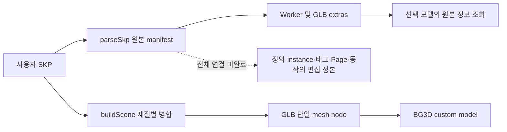

# 공간 모델러 전체 요구의 source·공개 계약 대조

- 상태: `current source audit` / `migration` 기능 내재화. 실행 검증·전체 완료 기록이 아니다.
- 날짜: 2026-10-29.
- 대상: `sketchup-primitive-edit/toonstudio`, `codex/sketchup-scene-export`, HEAD `35307f655e0ce855cca0f363c9b98c448e4ea8f9` + 미커밋 변경.
- 원래 목표는 [SK01–SK33 원장](../features/sketchup-feature-coverage.md)의 전체 범위다. 이번 대조는 원래 요구를 예제·커널의 존재로 축소하지 않기 위한 조사다.
- 방법: 현재 UI→handler→실제 정본 소비자, 기존 회귀 정의, 보존 REA 결과, 공식 공개 계약을 읽었다. 새 native/REA 분석·Node·Python·browser·테스트·타입 검사·lint 실행은 없다.
- 후속 MR·품질·SKP 소유권 코드의 검사 입력은 동결했다. 이 조사로 제품 source/tests나 동결 `4d86/353` 후보를 변경하지 않았다.

## 원본 보관과 편집 가능한 정본의 차이

이 그림은 현재 호출 경로의 source 대조이며 이번에 실제 파일 변환을 실행한 결과가 아니다.
현재 설치된 OpenSKP 1.3.0 `dist/index.js`를 다시 읽은 SHA-256은
`3b4a418e320920083aefa7551a924954b336e5addd0182971c7c66aeab575c2d`로 기존 REA 보고서와 같다.
기존 JS 분석은 이 패키지의 정적 분석이고, Ghidra writer의 자식 재귀·local TRS 관측은 별도 native 근거다.
어느 쪽도 동적 수식 실행이나 편집 가능한 SKP 계층 전체 복원을 입증하지 않는다.

## 현재 연결에서 확인한 큰 공백

경로 접두사 `bg3d/`와 `hybrid-dcc/`는 `apps/web/src/domains/creator/` 아래다.

| 원장 | 실제로 연결된 것 | 현재 끊기는 경계와 근거 |
| --- | --- | --- |
| SK01–03·SK09 | 실제 선택 면의 내부 polygon 작도와 원본 geometry commit. BG3D 측정·배치용 추론 서비스도 존재 | `hybrid-dcc/StudioHybridDccFaceDrawPad.tsx:51`은 별도 SVG/grid 점 입력이다. `studio-hybrid-dcc-face-modeling-draw.ts:126`은 기존 면 경계 접촉을 거부한다. `bg3d/StudioBg3dPrimitiveFaceEditor.tsx:68`은 face 이외 선택을 받지 않는다. 실제 기존 endpoint/edge→추론 고정→면 분할/edge-chain 경로의 연결은 없다. |
| SK10 | 독립 정밀 모델러의 실제 operand-aware Boolean·cutter 변환·hash receipt | `bg3d/StudioBg3dSpatialModelerSections.tsx:102,331`은 고정 solid A/B를 계산해 예제 primitive를 추가한다. 실제 선택 두 BG3D node의 source/부모 TRS/권리/정규화와 결과 교체 명령을 받지 않는다. `hybrid-dcc/studio-hybrid-dcc-modifier-workspace.ts:151`의 엄격한 operand 권위를 비교해야 하며, legacy 보조 함수의 고정 CC0 metadata를 원본 권리로 대체해서는 안 된다. |
| SK07·SK11 | 실제 parent 계층, component 표시 묶음, linked clone 외형 동기화, 선택한 authored source의 독립 재편집 | `bg3d/studio-bg3d-organization-mutation.ts:274`는 `componentRef`를 기록한다. `studio-bg3d-linked-clones.ts:64`는 재질/paint 등 외형만 동기화한다. `studio-bg3d-authored-model-edit-source.ts:122`는 관련 source를 거부하고 replacement는 선택 instance 하나만 교체한다. 공유 definition geometry 편집·고유화·중첩 해체와 다르다. |
| SK12·SK25 | 원본 instance의 string properties와 definition 참조가 실제 manifest→Worker→GLB extras→정보 조회에 도달 | `bg3d/studio-bg3d-skp-conversion-core.ts:255`, `studio-bg3d-skp-scene-manifest.ts:283`, `studio-bg3d-skp-import.ts:221`, `studio-bg3d-skp-source-read-command.ts:74`가 보관 경로다. 별도 dynamic 추론 helper의 production importer 호출은 없고 full-scene-restorer는 패널의 SAMPLE 입력을 소비한다. 속성 보관은 수식·의존성·상호작용 실행이나 hierarchy 정본 전개가 아니다. |
| SK14–15 | 실제 줄자 UI·viewport pick·추론·길이 잠금·editor 수명 안의 고정 가이드 | `bg3d/StudioBg3dEditorSidebarExtras.tsx:639`는 실제 setter에 연결하지만 `useStudioBg3dEditorState.ts:245`의 별도 state다. `studio-bg3d-measurement.ts:863`의 codec은 production 저장 소비자가 없고 scene DTO·history·template에 합류하지 않는다. 월드 두 점은 대상 geometry 참조에 따라 갱신되는 치수와 다르다. |
| SK16–17 | ToonStudio 수동 태그의 canonical/history 명령, 원본 SKP 정보 조회, 제한된 평행 Page 카메라 적용 | SKP의 source tag ID·membership·Page 저장 플래그가 충분히 노출되지 않는다. 실제 변환은 재질별 병합이며 원본 instance/tag와 렌더 부품을 편집 권위로 연결하지 않는다. `studio-bg3d-skp-camera-restore-command.ts:69`의 평행 카메라 적용을 전체 Page 상태 복원으로 확대할 수 없다. |
| SK21–22 | 일부 실제 NPR/line 설정과 별도 Sun Rig의 lighting/background/render 적용 | 공간 모델러의 style/태양 callback 일부는 요약 문구다. `StudioBg3dAdvancedWorkbenchHub.tsx:570,576`과 별도 `studio-bg3d-sun-rig.ts:218`을 구분한다. Sun Rig의 적용 결과 저장은 원래 위치·시각·북쪽 config의 재편집 왕복과 다르다. |
| SK23 | height grid 계산과 실제 UUID/admission/history를 거치는 결과 삽입 | `bg3d/studio-bg3d-sketchup-full-engine.ts:291`은 grid를 box들로 바꾸고 원래 grid/편집 recipe를 보존하지 않는다. 고정 등고선 예제에서 새 묶음을 생성하며 선택한 지형의 정점·대각선·연속 표면을 재편집하지 않는다. 실제 삽입 사실을 인정하되 지형 위상 지원으로 세지 않는다. |

이 대조는 실제 내부 면 작도·Push/Pull·볼록 Offset·열린 Follow Me·독립 authored source 재편집의 기존 연결을 부정하지 않는다.
또한 imported SKP의 layer 이름을 원본 tag identity로 추측하거나 unknown Page flag를 apply-all로 해석하는 수정은 완료 조건이 아니다.

교차 검토 중 native DCC 담당 세션은 Boolean modifier의 private 역변환과 공용 canonical 역변환의 회전 순서 차이를 찾았다.
현재 source의 `hybrid-dcc/studio-hybrid-dcc-modifier-workspace.ts:87`과 `studio-hybrid-dcc-object-transform.ts:113`에서도
서로 다른 식을 확인했다. 두 축을 동시에 회전한 입력의 round-trip·A/B 상대 변환 회귀가 필요하며,
담당 세션의 수정·실행 증거가 통합되기 전에는 기존 operand 포트의 모든 TRS 동등성을 보증하지 않는다.
BG3D bridge는 이 수정과 별도로 target/cutter/부모·정규화·문서 lease를 최종 교체까지 검증해야 한다.

## SK27–28: 파일 이름 이외에 확인해야 할 출력 계약

현재 실제 importer의 primary 목록은 `bg3d/studio-bg3d-model-import.ts:135`의 9형식이다.
이미지 companion과 이미지 자체를 모델/지형으로 변환하는 입력을 구분하며, DWG/DXF·DEM의 실제 primary 반입은 이 목록에 없다.
공간 모델러 `StudioBg3dSpatialModelerPanel.tsx:326`의 다중 CAD 예제는 고정 벽을 writer에 넣고 생성 bytes의 요약만 표시한다.
현재 사용자 장면의 파일 다운로드는 별도 [GLB 경로](../features/bg3d-current-scene-glb-export.md)이며 모든 형식 출력으로 세지 않는다.

[공식 exporter 옵션](https://ruby.sketchup.com/file.exporter_options.html)은 STL/OBJ의 단위·축·선택 범위,
OBJ의 삼각분할·면 양면·edge·이미지, DAE의 계층·숨김·카메라·저작자, CAD의 보조선·치수·문자·재질,
IFC의 버전·공간 계층 등을 구분한다. 공개 문서에서 GLB의 exporter 옵션이 없다는 사실도 다른 형식의 옵션이나
ToonStudio 전체 출력 요구를 없애지 않는다. 각 형식의 UI/버전별 실제 실행과 의미는 별도 확인해야 한다.

추가 완료 조건은 실제 선택/표시 범위, nested TRS·단위·반사, face/edge/normal/UV·texture companion,
source 권리·출처, 취소/오류 원자성, 실제 download와 타 소비자의 재읽기다. 형식이 담지 못하는 pose·재질·카메라·편집 정보를
별도로 명시해야 하며, 임시 static snapshot의 인덱스를 영속 entity ID로 승격하지 않는다.

## SK31: 확장 API는 함수 이름만으로 호환 판정하지 않는다

[공식 Ruby Model 계약](https://ruby.sketchup.com/Sketchup/Model.html)은 영속 ID 조회와 작업 단위를 제공하며,
작업을 중첩하는 의미도 명시한다. [ModelObserver](https://ruby.sketchup.com/Sketchup/ModelObserver.html)는
transaction 관련 이벤트가 commit 시점에 순서대로 전달되는 점과 callback 안의 모델 변경 주의를 설명한다.
ToonStudio의 기존 command/history가 있다는 이유만으로 외부 확장의 ID·이벤트 순서·Undo 의미까지 호환한다고 판정하지 않는다.

[공식 JavaScript capability 지도](https://developer.trimble.com/docs/sketchup/jsa/welcome/capabilities)는 Ruby와 다른
manifest/iframe/message 구조와 미지원 API를 구분한다. 해당 API의 미지원은 원본 제품 UI의 기능 부재나 ToonStudio
전체 목표에서 그 기능을 제외할 근거가 아니다. 확장 세션의 권한·취소·수명·atomic command·외부 입력 경계와
실제 원고/장면 엔티티에 대한 실행·Undo·저장·재개방을 추가로 증명해야 한다.

## 다음 구현·검증에서 유지할 순서

1. 이미 동결한 MR·품질·SKP 소유권의 실제 회귀·scoped 타입·정적 검사부터 수행한다. 실패를 예제 성공이나 과거 수치로 덮지 않는다.
2. 실제 endpoint/edge·source revision을 공통 편집 context에 연결하고, 실제 선택 operands와 공유 definition의 권위를 잇는다. 새로운 예제 버튼 추가로 대체하지 않는다.
3. 측정/치수·원본 태그/Page·지형의 지속 가능한 엔티티/recipe를 같은 command/history·저장 권위에 합류시킨다.
4. 동일 source fence를 재사용하는 실제 형식별 출력과 확장 API 계약을 이어간다. 원래 SK01–SK33의 남은 요구는 유지한다.

이번 source 조사로 테스트·브라우저·native 실행 성공은 추가되지 않았다. 새 문서의 하네스·Secretlint와 후속 제품 전체 검사도 미완료다.
커밋·PR·병합·배포는 없으며, 새 source/test 편집이나 검사 조정자에게 상태/PID 재문의도 하지 않았다.
