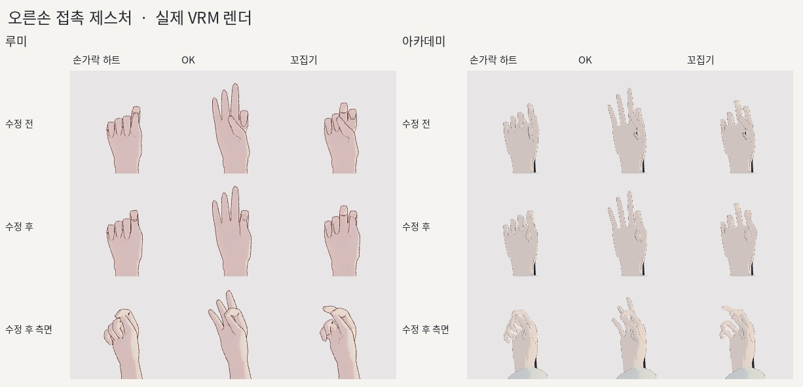
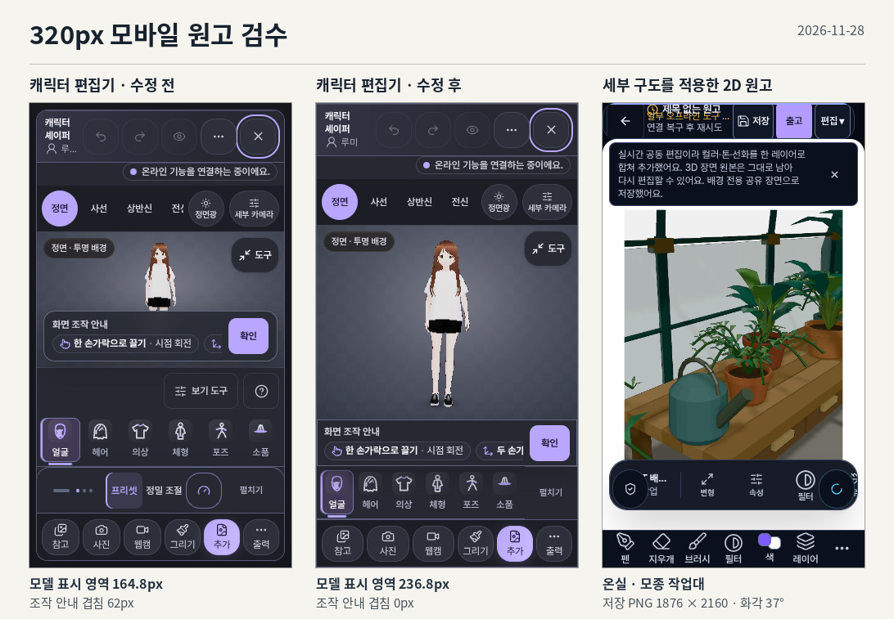

# 원고용 3D 캐릭터와 배경 시각 검수

상태는 `current`다. 최초 검수일은 2026-11-27이며, 소형 화면은 2026-11-28에 추가로 확인했다. 웹툰 컷에서 손동작을 읽을 수 있는지, 얼굴을 가리지 않고 머리 모양을 바꿀 수 있는지, 소재 카드와 실제로 원고에 놓이는 모델이 일치하는지 확인했다.

공개 모델 GLB 1,524개와 VRM 117개를 원본에서 각각 한 시점으로 렌더했다. 1,641장 모두 화면에 메시가 그려졌고, 17개 접촉 시트로 전체 실루엣과 소재 성격을 확인했다. 모델별 삼각형과 재질 수는 파일의 glTF 메타데이터에서 읽었다. 기본 목록 선정과 손·헤어·의상 품질 판정에는 아래의 원고 편집기와 다각도 근접 컷을 사용했다. [검색 가능한 전체 모델 검수표](asset-gallery.html)

## 손과 포즈

루미의 OK와 집기 동작에는 약 3cm의 틈이 있어 검지와 엄지가 떨어져 보였다. 지금은 프리셋을 적용할 때 모델의 손가락 길이를 반영해 두 손가락을 맞춘다. 손끝 거리는 VRM 리그의 가상 손끝을 월드 좌표에서 잰 값이다. 접촉면은 실제 메시의 정면·사선 렌더에서도 확인했다. 손가락 하트는 두 손가락 옆면을 교차해 만든다.

| 모델 | OK 적용 후 | 집기 적용 후 |
| --- | ---: | ---: |
| 루미 | 3.9mm | 2.8~3.0mm |
| 시노 | 4.1mm | 5.5~5.8mm |
| 아카데미 여성 | 5.1mm | 4.2mm |

원고용 VRM 17종 각각에 16개 손 모양을 양손에 적용해 544가지 모습을 렌더했다. 루빈과 카게의 긴 소매, 비타의 장갑은 해당 모델의 손 일부를 덮는다. [오른손 272개](vrm-hands-right.jpg) · [왼손 272개](vrm-hands-left.jpg) · [접촉 자세 확대](contact-closeup.jpg)

데생 인형의 엄지 뿌리와 손바닥 너비, 손가락의 굽힘 방향과 좌우 손목 대칭을 보정했다. 손 모양만 바꿀 때는 손가락 리그만 갱신하므로 작업 중인 카메라를 유지한다. [데생 인형 손 비교](mannequin-hands.jpg)

2026-11-28에 실제 포저에서 V 사인을 주먹으로 바꾼 뒤 실행 취소하고 다시 실행했다. 수정 전에는 실행 취소 후에도 양손 검지와 중지 12마디가 굽은 채로 남았다. 정면을 고정한 1319×821 캔버스에서 원래 V 사인과 다른 픽셀은 1,882개였고 그중 1,740개는 색 채널값이 12 이상 달랐다. 수정 후에는 실행 취소한 V 사인과 다시 실행한 주먹 모두 원본과 다른 픽셀이 0개였다. 두 손목과 손가락 30마디의 회전, 편집기의 굽힘·벌림 값도 각 원본과 일치했다. [양손 실행 취소·다시 실행 확대](poser-history.jpg)

펼친 왼손으로 바닥을 짚은 상태에서도 주먹을 적용한 뒤 실행 취소했다. 이전에는 손목과 손가락이 돌아와도 손바닥이 원래 높이보다 7.044mm 떠 있었다. 복원한 손 모양으로 접지를 다시 계산하자 손바닥 높이와 골반 위치가 원본과 일치했고 실행 취소·다시 실행 모두 캔버스의 픽셀 차이가 0이었다.

기본 70종과 고급 포즈 23종을 각각 전면·측면에서 확인했다. 전신 카메라로 보던 중 포즈가 잘리는 경우를 보정하고 기본 70종의 모든 메시 정점을 가로세로 비 1.5와 0.8에서 다시 투영했다. 개선 전 각각 6종·9종에서 정점이 화면 밖으로 나갔고 개선 후에는 두 화면 모두 0종이었다.

실제 접지·IK 적용 뒤 의자 앉기의 양발은 지면 0mm, 골반 높이는 382mm였다. 창가에 기대는 동작의 오른발은 지면 0mm, 왼발은 23.7mm였다. 의자와 창턱은 장면에서 별도로 배치한다. 점프의 최저점은 지면 위 279.3mm였다. [기본 전신 포즈](body-poses.jpg) · [고급 포즈의 옆모습](advanced-poses.jpg)

## 편집 성능

같은 Chromium에서 동일한 기본 체형·포즈의 오른손 검지를 버전별로 12회 예열하고, 같은 편집을 전후 버전에서 순서를 바꿔 40회씩 실행했다. 지오메트리 생성은 갱신당 304개에서 25개로 줄었다. 이 측정은 공유 4 CPU 환경의 동기 편집 처리만 포함한다. 실제 기기의 GPU 프레임 시간은 별도로 측정해야 한다. [측정 조건과 원시 데이터](finger-performance.json)

| 검지 갱신 한 번 | 수정 전 | 수정 후 |
| --- | ---: | ---: |
| 렌더러 메인 스레드 평균 CPU | 49.2ms | 2.7ms |
| 경과 시간 중앙값 | 84.5ms | 3.5ms |
| 경과 시간 95백분위 | 159.3ms | 11.5ms |
| 카메라 재프레이밍 | 1회 | 0회 |

## 얼굴과 헤어

머리뼈의 원본 축으로 너비·높이를 변환해 루미와 시노에서 둥근 얼굴과 긴 얼굴의 조절 방향을 맞췄다. 같은 조명에서 각 모델의 기쁨·분노·슬픔·눈 감기를 확인했다. 1200×800 편집기에서는 정밀 조절 열과 캐릭터 뷰포트를 분리해 얼굴 확대 중에도 양쪽 눈이 보인다. [표정과 얼굴형](faces.jpg) · [실제 캐릭터 편집기](character-editor.jpg)

앞머리 8종, 옆머리 6종, 뒷머리 8종에 각각 선택 상태와 색상을 저장한다. 한 부위를 바꾼 뒤 다른 부위가 유지되는지, 되돌리기와 문서 복원에서 같은 모양으로 돌아오는지 확인했다. VRM으로 내보낸 파일을 다시 읽어 부위별 색과 스킨 가중치도 검사했다.

세 모델의 기본 스타일 14종을 정면·사선·측면·후면에서 확인하고 루미에서 22개 부위 선택을 두 시점씩 확인했다. 총 212장이다. 가닥을 두상에 맞추고 정수리와 옆머리 사이의 틈, 어깨를 뚫는 트윈테일, 끊겨 보이던 땋은 머리를 고쳤다. 숏과 픽시는 이마선과 귀 노출, 목덜미 길이로 구별할 수 있다. [헤어 수정 전후](hair-before-after.jpg) · [22개 부위 옵션](hair-sections.jpg) · [숏과 픽시](hair-short-pixie.jpg) · [장발 카메라 3면](hair-camera.jpg)

루미와 시온의 얼굴을 정면에서 확대한 뒤, 각각 새 그룹에 가이드 두 개를 만들어 앞머리를 비교했다. 두 모델의 머리뼈 축과 얼굴 방향이 달라도 가닥은 정수리에서 이마로 내려오고 눈 위에서 가늘어진다. 뿌리와 끝의 음영에는 루미의 갈색과 시온의 짙은 남색 모발이 반영된다. 비교 이미지의 왼쪽과 오른쪽은 수정 소스 `5d1316e127`의 개발 서버에서, 가운데는 이전 배포형 빌드 `87d069cdbc`에서 촬영했다. [두 모델의 원래 헤어와 가이드 수정 전후](groom-guide-materials.jpg)

모델별 스타일 시트에는 앞쪽 사선과 후면을 함께 실었다. [루미](styles-lumi.jpg) · [시온](styles-shion.jpg) · [아카데미 여성](styles-academy.jpg)

## 의상

재킷을 입혔을 때 둥근 통 모양이던 가슴에 V 앞트임과 라펠, 포켓, 단추를 재단했다. 원본 치수와 옷을 재단할 때 필요한 여유를 구분해 기본 자세의 가슴과 어깨 관통을 줄였다. 루미와 시노의 기본 의상·재킷·손인사 정면·손인사 사선을 비교했다. 팔을 들어 올리는 루미의 겨드랑이에는 원래 반팔의 스키닝을 따르는 안쪽 천을 맞췄다. 원본 셔츠색 픽셀은 정면 측정 영역에서 871개에서 4개로, 사선에서 325개에서 4개로 줄었다. [수정 전 원본 상의와 재킷](blazer-before.jpg) · [두 모델의 최종 착용 8컷](blazer.jpg)

## 뷰포트와 원고 소재

인물의 위에서 주광이 들어오도록 고치고 발 아래 접지 그림자를 복원했다. 조명의 색온도를 바꿔도 아침·석양·밤 프리셋의 고유 색이 유지된다. [아리시아 조명과 발밑 비교](lighting.jpg)

기본 캐릭터 목록은 원고용 17종으로 정리했다. 기본 카드 17장은 같은 밝은 배경과 가슴 위 구도로 촬영했다. 원본 ID는 보존해 이전 문서와 가상공간 인물을 계속 불러올 수 있다. [원고용 캐릭터 카드](cast.jpg) · [실제 선택 목록](casting-library.jpg) 3D 가구 36종 중 원고용 24종을 먼저 표시하고 블록아웃용 12종은 검색으로 찾을 수 있다. 배치 템플릿은 각 장면에서 직접 렌더한 이미지를 쓴다. 교실·카페의 책상과 의자에는 다리를 추가했다. 소재 카드에서 가구를 선택하면 배경 편집기에 해당 GLB가 들어온다. [편집기에 삽입한 가구](furniture-editor.jpg) · [배경 6종](environments.jpg) · [배치 템플릿 24종](scene-layouts.jpg)

오피스의 실제 편집 화면에서 창과 천장등은 밝지만 바닥·가구는 검게 보였다. 원본 텍셀을 조사해 오피스·병동·지하철의 건축·목재 재질에 잘못 구워진 법선 및 차폐·거칠기·금속 맵을 확인했다. 일치하는 배포 ID와 해시의 해당 재질에 한해 렌더할 때 기하 법선과 중립 재질값을 사용한다. 빈 원고에 추천 실내를 처음 배치할 때는 번들의 카메라와 실내 채광을 적용한다. 같은 시점에서 측정한 오피스 바닥·가구 영역의 8비트 휘도 중앙값이 10에서 150으로 올라갔다. 편집기에서 컬러 배경을 원고에 넣고 백업에서 추출한 2731×1534 PNG에서도 같은 시점과 휘도를 확인했다. [오피스 실내 수정 전후](office-before-after.jpg) · [실제 원고에 넣은 배경](office-manuscript.jpg)

머그의 기울기는 루미 80.6°에서 1.9°, 시노 77.5°에서 2.9°로 줄었다. 추가 검수한 여섯 모델 모두 검지가 고리 안을 지났고 중지까지 통과한 모델은 네 종이었다. 여섯 모델 중 제니퍼의 입구 기울기가 13.8°로 가장 컸다. 내려 든 책에 반대손이 닿는지 확인해, 닿지 않는 책을 잡으려고 팔이 몸통을 가로지르던 자세를 고쳤다. [머그와 책 착용 전후](props.jpg)

작은 데스크톱의 배경 편집기에서는 컷 버전 패널이 처음에 접힌다. 1200×800 화면에서 뷰포트 상단이 y555에서 y427로 올라왔다. 패널을 펴서 현재 장면을 컷으로 저장한 뒤 창 크기를 바꿔도 수동 선택과 저장한 컷을 유지했다. 독립 포저에서 캡처한 이미지는 선택한 원고에 한 레이어로 추가된다. [배경 편집기 전후](bg-editor.jpg) · [포저에서 원고로 삽입한 결과](poser-layer.jpg)

### 2026-11-28 모바일 추가 검수

320×568px Chromium에서 루미를 정면으로 처음 연 화면을 비교했다. 두 화면 모두 온라인 연결 안내가 한 줄인 상태였다. 3D 모델 표시 영역은 302×164.8px에서 318×236.8px로 커졌다. 조작 안내가 모델 영역을 덮는 높이는 62px에서 0px로 줄어 안내를 닫기 전에도 발끝이 보인다.

같은 화면에서 헤어 가이드 두 개를 미리보기하면 전신과 적용·취소 버튼을 함께 볼 수 있다. 하단 편집창과 3D 화면이 겹치는 면적은 0이었다. 가이드 편집으로 돌아가 초안을 이어서 고칠 수 있었고, 취소하면 초안이 폐기됐다. 적용한 뒤 V3 문서를 다시 열면 저장한 그룹 하나와 가이드 두 개가 복원됐다. [모바일 헤어 미리보기 전후](mobile-groom-preview.jpg)

조작 안내를 열어 둔 채 320×568, 844×390, 768×1024 화면을 오가도 확인 버튼에 키보드 초점이 남았고 모델 가림은 0이었다. 밝은 Paper 테마의 시점 배지 명암비는 8.27:1이었다. OS 강제 색상을 켰을 때 활성 카메라와 캔버스 추가 버튼의 글자·배경 명암비는 밝은 팔레트 11.31:1, 어두운 팔레트 8.73:1이었다.

같은 크기의 화면에서 ‘물뿌리개’로 온실을 찾아 터치로 배치하고 ‘모종 작업대’ 세부 구도를 현재 컷에 적용했다. 2D 원고로 돌아온 뒤 프로젝트에서 꺼낸 1876×2160 PNG에는 화분과 물뿌리개가 보였다. 저장한 장면의 화각은 37°였고, 노드 ID는 배치 직후와 같은 `bg3dmodel-mwzo9q42-bzzlx7`이었다.

## 3D 모델링과 내보내기

정밀 모델링 편집기에서 정육면체를 추가하고 X 방향으로 0.35m 이동해 깊이를 1.6배로 늘렸다. 실행 취소·다시 실행이 각 단계의 상태 해시까지 복원했고, 모서리 베벨 후에는 8정점·6면에서 10정점·7면으로 늘었다. 베벨 메시를 GLB로 내려받아 확인했다. 선택 메시의 GLB는 로컬 좌표를 사용한다. 작업 파일 `.toon3d`로 내보내고 다시 열면 장면의 배치·스케일도 돌아온다. 데스크톱에서는 오른쪽 수치 입력란만 스크롤해 변환 중에도 모델을 볼 수 있다. 모바일에서는 같은 입력란이 하단 상태바에 가리지 않는다. [베벨 적용 화면](dcc.jpg) · [치수 편집 중 뷰포트](dcc-inspector.jpg)

## 검증 환경과 브라우저 결과

캐릭터 편집기에서 루미를 투명 PNG 2048×1109와 4096×2219로 내려받았다. 두 파일은 모서리 네 곳의 알파가 모두 0이었다. PSD는 2048×1109이고, 그룹을 포함한 항목 19개 중 래스터 레이어 13개에 픽셀이 있었다. 독립적으로 레이어를 합성해 PNG의 2,271,232픽셀과 대조했다. 알파 차이는 전 픽셀에서 0이었고, 흰색·검은색 바탕에서 8비트 RGB 평균 차이는 0.000198이었다. 4K 출력을 취소했을 때 부분 파일 없이 편집 잠금이 풀렸고, 같은 설정으로 다시 출력했다. [실제 2K 투명 PNG](character-export.png)

- Chromium에서 캐릭터 확대와 헤어 3면, 뷰포트·오른쪽 패널 배치, 데생 인형 캡처와 원고 삽입, 배경 WebGL2 도형 추가, DCC 진입과 메시 편집을 확인했다.
- WebGPU 기즈모 시험에서 상자를 24단계로 회전한 경우와 같은 자세로 한 번에 회전한 경우를 비교했다. 실행 취소·다시 실행 이후 713×542 프레임의 최대 타일 휘도 차는 0이었다. Chromium 내장 SwiftShader Vulkan을 사용했다. [WebGPU 회전 결과](webgpu-rotation.jpg)
- 실제 캐릭터 편집기의 헤어 선택 필드 3개는 108×44px였다. 이 영역과 모바일 390px에서 검색한 모델 검수표를 axe로 검사해 WCAG A·AA 위반 0건을 확인했다.

변경 모듈에 직접 대응하는 Vitest 59개 파일의 998건과 추가 13개 파일의 214건이 통과했다. 이후 마지막 재질·카메라 변경은 관련 5개 파일 100건으로 확인했다. 재킷과 캐스팅 목록, 배경의 브라우저·단위 검사는 일부 대상을 중복해 검사했다.

로컬 체크아웃에 `origin/main` 참조가 없어 작업 시작 커밋인 `HEAD`를 기준으로 `pnpm harness:verify --base=HEAD`를 실행했다. 웹 타입 검사 31,103개 파일에서 진단 0건이었고 API 타입 검사, 아키텍처 경계, 소스 크기, 스튜디오 진입 시 로드하는 모듈, 변경 모듈 테스트 65건이 통과했다. 캐릭터 편집기 전체 브라우저 검수기는 320px·390px의 패널 상태 여덟 개를 검사했고 브라우저 오류 0건으로 끝났다.

## 비교 기준

WEBTOON SHAPER의 파츠 조합·포즈·출력 흐름과 CLIP STUDIO PAINT의 손 프리셋 사용 방식을 기준으로 삼았다. 이번 실행 환경은 Linux의 Chromium과 SwiftShader다. WebGL2와 Vulkan 기반 WebGPU에서 편집 프레임을 검사했다. 동일 기기에서 SHAPER와 같은 장면을 편집하는 비교, 실제 휴대기기의 프레임 시간, 사용자의 원고 작업 시간은 측정 범위에 포함하지 않았다. [SHAPER 공식 가이드](https://shaper.webtoons.com/how-to/) · [CLIP STUDIO PAINT 손 포즈 가이드](https://help.clip-studio.com/en-us/manual_en/660_3d/Posing_3D_drawing_figures.htm) · [설치된 SHAPER 1.05의 이전 실기 기록](../episode-workflow-2026-11-23/README.md)
