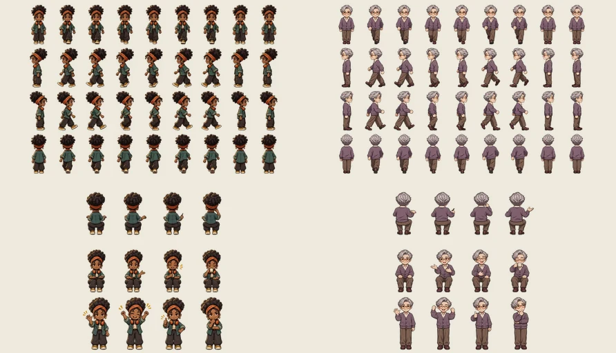

# 가상 스튜디오의 제작 업무 개선안

2026-11-27 기준. 기본 2D 작업실에서 원고를 다시 열고, 동료와 검토하고, 다음 사람에게 일을 넘기는 흐름을 기준으로 정리했다.

## 이번에 구현한 흐름

| 하려는 일 | 사용하는 방법 |
| --- | --- |
| 팀의 검수 자리로 이동 | 전체 지도(M)의 **목적지 목록**에서 방, 좌석, 도구 이름을 검색한다. 개별 좌석을 누르면 접근 지점까지 걷고, 방의 **바로 가기**를 누르면 그 방으로 이동한다. |
| 개인 원고 이어 그리기 | 개인 공간의 **작업 시작**에서 최근 활성 작품과 복원 지점을 확인한다. 클릭 시점에 해당 원고를 다시 확인한 뒤 연다. |
| 다음 팀 작업 인계 | **다른 작업 선택**으로 작업 카드를 열어 마감·완료 기준을 확인하고, **인계 메모 복사**로 작업 상세 링크와 함께 가져간다. |
| 제작진 구별 | 캐릭터 선택기에서 이름이나 직무로 검색한다. 사운드 디자이너 니아, 프로덕션 디자이너 준서는 서로 다른 보행·작업 스프라이트를 사용한다. |
| 복잡한 공간에서 이동 경로 확인 | 바닥을 클릭하면 경유점이 점선으로 이어지고 목적지에는 마름모가 표시된다. 동작 줄이기 설정에서도 목적지를 구분할 수 있다. |

## 후속 아이디어와 판단 기준

| 아이디어 | 제작 현장에서 쓸 장면 | 다음 실험에서 볼 것 |
| --- | --- | --- |
| 회차별 검수 동선 | PD가 특정 회차의 원고, 검토본, 회의석을 묶어 두면 동료가 링크 하나로 검수 준비를 마친다. | 팀원이 올바른 회차와 검토본에 도착하기까지의 클릭 수. 권한이 만료된 검토본과 이미 사용 중인 좌석의 안내도 확인한다. |
| 공정별 즐겨찾는 자리 | 채색과 검수를 오가는 작가가 지도에 둘 이상의 자리를 이름으로 저장해 다시 찾는다. | 재입장 후 올바른 자리로 돌아가는 시간. 공간 편집으로 자리가 삭제됐을 때의 복구 흐름. |
| 업무용 캐릭터 동작 | 식자 교정, 태블릿 채색, 음향 파형 검토처럼 손과 작업 도구의 움직임을 실제 업무 상태에 맞춘다. | 1배율에서 동작을 서로 구분할 수 있는지, 좌석 방향별 발·손 접점이 맞는지, 원격 동료에게도 같은 상태가 보이는지. |
| 혼잡한 방의 자동 효과 조절 | 인원이 많은 회의에서는 동료와 목적지 표식을 선명하게 두고 배경 장식의 갱신 빈도를 낮춘다. | 저사양 기기에서 입력부터 첫 이동 프레임까지의 지연과 프레임 시간 95백분위. 회의가 끝나면 원래 품질로 복구되는지도 측정한다. |
| 인계받은 수정 사항의 왕복 | 인계 메모에서 해당 컷을 열고 수정한 뒤 같은 검수 위치로 돌아와 변경 전후를 비교한다. | 담당자가 컷을 다시 검색한 횟수와 인계에서 재검수까지 걸린 시간. 원고가 이동하거나 개정될 때도 확인한다. |
| 좌석 배치 시뮬레이션 | 공간을 꾸미는 사람이 출입문부터 각 작업석까지 실제 캐릭터 크기로 걸을 수 있는지 배치 전에 확인한다. | 입구가 막힌 배치, 좁은 통로, 가구를 옮긴 직후의 도달 가능 판정이 실제 보행 결과와 일치하는지. |

먼저 회차별 검수 동선과 인계 왕복을 같은 팀의 실제 회차 한 편에 적용하면, 이번에 추가한 검색·원고 복원·작업 링크가 제작 시간을 얼마나 줄이는지 함께 측정할 수 있다.
