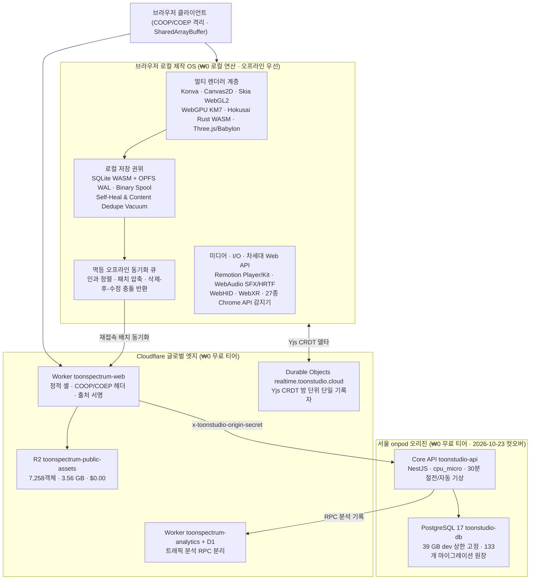
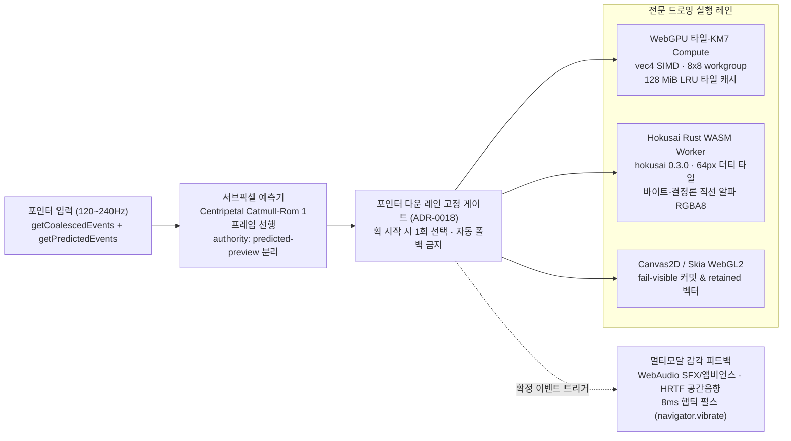
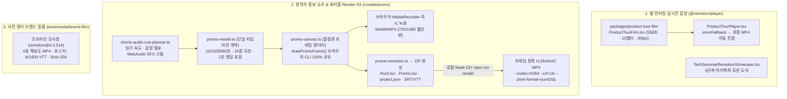
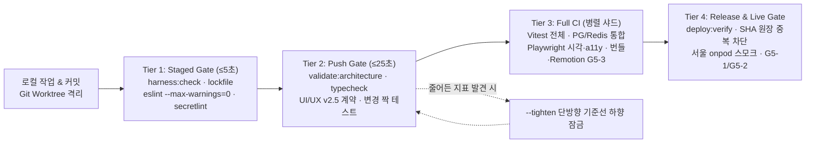

# ToonStudio 차세대 웹 엔지니어링 기술 백서

> **"설치 0초의 브라우저 탭 하나에 WebGPU 분광 물감, Rust WASM 자연매체, 결정론적 Remotion 영상 파이프라인, WebHID 왼손 다이얼, 차세대 크롬 플랫폼 API까지 어떻게 다 우겨 넣었을까?"**

- **문서 상태**: `current` (2026-11-23 저장소 실측 기준, 단 각 장·표마다 `current` / `migration` / `target` 경계를 엄격히 분리 표기)
- **작성 기준일**: `2026-11-23` (기준 브랜치 `main` 커밋 `1190c4dda9`)
- **대상 독자**: 프런트엔드·그래픽스·시스템 엔지니어, 테크니컬 프로덕트 매니저(PM), 웹툰 프로덕션 파이프라인 설계자
- **정직성 원칙**: 이 백서의 모든 코드 경로, 셰이더 상수, 거버넌스 수치는 실제 저장소 소스와 검증 스크립트에 근거한다. 아직 구현되지 않은 차세대 디바이스·API 계획은 `target`으로 분리하며, 완성된 기능처럼 포장하지 않는다.

---

## 목차

1. [왜 브라우저 올인원인가: 설치 0초 · OPFS SQLite · ₩0 단위경제](#1-왜-브라우저-올인원인가-설치-0초--opfs-sqlite--0-단위경제)
2. [WebGPU 타일 브러시 + Rust WASM + 물리 모델링 Web Audio Foley & 햅틱](#2-webgpu-타일-브러시--rust-wasm--물리-모델링-web-audio-foley--햅틱)
3. [Remotion(리모션) 구현 원리 및 실전 사용법](#3-remotion리모션-구현-원리-및-실전-사용법)
4. [AI 활용 개발 스킬 & 에이전트 하네스 엔지니어링](#4-ai-활용-개발-스킬--에이전트-하네스-엔지니어링)
5. [멀티 디바이스 & 주변기기 I/O 생태계](#5-멀티-디바이스--주변기기-io-생태계)
6. [차세대 크롬(Chrome) 웹 플랫폼 API 실전 가이드](#6-차세대-크롬chrome-웹-플랫폼-api-실전-가이드)

---

## 1. 왜 브라우저 올인원인가: 설치 0초 · OPFS SQLite · ₩0 단위경제

### 1.1 웹툰 1화가 거쳐 가는 4~6개 앱의 왕복 비용

현업 웹툰 작가나 어시스턴트가 1화를 마감하는 평범한 일주일을 들여다보면, 그림을 그리는 시간 못지않게 **파일을 옮기고 형식을 바꾸는 시간**이 크다. 대본·콘티는 문서 앱에서, 선화와 채색은 Clip Studio Paint나 Procreate에서, 3D 배경은 SketchUp이나 Blender에서, 최종 보정은 Photoshop에서, 수정 피드백과 일정은 메신저·드라이브·협업 툴에서 처리한다. 기기를 바꾸면 라이선스 인증을 다시 풀어야 하고, PSD·GLB·폰트 파일이 버전마다 흩어져 마감 직전에 유료 폰트나 비상업 3D 소재가 섞여 들어가는 사고도 잦다.

ToonStudio(`https://www.toonstudio.cloud`)는 이 문제를 "클라우드 서버에 무거운 가상 데스크톱을 띄우는 방식"이 아니라 **정반대의 로컬-퍼스트(Local-First) 브라우저 OS**로 풀었다. 핵심 설계 전제는 세 가지다.

1. **설치 0초 · 3초 비차단 진입 (`current`)**: 앱 설치나 결제 카드 등록 없이 URL 하나로 작업실에 들어온다. 백엔드 콜드스타트나 네트워크 지연이 생겨도 `INITIAL_SESSION_READY_DEADLINE_MS <= 3_500` 불변식([품질 게이트 정책](../operations/quality-gates-policy.md)) 안에서 게스트·로컬 캐시 작업실이 즉시 열린다.
2. **로컬 OPFS + SQLite WASM 권위 저장 (`current`)**: 캔버스 원고, 3D 장면 스냅샷, 스타일러스 입력 바이너리 스풀, 번역 메모리, 컷 히스토리의 1차 권위(Authority)는 서버가 아니라 **브라우저 내부 Origin Private File System(OPFS) 위 SQLite WASM**에 둔다.
3. **₩0 AI · ₩0 렌더 · ₩0 베타 인프라 단위경제 (`current`)**: 브러시 안료 연산(WebGPU), 자연매체(Rust WASM), 효과음 합성(Web Audio), 3D 임포트(로컬 Wasm64 최대 1 GiB), 숏폼 영상 조립(브라우저 Canvas + 포터블 Remotion ZIP)을 사용자 기기에서 직접 돌린다. 서버 GPU 팜이나 원격 렌더 서버에 매달 고정비를 태우지 않으므로 베타 운영 인프라 고정비를 **월 ₩0**으로 묶을 수 있었다(도메인 연 갱신비 별도, [인프라 정본 지도](../operations/infrastructure-map.md)).

### 1.2 전체 시스템 아키텍처 (`current`)



### 1.3 로컬-퍼스트 내구성: OPFS SQLite · 자가 복구 · 멱등 동기화 (`current`)

브라우저 저장소가 "언제 날아갈지 모르는 임시 캐시"로 취급받던 시대는 끝났다. 다만 실전에서는 탭 2개가 동시에 SQLite 잠금을 쥐거나, 비정상 종료 뒤 WAL(Write-Ahead Log)이 남거나, 네트워크가 끊긴 상태에서 컷을 고치고 삭제하는 경합이 반드시 일어난다. ToonStudio는 이 지점을 전용 모듈로 분해해 방어한다.

| 계층 | 역할 및 핵심 메커니즘 | 저장소 근거 파일 |
| --- | --- | --- |
| **OPFS 파일시스템 & SQLite 런타임** | OPFS 동기/비동기 핸들 관리, 작업실·자산·자동저장·브랜드 키트·VRM 포즈 SQLite 저장 | [`studio-opfs-filesystem.ts`](../../apps/web/src/domains/creator/studio-opfs-filesystem.ts), [`studio-workspace-sqlite-runtime.ts`](../../apps/web/src/domains/creator/studio-workspace-sqlite-runtime.ts), [`studio-autosave-sqlite-store.ts`](../../apps/web/src/domains/creator/studio-autosave-sqlite-store.ts) |
| **스타일러스 바이너리 스풀** | 고속 펜 입력 스트림을 JSON 직렬화 대신 OPFS 바이너리로 스풀링해 GC 스파이크 억제 | [`studio-freehand-input-binary-spool-opfs-store.ts`](../../apps/web/src/domains/creator/studio-freehand-input-binary-spool-opfs-store.ts) |
| **WAL 스크러버 & 중복 제거 자가 복구** | 손상·미완성 WAL 점검, 콘텐츠 해시 기반 중복 제거 Vacuum, 할당량 정리 UI 패널 | [`sqlite-opfs-wal-scrubber.ts`](../../apps/web/src/domains/creator/runtime-resilience/sqlite-opfs-wal-scrubber.ts), [`studio-opfs-content-dedupe-vacuum.ts`](../../apps/web/src/domains/creator/storage/studio-opfs-content-dedupe-vacuum.ts), [`StudioOpfsSelfHealPanel.tsx`](../../apps/web/src/domains/creator/storage/StudioOpfsSelfHealPanel.tsx) |
| **멱등 오프라인 동기화 병합기** | `causalSequence → revision → createdAtMs → opId` 결정론 정렬, `idempotencyKey` 중복 제거, 동일 컷 연속 패치 압축, `modify-after-delete` 충돌 자동 덮어쓰기 금지 및 명시 반환 | [`studio-offline-sync-queue-merger.ts`](../../apps/web/src/domains/creator/live/studio-offline-sync-queue-merger.ts) |
| **실시간 협업(Yjs CRDT + DO)** | 방 단위 단일 기록자 의미 보장, 스코프 제한 쓰기, 레이어 권한 분리 | [`studio-crdt-authoring.ts`](../../packages/contracts/src/studio-crdt-authoring.ts), [`deploy/cloudflare-realtime/README.md`](../../deploy/cloudflare-realtime/README.md) |

> **실전 포인트**: 서울 onpod 무료 `toonstudio-api`는 30분간 요청이 없으면 절전 모드로 들어간다. 일반 SaaS라면 이때 저장 버튼이 멈추겠지만, ToonStudio는 1차 저장이 로컬 OPFS SQLite에 0ms 대기로 커밋되고, 백그라운드 동기화 큐가 기상된 Core API와 멱등 키로 안전하게 합쳐진다.

---

## 2. WebGPU 타일 브러시 + Rust WASM + 물리 모델링 Web Audio Foley & 햅틱

### 2.1 "조용한 폴백 금지" — 역할 분리형 멀티 렌더러 권위 구조 (`current`)

웹 그래픽스 앱이 망가지는 가장 흔한 원인은 "GPU가 실패하면 조용히 Canvas2D로 넘어가자"는 자동 폴백이다. 겉으로는 돌아가는 것처럼 보이지만 색감·혼색·선폭이 미묘하게 틀어지고, 어느 엔진에서 버그가 났는지 추적조차 불가능해진다. ToonStudio는 [ADR-0018](../adr/0018-no-automatic-engine-fallback-vello-primary.md)과 기계 생성 원장인 [Studio 렌더러/엔진 역할 원장](../engines/renderer-roles.md)으로 **권위(Authority)당 단일 `primary` 소유자** 불변식을 코드 테스트로 강제한다.

- **`konva` (`primary`)**: 문서 표시(`document-display`), 포인터 입력(`pointer-input`), 선택/변형 크롬(`selection-transform-chrome`)
- **`canvas2d-draw-node` (`primary`)**: 래스터 브러시 종단 커밋(`raster-brush-commit`, fail-visible). 포인터 다운 입구에서 `living-ink → hokusai → stamp → gpu → live-ink → wet-ink → dynamic → konva` 레인을 1회 고정하며, 획 도중 다른 레인으로 갈아타지 않는다.
- **`hokusai-wasm` (`primary`)**: 연필·목탄·유화·수채 자연매체 권위(`natural-media`, Dedicated Worker 실행)
- **`skia-document-webgl2` (`primary`)**: 일반 선화·마커·지원 벡터 문서의 WebGL2 retained 표시(`document-vector-island`, `SkPicture` 재사용)
- **`webgpu-brush-runtime` (`provider` → 목표 `primary`)**: 전용 WebGPU 타일·분광 브러시 런타임. 현재는 명시 선택형 `provider`이며, `raster-brush-commit` 기본 승격이 `target`이다.
- **`three` + `@pixiv/three-vrm` (`primary`) & `babylon` (`primary`, 전문 패스 분리)**: 3D 배경·VRM 마네킹은 Three.js, 노멀·스테이블 ID·아티팩트 캡처 전문 패스는 Babylon.js가 각자 소유한다.



### 2.2 100% 클린룸 7밴드 분광 Kubelka-Munk WebGPU 엔진 (`current`)

디지털 페인팅에서 파란색(`#0047AB`)과 노란색(`#FFD700`)을 일반 sRGB 알파 블렌딩으로 섞으면 탁한 회색이 나온다. 실제 물감은 빛을 더하는 가산 혼합이 아니라 특정 파장을 흡수하고 나머지를 산란시키는 **감산 혼합(Kubelka-Munk 이론)**을 따르기 때문이다.

많은 웹 프로젝트가 이 문제를 풀기 위해 `mixbox` 패키지를 쓰지만, `mixbox@2.0.0`은 비상업 전용(`CC BY-NC 4.0`)이라 상용 서비스에 그대로 넣으면 법적 지뢰가 된다. ToonStudio는 `2026-11-05` 의존성 그래프에서 `mixbox`를 **0바이트 완전 제거**하고, 제3자 LUT나 측정표 없이 1차 원리로 **클린룸 7밴드 분광 Kubelka-Munk 엔진**을 CPU와 WebGPU WGSL 단일 진실 원본으로 새로 작성했다([`studio-webgpu-km7-spectral-core.ts`](../../apps/web/src/domains/creator/render/studio-webgpu-km7-spectral-core.ts), [`studio-webgpu-km7-compute-wgsl.ts`](../../apps/web/src/domains/creator/render/studio-webgpu-km7-compute-wgsl.ts)).

- **7개 지각 파장 밴드**: `[420, 465, 505, 545, 585, 625, 670] nm`
- **파티션 항등식 & 의사역행렬 복원**: 모든 밴드에서 `BR[i] + BG[i] + BB[i] = 1.0`을 만족하는 3원색 기저와 가중 무어-펜로즈 의사역행렬 `M · B = I₃`를 구성해 선형 sRGB 왕복 오차를 제거했다.
- **수치 안정 역공식**: `K/S = (1 - R)² / (2R)`의 역변환을 `f32`에서 암부 상쇄 오차가 나지 않도록 유리화한 `R = 1 / (1 + q + sqrt(q² + 2q))`로 계산하며, 반사율 하한 `KM7_REFLECTANCE_FLOOR = 0.002`로 순흑+순백 혼색이 중립 회색을 유지하게 했다.
- **루프 없는 WGSL 2-레지스터 SIMD + CSR 타일 비닝**: 7개 밴드를 `vec4<f32>` 두 개(`lo: 0..3`, `hi: 4..6 + w: luminance`)로 패킹하고, `@workgroup_size(8, 8, 1)` 스레드 그룹이 `var<workgroup>` 공유 메모리로 최대 64개 댑(dab)을 `workgroupBarrier()` 배치 로드해 처리한다.

```wgsl
// 실제 저장소 생성 WGSL 발췌 (studio-webgpu-km7-compute-wgsl.ts)
// 7개 가시광선 밴드를 vec4<f32> 2개 레지스터에 패킹해 분기/루프 없이 SIMD 연산
struct Km7Spec {
  lo: vec4<f32>, // 420nm, 465nm, 505nm, 545nm
  hi: vec4<f32>, // 585nm, 625nm, 670nm, luminance
}
```

이 엔진 위에서 **상업 안전(`permissive-only`) 브러시 5종**(`km7-oil-impasto-bristle`, `km7-gouache-opaque-flat`, `km7-watercolor-wet-edge-bloom`, `km7-acrylic-soft-blend`, `km7-dry-pastel-chalk`)과 **안료 필터 4종**(감산 그라데이션 맵 · 색온도 시프트 · 전통 글레이징 · 색조화 하모나이저, 96바이트 단일 유니폼 계약)이 무료·상용 기본 프로필에서 제약 없이 동작한다.

### 2.3 차세대 GPU 파이프라인 & 서브픽셀 스타일러스 예측 (`current`)

브러시 한 획이 화면에 꽂히는 체감 지연을 줄이기 위해 `apps/web/src/domains/creator/render/gpu-next/` 아래에 전용 가속 모듈을 쌓았다.

- **타일 캐시 & 제로카피 패킹**: [`studio-webgpu-tile-runtime.ts`](../../apps/web/src/domains/creator/render/studio-webgpu-tile-runtime.ts)가 기본 `128 MiB / 256개` 타일 LRU 예산을 강제하고, [`studio-webgpu-tile-viewport-culling.ts`](../../apps/web/src/domains/creator/render/studio-webgpu-tile-viewport-culling.ts)로 가시 타일만 상주시킨다. [`studio-webgpu-zero-copy-pack.ts`](../../apps/web/src/domains/creator/render/studio-webgpu-zero-copy-pack.ts)와 [`gpu-buffer-pool-and-warmup.ts`](../../apps/web/src/domains/creator/render/gpu-next/gpu-buffer-pool-and-warmup.ts)가 매 프레임 GPU 버퍼 할당과 첫 획 셰이더 컴파일 버벅임(stutter)을 없앤다.
- **서브픽셀 스타일러스 1프레임 선행 예측**: [`gpu-stylus-subpixel-predictor.ts`](../../apps/web/src/domains/creator/render/gpu-next/gpu-stylus-subpixel-predictor.ts)는 `PointerEvent.getCoalescedEvents()`로 120~240Hz 펜 샘플을 손실 없이 모으고, `getPredictedEvents()`(가중치 `0.65`)와 Centripetal Catmull-Rom(`α=0.5`, 기본 선행 `16.67ms`, 최대 `24ms` / `48px` 클램프)을 융합해 1프레임 앞선 미리보기 꼬리를 그린다. 예측 포인트는 항상 `authority: "predicted-preview"`로 격리해 최종 확정 획을 절대 오염시키지 않는다.
- **Lanczos3 컴퓨트 변형 & 모아레 억제 스크린톤**: [`studio-webgpu-transform-resample-wgsl.ts`](../../apps/web/src/domains/creator/render/studio-webgpu-transform-resample-wgsl.ts)와 [`gpu-stylus-predict-and-screentone.ts`](../../apps/web/src/domains/creator/render/gpu-next/gpu-stylus-predict-and-screentone.ts)가 확대·회전 시 흐려짐과 망점 모아레를 억제하고, [`gpu-hdr-dither-and-frame-budget.ts`](../../apps/web/src/domains/creator/render/gpu-next/gpu-hdr-dither-and-frame-budget.ts)가 10-bit HDR 디더링으로 그라데이션 밴딩을 막는다.

### 2.4 Rust WASM 결정론 파이프라인 & Wasm64 메모리 거버너 (`current`)

자연매체 드로잉과 대형 3D 모델 임포트는 JavaScript GC와 32비트 메모리 경계의 한계를 정면으로 맞닥뜨린다.

- **Hokusai Rust WASM (`packages/studio-hokusai-wasm`)**: 업스트림 `hokusai-wasm`은 흰 배경 위에 타일을 합성해 레이어 투명이 깨지는 문제가 있었다. ToonStudio는 `hokusai-core`/`hokusai-brush`/`hokusai-tile-mem` `0.3.0`을 직접 감싸 **투명 직선 알파(straight-alpha) sRGB RGBA8**을 반환하고, 64px 단위 보수적 `dirtyBounds()`만 잘라 올려 전송량을 최소화했다. Rust `1.97.1` + `wasm-pack 0.15.0` 오프라인 재현 빌드 결과는 `pkg/INTEGRITY.sha256`으로 바이트 단위 봉인된다([`packages/studio-hokusai-wasm/README.md`](../../packages/studio-hokusai-wasm/README.md)).

```ts
// Hokusai Rust WASM 투명 더티-타일 생명주기 (packages/studio-hokusai-wasm/README.md 실전 패턴)
import init, { HokusaiBrush, HokusaiCanvas } from "./pkg/studio_hokusai_wasm.js";

await init();
const brush = HokusaiBrush.naturalMedia();
const canvas = new HokusaiCanvas(2048, 2048, 0xdecafbad);

canvas.beginStroke(brush, 0xdecafbad); // 동일 시드·샘플 스트림 → 바이트 단위 결정론 출력
canvas.addSample(brush, 120, 200, 0.35, -0.2, 0.7, performance.now());
canvas.addSample(brush, 180, 230, 0.75, 0.1, 0.6, performance.now());
canvas.finishStroke(brush);

const [x, y, width, height] = canvas.dirtyBounds(); // 64px 보수적 더티 영역만 업로드
const rgba = canvas.dirtyFrame();
canvas.clearDirty();
// 종료 시 canvas.dispose(); canvas.free(); brush.free();
```

- **Wasm64 동적 3D 메모리 거버너**: [`studio-wasm64-memory-governor.ts`](../../apps/web/src/domains/creator/studio-wasm64-memory-governor.ts)와 [`studio-3d-upload-limit-policy.ts`](../../apps/web/src/domains/creator/import-safety/studio-3d-upload-limit-policy.ts)는 기기 메모리·Wasm64·OPFS 지원 여부를 탐지해 4단계 상한을 동적으로 결정한다. 서버 보안 업로드 한도(12 MiB)와 완전히 분리해, 브라우저 로컬에서는 **GLB/VRM 최대 1 GiB**, **SketchUp `.skp` 최대 256 MiB(OpenSKP 워커)**, **OPFS 누적 16 GiB**까지 안전하게 다룬다.

### 2.5 물리 모델링 Web Audio Foley & 햅틱 엔진 (`current` vs `target`)

외부 MP3 수백 개를 내려받는 대신, ToonStudio는 브라우저 내장 **Web Audio API**를 절차적 음향 합성기로 활용한다.

| 계층 | 상태 | 구현 원리 및 특징 | 저장소 근거 파일 |
| --- | --- | --- | --- |
| **₩0 절차적 WebAudio SFX 스템 합성** | `current` | 한국어 의성어(`쿵/퍽/두근/샤라랑/우르릉/스윽/사락`)나 컷 감정 톤을 7종 프리셋(`whoosh-pan`, `impact-thud`, `heartbeat-pulse`, `sparkle-chime`, `paper-turn`, `thunder-rumble`, `rain-ambient`)으로 자동 매핑. 결정론적 LCG 노이즈 + BiquadFilter + ADSR 엔벨로프로 매 실행 동일 파형 생성 | [`shorts-webaudio-sfx-scheduler.ts`](../../apps/web/src/domains/creator/creator-promo-kit/shorts-webaudio-sfx-scheduler.ts) |
| **무음원 절차적 앰비언스 & 연필 마찰음** | `current` | `wind`, `room`, `ocean`, `hearth`, `focus-stream`, `atelier-breeze`, `soft-rain`, **`pencil-scratch`(연필 사각임)** 8종을 오디오 파일 0바이트로 합성. `mulberry32` 화이트 노이즈를 1폴 저역 필터 원형 버퍼로 3회 순환시켜 루프 이음새 클릭음을 완전히 제거 | [`studio-virtual-space-ambient-synth.ts`](../../apps/web/src/domains/creator/virtual-space/studio-virtual-space-ambient-synth.ts) |
| **3D HRTF 공간 음향 패너** | `current` | 리스너 카메라 요(Yaw) 각도에 맞춰 동료 아바타 음성을 `PannerNode(HRTF)`로 3D 투영하고, 미지원 환경에서는 `StereoPannerNode`로 자연 저하 | [`studio-virtual-space-spatial-panner.ts`](../../apps/web/src/domains/creator/virtual-space/audio/studio-virtual-space-spatial-panner.ts) |
| **저지연 48kHz AudioWorklet 프로세서** | `current` | `latencyHint: "interactive"` 48kHz `AudioWorkletNode` + SFX/BGM 덕킹 믹스 설정과 오프라인 폴백 핸들 | [`chrome-nextgen-media-tools.ts`](../../apps/web/src/domains/creator/nextgen-web-platform/chrome-nextgen-media-tools.ts) |
| **모바일·관절 8ms 마이크로 햅틱** | `current` | 2/3/4손가락 캔버스 탭(Undo/UI 토글), 퀵 액션 휠 선택, VRM 관절 핸들 조작 시 `navigator.vibrate(8)` 촉각 피드백 | [`studio-mobile-history-touch-gesture-host.ts`](../../apps/web/src/domains/creator/studio-mobile-history-touch-gesture-host.ts), [`StudioQuickActionsMenu.tsx`](../../apps/web/src/domains/creator/StudioQuickActionsMenu.tsx), [`StudioVrmJointHandles.tsx`](../../apps/web/src/domains/creator/vrm/StudioVrmJointHandles.tsx) |
| **실시간 브러시 필압·속도 연동 연속 Foley & 다단 햅틱** | `target` | 스트로크 속도·필압·종이 거칠기(tooth)·습도에 실시간으로 필터 차단주파수와 진폭을 묶는 연속 물리 모델링 펜촉 Foley, WebHID/촉각 스타일러스 다단 진동 프로파일 | 로드맵 (`target`) |

---

## 3. Remotion(리모션) 구현 원리 및 실전 사용법

웹 개발자들이 툰스튜디오 저장소를 열어보고 가장 놀라는 지점 중 하나가 **Remotion(리모션)** 활용 구조다. 웹툰은 정지된 세로 스크롤 이미지이지만, 연재 홍보용 숏폼(틱톡·유튜브 쇼츠·인스타 릴스)이나 인터랙티브 제품 투어를 만들려면 컷 패닝, 말풍선·키네틱 자막, 내레이션과 BGM 덕킹이 프레임 단위로 맞아떨어져야 한다.

### 3.1 핵심 원리: "영상은 시간 함수 `f(frame)`로 그리는 React 컴포넌트다"

일반 웹 애니메이션은 `requestAnimationFrame`과 CSS transition에 기대므로, 기기 CPU가 잠깐 느려지면 프레임이 건너뛰고 녹화본마다 타이밍이 달라진다. 반면 Remotion의 철학은 극도로 단순하고 강력하다.

- `useCurrentFrame()`이 돌려주는 정수 프레임 번호 `frame`(예: 30fps에서 `0..449`)과 `useVideoConfig()`의 `{ width, height, fps, durationInFrames }`만으로 화면 전체를 결정론적으로 계산한다.
- 벽시계(`Date.now()`, `performance.now()`)와 비시드 난수(`Math.random()`)를 쓰지 않는다. 실제로 ToonStudio의 3D 오버더숄더(OTS) 무빙툰 검증기([`studio-bg3d-duo-ots-remotion-offline.ts`](../../apps/web/src/domains/creator/bg3d/studio-bg3d-duo-ots-remotion-offline.ts))는 `unseededRandomCalls: 0`, `wallClockCalls: 0`, `extrapolateClamped: true` 불변식을 체크포인트 프레임(`[0, 111, 246, 359]`)에서 검증한다.
- 이미지·폰트 로딩 같은 비동기 작업은 `delayRender()`로 프레임을 잠그고, 준비가 끝나면 `continueRender(handle)`로 해제해 반쯤 그려진 프레임이 인코딩되는 사고를 원천 차단한다.

### 3.2 툰스튜디오의 4대 Remotion 활용 패턴 (`current`)

ToonStudio는 Remotion을 한 덩어리로 쓰지 않고, 목적과 배포 경계에 따라 네 가지로 엄격히 분리한다([`tools/media/brand-film/README.md`](../../tools/media/brand-film/README.md), [`remotion-retention-decision-2026-11-05.md`](../reports/remotion-retention-decision-2026-11-05.md)).



| 활용 영역 | 실행 위치 & 버전 (`current`) | 핵심 구조 및 강점 | 저장소 근거 파일 |
| --- | --- | --- | --- |
| **① 제품 투어 실시간 재생기 (`/product-tour`)** | 브라우저 런타임<br>`remotion` / `@remotion/player` (`4.0.536`~`4.0.543` lockfile 단일 인스턴스) | 558초(9분 18초) 10챕터를 React `<Player>`로 실시간 합성. `capture`(실제 화면)와 `concept`(개념 도해) 배지 구분. 오류·45초 타임아웃 시 호환 MP4로 자동 폴백 | [`ProductTourFilm.tsx`](../../packages/product-tour-film/src/ProductTourFilm.tsx), [`ProductTourPlayer.tsx`](../../apps/web/src/domains/marketing/ProductTourPlayer.tsx) |
| **② 기술 세미나 모션 도식** | 브라우저 런타임 (`@remotion/player`) | 발표 현장용 4단계 아키텍처 모션 플레이어. `prefers-reduced-motion: reduce` 감지 시 정적 4단계 보드로 즉시 전환 | [`TechSeminarRemotionShowcase.tsx`](../../apps/web/src/domains/legal/technology/seminar-showcase/TechSeminarRemotionShowcase.tsx) |
| **③ 웹툰 홍보 쇼츠 & Render Kit ZIP (`/create/promo`)** | 브라우저 미리보기/녹화 + 사용자 로컬 Remotion CLI (`4.0.487` 고정) | **편집기와 Remotion CLI가 `promo-model.ts`·`promo-canvas.ts` 원본을 그대로 공유**. 16종 카메라 모션, 4종 전환, 비·눈·불씨·속도선 입자, 투명 전경 2레이어 패럴랙스, 내레이션 구간 BGM 자동 덕킹, SRT/VTT/가라오케 VTT/`shot-list.json` 동봉 | [`promo-remotion.ts`](../../apps/web/src/domains/creator/promo/promo-remotion.ts), [`promo-model.ts`](../../apps/web/src/domains/creator/promo/promo-model.ts), [`promo-canvas.ts`](../../apps/web/src/domains/creator/promo/promo-canvas.ts) |
| **④ 브랜드 필름 오프라인 오서링** | CI/로컬 CLI (`tools/media/brand-film`, `4.0.514`) | 24초 브랜드 영상 4종 해상도(`1280×720`, `720×1280`, `1080×1080`, `1920×768`) + SHA-256 매니페스트 생성. 웹앱이 이 패키지를 직접 import하지 않음 | [`tools/media/brand-film/README.md`](../../tools/media/brand-film/README.md) |

### 3.3 `promo-remotion.ts` 해부: 브라우저 미리보기와 CLI 렌더링이 1픽셀도 안 틀어지는 이유

일반 웹 비디오 편집기는 브라우저 미리보기 코드와 서버 FFmpeg/Remotion 렌더링 코드를 따로 짜서, 막상 최종 영상을 뽑으면 자막 줄바꿈이나 카메라 이징이 어긋나는 경우가 많다. ToonStudio의 [`promo-remotion.ts`](../../apps/web/src/domains/creator/promo/promo-remotion.ts)는 이 문제를 **소스 코드 동봉 패턴**으로 해결했다.

1. ZIP을 생성할 때 편집기가 방금 실행한 `src/promo-model.ts`, `src/promo-canvas.ts`, `src/promo-voice-studio-model.ts` 소스를 그대로 ZIP 안에 복사한다.
2. 사용자가 올린 컷 이미지(`panel-*.webp/png/jpg`), 투명 전경 레이어(`foreground-*`), `bgm.*`, `narration.*`를 `public/`에 바이너리로 풀고 `staticFile()`로 연결한다.
3. 생성된 `src/Promo.tsx`는 `useCurrentFrame()`으로 받은 프레임 `frame`을 `drawPromoFrame(ctx, project, images, frame, width, height)`에 그대로 넘기고, 오디오는 `<Html5Audio>`의 `volume={f => promoMusicGain(project, f)}` 콜백으로 내레이션 구간 BGM 덕킹과 1초 페이드인/아웃을 프레임 단위로 계산한다.

```tsx
// promo-remotion.ts가 생성하는 src/Promo.tsx 핵심 구조 (실제 코드 요약)
export const Promo = ({ project }: { project: PromoProject }) => {
  const frame = useCurrentFrame();
  const { width, height, durationInFrames } = useVideoConfig();
  const canvas = useRef<HTMLCanvasElement>(null);
  const [images, setImages] = useState<PromoImages | null>(null);
  const [handle] = useState(() => delayRender("Load webtoon panels"));

  useEffect(() => {
    const controller = new AbortController();
    loadPromoImages(project, controller.signal)
      .then((loaded) => { if (!controller.signal.aborted) setImages(loaded); })
      .catch((error) => { if (!controller.signal.aborted) cancelRender(error); });
    return () => controller.abort();
  }, [project]);

  useLayoutEffect(() => {
    const ctx = canvas.current?.getContext("2d");
    if (!ctx || !images) return;
    drawPromoFrame(ctx, project, images, frame, width, height); // 편집기와 100% 동일 렌더러
    continueRender(handle);
  }, [project, images, frame, width, height, handle]);

  return (
    <AbsoluteFill>
      <canvas ref={canvas} width={width} height={height} />
      {project.audio ? (
        <Html5Audio
          src={project.audio.src}
          loop
          loopVolumeCurveBehavior="extend"
          volume={(f) => promoMusicGain(project, f)}
        />
      ) : null}
    </AbsoluteFill>
  );
};
```

### 3.4 실전 사용 절차: 웹툰 컷에서 H.264 쇼츠 MP4까지 (Step-by-Step)

1. **컷 묶음 추출 (Studio → 홍보 편집기)**: Studio 내보내기 메뉴의 「홍보 쇼츠로 보내기 → 홍보 쇼츠용 컷 묶음 저장」으로 원고 컷과 말풍선 자막 후보를 JSON 묶음(최대 60컷 · 90 MB)으로 뽑는다. (또는 `/create/promo`에서 PNG/JPEG/WebP 컷을 직접 올리거나 세로 원고를 2/3/4/6/12등분한다.)
2. **타임라인·모션·자막·오디오 연출**:
   - 길이(`10 / 15 / 30 / 60초`, 10초 쇼츠는 최대 6컷·본편 8초 + 2초 엔딩)와 화면비(`9:16`, `16:9`, `1:1`) 선택
   - 6종 로컬 템플릿(애니 오프닝·시네마틱·로맨스·미스터리·런칭 쇼츠·스토리 리캡) 적용 후 16종 카메라 모션(`push-in`, `impact`, `orbit`, `arc-left`, `diagonal-reveal` 등), 4종 전환(`fade`, `dissolve`, `wipe`, `cut`), 4종 절차적 입자(`rain`, `snow`, `embers`, `speedlines`), 3종 자막 스타일(`classic`, `boxed`, `typewriter`) 미세 조정
   - BGM 업로드 또는 로컬 합성 패드 선택, 내레이션 시작 시각·음량 설정(자동 덕킹 적용), 다국어 배포 시 로케일별 SRT/WebVTT 일괄 ZIP 출력([Comic video director](../features/comic-video-director.md))
   - 오디오 드라마/9:16 릴스 자막 큐 시트가 필요하면 [`shorts-audio-cue-planner.ts`](../../apps/web/src/domains/creator/creator-promo-kit/shorts-audio-cue-planner.ts)가 대사 글자 수와 7종 감정 템포(`sad: 1.22x`, `action: 0.84x` 등)로 자동 타이밍과 WebAudio SFX 스템을 배치한다.
3. **출력 방식 선택**:
   - **즉시 브라우저 녹화**: 탭을 열어 둔 채 MediaRecorder로 720/1080 짧은 변 WebM/MP4를 바로 내려받는다(네트워크 오프라인에서도 페이지 로드 후 동작).
   - **프레임 드롭 없는 마스터 H.264 렌더링 (Remotion Render Kit ZIP)**: ZIP을 내려받아 로컬(Node.js 22+, 한국어 시스템 폰트 예: `Noto Sans CJK` 설치 환경)에서 실행한다.

```bash
# 실행 위치: 내려받은 Remotion Render Kit ZIP 압축 해제 디렉터리
# 전제 조건: Node.js 22+, 초기 의존성/Chrome Headless Shell 다운로드용 네트워크, 한국어 폰트 설치
# 부작용: out/promo.mp4 파일 생성 (외부 AI 호출·유료 과금·원격 업로드 없음)

npm install
npm run studio   # 브라우저에서 Remotion Studio 타임라인 실시간 미리보기
npm run render   # H.264 / CRF 18 / yuv420p / 30fps 프레임 정확 MP4 출력 (out/promo.mp4)
```

### 3.5 운영 장애를 막는 Remotion G5 배포 게이트 & 라이선스 경계 (`current` / `target`)

실제 운영에서 겪었던 가장 까다로운 장애는 **피어 의존성 분기(Peer Divergence)**였다. `remotion@4.0.536`이 React `19.2.7`과 `19.3.1` 조합으로 lockfile에 두 개 스냅샷으로 깔리면 `<Player>` 내부 Context가 갈라져 재생 즉시 오류가 터지고 MP4 폴백으로 빠져 버렸다(PR #2373). ToonStudio는 이를 **G5 3중 배포 게이트**([제품 투어 Remotion 배포 게이트](../operations/product-tour-remotion-release-gate.md))로 영구 봉쇄했다.

```bash
# 실행 위치: 저장소 루트 (읽기 전용 검증, 부작용 없음)
node scripts/check-product-tour-remotion-chunks.mjs          # G5-3: vite dedupe + pnpm-lock.yaml 단일 인스턴스 검증
node scripts/verify-product-tour-live.mjs --dry-run          # G5-1/G5-2: 운영 /product-tour 8대 실재생 판정 계획 확인
```

- **라이선스 경계 (`current` vs `target`)**: Remotion 4.x는 **개인·비영리 및 전체 직원 3명 이하 영리 조직**의 상용 영상·이미지 제작을 무료로 허용한다([Remotion 유지 결정 보고서](../reports/remotion-retention-decision-2026-11-05.md)). 팀 규모가 **4인 이상**으로 넘어가는 시점에는 Remotion Company License 계약 또는 제품 투어 런타임 교체(`target`)가 필수 트리거다.

---

## 4. AI 활용 개발 스킬 & 에이전트 하네스 엔지니어링

대규모 모노레포(7개 앱 · 14개 패키지 · 14,672개 측정 소스)를 소수 인원과 AI 에이전트가 함께 밀고 나갈 때 가장 먼저 터지는 문제는 "AI가 코드를 못 짜서"가 아니다. **컨텍스트 표류, 파일 비대화, 조용한 번들 폭증, 서로 다른 에이전트 간의 충돌, 테스트 회피**가 속도를 잡아먹는다. ToonStudio는 이를 **에이전트 하네스 엔지니어링(Agent Harness Engineering)**으로 시스템화했다.

### 4.1 `AGENTS.md` 단일 계약과 사실 판정 우선순위 (`current`)

Claude, Codex, Copilot, Cursor, Gemini, OpenCode마다 각자 다른 규칙 파일을 복제해 두면 한 달 만에 규칙이 서로 모순된다. 저장소 루트의 [`AGENTS.md`](../../AGENTS.md)를 **유일한 정본 계약**으로 두고, 도구별 어댑터(`GEMINI.md` 등)는 규칙을 복제하지 않고 루트 `AGENTS.md`와 가장 가까운 하위 `AGENTS.md`(`docs/AGENTS.md` 등)를 참조한다.

충돌이 나면 **사실 판정 우선순위**가 자동으로 교통정리를 한다:
`source / tests` → `기계 원장 & ratchet` → `accepted ADR` → `ARCHITECTURE.md` → `기타 문서 & OpenWiki`.

### 4.2 병렬 스웜(Swarm) 워크트리 아키텍처 (`current`)

단일 에이전트가 순차적으로 6개 트랙을 처리하면 컨텍스트가 썩고 대기 시간이 길어진다. ToonStudio 개발 워크플로는 **Git Worktree 기반 병렬 스웜**을 쓴다.

- **작업트리 물리 격리**: 코디네이터가 트랙마다 전용 브랜치와 독립 Git Worktree를 할당하고, **파일 소유권 경계**를 브리프에 못 박아 두 에이전트가 같은 파일을 편집하는 충돌을 원천 차단한다.
- **비동기 보드 & 검증 분리**: 작성자(Author)가 수정과 대상 테스트·린트를 마치고 공유 보드에 SHA·실측 지표를 보고하면, 코디네이터가 병합 직후 일괄 기준선 하향(`--tighten`)과 통합 게이트를 돌린다.
- **Wave 5·6 실측 성과 (`2026-11-23` HEAD 확인)**:
  - `StudioCuttoonEditorHost.tsx` 안전 분해: **`29,365줄`(2026-10-15) → `24,744줄`(2026-11-23, `−4,621줄`)**, 호스트 경계 테스트 209개 스위트 유지
  - Studio 진입 그래프 금지 도메인 정적 도달: **`55건`(2026-10-15) → `9건` → `1건`** (`bg3d` 0 · `character-platform` 0 · `vrm` 0 · `scene-3d` 1, 지연 무효화 **0개 / 0.0 KiB**)
  - `creator/` 루트 45파일 + 하위 30파일 시맨틱 OKLCH 토큰 정규화: 활성 `eslint --max-warnings=0` 경고 **0건**(`shadcn/no-raw-colors` 0건)

### 4.3 4단계 품질 게이트 & 자동 래칫(Ratchet) 5대장 (`current`)

기존 기술 부채를 한 번에 없애겠다고 개발을 멈출 수는 없지만, 부채가 **1줄이라도 다시 늘어나게 두면** 영원히 못 갚는다. 그래서 ToonStudio는 **단방향 하향 래칫(One-way Ratchet)**을 핵심 가드레일로 채택했다([코드 구조와 번들 경계 패턴](../engineering/code-structure-and-bundle-patterns.md), [품질 게이트 정책 v2.5](../operations/quality-gates-policy.md)).



| 자동 래칫 게이트 | 검증 스크립트 | 2026-11-23 실측 기준 | 차단하는 회귀 |
| --- | --- | --- | --- |
| **엄격 린트 무경고** | `eslint --max-warnings=0` + `lintStrictMaxWarnings` | 수정·스테이징 파일 **0 경고** / `creator` 75파일 0 경고 | `any`, 원시 HEX 색상(`shadcn/no-raw-colors`), 미사용 변수 유입 |
| **소스 파일 크기 래칫** | `scripts/check-source-file-size.mjs` | 측정 대상 **14,672개**, 신규 **800줄 상한**, 초과 **704개(340,849줄)**, `// @ts-nocheck` **0개 고정** | 거대 파일 재비대화, React Compiler deopt 유발, `@ts-nocheck` 재유입 |
| **Studio 진입 그래프 래칫** | `scripts/check-studio-eager-graph.mjs` | 정적 도달 **1,592모듈 · 17.00 MiB** (기준선 1,564모듈 · 16.89 MiB, 허용 +1% = 17.06 MiB), 금지 도메인 **1건**, 지연 무효화 **0개** | `import()` 지연 경계를 깨는 정적 import 1줄 유입 |
| **미연결 고아 코드 게이트** | `scripts/check-unconnected-code.mjs --check` | 기준선 664건 대비 **신규 고아 모듈 0건** 강제 | 만들고 배선하지 않은 죽은 코드·중복 헬퍼 방치 |
| **문서 권위·링크 감사** | `scripts/validate-documentation.mjs` | **1,206개 관리 문서** 전수 검사 PASS | 깨진 상대 링크, 퇴역 표현, 현재 문서 한글 누락 |

```bash
# 실행 위치: 저장소 루트 (읽기 전용 로컬 검증 레시피, 부작용 없음)
pnpm run harness:check              # 에이전트 하네스·어댑터 무결성 확인
pnpm run validate:documentation     # 1,206개 관리 문서 링크·언어·권위 검사
pnpm run check:source-file-size     # 14,672개 소스 800줄 상한 & @ts-nocheck 0건 확인
pnpm run check:studio-eager-graph   # 정적 진입 그래프·금지 도메인·지연 무효화 확인
pnpm run check:unconnected-code:gate # 신규 미연결 고아 코드 0건 확인
```

### 4.4 클린룸 REA(Reverse-Engineer-Anything) 벤치마킹 방법론 (`current`)

경쟁 제품을 감으로 따라 만들면 겉모양만 비슷한 슬롭(slop)이 된다. ToonStudio는 **클린룸 REA 방법론**을 규칙으로 못 박았다([`AGENTS.md`](../../AGENTS.md) 6절, [브러시 생태계 REA 보고서](../benchmarks/universal-brush-drawing-rea-internalization-2026-10-26.md), [REA 참조 서비스 마스터 카탈로그](../architecture/rea-competitor-services-catalog.md)).

1. **무료 오픈소스 Ghidra 강제**: 네이티브 바이너리 역공학 시 유료 Hopper를 금지하고 `provider_id: "ghidra"`(`REA_ANALYSIS_PROVIDER=ghidra`)만 사용한다.
2. **증거 체인 분리**: 모든 분석 결과는 **Observations**(SHA-256 해시, AST 노드 수, 네트워크/DOM 관측)와 **Inferences**(수학적 행동 모델 추정), **Unknowns**(확인 못한 영역)를 분리해 기록한다.
3. **클린룸 수학적 내재화**: 타사 코드나 자산·독점 LUT를 1바이트도 복사하지 않고, 관측된 사용자 경험 계약(예: 슬라이더 수직 감쇠 `1 / min(10, 1 + floor(d/50)^2)`, 4점 사영 호모그래피 원근 변형, 7밴드 분광 반사율)만 독립된 TypeScript/WGSL과 단위 테스트로 새로 구현한다.

---

## 5. 멀티 디바이스 & 주변기기 I/O 생태계

웹툰 창작은 이제 책상 위 PC 한 대에서만 끝나지 않는다. 출근길 스마트폰에서 콘티를 다듬고, 카페 아이패드에서 선화를 긋고, 작업실 액정 타블렛과 왼손 다이얼로 채색하고, 팀원들과 큰 화면에서 연출을 검수한다. ToonStudio는 **입력 장치의 다양성**을 플랫폼 종속 네이티브 드라이버가 아닌 **표준 웹 I/O API + 로컬 루프백 브리지**로 흡수한다.

### 5.1 디바이스 · 주변기기 지원 현황 매트릭스 (`current` vs `target`)

| 디바이스 / 주변기기 | 상태 | 핵심 구현 또는 설계 아키텍처 | 저장소 근거 / 경계 |
| --- | --- | --- | --- |
| **데스크톱 PC · 맥북 트랙패드** | `current` | `>=1280px` 3단 반응형 레이아웃, 수평 휠/트랙패드 팬·줌([`studio-horizontal-wheel.ts`](../../apps/web/src/domains/creator/studio-horizontal-wheel.ts)), `⌘K` 한국어 초성(`ㄹㅍ`, `ㅇㅂㄷㅅㄷ`) 명령 팔레트 | [`multidevice-spectrum-ux.contract.test.ts`](../../apps/web/src/shared/components/workspace/multidevice-spectrum-ux.contract.test.ts), [`studio-bg3d-duo-ots-remotion-offline.ts`](../../apps/web/src/domains/creator/bg3d/studio-bg3d-duo-ots-remotion-offline.ts) |
| **아이패드 · 태블릿 · 터치스크린** | `current` | `768–1279px` / `<=767px` 반응형 셸, `>=44px` 터치 타깃, `env(safe-area-inset-bottom)`, 2/3/4손가락 탭(12px·320ms 판정 + 8ms 햅틱), 120–240Hz 스타일러스 `getCoalescedEvents` + `getPredictedEvents` + 기울기(tiltX/Y), Capacitor 모바일 셸(`apps/mobile`) | [`studio-mobile-history-touch-gesture-host.ts`](../../apps/web/src/domains/creator/studio-mobile-history-touch-gesture-host.ts), [`gpu-stylus-subpixel-predictor.ts`](../../apps/web/src/domains/creator/render/gpu-next/gpu-stylus-subpixel-predictor.ts) |
| **왼손 단축키 · 디지타이저 (WebHID)** | `current` | Chrome `navigator.hid` 직접 연결 + 바이너리 `InputReport` 파서: **TourBox Neo/Elite**(`0x0483`), **Wacom ExpressKey Remote**(`0x056a`, 72단계 터치 링), **Xencelabs Quick Keys**(`0x28bd`). 3종 키맵 프리셋(`inking`/`coloring`/`retouch`), 실시간 키 리바인딩, `simulateReport()` 진단기 | [`studio-webhid-left-hand-device.ts`](../../apps/web/src/domains/creator/drawing/studio-webhid-left-hand-device.ts) |
| **외장 매크로 패드 브리지 (Stream Deck · TourBox)** | `current` | 루프백 전용 `ws://127.0.0.1:47615` 페어링 토큰 fail-closed 브리지 + 실카탈로그 대조 검증을 통과한 TourBox·Stream Deck 3×5(15키) 프로필 JSON 내보내기 | [`studio-hardware-bridge.ts`](../../apps/web/src/domains/creator/studio-hardware-bridge.ts), [`studio-hardware-profiles.ts`](../../apps/web/src/domains/creator/studio-hardware-profiles.ts) |
| **웹캠 포즈 · 손 추적** | `current` | 브라우저 웹캠 스트림 기반 VRM 아바타·3D 마네킹 포즈·손 추적 및 SQLite 캘리브레이션 저장 | [`use-studio-vrm-webcam-session.ts`](../../apps/web/src/domains/creator/vrm/use-studio-vrm-webcam-session.ts), [`studio-mannequin-webcam-tracking.ts`](../../apps/web/src/domains/creator/scene-3d/studio-mannequin-webcam-tracking.ts), [`studio-mannequin-hand-tracking.ts`](../../apps/web/src/domains/creator/scene-3d/studio-mannequin-hand-tracking.ts) |
| **WebXR VR 헤드셋 · AR 패스스루** | `current` (런타임) / `target` (실기기 양안 QA) | Three.js `WebXRManager` 기반 `immersive-vr`·`immersive-ar` 세션 컨트롤러, 90° 곡면 캐노피 공간 웹툰 리더(최대 5장 베이스 + 3깊이 레이어 메모리 상한, AR hit-test 레티클 배치), 3D 배경 공간 콘티 배치 계획(96컷 한도) | [`studio-webxr-session.ts`](../../apps/web/src/domains/creator/studio-webxr-session.ts), [`spatial-reader-runtime.ts`](../../apps/web/src/domains/creator/spatial-reader/spatial-reader-runtime.ts), [XR 리서치 문서](../studio-xr-research-and-spatial-storyboard-2026-09-06.md) |
| **WebMIDI 컨트롤러** | `migration` (감지 완료 · 표면 `target`) | `nextgen-web-capabilities.ts`에서 `navigator.requestMIDIAccess` 능력 감지 완료. MIDI 노브·페이더 CC 메시지를 브러시 크기·불투명도·레이어 믹서에 매핑하는 제작 표면 연결은 후속 과제 | [`nextgen-web-capabilities.ts`](../../apps/web/src/shared/lib/nextgen-web-capabilities.ts) |
| **폴더블 듀얼 스크린** | `target` | `Window.viewport.segments` 및 CSS `horizontal-viewport-segments` / `env(viewport-segment-*)`로 힌지(fold) 영역을 피해 좌측 캔버스·우측 인스펙터/레퍼런스를 분리 배치하는 레이아웃 | 로드맵 (`target`) |
| **스마트워치 크라운 컴패니언** | `target` | 초소형 화면 직접 드로잉 대신, 손목 크라운 회전을 브러시 크기·캔버스 회전 다이얼로 쓰고 탭으로 Undo/스포이트를 트리거하는 로컬 브리지(`ws://127.0.0.1:47615` 호환 프로토콜) 컴패니언 모드 | 로드맵 (`target`, 시각 에셋 `device-watch.webp` 준비 완료) |
| **스마트TV 10ft · 듀얼스크린 검수** | `target` | 리모컨 D-Pad 포커스 링 기반 10ft 원거리 원고 시사회·컷 검수 뷰어, 태블릿(캔버스) ↔ TV/보조 모니터(`Window Management` API) 실시간 풀스크린 미러링 | 로드맵 (`target`, `window-management` 감지 `current`, `device-tv.webp` 준비 완료) |
| **Gamepad API · USB 풋페달** | `target` | `navigator.getGamepads()` 아날로그 스틱 → 3D 카메라 오빗/패닝, USB 풋페달(HID/키보드 에뮬레이션) → 스페이스 캔버스 이동·스포이트 홀드·녹음 PTT 핸즈프리 바인딩 | 로드맵 (`target`) |
| **AR 글라스** | `target` | 경량 WebXR 패스스루 + 핸드 핀치 기반 허공 레퍼런스 핀 보드 및 실척 배경 구도 점검(실기기 광학·양안 가독성 검증 필요) | 로드맵 (`target`, `device-ar-glasses.webp` 준비 완료) |

### 5.2 Chrome WebHID 왼손 리모컨 직결 아키텍처 (`current`)

기존 웹 드로잉 앱에서 TourBox나 Wacom ExpressKey Remote를 쓰려면 제조사 전용 데스크톱 앱이 OS 전역 키보드 단축키를 흉내 내야 했다. 그러면 브라우저 단축키와 충돌하거나 한글 IME 상태에서 단축키가 씹히는 고질병이 생긴다.

ToonStudio의 [`studio-webhid-left-hand-device.ts`](../../apps/web/src/domains/creator/drawing/studio-webhid-left-hand-device.ts)는 **브라우저가 USB/블루투스 HID 바이너리 리포트를 직접 수신**해 IME 상태와 무관하게 스튜디오 액션을 실행한다.

```ts
// WebHID 왼손 리모컨 직결 및 바이너리 패킷 해석 흐름 (studio-webhid-left-hand-device.ts)
import { createWebHidLeftHandController } from "@/domains/creator/drawing/studio-webhid-left-hand-device";

const controller = createWebHidLeftHandController({
  keymapPreset: "inking", // "inking" | "coloring" | "retouch"
  onAction: (event) => {
    // event.action: "brush.size+" | "brush.size-" | "canvas.rotate" | "history.undo" | "history.redo" | "eyedropper"
    // Wacom ExpressKey 72-step 터치 링 랩어라운드(71 → 0) 보정 완료된 delta 전달
    dispatchStudioAction(event.action, event.delta);
  },
});

const result = await controller.connect("tourbox"); // 보안 컨텍스트(HTTPS/localhost) 자동 검증
```

WebHID를 지원하지 않는 브라우저(Firefox·Safari)에서는 [`studio-hardware-bridge.ts`](../../apps/web/src/domains/creator/studio-hardware-bridge.ts)의 루프백 WebSocket(`ws://127.0.0.1:47615`)과 실카탈로그 대조 JSON 프로필([`studio-hardware-profiles.ts`](../../apps/web/src/domains/creator/studio-hardware-profiles.ts))로 우아하게 이어진다.

---

## 6. 차세대 크롬(Chrome) 웹 플랫폼 API 실전 가이드

최신 Chrome 플랫폼 API를 도입할 때 가장 위험한 태도는 "크롬에서만 동작하게 코드를 짜서 Safari·Firefox 사용자를 깨뜨리는 것"이다. ToonStudio는 **2계층 점진적 향상(Progressive Enhancement)** 원칙으로 이 위험을 통제한다.

1. **Zero-Throw 중앙 능력 감지기 (`current`)**: [`apps/web/src/shared/lib/nextgen-web-capabilities.ts`](../../apps/web/src/shared/lib/nextgen-web-capabilities.ts)가 **27종 차세대 웹 API**를 단 한 번의 예외도 던지지 않고 판별하며, 설정의 [실험 기능 패널(`NextgenLabSettingsSection.tsx`)](../../apps/web/src/domains/account/NextgenLabSettingsSection.tsx)이 사용자 기기의 실제 지원 상태를 투명하게 보여 준다.
2. **폴백 완결형 크리에이터 도구 레이어 (`current`)**: [`apps/web/src/domains/creator/nextgen-web-platform/chrome-nextgen-apis.ts`](../../apps/web/src/domains/creator/nextgen-web-platform/chrome-nextgen-apis.ts)와 [`chrome-nextgen-media-tools.ts`](../../apps/web/src/domains/creator/nextgen-web-platform/chrome-nextgen-media-tools.ts)가 11종 핵심 API에 대해 미지원·권한 거부·모션 축소 시 대체 경로를 코드로 고정한다.

### 6.1 차세대 Chrome API 총괄 지원·폴백 매트릭스

| API | 현재 적용 상태 | 주요 브라우저 지원 범위 (2026 기준) | ToonStudio 실전 활용 | 점진적 향상 & 폴백 전략 |
| --- | --- | --- | --- | --- |
| **View Transitions API** (`document.startViewTransition`) | `current` | Chrome/Edge 111+, Safari 18+, Firefox 단계 확대 | 작품 상세 → 리더 전환, 스코프 UI 전환(`runScopedViewTransition`) | `prefers-reduced-motion: reduce` 또는 미지원 시 즉시 DOM 갱신(`usedViewTransition: false`) |
| **CSS Anchor Positioning + Popover API** (`anchor-name`, `popover`) | `current` (감지·스타일) / `migration` (전면 이관) | Chrome/Edge 125+(Anchor), 전 주요 브라우저(Popover) | 툴팁·브러시 메뉴를 JS 좌표 계산 없이 브라우저 top-layer에 부착 | `@supports (anchor-name: --x)` 분기 + 기존 포지셔닝·접근성 포커스 복원 유지 |
| **Scroll-Driven Animations** (`animation-timeline: view()` / `scroll()`) | `current` | Chrome/Edge 115+, Safari/Firefox 점진 지원 | 4대 핵심 CSS 시트(`mobile-first-shell.css`, `workspace-visual-v3.css` 등)의 스크롤 연동 모션·진행 바 | `@supports (animation-timeline: view())` 내부에만 선언 + `prefers-reduced-motion: reduce` 비활성화 |
| **Speculation Rules API** (`<script type="speculationrules">`) | `current` | Chromium 전용 (Chrome 121+ prerender) | COOP/COEP 경계를 넘는 공개 페이지 → `/studio` 문서 이동 즉시 체감화 | Firefox·Safari는 태그를 무해하게 무시. **`document.prerendering` 가드로 OPFS SQLite 잠금 경합 차단** |
| **Compute Pressure API** (`PressureObserver`) | `current` (관측·정책 정의) / `target` (자동 다운스케일 배선) | Chrome/Edge 125+ 데스크톱 한정 | CPU 압력 4단계(`nominal` 60fps/4워커 → `fair` 45fps → `serious` 30fps → `critical` 15fps/1워커) 감지 및 설정실 표시 | 미지원 환경에서 no-op 해제 함수 반환, 수동 성능 설정 유지 |
| **Viewport Segments API** (`horizontal-viewport-segments`) | `target` | Chromium 폴더블 기기(Surface Duo·Galaxy Z Fold 계열) | 힌지 영역을 피한 캔버스/인스펙터 분할 레이아웃 | 미지원·단일 화면에서는 기존 3단 반응형(`768px`/`1280px`) 그대로 유지 |
| **EyeDropper API** (`new EyeDropper().open()`) | `current` | Chrome/Edge 데스크톱 (Safari·Firefox 미지원) | 브라우저 창 바깥 레퍼런스 이미지·데스크톱 화면에서 즉시 색 추출(`sampleScreenColorWithEyeDropper`) | 미지원·권한 제한 시 엄선된 Starlight OKLCH 스와치 팔레트 + 캔버스 내장 스포이트로 즉시 전환 |
| **WebNN (`navigator.ml`) & Built-in Prompt API (`LanguageModel`)** | `current` (프로브·감지) / `target` (온디바이스 생성 통합) | WebNN: Chromium 실험/CR 단계 · Built-in AI: Chrome 148+ 오픈 웹 정식 | `probeWebNnRuntime()`으로 `npu → gpu → cpu` 순차 탐지, 키 없는 온디바이스 텍스트 보조 후보 | WebNN 미지원 시 `webgpu → wasm-simd` 자동 하향, Built-in AI 부재 시 기존 로컬/BYOK 경로 유지 |
| **`scheduler.yield()` · Local Font Access · Document PiP · HDR P3** | `current` | Chromium 데스크톱 중심 (`matchMedia(color-gamut: p3)` 광범위) | 메인 스레드 양보(`yieldToMainThread`), PC 설치 폰트 한국어 웹툰 5분류 자동 인덱싱(`queryWebtoonLocalFonts`), 떠다니는 레퍼런스 PiP 창(`openStudioReferencePipWindow`), `display-p3` + `float16` 캔버스 탐지 | `setTimeout(0)` 양보, 번들 웹툰 폰트 6종 프리셋, 화면 내 접이식 패널, 표준 `sRGB` 자동 폴백 |

### 6.2 하이라이트 실전 레시피: Speculation Rules + COOP/COEP + OPFS 잠금 충돌 막기

웹 개발 실무에서 Speculation Rules를 무턱대고 도입했다가 가장 자주 밟는 지뢰가 **부작용이 있는 부팅 로직**이다. 특히 ToonStudio는 공개 페이지(`/`)와 스튜디오(`/studio`)가 `COOP/COEP` 헤더 경계를 넘나들기 때문에 SPA 라우팅이 아니라 **문서 이동(Document Navigation)**이 일어난다. 이때 사용자가 "스튜디오 열기" 버튼에 마우스를 올린 순간(`eagerness: "moderate"`) 브라우저가 백그라운드에서 `/studio`를 미리 렌더링해 버리면, 숨어 있는 프리렌더 탭이 이미 열려 있던 다른 편집기 탭의 **OPFS SQLite 단독 쓰기 잠금을 뺏어 버리는 사고**가 날 수 있다.

[`apps/web/src/shared/lib/speculation-rules.ts`](../../apps/web/src/shared/lib/speculation-rules.ts)는 이 함정을 단 7줄의 가드로 완벽하게 막았다.

```ts
// apps/web/src/shared/lib/speculation-rules.ts 실제 패턴
export function runWhenDocumentActivated(task: () => void, doc: Document = document): void {
  if ((doc as Document & { readonly prerendering?: boolean }).prerendering !== true) {
    task();
    return;
  }
  // 사용자가 실제로 링크를 클릭해 프리렌더 문서가 활성화될 때까지
  // SQLite 잠금·페이지뷰 전송·라이브러리 동기화를 보류한다.
  doc.addEventListener("prerenderingchange", () => task(), { once: true });
}
```

### 6.3 실전 레시피: `scheduler.yield()`와 `Compute Pressure` 결합

대용량 웹툰 원고 필터나 내보내기 타일을 처리할 때 메인 스레드가 50ms 이상 묶이면 펜 입력과 취소 버튼이 얼어붙는다. ToonStudio는 [`chrome-nextgen-apis.ts`](../../apps/web/src/domains/creator/nextgen-web-platform/chrome-nextgen-apis.ts)에서 `scheduler.yield()`를 우선 호출하고, 미지원 브라우저에서는 `setTimeout(0)`으로 내려가며, `PressureObserver`가 `serious`·`critical`을 보고하면 프레임당 양보 주기(`yieldEveryNFrames: 4 → 2 → 1`)와 동시 워커 수(`4 → 1`)를 단계적으로 낮추는 정책 테이블(`COMPUTE_PRESSURE_POLICIES`)을 제공한다.

```ts
import {
  createComputePressureMonitor,
  yieldToMainThread,
} from "@/domains/creator/nextgen-web-platform/chrome-nextgen-apis";

const monitor = createComputePressureMonitor((policy) => {
  // nominal(60fps/4워커) → fair(45fps/3워커) → serious(30fps/2워커) → critical(15fps/1워커)
  applyWorkerConcurrency(policy.maxConcurrentWorkers, policy.previewScale);
});

for (let i = 0; i < tiles.length; i += 1) {
  processTile(tiles[i]);
  const { yieldEveryNFrames } = monitor.getPolicy();
  if ((i + 1) % yieldEveryNFrames === 0) {
    await yieldToMainThread({ signal: abortController.signal });
  }
}
monitor.disconnect();
```

---

## 7. 연관 정본 문서

- **경쟁 도구·멀티디바이스 심층 벤치마크**: [글로벌 경쟁사 및 멀티디바이스 드로잉 UX 벤치마크 보고서 (2026-11)](../benchmarks/toonstudio-global-competitor-device-benchmark-2026-11.md)
- **IR·홍보·제휴 차별화 브리프**: [ToonStudio IR · 홍보 · 제휴 차별화 브리프 (2026-11)](../ir/toonstudio-ir-promo-differentiation-brief-2026-11.md)
- **기술 IR 현황 정본 (2026-11-22)**: [ToonStudio IR · 제품 기술 현황 브리프](../ir/toonstudio-ir-brief-20261122.md)
- **운영 인프라 및 ₩0 하이브리드 아키텍처**: [ToonStudio 인프라 지도](../operations/infrastructure-map.md) · [`deploy/DEPLOY_MANIFEST.json`](../../deploy/DEPLOY_MANIFEST.json)
- **렌더러 권위 원장 & 번들 가드레일**: [Studio 렌더러/엔진 역할 원장](../engines/renderer-roles.md) · [코드 구조와 번들 경계 패턴](../engineering/code-structure-and-bundle-patterns.md)
- **상용화 라이선스 & Remotion 정책**: [1인 기업 상용화 라이선스 마스터 감사 리포트](../legal/solo-founder-commercial-license-audit-20261122.md) · [Remotion 유지 결정](../reports/remotion-retention-decision-2026-11-05.md)
